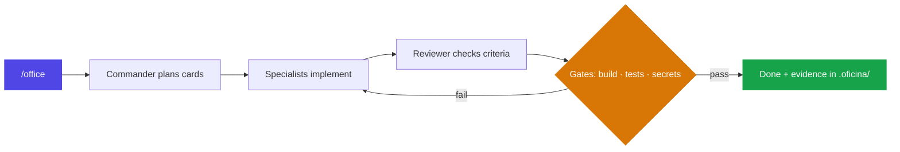

<div align="center">

<picture>
  <source media="(prefers-color-scheme: dark)" srcset="docs/assets/banner-dark.svg">
  <source media="(prefers-color-scheme: light)" srcset="docs/assets/banner-light.svg">
  
</picture>

<br>

# AI-OFFICE

### Your AI agent says "done". AI-OFFICE makes it prove it.

> A multi-agent orchestrator where **no task closes until build, tests and security gates actually pass** — with evidence saved on disk.

[](https://www.npmjs.com/package/ai-office-cli)
[](https://github.com/SOCRAMbt/AI-OFFICE/actions/workflows/ci.yml)
[](LICENSE)
[](https://github.com/SOCRAMbt/AI-OFFICE/stargazers)
[](https://nodejs.org)

<br>

[Quick Start](#quickstart) · [How it works](#how-it-works) · [Compatibility](#supported-agents) · [Why AI-OFFICE?](#why-not-just-one-agent) · [Roadmap](#roadmap)

<br>

<picture>
  <source media="(prefers-color-scheme: dark)" srcset="docs/assets/demo-dark.gif">
  <source media="(prefers-color-scheme: light)" srcset="docs/assets/demo-light.gif">
  
</picture>

<sub>↑ Agent claims "done" → test gate fails → team fixes it → gate passes → evidence saved</sub>

</div>

<br>

---

<br>

## Quickstart

```bash
npx ai-office install        # detects your agent and installs AI-OFFICE
```

Then, inside your agent:

```
/office add input validation to the signup form
```

A live dashboard opens at `localhost:7333`. **No task turns green until its gates pass.**

---

## Supported agents

| Agent | Status | How it plugs in |
|:---|:---:|:---|
| **OpenCode** | ✅ Stable | Native plugin |
| **Claude Code** | 🧪 Beta | Plugin + MCP server |
| **Codex** | 🧪 Beta | MCP server (`config.toml`) |
| **Cursor** | 🧪 Beta | MCP server (`.cursor/mcp.json`) |
| **Gemini CLI** | 🧪 Beta | Extension |
| **Any agent** | ✅ | `proof-of-done` skill (instructions only) |

<details>
<summary><b>OpenCode</b> — native plugin, zero config</summary>

```bash
npx ai-office install --platform opencode
```
Restart OpenCode and run `/office <task>`.
</details>

<details>
<summary><b>Claude Code</b> — plugin marketplace + MCP</summary>

```bash
claude plugin marketplace add SOCRAMbt/AI-OFFICE
claude plugin install ai-office
```
Run `/office <task>` in any session.
</details>

<details>
<summary><b>Codex</b> — MCP server via config.toml</summary>

```bash
codex mcp add ai-office -- npx -y ai-office-mcp
```
Then ask: *"use ai-office to add input validation…"*
</details>

<details>
<summary><b>Cursor</b> — MCP in .cursor/mcp.json</summary>

Add to `.cursor/mcp.json`:
```json
{ "mcpServers": { "ai-office": { "command": "npx", "args": ["-y", "ai-office-mcp"] } } }
```
</details>

<details>
<summary><b>Gemini CLI</b> — extension install</summary>

```bash
gemini extensions install https://github.com/SOCRAMbt/AI-OFFICE
```
</details>

<details>
<summary><b>Just the skill</b> — any agent, no dashboard</summary>

```bash
npx skills add SOCRAMbt/AI-OFFICE --skill proof-of-done
```
Lightweight: rules only, no dashboard or gates engine.
</details>

---

## How it works



| Role | What it does |
|:---|:---|
| **Commander** | Splits the goal into small cards and picks specialists from a 258-role catalog |
| **Specialists** | Implement within strict scope — one card, one agent, one artifact |
| **Reviewer** | A *different* agent checks every card against its acceptance criteria |
| **Gates** | Real commands (`npm test`, `tsc`, secret scan) — exit code 0 or the card goes back |
| **Evidence** | Every criterion gets proof saved to `.oficina/artifacts/` |

---

## Why not just one agent?

| | Single agent | AI-OFFICE |
|:---|:---|:---|
| Says "done" when tests fail | Often | **Blocked by gates** |
| Independent review | No | **Required** |
| Audit trail | Chat history | **Evidence files per criterion** |
| Scope enforcement | Honor system | **Guard rejects out-of-scope writes** |
| Token cost | 1× | ~2–3× (be honest) |

---

## What you get

| Feature | Description |
|:---|:---|
| 🎯 **Commander** | Decomposes goals into verifiable cards with acceptance criteria |
| 🔍 **Independent review** | Reviewer ≠ implementer — enforced by the engine |
| ⚡ **Quality gates** | Build, typecheck, lint, tests, secrets, diff — real exit codes |
| 📋 **Evidence graph** | Every criterion needs proof before a card can close |
| 🛡️ **Scope guard** | Agents can't write outside their authorized files |
| 💬 **Message bus** | Agents request help, decline, and coordinate on disk |
| 📊 **Live dashboard** | Real-time view of cards, agents, gates and cost |
| 💰 **Cost tracking** | Token and USD per card, agent and phase |
| 🔄 **Recovery** | Resume after crash — state persisted in `.oficina/` |
| 🧪 **Proof-of-done skill** | Lightweight version for any agent, no dashboard needed |

---

## Commands

| Command | What it does |
|:---|:---|
| `/office <task>` | Full team run |
| `/office lite <task>` | One implementer + one reviewer |
| `/office --maxagents 2 <task>` | Cap the team size |
| `ai-office demo` | Dashboard with a recorded run, no agent needed |
| `ai-office report` | Shareable report card of the last run |

---

## FAQ

<details>
<summary><b>Does it work offline / with local models?</b></summary>

Yes. AI-OFFICE is model-agnostic — it orchestrates whatever agent you point it at. Local models work as long as the agent supports tool calls.
</details>

<details>
<summary><b>How much more does it cost in tokens?</b></summary>

Roughly 2–3× a single-agent run, because of the reviewer pass and gate retries. The `/office lite` mode keeps it closer to 1.5×.
</details>

<details>
<summary><b>Is my code sent anywhere?</b></summary>

No. Everything runs locally. The only network calls are the ones your agent already makes to its LLM provider.
</details>

<details>
<summary><b>What languages and frameworks does it support?</b></summary>

Any. AI-OFFICE doesn't care about your stack — it runs your build and test commands and checks the exit codes.
</details>

<details>
<summary><b>Can I use it without installing anything?</b></summary>

Yes. The `proof-of-done` skill is a set of rules you can drop into any agent's context. No dashboard, no gates engine — just the discipline.
</details>

---

## Roadmap

- [x] Core engine: state machine, cards, gates, bus, leases, recovery
- [x] OpenCode native plugin (stable)
- [x] 6 host adapters (Claude Code, Codex, Cursor, Gemini, Grok, OpenCode)
- [x] Unified CLI with auto-detect
- [x] Evidence graph per acceptance criterion
- [x] Cost tracking and budget enforcement
- [ ] MCP server (`@ai-office/mcp`) — single implementation for all agents
- [ ] Native plugins for Claude Code, Gemini CLI, Codex, Cursor
- [ ] Dashboard improvements and real-time gate streaming
- [ ] Benchmark suite with real (non-simulated) results

---

## Contributing

Bugs and ideas → [issues](https://github.com/SOCRAMbt/AI-OFFICE/issues) · Dev setup → [DEVELOPING.md](DEVELOPING.md)

Good first issues → [label](https://github.com/SOCRAMbt/AI-OFFICE/labels/good%20first%20issue)

---

<div align="center">
<sub>MIT · Built in Buenos Aires · <a href="docs/ARCHITECTURE.md">Architecture</a> · <a href="SECURITY.md">Security</a> · <a href="docs/GARANTIAS.md">Guarantees</a></sub>
</div>
