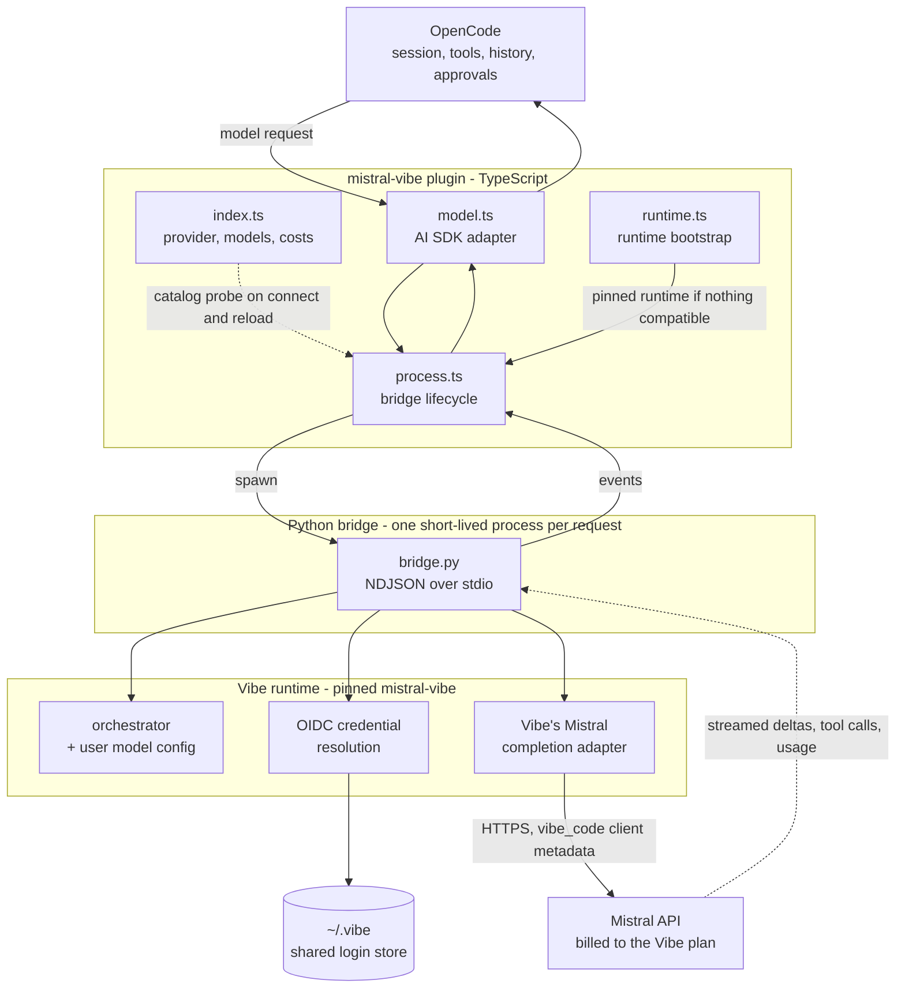

# Opencode Provider Mistral-Vibe

Adds [Mistral Vibe](https://github.com/mistralai/mistral-vibe) to
[OpenCode](https://opencode.ai) as a model provider, so your coding agent runs
on the models your Vibe plan already pays for and not on a pay-per-token API key.

Based on the original idea of [opencode-with-vibe](https://github.com/ilyhalight/opencode-with-vibe).

Every model request is executed by a small local Python bridge that uses Vibe's
own completion adapter, model configuration and OIDC credential. In practice
that means:

- **Billed to your Vibe plan.** Completions carry the same client metadata the
  `vibe` CLI sends, so Mistral meters them against your workspace balance /
  abo credits instead of a raw API budget.
- **Your account's models.** The plugin loads Vibe's curated online catalog for
  your account - including third-party models Mistral hosts for Vibe - and
  contributes them to `/models` with real per-model costs.
- **Native agent behavior.** Text and reasoning stream live, tool calls return
  to OpenCode for execution, and token/cache usage is reported per request.
- **Zero manual setup.** If no compatible Vibe runtime is installed, the plugin
  installs its own pinned copy automatically and never touches anything you
  already have.
- **Errors say what happened.** Quota, auth, network and version failures
  surface with their real cause - including an observed network diagnostic when
  you are offline - never a generic "run setup" mask.

## Quick start

On the machine running the OpenCode server:

```sh
opencode plugin add "github:AiPrimitivesStudio/Opencode-Provider-Mistral-Vibe#main::path:package"
```

Then, inside OpenCode:

1. `/connect` -> **Mistral Vibe** -> **Use Vibe login**. If you already use
   the `vibe` CLI and are logged in, you are done: pick a model in `/models`.
2. An OpenCode-only machine has no credentials yet - the login command is
   not executed by OpenCode; run it once from a terminal, exactly as the
   connection status names it (the plugin-managed `vibe` binary), e.g.:

   ```sh
   # Windows
   "%USERPROFILE%\.config\opencode\mistral-vibe-runtime\<pinned version>\Scripts\vibe.exe" --setup
   # macOS / Linux
   ~/.config/opencode/mistral-vibe-runtime/<pinned version>/bin/vibe --setup
   ```

   It opens a browser to sign in to Mistral and stores the credential once
   in `~/.vibe` (shared with the `vibe` CLI, should you ever install it).
3. Pick a model in `/models`, for example
   `mistral-vibe/mistral-medium-3.5#high`, and start prompting. Credentials
   are read at request time, so models work immediately after the login - no
   reconnect needed. The connection badge may still read not-logged-in until
   the next refresh; reconnecting once simply clears it sooner.

On a machine with no Vibe at all, the plugin installs its pinned runtime in
the background on first load - give that a moment; the login command in step
2 only exists once that install has finished (the connection status names it
from then on).

Pin a version by pointing at a tag instead of the branch:

```sh
opencode plugin add "github:AiPrimitivesStudio/Opencode-Provider-Mistral-Vibe#v0.1.0::path:package"
```

Or ride the newest release instead of the branch:

```sh
opencode plugin add "github:AiPrimitivesStudio/Opencode-Provider-Mistral-Vibe#latest::path:package"
```

The `latest` tag moves with every release. A tag install stays on the version
it resolved until you run `opencode plugin update`; `#main` follows the branch
instead.

## How it works



Every request crosses the plugin as one Python process speaking NDJSON over
stdio: OpenCode keeps ownership of the agent loop, Vibe keeps ownership of
transport and credentials, and the only thing that leaves the machine is the
HTTPS call Mistral's own Vibe adapter makes - metered against your plan.

## Non-standard setups

### Runtime resolution and the bootstrap

The plugin speaks Vibe's internal Python adapter API, so it is deliberately
**pinned to one tested runtime version** - never floating. The pin lives in a
single source constant (`REQUIRED_VIBE_VERSION` in
`package/src/runtime.ts`); the managed runtime, the automatic install and the
compatibility gate all derive from it, and a runtime outside the pinned line
fails with an explicit error naming the version it needs instead of guessing.
At startup it picks a runtime in this order:

1. `OPENCODE_VIBE_PYTHON` - an explicit interpreter path, used as-is;
2. the plugin-managed runtime it installed itself
   (`~/.config/opencode/mistral-vibe-runtime/<pinned version>/`);
3. any Vibe you already have - **but only if its version is on the pinned
   runtime's line**.

If nothing compatible exists, the plugin installs its own pinned copy in the
background: atomically (temp dir + swap), behind a cross-process lock, without
ever upgrading, downgrading or otherwise touching a Vibe you already use. Your
own tool keeps working for your CLI use, whatever version it runs; OpenCode
uses its private pinned copy. Installs never block server startup, and a
failed install surfaces its real cause.

- `OPENCODE_VIBE_AUTO_INSTALL=0` - disable the bootstrap; the plugin then fails
  loudly instead of silently using an incompatible runtime.
- `OPENCODE_VIBE_RUNTIME_DIR` - where the managed runtime lives.
- `OPENCODE_VIBE_UV` / `OPENCODE_VIBE_BASE_PYTHON` - the `uv` binary (default:
  `uv` on PATH) and the fallback Python used to create the managed venv
  (`py` on Windows, `python3` elsewhere). `uv` is preferred when present.

### Paths and process behavior

- `OPENCODE_VIBE_PATH` - path to a `vibe` launcher (otherwise PATH, then
  `~/.local/bin/vibe`).
- `OPENCODE_VIBE_PREWARM=0` - start the Python bridge cold for every request.
  By default one idle bridge with Vibe already imported waits for the next
  model request (~0.6 s faster per request, ~85 MB of memory) and stops after
  10 idle minutes. Each request still runs in its own process and reads
  configuration and credentials at request time.
- `VIBE_HOME` - honored by Vibe for user configuration and authentication.

Set these in the **server's environment**, not just the terminal client.

### Where models, billing and credentials actually go

- OpenCode owns instructions, history, tools, approvals, compaction and
  subagents; the bridge runs exactly one model call per request - there is no
  second agent loop and no flattening of conversation history.
- Credentials stay inside the Python process. Probe responses carry model
  metadata and an authentication-presence flag, never tokens; the crash-path
  traceback dump is redacted before it is written to disk.
- Cancellation terminates only the bridge process belonging to that request.
- Model requests carry Vibe's own client user-agent, so Mistral meters them
  like `vibe` CLI requests.

### Cost reporting

Costs are reported from a maintained price table (`API_PRICES` in
`package/src/index.ts`, official Mistral API rates per 1M tokens), because Vibe
bills the workspace balance at exactly those rates. A blank cost in OpenCode
means the model has no entry in the table yet - **not** free usage.

### Scope and limitations

- Local-server integration; not registered in remote workspaces.
- Lists Vibe's curated Mistral-hosted models and configured Mistral-backend
  models; generic third-party provider backends are not supported.
- Supports text, reasoning, image input, function tools and token/cache usage.
- Structured output and forced tool choice fail explicitly; unsupported
  sampling settings produce stream warnings; PDF/audio input is not supported.
- Uses OpenCode's system prompt rather than Vibe's product prompt.
- OpenCode HTTP hooks do not intercept Python's model requests.
- Credential presence is checked locally; a successful paid model request still
  depends on account access. No sign-in is performed automatically.

### When something fails

Errors are never masked. You will see the actual HTTP status, quota or auth
error, and when OIDC credential resolution fails the plugin also reports what
it observed on the network - for example:

```
OidcError: OIDC credential resolution failed; explicitly re-login
(network check to api.mistral.ai:443 failed: gaierror [Errno 11001] getaddrinfo failed)
```

means the machine is offline; "network reachable" in the same message means
the login store needs attention. Re-login always runs through the runtime
actually serving requests (the no-credential message names the exact binary).

### Development and tests

The installable package lives in `package/` (that is what
`::path:package` points at). The in-repo layout:

```
package/
  src/        TypeScript plugin + the Python bridge
  test/       unit (offline), bridge (real Vibe plan) and e2e suites
```

From this directory, with Node.js installed:

```sh
cd package
npm install
npm run test:unit     # offline gate; no API spend
npm run typecheck
npm run coverage:unit # offline c8 gate: >= 85% lines AND branches
npm run coverage      # full c8 gate (includes the token-spending suites)
npm run test:e2e      # spends real Vibe tokens
```

The unit suite is fully offline (a scripted fake bridge stands in for the real
one; tests locate the Python interpreter from the uv tool layout, or set
`OPENCODE_VIBE_PYTHON`). The e2e suites run the real bridge against the real
Vibe plan - and one test sends a real message to the live OpenCode server
(service URL and password from `~/.config/opencode/service.json`) - so they
spend real tokens; run them only when you need that verification.

## License

[MIT](LICENSE). Vibe is installed separately and remains subject to its own
license and service terms.

Sources: [OpenCode plugins](https://opencode.ai/docs/plugins/),
[OpenCode plugin API](https://opencode.ai/v2/docs/build/plugins/server/),
[Mistral Vibe](https://github.com/mistralai/mistral-vibe).
