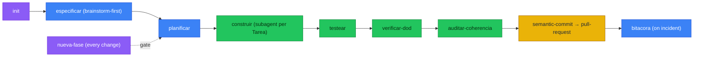

<h1 align="center">project-suite</h1>

<p align="center">
  <em>Plan in documents first. Code follows the plan, never the other way around.</em>
</p>

<p align="center">
  
  
  
  
  
</p>

<p align="center"><a href="README-es.md">Español</a></p>

---

Ask an agent for a feature without this plugin: it writes the code directly, marks the task as done, and three weeks later nobody remembers why that architecture decision exists or whether the tests it claims to have actually ran.

With project-suite, that same request first becomes a Fase with Sub fases and Tareas in a document — and the `[X]` checkbox is only ticked when `verificar-dod` confirms the tests passed.

## Before / after

**Without the plugin**, "add social login" turns straight into code: the agent picks a provider, writes the endpoint, moves on. Nobody decided that, nobody documented it, and if the approach was wrong there are already three files to revert.

**With `nueva-fase` + `construir`:**

```
Fase 4 — Social authentication
  SF4.1 — OAuth integration (Google + GitHub)
    T4.1.1 — OAuth callback endpoint
      AC: redirects with a valid token; rejects invalid state
      Unit test: validates the state parameter signature
      User-simulation test: full end-to-end login
```

The plan is written and approved **before** a single line of code exists. `construir` dispatches one subagent per Tarea, each closing with `testear` + `verificar-dod` — only then does the checkbox flip to `[X]`.

## How it works



1. **`init`** bootstraps the project: a brainstorming-style design interview (one question at a time, approval gate) → `docs/` from templates → `CLAUDE.md`/`AGENTS.md` with the rules → `.gitignore`.
2. **`nueva-fase`** is the gate for every later change: before touching code, it decides whether the feature needs a new Fase and drafts it with its Tareas and tests.
3. **`construir`** executes the plan: one subagent per Tarea, bounded context, closing with `testear` (creates and runs the two mandatory test levels) + `verificar-dod` (the real gate — no green, no `[X]`).
4. **`auditar-coherencia`** detects when code drifts from `architecture.md`/`diseno_db.md`. **`bitacora`** logs incidents so the same bug is never fixed twice.
5. Every commit goes through `semantic-commit`; every PR through `pull-request` — never a direct push, never `--no-verify` without explicit permission.

Documents live in `docs/` inside your repo (auditable), in the language you choose (`es | en`). Working files (`docs/task/`, `docs/plan/`, `docs/logs/`, `CLAUDE.md`, `AGENTS.md`) stay **local by default** — they are not versioned unless you ask for it at setup. That is why a worktree receives them by copy and hands them back with `tablero.py --sync`, not by merge.

## Several plans in one repo (tracks)

A repo can hold **several plans with different purposes** —one pipeline per booklet, one service per domain—, each with its own Fase 0. Each plan is a **track**.

**A single plan** (the default case, zero configuration):

```
docs/plan/plan_maestro.md
docs/task/tareas.md          ← cover + index
docs/task/fases/F00-*.md     ← one Fase per file
```

**Several plans** — one folder per track:

```
docs/plan/<track>/plan_maestro.md
docs/task/<track>/tareas.md
docs/task/<track>/fases/F00-*.md
```

Tracks **are** the directories under `docs/plan/` that contain a `plan_maestro.md`: there is no registry that can drift from disk. The active one is persisted in `.project-suite/track`.

### The board is split

`tareas.md` is cover and index; **each Fase lives in its own file** under `fases/`. A monolithic board grows to tens of thousands of lines, and then opening it to look at one Sub fase loads everything and two sessions editing it clobber each other. `scripts/tablero.py` maintains the structure:

| Flag | What it does |
|---|---|
| `--rutas` | Prints the active track's paths as JSON. The single source of truth for where everything lives. |
| `--tracks` | Lists the repo's tracks. |
| `--indice` | Regenerates the cover index from `fases/` and updates the roll-ups. |
| `--rollup` | Recomputes and cascades Tarea, Sub fase and Fase checkboxes. |
| `--verificar` | Exits 1 if the index or roll-ups are stale (consumed by `verificar-dod`). |
| `--partir` | Migrates an existing monolithic board into `fases/`, leaving a `.bak`. |
| `--worktree FNN[/SFx.y]` | Creates a branch and worktree for that Fase or Subfase, with bounded scope and isolated documents. |
| `--sync` | Returns those documents to the main repo with automatic roll-up, without overwriting external changes. |

### Worktree per Fase

`docs/plan/` and `docs/task/` are gitignored on purpose, so **git does not carry them** into a worktree: `/fase F7` copies them, and only those of that Fase. When each Sub fase closes, `--sync` returns them to the main repo — the plan goes back to main by sync, not by merge, so a long branch never leaves main with a lying plan.

### The plan corrects itself

When each Sub fase closes, `construir` contrasts what was learned against the pending Sub fases of the same Fase and rewrites them if needed, inserting corrective Tareas **inside the current Fase** —never as a new Fase at the end— and tagging each touched block with `> ⟳ Ajustado en SF{x.y} — <reason>`. It always warns; it only asks permission if the adjustment would change the Fase's global deliverable.

## Commands

| Command | What it does |
|---|---|
| `/init [idea]` | Bootstraps a project: design interview → `docs/` → rules → `.gitignore` → authorship. |
| `/nueva-fase [change]` | Spec-driven gate: decides whether a change deserves a new Fase and drafts it **before** coding. |
| `/modo [estricto/relajado/off]` | Changes or queries the ambient reminder intensity. |
| `/track [slug \| nuevo <slug>]` | Lists, switches or creates the repo's plans (tracks). |
| `/fase <FNN \| SFx.y>` | Opens a worktree and branch for a Fase or Subfase, with bounded scope and isolated documents. |
| `/review [commit]` | Reviews the current diff against the plan: detects unplanned code or spec contradictions. |
| `/audit` | Audits the WHOLE repo against `architecture.md` and `diseno_db.md`: detects global drift. |
| `/help` | Quick reference for commands and skills. |

## Skills (22)

**Documents:** `especificar` (description + architecture + DB design), `planificar` (master plan + board), `bitacora` (incident log), `ejecucion` (setup/deploy guide).

**The quality loop:** `testear` (creates and runs unit + user-simulation tests), `verificar-dod` (Definition-of-Done gate with auditable receipts in `docs/logs/recibos/`), `auditar-coherencia` (docs↔code drift), `construir` (executes the plan via subagents, one per Tarea).

**Architecture and language standards:** `frontend-standards`, `backend-standards`, `python`, `r`, `rust`, `astro`, `sql`, `ts`, `webapp`.

**Packaged:** `generar-diagramas` (Mermaid), `semantic-commit`, `pull-request`, `caveman`, `visualizar-datos`.

## Install

### Claude Code

```
/plugin marketplace add AlexPrietoRomani/project-suite
/plugin install project-suite@project-suite-marketplace
```

(Send the two commands as separate prompts)

The desktop app has no `/plugin`. Install from the UI: Customize → the + next to personal plugins → Create plugin and add marketplace → Add from repository → paste the repo URL.

It asks at install time: default documentation language (`es | en`) and whether to version working files (`version_working_files`, default **no**).

### opencode

**From npm (recommended):**

```json
{ "plugin": ["@alexprietoromani/project-suite"] }
```

**From a local checkout:**

The repo ships a tree generated from the same source:

- `.opencode/skills/` — the 22 skills (native opencode SKILL.md)
- `.opencode/command/` — `/init`, `/nueva-fase`, `/modo`, `/track`, `/fase`, `/review`, `/audit`, `/help`
- `.opencode/plugins/project-suite.mjs` — plugin that registers commands, skills and the system prompt
- `opencode.json` — registers the plugin; no MCP servers (see [MCP servers](#mcp-servers))

Open opencode inside the repo (it reads `.opencode/` + `opencode.json`), or copy `.opencode/*` to `~/.config/opencode/` and merge the `mcp` block.

> `.opencode/` and `opencode.json` are **generated**, do not edit them by hand. After touching `skills/`, `commands/` or `.mcp.json`: `python scripts/sync_opencode.py`. Verify with `python scripts/validate_plugin.py`.

### Antigravity CLI

Antigravity CLI (`agy`) is the successor to Gemini CLI — a new Go-based terminal agent, not a rename:

```
agy plugin install https://github.com/AlexPrietoRomani/project-suite
```

The plugin root ships a `plugin.json` manifest; `agy plugin validate` processes the 22 skills and converts the 8 commands into skills (so they are typed in chat, e.g. `/review` as a message, instead of being picked from a slash menu). Known limitation: the lifecycle hooks (ambient mode reminder) are wired for Claude Code and opencode only, not for Antigravity yet.

### Gemini CLI (legacy — enterprise and API keys)

Google discontinued Gemini CLI for consumer accounts on **June 18, 2026**; it was replaced by Antigravity CLI. The extension still works for Gemini Code Assist Standard/Enterprise licenses and paid Gemini API keys:

```
gemini extensions install https://github.com/AlexPrietoRomani/project-suite
```

It loads the rules as always-on context each session and registers the commands `/init`, `/nueva-fase`, `/modo`, `/track`, `/fase`, `/review`, `/audit`, `/help`. Skills load when the task requires them. The Gemini adapter does not include a root `hooks/hooks.json`: Gemini auto-loads that path, and project-suite's lifecycle hooks use Claude Code event names.

## MCP servers

**The plugin does not bundle any MCP server.** Every MCP server is a process that starts with the session, whether you use it or not: neither Claude Code, nor opencode, nor Antigravity have lazy startup for local (stdio) servers. That is why `init` writes them only into the repo that will use them.

| Server | Scope | Why |
|---|---|---|
| `playwright` | Per project (web/UI apps) | `init` adds it for user-simulation tests. |
| `codegraphcontext` | Per project, opt-in | `init` asks. Indexes code into a graph (`uvx --with kuzu codegraphcontext==0.6.13 mcp start`). Measured footprint: **~250 MB RSS per session** (uvx + worker + kuzu), idle CPU ~0.4%. On Windows it uses **KuzuDB**; FalkorDB Lite is Unix-only. |
| `context7` | *Not bundled* | Use the global server you already have; a second one causes disconnects. |

`init` verifies each server's runner (`npx`, `uvx`) before writing it and pins versions for reproducibility.

> Up to 1.3.x the plugin shipped `codegraphcontext` globally. If you want it in a repo, run `init` or copy the step-7 block from [`commands/init.md`](commands/init.md) into its `.mcp.json`.

### What about the skills?

Skills **do not** consume RAM or full context: in all three harnesses only the name and description load at startup, and the `SKILL.md` is read when invoked. That listing is the only always-on cost.

### Turning off an MCP you don't use

| Harness | One server, without uninstalling | Per repo |
|---|---|---|
| Claude Code | `/mcp` → select the server → *Disable* (saved per project, takes effect immediately) | Whole plugin: `"enabledPlugins": {"<plugin>@<marketplace>": false}` in `.claude/settings.local.json` |
| opencode | `"enabled": false` in the `mcp` block of `opencode.json` — **takes effect on session restart** | The same flag in the repo's `opencode.json`; or enable it only in the agent that uses it |
| Antigravity CLI | `agy mcp disable <name>` — **takes effect on session restart** | Whole plugin: `agy plugin disable project-suite` |
| Gemini CLI (legacy) | `gemini mcp disable <name>` | `"mcp": {"excluded": ["<name>"]}` in `.gemini/settings.json` |

**For maintainers:** a server in the plugin's `.mcp.json` with `"x-project-suite": {"startup": "off"}` is synced to opencode with `enabled: false` (configured but off). Claude Code ignores the `x-` key.

## Authorship

`init` sets the author of docs and commits from your git identity (the connected GitHub user, if any) or by asking in local repos — and persists it in `CLAUDE.md`/`AGENTS.md` so it never asks twice. **LLM co-authorship is on by default**: commits record `Co-Authored-By: <Model> <<email>>` based on the active assistant or model (Claude, Gemini, ChatGPT, DeepSeek, Qwen, Kimi, etc.), unless the user turns it off at setup or in the authorship section.

## Publishing to npm

So that `opencode` can resolve `@alexprietoromani/project-suite` from the registry (like ponytail with `@dietrichgebert/ponytail`):

```bash
# 1. Login (once)
npm login

# 2. Publish
npm publish --access public
```

Afterwards, any user can install with:

```json
{ "plugin": ["@alexprietoromani/project-suite"] }
```

If the package is private, use an internal registry and change `publishConfig.access` to `"restricted"` in `package.json`.

## Supported agents

| Agent | Status | Installation |
|---|---|---|
| Claude Code | ✅ | `/plugin marketplace add AlexPrietoRomani/project-suite` |
| opencode | ✅ | `{ "plugin": ["@alexprietoromani/project-suite"] }` |
| Antigravity CLI | ✅ | `agy plugin install https://github.com/AlexPrietoRomani/project-suite` |
| Gemini CLI | ⚠️ Legacy (enterprise / API keys) | `gemini extensions install https://github.com/AlexPrietoRomani/project-suite` |
| Codex | 🔜 Coming soon | Requires `.codex-plugin/` |
| Cursor / Windsurf | 🔜 Coming soon | Requires `.cursor/rules/` and `.windsurf/rules/` |

## FAQ

**Can I skip planning for something trivial?**
Nothing stops you, but the plugin's discipline is "plan first" even for small changes — the cost of a one-Tarea Fase is low compared to code with no trace of why it exists.

**What happens if `verificar-dod` fails?**
`construir` stops that branch, does not tick the checkbox, and reports which DoD item failed (red test, lint warnings, undocumented DB change). You decide: fix or replan.

**Why aren't working docs (`plan/`, `task/`, `logs/`) versioned by default?**
They are process state, not the project's shareable contract. The spec (`description`, `architecture`, `db`, `ejecucion`) is always versioned. If you work in a team and want to share the plan, set `version_working_files` to `yes`.

## Method

7 chained templates (`templates/`): `description_proyecto` → `architecture` → `diseno_db` → `plan_maestro` → `tareas` → `log` → `ejecucion`. It is a domain-specific, document-anchored version of the `superpowers` flow (brainstorming → writing-plans → subagent-driven-development → TDD → verification).

## License

MIT.
