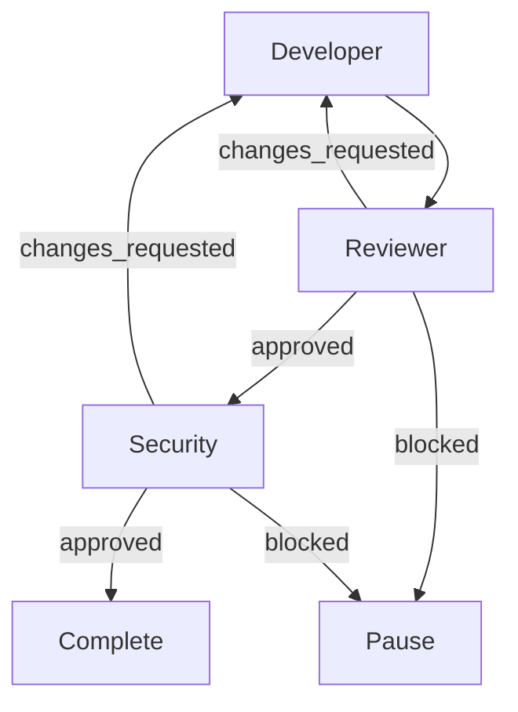

# opencode-flowgraph

An OpenCode V2 plugin for user-defined multi-agent workflows.

OpenCode owns agents. You define native Markdown agents in `.opencode/agents/*.md`.
This plugin owns workflows. You define execution graphs in `.opencode/workflows/*.yaml`.
The plugin orchestrates native OpenCode sessions, persists runs, and generates Mermaid from the graph.

- No hosted backend
- No separate agent runtime
- No custom LLM client
- No predefined roles or teams
- No mobile UI

## Install

Install from npm by adding the plugin to `opencode.jsonc`:

```jsonc
{
  "$schema": "https://opencode.ai/config.json",
  "plugins": ["@alvarolorentedev/opencode-flowgraph"]
}
```

Pin a version when reproducibility matters:

```jsonc
{
  "plugins": ["@alvarolorentedev/opencode-flowgraph@0.8.0"]
}
```

No clone or build is required. OpenCode loads the published package.

For local development, point at this repository:

```jsonc
{
  "$schema": "https://opencode.ai/config.json",
  "plugins": ["/absolute/path/to/opencode-flowgraph"]
}
```

A local directory needs a root `index.ts` (server) and `rpc.ts` (shared contract); this repository provides both. Release automation is documented in [`docs/releasing.md`](docs/releasing.md).

## Migrating from 0.1.x

Version `0.2.1` is a full rename:

- npm package: `opencode-agent-workflows` → `opencode-flowgraph`
- plugin ID: `agent-workflows` → `flowgraph`
- RPC ID: `agent_workflows` → `flowgraph`
- reporting tool: `agent_workflows_report` → `flowgraph_report`

Update the plugin entry in `opencode.json(c)` and any agent prompts that call the reporting tool. Runs stored under the old plugin ID are not visible to `0.2.1`; start new runs.

## Agent requirements

Workflow nodes reference native OpenCode agent IDs. Agents must be:

- Not hidden
- `mode: primary` or `mode: all`
- Able to use tools, because conditional nodes report through the `flowgraph_report` tool
- Given a `model`, or covered by a global `model` in `opencode.json(c)`

`mode: subagent` agents are rejected by the MVP. The documented native contract runs subagents only through the `subagent` tool, and directly selecting one from a workflow would bypass that gate. Change the native agent to `mode: all` if you want it in a workflow.

The plugin never creates, edits, or elevates agents.

Example:

```md
---
description: Reviews changes for correctness and missing tests
mode: primary
model: opencode-go/deepseek-v4.1-flash
permissions:
  - action: edit
    resource: "*"
    effect: deny
---

Review the change. Report findings in severity order.
```

## Workflow example

```yaml
version: 1
name: development
description: Development with iterative quality checks

entry: developer

limits:
  max_steps: 12
  timeout_seconds: 3600
  node_timeout_seconds: 900
  max_result_retries: 2
  max_recovery_attempts: 3
  max_repeat_transitions: 5

nodes:
  developer:
    agent: developer
    next: reviewer

  reviewer:
    agent: reviewer
    routes:
      approved: security
      changes_requested: developer
      blocked: pause

  security:
    agent: security
    routes:
      approved: complete
      changes_requested: developer
      blocked: pause
```

Rules:

- `version` must be `1`.
- `name` must match the file stem: `development.yaml` → `name: development`.
- `entry` must be a node ID.
- A node defines exactly one of `next` or `routes`.
- `next` is unconditional.
- `routes` maps structured outcomes to targets.
- `complete` and `pause` are reserved terminal targets.
- Every node must be reachable from `entry`.
- Cycles are supported; `max_steps` and `max_repeat_transitions` bound them.
- Unknown fields, duplicate YAML keys, aliases, merge keys, custom tags, and oversized files are rejected.

`limits` and `max_steps` are required. Other limits have defaults.

## Structured outcomes

V2 session prompts do not support a native response schema. The plugin registers a typed tool:

`flowgraph_report`

At the end of each node the agent calls it with:

```json
{
  "outcome": "changes_requested",
  "summary": "The implementation has an unhandled error path.",
  "feedback": "Handle the error and add a regression test.",
  "evidence": [
    { "kind": "file", "value": "src/example.ts:42" }
  ]
}
```

The plugin validates `outcome` against the current node's declared routes. Invalid outcomes are returned to the agent as tool errors. If a successful node never reports, the plugin sends a bounded correction prompt and then fails the node.

Evidence is **agent-reported**. It is stored separately from the native tool audit and is never presented as independently verified. The plugin does not claim a test passed because an agent said so.

The tool is registered for the whole location because OpenCode plugin tools are not session-scoped. Calls from normal, non-workflow sessions are rejected.

## RPC

The shared contract is exported from `@alvarolorentedev/opencode-flowgraph/rpc`.

| Method | Purpose |
|---|---|
| `capabilities` | Plugin, RPC, schema, feature, and limit versions |
| `listWorkflows` | Discover project workflows and validation state |
| `getWorkflow` | Raw YAML, validated graph, agents, Mermaid |
| `validateWorkflow` | Validate YAML without writing |
| `saveWorkflow` | Create/update with a hash precondition |
| `deleteWorkflow` | Delete with a hash precondition |
| `startRun` | Start a run with an objective and idempotency key |
| `listRuns` | List project runs |
| `getRun` | Current state, step summaries, Mermaid, live permissions |
| `getRunGraph` | Structured graph, run and run-session IDs, active node, node sessions, Mermaid mapping, controls |
| `getRunStep` | Full persisted step result |
| `pauseRun` | Safe pause between nodes |
| `resumeRun` | Resume, with explicit confirmation for ambiguous retries |
| `cancelRun` | Cancel future execution and interrupt active work |

Event: `runUpdated` with project, run, workflow, status, current node, revision, timestamp, and blocker. Events are live-only notifications; reconnecting clients must call `getRun` or `listRuns`.

```ts
import { OpenCode } from "@opencode/client"
import { FlowgraphRpc } from "@alvarolorentedev/opencode-flowgraph/rpc"

const client = OpenCode.make({ baseUrl, headers })
const workflows = client.rpc(FlowgraphRpc)

const result = await workflows.listWorkflows(undefined, {
  location: { directory: "/workspace/project" },
})
```

All methods are location-scoped. The plugin rejects runs that belong to another project or canonical checkout. No `projectID` is accepted from the client.

## Execution and recovery

- MVP execution is sequential: one node session at a time.
- One active workflow per canonical project tree. Separate canonical trees can run concurrently.
- The TUI page and Desktop run picker list runs from every project and worktree on the connected server.
- Each node runs in a fresh native child session of a stable workflow-run session.
- Run and step records are stored in OpenCode plugin storage, keyed by project.
- Completed nodes are never rerun merely because the server restarted.
- A node that finished before the last checkpoint is reconciled from its native session and persisted report.
- An interrupted or ambiguous active node is blocked, not blindly re-prompted.
- `resumeRun` with `confirmRetry: true` explicitly retries an ambiguous node in a new session.
- The workflow graph is snapshotted at run start. Editing the YAML does not affect an active run.
- Native agent definitions are owned by OpenCode and resolved when each node session starts; editing an agent affects later nodes. The plugin never copies or edits agent definitions.
- Paused-at-terminal runs are not resumable; start a new run.
- Exactly-once external side effects are not promised.

Storage has no transactions or compare-and-swap. The plugin uses a host-local project lock, a KV lease, in-process mutexes, and revision preconditions. One OpenCode server per project database is supported; multi-host HA is not.

## Permissions and Git

- Native permissions are respected.
- Pending permission requests are surfaced through `getRun` and native sessions.
- The plugin never auto-approves a permission.
- The plugin adds no Git side effects: no branches, commits, pushes, pull requests, worktrees, or release process.
- Agents may use Git under their own native permissions and project policy.
- Background `subagent` and `shell` calls are rejected inside workflow sessions by default because they would outlive the sequential node. Set the plugin option `allowBackgroundWork: true` to opt out.
- Workflow nodes cannot modify protected configuration paths: `.opencode`, `opencode.json`, `opencode.jsonc`, `AGENTS.md`, `.git`, and `.github`. File edits are blocked directly; destructive shell commands are blocked by a command-text guard. Reads remain allowed.
- Add project-specific protected paths with the plugin option `protectedPaths: ["infra", ".env"]`. The shell guard is heuristic; native permissions remain the security boundary.
- Workflow file writes are restricted to `.opencode/workflows`, reject symlinks/path traversal, use atomic replacement, and require the current content hash.

## TUI and Desktop GUI

The package ships optional UI parts beside the server part:

- `./tui` adds a full-screen `Workflow` page, a `Workflow graph` session panel, a `/flowgraph` command, active-node highlighting, and keyboard controls. See [`docs/tui.md`](docs/tui.md).
- The TUI page needs no session open. It lists every run visible on the connected server, including runs in other projects and worktrees.
- `/flowgraph` accepts arguments: `graph`/`visuals` to view, `runs` to pick a run, `list` to list workflows, `run <id> <objective...>` to start a run, and `<id> <objective...>` as shorthand.
- `./gui-experimental` adds an experimental OpenCode Desktop panel that renders the Mermaid graph, highlights the active node, and opens node sessions on click. Use the `Workflow` command to pick a run from any project or worktree; each run opens in its own session tab with its own graph. See [`docs/gui.md`](docs/gui.md).

The TUI renders a boxed terminal diagram from the structured run graph, with state colours and a pulsing active node; it does not render Mermaid. When the diagram does not fit the panel, it falls back to a compact text list. The Desktop GUI renders Mermaid. Neither requires a separate server or web app.

`getRunGraph` is the shared read model for both surfaces. It returns node states, node session IDs, edges, the Mermaid source, Mermaid node IDs, and the active node.

## Mermaid

Mermaid is derived output, never an input or execution format. `renderMermaid(graph)` is a pure exported function; the RPC returns the same string. Output is deterministic, uses synthetic safe node IDs, and escapes labels. No `click`, `style`, or other executable directives are emitted.



## Development

```sh
bun install
bun run typecheck
bun run test
```

The optional real OpenCode plugin-loading/RPC smoke test:

```sh
OPENCODE_SMOKE=1 OPENCODE_BIN=/path/to/opencode bun run test:smoke
```

It starts an isolated `opencode api --standalone` request, loads the plugin from this repository, and calls `capabilities` and `listWorkflows`. It does not make model calls.

A real-model end-to-end verification is manual: define two primary agents, create the workflow, start a run through RPC, verify the review loop, disconnect the client, restart the server, and confirm conservative recovery. See `docs/rpc.md` and `docs/recovery.md`.

## Releasing

Releases are tag-driven GitHub Actions using npm Trusted Publishing (OIDC): typecheck, tests, npm publish with automatic provenance, and a GitHub release. No long-lived npm token is stored. The one-time first-publish bootstrap and rollback are documented in [`docs/releasing.md`](docs/releasing.md).

## Known limitations

- No parallel branches, graph joins, nested workflows, shell-command nodes, marketplace, cloud execution, or visual editor.
- No native structured-output schema on V2 session prompts; the reporting tool is the supported mechanism.
- Plugin tools are location-wide, not session-scoped.
- Background native work is restricted by default.
- Cost and token usage are provider-reported estimates, not enforced spending caps.
- Subagent-only native agents are not supported directly.
- Interactive question forms are outside the MVP; a waiting question may look like a running node until timeout.
- There is no browser/web UI part. The graphical surfaces are the TUI panel and the experimental Desktop GUI panel.

## License

Apache-2.0. See `LICENSE`.
