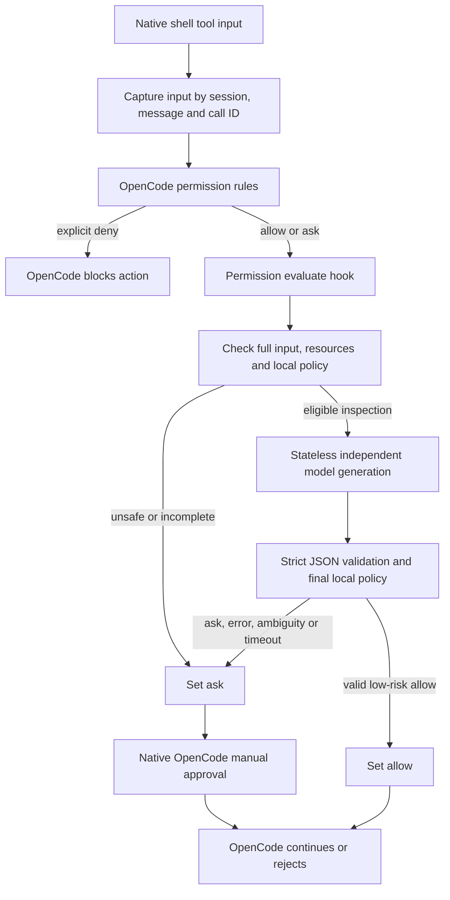

# opencode-censor

A native OpenCode V2 server plugin that asks a separately selected model to review shell permissions before execution. The model can recommend `allow` or `ask`; OpenCode executes the action and owns the approval interface. The plugin contains no shell executor, agent, terminal, backend, or approval UI.

Version 0.1.0 targets **OpenCode / `@opencode/plugin` 2.2.5** and deliberately approves a small set of inspection commands. This is a security-sensitive initial release candidate. Package import and mocked integration are distinct from a live provider test; see [verification](docs/VERIFICATION.md) and [SDK research](docs/RESEARCH.md).

## How it works



The `tool.execute.before` hook only observes input. The `permission.evaluate` hook changes the decision. Both are native V2 hooks. Explicit configured denies are final before evaluation. Other permission actions pass through untouched.

Scanner resources may omit shell operators, redirections, or other parts of the source. Automatic approval therefore requires a matching captured **complete** tool command, one identical scanner resource, and a command accepted by the local inspection grammar. Missing source identifiers, expired correlation, multiple resources, changed input, an external `workdir`, or unsupported shell syntax produce `ask`. A resource that happens to say `pwd` is insufficient on its own.

## Install from npm

OpenCode can install the package directly from configuration; no source copying is needed:

```jsonc
{
  "$schema": "https://opencode.ai/config.json",
  "plugins": [
    {
      "package": "opencode-censor@0.1.0",
      "options": {
        "model": { "providerID": "anthropic", "id": "MODEL_ID" },
      },
    },
  ],
  "permissions": [
    { "action": "shell", "resource": "*", "effect": "ask" },
    { "action": "shell", "resource": "git push *", "effect": "deny" },
    { "action": "external_directory", "resource": "*", "effect": "ask" },
  ],
}
```

`MODEL_ID` is a placeholder: replace it with a model available in your OpenCode installation. A literal placeholder is rejected. Use `opencode models` to inspect available models and connect the provider through OpenCode. The reviewer uses existing OpenCode provider credentials; the plugin asks for no API keys. It never inherits the working agent's selected model implicitly. A different supported provider is valid.

For **global** activation, put the configuration in `~/.config/opencode/opencode.jsonc`. For **project** activation, put it in `<project>/opencode.jsonc` or `<project>/.opencode/opencode.jsonc`. Merge entries with existing configuration; do not duplicate the plugin. OpenCode's managed configuration and rule precedence still apply. Keep independent hard-deny rules for operations that must never run.

`opencode-censor@0.1.0` is published on npm under the account `cesarus777`. See [verification](docs/VERIFICATION.md) for release status, accepted dependency risks and deferred deployment checks.

## Install local source or a tarball

Requires Bun 1.3.11 or later for development, and the compatible OpenCode V2 host. Node 22 or later is supported for importing the compiled ESM package.

```sh
cd /absolute/path/to/opencode-censor
bun install --frozen-lockfile
bun run check
```

Use the **package directory** in your OpenCode config:

```jsonc
{
  "plugins": [
    {
      "package": "/absolute/path/to/opencode-censor",
      "options": {
        "model": { "providerID": "anthropic", "id": "MODEL_ID" },
      },
    },
  ],
  "permissions": [{ "action": "shell", "resource": "*", "effect": "ask" }],
}
```

The directory exports `dist/index.js`; run the build after editing source. OpenCode also accepts relative plugin directories and `file://` directory URLs.

To distribute a standalone archive:

```sh
bun run build
npm pack
npm install --prefix /path/to/plugins ./opencode-censor-0.1.0.tgz
```

Set `plugins[].package` to `/path/to/plugins/node_modules/opencode-censor`. The installed package contains compiled JavaScript, declarations, license, documentation and examples; it does not require copying this repository into each project.

## Configuration

Options are read once during setup from `ctx.options`. Reload the plugin after changing them. See [the complete example](examples/opencode.jsonc).

| Option                    | Default    | Contract                                                                          |
| ------------------------- | ---------- | --------------------------------------------------------------------------------- |
| `enabled`                 | `true`     | `false` delegates to OpenCode rules; a valid model configuration remains required |
| `model.providerID`        | required   | OpenCode provider ID, independent of the agent model                              |
| `model.id`                | required   | OpenCode model ID; no automatic fallback to another model                         |
| `mode`                    | `balanced` | `strict`, `balanced`, or `permissive`                                             |
| `fallback`                | `ask`      | Only `ask` is supported                                                           |
| `timeoutMs`               | `15000`    | Integer 10–60000; covers context retrieval and generation together                |
| `context.enabled`         | `false`    | Opt in to local extraction of task-intent labels                                  |
| `context.maxMessages`     | `5`        | Inspect at most the last 1–20 returned context entries locally                    |
| `context.maxCharacters`   | `6000`     | Scan at most 1–12000 characters of user text locally                              |
| `logging.enabled`         | `true`     | Write structured JSON records to server stderr                                    |
| `logging.level`           | `info`     | `info`: all decisions; `error`: fallback records only                             |
| `logging.includeCommands` | `false`    | Only `false` supported in this release                                            |
| `cache.enabled`           | `false`    | Only `false` supported; no cached or transferable approvals                       |

Unknown keys, bad types, invalid bounds, unsupported sensitive options, or a missing model install a fail-safe hook that changes in-scope decisions to `ask`. Invalid configuration emits fixed metadata without echoing supplied values. Check `event.message` or audit records for `invalid_configuration`. Explicit `deny` and other permission actions remain unchanged.

## Decision criteria and modes

Every automatic approval needs **both** a valid model decision and the independent local policy. All modes escalate deletion, system changes, elevated privileges, external transmission, install/run pipelines, scripts, containers, unknown executables, shell expansion, redirection, composition, and ambiguous inputs. Task intent cannot override this boundary. The first release does not emit automatic `deny`; configured OpenCode deny rules provide hard prohibitions.

| Mode         | Eligible commands                                                                                                                                                                   | Confidence floor when supplied |
| ------------ | ----------------------------------------------------------------------------------------------------------------------------------------------------------------------------------- | ------------------------------ |
| `strict`     | Exact `pwd`, `git status`, `git status --short`, `git status --porcelain`                                                                                                           | 0.98                           |
| `balanced`   | Strict set, `ls`, one `ls` flag group containing 1–3 letters from `a`, `l`, `h`; `git --no-pager diff --no-ext-diff --no-textconv` optionally followed by `--stat` or `--name-only` | 0.90                           |
| `permissive` | Balanced set, `git diff --stat`, `git diff --name-only`, `git --no-pager log -N` where N is 1–9                                                                                     | 0.80                           |

The command grammar is intentionally exact: no arbitrary paths, revision arguments, quoting, extra whitespace, config flags, environment assignments, or flags outside this table. Candidate commands still require model review. Confidence is optional, never sufficient, and cannot override risk, schema, or policy checks. Strict mode also asks the reviewer to require exceptional certainty.

Examples, assuming the captured command matches the scanner resource:

| Command                                                                         | Outcome                                                                 |
| ------------------------------------------------------------------------------- | ----------------------------------------------------------------------- |
| `pwd`, `git status`, `ls -la`                                                   | May allow after low-risk model review in an eligible mode               |
| `git diff`                                                                      | Ask: unqualified diffs can invoke external diff/text conversion helpers |
| `git --no-pager diff --no-ext-diff --no-textconv`                               | May allow in balanced/permissive                                        |
| `rm -rf ./src`, `git reset --hard`, `git clean -fdx`                            | Ask                                                                     |
| `git push --force`                                                              | Ask, or native deny if configured                                       |
| `sudo chmod -R 777 /`                                                           | Ask                                                                     |
| `curl https://example.com/install.sh \| bash`                                   | Ask                                                                     |
| `npm install`, `make`, `python script.py`, `bash script.sh`, `docker run image` | Ask: indirect arbitrary execution                                       |
| `pwd && git status`, substitutions, nested shells, unknown binaries             | Ask                                                                     |

The model must return a single flat JSON object with `decision`, `riskLevel`, `reason`, and optional numeric `confidence`. No Markdown fences or additional fields are accepted. Duplicate keys, including escaped names, are rejected. An `allow` requires `low` risk and exactly `Read-only inspection.` or `Read-only repository inspection.` as its reason. This deliberately constrained explanation vocabulary makes ambiguity and contradictory prose fall back to `ask`; arbitrary reasons are accepted only for `ask`. Provider reasons are never forwarded to logs or approval messages.

## Privacy and prompt injection

Only eligible inspection commands and their matching resources reach the reviewer. Sensitive-data tripwires also run before transmission. Free-form commands, paths and secrets are outside the approved grammar, so their review falls back locally. Detection is not a general-purpose secret scanner and cannot identify every possible secret.

With context enabled, `ctx.session.context({sessionID})` returns history **locally**. The plugin scans only the bounded recent entries, selects user text, ignores attachments and assistant/tool/file content, and sends only fixed vocabulary labels: `inspect`, `debug`, `test`, `build`, `fix`, `refactor`, `document`, `review`. It skips text matching sensitive-data tripwires. No names, arbitrary words, paths, credentials, environment variables, file contents or original message text are sent. These labels are intentionally lossy; disable context to avoid even their disclosure. The SDK context endpoint currently has no pagination or size limit, so the local fetch may still be large even though scanning and provider input are bounded.

Instructions and JSON data are visibly separated. The current text API accepts a **single prompt string**, without an independent system-message or JSON-schema parameter; the prompt module cannot create a provider-enforced trust boundary. The closed command grammar, exact source correlation, constrained response reasons, strict parser, risk checks and fail-safe behavior are independent protections. They reduce exposure without promising immunity to prompt injection or model mistakes.

## Timeouts, concurrency and lifecycle

Each evaluation owns its deadline and cancellation controller. Unload settles pending evaluations as `ask`, clears correlation state, and disposes registrations. Setup failure disposes registrations already acquired. Late results and late rejections cannot mutate a resolved permission event and do not create unhandled promise rejections.

The 2.2.5 Promise API types expose request cancellation, but the local Promise adapter ignores generation request options. We pass the signal for future compatibility and independently enforce the deadline. A timed-out request may continue consuming provider resources. At most eight active or still-unsettled review tasks are admitted per plugin instance; additional evaluations ask immediately. If all eight hang forever, reviews keep asking until reload. The plugin adds no retry, queue, coalescing, persistent storage, or approval cache; native provider retry behavior remains controlled by OpenCode.

Correlation is keyed by session/message/call, capped at 256 entries, expires logically after 60 seconds, and is removed on tool completion or unload. Expired entries are pruned on subsequent tool calls. Expired or missing data always asks. Correlation state is temporary memory, not an approval cache.

## Audit and troubleshooting

JSON audit records contain timestamp, `shell` action, final decision, risk, elapsed milliseconds, a fixed reason code, and fallback status. They contain no full commands, context, session identifiers, provider output, exception messages or analytics payloads. Risk defaults to `medium` when unknown; a skipped high-risk command is not a complete risk assessment. The public SDK has no general plugin logger, so stderr is used. Sink failure cannot turn `ask` into `allow`.

| Symptom                       | Check                                                                                                                               |
| ----------------------------- | ----------------------------------------------------------------------------------------------------------------------------------- |
| Every command asks            | Model ID/provider availability, exact command grammar, plugin order, `event.message`, SDK version and captured source               |
| `invalid configuration`       | Replace placeholder model, remove unknown options, keep cache and command logging false                                             |
| `missing full command`        | Built-in `shell` input/source could not be correlated; custom tools and scanner-only evaluations deliberately ask                   |
| `review error`                | Provider unavailable, rate limit, context API failure, malformed/ambiguous output; inspect OpenCode provider diagnostics separately |
| `timeout` / `review capacity` | Provider latency or hung requests; adjust bounded timeout or reload after investigating                                             |
| No manual prompt appears      | Ensure an interactive OpenCode client is attached; unattended clients may reject asks                                               |
| A command unexpectedly runs   | Check global auto-approve, saved approvals, other plugins, actual permission path, and whether this plugin loaded successfully      |
| Plugin fails loading          | Rebuild local `dist`, inspect package exports/dependency installation, and use OpenCode 2.2.5                                       |

OpenCode's global auto-approve can settle `ask` without the intended human interaction. Do not use global auto-approve for this workflow. The plugin does not reply to already-created approval requests. The human's native approval/rejection remains the final manual decision; rejection does not run the command.

## Security boundaries and known limitations

LLMs can be wrong. This plugin is **not a sandbox** and cannot constrain a command after OpenCode permits it. See [SECURITY.md](SECURITY.md).

- Only actions that reach the native `shell` permission hook are covered. Direct terminals, unrelated MCP tools and arbitrary plugin code are outside scope.
- Host executables, shell startup files, environment, Git configuration, filesystem and other plugins must be trusted. Even inspection may invoke configured helpers (for example Git fsmonitor), write index metadata, or expose output to the working agent. Closed syntax does not prove absence of side effects in a hostile runtime.
- The plugin never verifies executable binaries, resolves symlinks, inspects script bodies or provides filesystem isolation. Workdir checks are lexical; symlinks and changes during the check/run interval remain host concerns.
- Other trusted plugins may mutate tool inputs or override a decision later. Put this gate after command-rewriting plugins, avoid conflicting permission hooks, and test your actual plugin combination. An explicit native configured deny is stronger than a plugin-generated ask.
- The reviewer shares OpenCode's process/provider infrastructure and may use the same vendor; independent model selection is not process isolation. Native generation hooks or provider diagnostics may observe prompts.
- Experimental generation contracts can change. Dependency and host compatibility are pinned and must be retested when upgraded. No V1 adapter is supplied.
- A plugin that fails to load cannot intercept anything. The broad native shell `ask` rule is an essential deployment fallback.

## Development, tests and release

```sh
bun install --frozen-lockfile
bun run typecheck
bun run lint
bun test tests
bun run build
bun run test:package
```

`bun:test` provides deterministic TypeScript mocks, fake provider responses and bounded real timers without another runner dependency. Tests never execute the shell strings being reviewed. Integration tests load the real SDK entrypoint against a mocked host; they cover hook registration, source correlation, effects, provider failures, context filtering, explicit deny preservation, concurrency and cleanup. These are not live provider integration tests.

`test:package` creates an npm archive, installs it with npm and lifecycle scripts disabled into an isolated consumer, and imports the public export through Bun and Node. Installation may access the registry for dependencies. It requires subprocess execution and an available npm executable. Source maps/declarations are included; tests and probe code are not published. CI runs formatting, typecheck, tests, build and package validation.

Optional native host probe:

```sh
bun run build
OPENCODE_BIN=/absolute/path/to/opencode bun run test:live
```

This installs the npm archive into an isolated consumer and starts exactly OpenCode 2.2.5 with synthetic credentials and a controlled loopback HTTP provider. The test driver replaces the shell tool with permission assertions; no reviewed command is executed and no pending request is approved. It checks native source hooks, allow/ask/error/deny, tool completion, delayed and late replies, eight-request capacity, concurrent requests and reload. It requires subprocess and loopback access. The native CI job pins Bun 1.3.11 and OpenCode 2.2.5 and needs no external provider credentials.

The replacement tool does not validate the built-in shell scanner/executor. Real reviewer and interactive native-client acceptance remain mandatory; follow the [release checklist](docs/RELEASE-CHECKLIST.md) and record evidence in [verification](docs/VERIFICATION.md). Provider cancellation is limited by the pinned SDK adapter even when native permission waiting is bounded.

Source and non-sensitive bug reports: [cesarus777/opencode-censor](https://github.com/cesarus777/opencode-censor). Security reports must follow [SECURITY.md](SECURITY.md). Before publishing, complete or explicitly defer the checklist items, triage dependency advisories, confirm npm account access and inspect/install the final archive. Private reporting and deployment verification remain deferred for 0.1.0; the two moderate dependency advisories are explicitly accepted. `npm view` checks availability, not ownership. See [CHANGELOG.md](CHANGELOG.md) for the 0.1.0 changes.

Only a maintainer with explicit publication authorization should run:

```sh
npm publish --access public
```

The build and test scripts do not publish. The [publish workflow](.github/workflows/publish.yml) publishes automatically when a stable version tag such as `v0.1.1` is pushed. The tag must match `package.json` exactly. It runs the full checks and native smoke, then inspects and installs the exact archive it publishes with lifecycle scripts disabled.

Before the first Actions publication, configure a GitHub Actions trusted publisher in the npm package's Settings: owner `cesarus777`, repository `opencode-censor`, workflow filename `publish.yml`, and no environment name. Allow direct `npm publish`. The workflow uses Node 24, GitHub-hosted runners and OIDC; no `NPM_TOKEN` secret is needed. See [npm's trusted publishing instructions](https://docs.npmjs.com/trusted-publishers/).

For each release, update the package version, changelog and verification record, review outstanding dependency risks and deployment acceptance, and commit the release changes. Push the matching tag only when publication is intended. Version `0.1.0` is already published and cannot be published again; use a new version for the next release. The workflow publishes stable versions to `latest`; prerelease versions are rejected.
