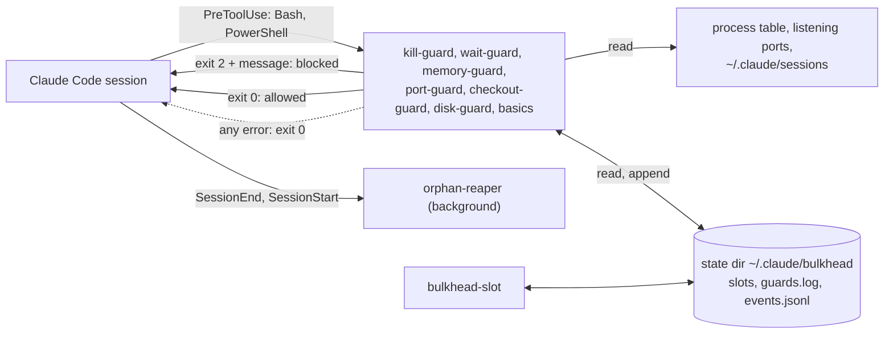

<h1 align="center">claude-bulkhead</h1>

<p align="center">
  <strong>Evita que Claude Code ejecute <code>rm -rf $DIR/</code> con <code>$DIR</code> vacía, <code>pkill node</code> sobre tus otros servidores de desarrollo, les quite los puertos y haga commit de las ediciones de otra sesión con <code>git add -A</code>.</strong>
</p>

<p align="center">Hooks que saben qué procesos, puertos y árboles de git pertenecen a cada sesión y subagente de Claude Code, así que bloquean solo lo que dañaría a otra cosa y le dicen a Claude qué comando seguro ejecutar en su lugar.</p>

<p align="center">Windows, macOS y Linux. Sin tmux, sin sudo, sin daemon en segundo plano, sin llamadas de red, sin dependencias. También protege a Codex, Gemini CLI, Copilot CLI, Cursor y otros seis agentes.</p>

<p align="center">
  <a href="https://www.npmjs.com/package/claude-bulkhead"></a>
  <a href="https://github.com/dooly6276/claude-bulkhead/actions/workflows/test.yml"></a>
  <a href="#instalación"></a>
  <a href="docs/other-agents.md"></a>
  <br>
  
  
  
  <a href="LICENSE"></a>
</p>

<p align="center">
  
</p>

<p align="center"><sub><a href="README.md">English</a> | <a href="README.ko.md">한국어</a> | <a href="README.zh-CN.md">简体中文</a> | <a href="README.ja.md">日本語</a> | <a href="README.pt-BR.md">Português (Brasil)</a></sub></p>

## Instalación

Primero, sin instalar nada, mira qué habría detenido en tus propias sesiones:

```
npx -y claude-bulkhead scan --since 30d --share
```

Solo lee las transcripciones de `~/.claude/projects` y no envía nada.

Después, instala el plugin dentro de Claude Code:

```
/plugin marketplace add dooly6276/claude-bulkhead
/plugin install bulkhead@bulkhead
```

Una vez instalado, el mismo informe se ve dentro de Claude Code:

```
/bulkhead:scan 30d
```

Otros agentes cargan los mismos guards como plugin:

| Agente | Instalación |
|---|---|
| Copilot CLI | `copilot plugin marketplace add dooly6276/claude-bulkhead` y luego `copilot plugin install bulkhead@bulkhead` |
| Cursor | `git clone https://github.com/dooly6276/claude-bulkhead ~/.cursor/plugins/local/bulkhead` y luego **Developer: Reload Window** |
| opencode | añade `"plugin": ["claude-bulkhead"]` a `opencode.json` |
| Gemini CLI | `gemini extensions install https://github.com/dooly6276/claude-bulkhead` |
| Codex | `codex plugin marketplace add dooly6276/claude-bulkhead`, luego `codex plugin add bulkhead@bulkhead` y aprueba el hook con `/hooks` |

Para los demás (Windsurf, Droid, Devin, Cline, Amp), consulta [Codex, Gemini y otros agentes](#codex-gemini-y-otros-agentes).

Node 18 o superior debe estar en el `PATH` (el instalador nativo de Claude Code no lo instala; compruébalo con `node --version`).

| Instalación | Qué obtienes |
|---|---|
| El plugin (arriba) | Los guards, que se ejecutan en cada llamada a Bash, PowerShell, Read y Edit; los slash commands `/bulkhead:scan`, `status`, `log`, `doctor`, `reap`, `remote`; la skill que enseña a Claude los hábitos seguros. Esta es la parte que te protege. |
| `npm install -g claude-bulkhead` (opcional) | El comando `bulkhead` en tu propia terminal (`status`, `top`, `explain`, `allow`, `worktree`, `scan`, `doctor`), la línea de estado, `bulkhead-slot` y `bulkhead setup <agent>` para Codex, Gemini y los demás. `npx claude-bulkhead status` funciona sin instalar. |

¿No sabes si funciona? `bulkhead doctor` ejecuta un comando inofensivo a través de cada guard y muestra que fue bloqueado, y cuánto tardó.

## Qué detiene

| Sin bulkhead | Con bulkhead |
|---|---|
| Un agente reinicia su dev server con `pkill node` y se caen con él los servidores de todos los demás worktrees. | kill-guard bloquea el comando y le explica al agente cómo encontrar y detener su propio PID. |
| Dos sesiones comparten un checkout. Una ejecuta `git add -A && git commit` y los cambios a medias de la otra viajan en ese commit. | checkout-guard lo bloquea y pide los nombres de archivo. |
| Dos worktrees ejecutan `npm run dev`. El segundo pasa al 3001, pero su agente sigue probando `localhost:3000` y ve la otra rama. | port-guard bloquea el segundo arranque e indica un puerto libre. |
| Tres sesiones lanzan `next build`, `npm test` y Playwright en el mismo minuto, y la máquina se congela. | memory-guard bloquea los comandos pesados cuando queda poca RAM. Con `bulkhead-slot`, el tercer trabajo espera en una cola hasta que haya espacio. |

<details>
<summary>Seis más</summary>

| Sin bulkhead | Con bulkhead |
|---|---|
| Una sesión cambia de rama en un árbol que otra sesión está editando. | checkout-guard lo bloquea y sugiere `git worktree add`. |
| Una sesión termina y sus dev servers, test workers y watchers siguen corriendo, ocupando RAM y puertos. | orphan-reaper los detiene a los pocos segundos de que la sesión termine. |
| Un subagente hace polling en primer plano durante diez minutos. La sesión no puede responderte y la caché del prompt caduca. | wait-guard bloquea el bucle y pide usar `run_in_background: true`. |
| Un agente quiere saber qué ocupa el disco y lanza diez `du` a la vez sobre tu carpeta personal. Los builds y el `git status` de todas las sesiones van a paso de tortuga durante minutos. | disk-guard lo bloquea y pide una carpeta cada vez. |
| Una tarea de "limpiar los worktrees" ejecuta `git worktree remove` sobre un worktree en el que otra sesión sigue trabajando. | checkout-guard lo bloquea e indica qué sesión sigue allí. |
| Una limpieza ejecuta `rm -rf "$BUILD_DIR"/*` con `BUILD_DIR` sin definir, que es `rm -rf /*`, o `rm -rf .git`, y el historial del repositorio desaparece. | basics lo bloquea y da la forma segura, `rm -rf "${BUILD_DIR:?}"/*`. |

</details>

Con una sola sesión siguen activos kill-guard, memory-guard, wait-guard, disk-guard y basics (nada de `rm -rf ~`, ni `rm -rf $D/`, que con `D` vacío se convierte en `rm -rf /`, ni `rm -rf .git`, ni force-push a `main`, ni `reset --hard` sobre trabajo sin commit). port-guard y checkout-guard actúan cuando hay una segunda sesión o un subagente activo.

## ¿Qué es?

<p align="center">
  <picture>
    <source media="(prefers-color-scheme: light)" srcset="docs/hero-light.svg">
    
  </picture>
</p>

Los hooks de Claude Code son pequeños programas que Claude Code ejecuta antes de cada comando de shell y que pueden detener el comando y decirle a Claude por qué. bulkhead es un conjunto de ellos. Antes de cada llamada a Bash o PowerShell comprueba el comando contra lo que hacen las demás sesiones de la máquina: qué procesos y puertos son de cada sesión, cuánta RAM queda y en qué árbol de git trabaja cada una. Cuando el comando dañaría a otra sesión, lo bloquea y Claude recibe un mensaje con el comando más seguro que debe ejecutar. Claude lo lee y sigue adelante, normalmente sin preguntarte.

## ¿Lo necesitas? Pregunta a tus transcripciones

No hace falta adivinar. Claude Code guarda la transcripción de cada sesión en `~/.claude/projects`, y `bulkhead scan` repite los comandos de shell que contienen contra los guards: cuántas sesiones ejecutas realmente a la vez y con qué frecuencia ya hacían lo que bulkhead bloquea.

<p align="center">
  <picture>
    <source media="(prefers-color-scheme: light)" srcset="docs/scan-light.svg">
    
  </picture>
</p>

```
/plugin install bulkhead@bulkhead      # then, inside Claude Code:
/bulkhead:scan 30d
```

Solo lee, enmascara todo lo que parezca un secreto antes de imprimir y no envía nada a ninguna parte. port-guard y la comprobación de poca RAM no se repiten, porque las transcripciones no registran qué puertos ni cuánta RAM estaban en uso; checkout-guard se reconstruye a partir de qué sesiones estaban activas en el mismo árbol de git en ese minuto. `bulkhead scan --share` imprime un resumen de 5 a 8 líneas con solo recuentos (sin rutas ni comandos) que puedes pegar en una publicación o en un chat, y `--explain 1` muestra un ejemplo completo con la parte que coincidió. Detalles: [docs/commands.md](docs/commands.md#bulkhead-scan).

## Por qué existe

Una forma habitual de acelerar el trabajo con Claude Code es ejecutar varias sesiones sobre un mismo repositorio, cada una en su propio git worktree y cada una con sus propios subagentes. git mantiene las ramas separadas. La máquina no: todas las sesiones comparten los mismos puertos, la misma tabla de procesos y la misma RAM. Ahí es donde chocan.

- Dos worktrees de la misma app ejecutan `npm run dev`. El segundo falla en el puerto 3000, o se pasa discretamente al 3001 mientras su agente sigue probando `localhost:3000` y ve la otra rama.
- Un agente reinicia su propio servidor con `pkill node` o `taskkill /IM node.exe` y tumba los dev servers y las pruebas de todos los demás worktrees, y a veces también su propia sesión.
- Tres sesiones lanzan `npm test`, `next build` y una ejecución de Playwright en el mismo minuto, y la máquina deja de responder.
- Una sesión termina y los dev servers que lanzó siguen corriendo.

El tracker de Claude Code tiene muchos reportes de exactamente esto:

- [#13941](https://github.com/anthropics/claude-code/issues/13941): al pedirle reiniciar un dev server, Claude ejecutó `taskkill //IM node.exe` o `pkill node` y mató su propia sesión.
- [#34754](https://github.com/anthropics/claude-code/issues/34754): `taskkill //F //IM python.exe` mató dos simulaciones de larga duración, después de que el usuario hubiera marcado sus PID como intocables.
- [#43225](https://github.com/anthropics/claude-code/issues/43225): al pedirle reiniciar un solo bot, Claude mató a la fuerza todos los procesos de Python de la máquina, unos 20 servicios.
- [#53229](https://github.com/anthropics/claude-code/issues/53229): a un agente se le dijo que detuviera solo los dev servers sin uso, y también mató un gateway y un proceso de Postgres que no había identificado.
- [#15487](https://github.com/anthropics/claude-code/issues/15487): 24 procesos de subagentes saturaron un VPS de 4 GB hasta que hubo que reiniciarlo; un comentarista congeló un Mac de 24 GB de la misma manera.
- [#11502](https://github.com/anthropics/claude-code/issues/11502) y [#25180](https://github.com/anthropics/claude-code/issues/25180): los procesos lanzados por agentes sobreviven a estos, 60 procesos de Node en un reporte y 550 workers de pytest en el otro.

claude-bulkhead es un conjunto de pequeños hooks que bloquean o limpian cada uno de estos casos. Cada uno se puede desactivar por separado. El nombre viene del patrón bulkhead (mamparo): que un compartimento se inunde no debe hundir el barco.

## Qué hace

| | |
|---|---|
| **[kill-guard](docs/guards/kill-guard.md)**<br>Bloquea `pkill node`, `taskkill /IM`, `Stop-Process -Name` y otras formas de matar por nombre de programa. Matar por PID pasa. | **[port-guard](docs/guards/port-guard.md)**<br>Bloquea arrancar un dev server en un puerto que otra sesión ya sirve, y matar por puerto el servidor de esa sesión. |
| **[memory-guard y bulkhead-slot](docs/guards/memory-guard.md)**<br>Bloquea los comandos pesados cuando queda poca RAM y pone en cola los trabajos pesados contra un único presupuesto de RAM compartido por todas las sesiones. | **[checkout-guard](docs/guards/checkout-guard.md)**<br>Bloquea `git checkout`, `stash`, `reset --hard`, `git add -A` y similares cuando otra sesión activa trabaja en el mismo árbol, y el borrado de una carpeta en la que trabaja otra sesión. |
| **[wait-guard](docs/guards/wait-guard.md)**<br>Bloquea los bucles de sleep en primer plano de más de 3 minutos, que hacen que la siguiente petición reescriba toda la caché del prompt. | **[orphan-reaper](docs/guards/orphan-reaper.md)**<br>Cuando una sesión termina, detiene los dev servers, test workers, watchers y navegadores headless que dejó corriendo. Para conservar uno a propósito, usa `BULKHEAD_KEEP=1`; los túneles y las bases de datos ya se conservan. |
| **[disk-guard](docs/guards/disk-guard.md)**<br>Bloquea `du -sh ~`, `find /` sin `-maxdepth` y los escaneos de disco en paralelo, que bloquean el disco que comparten todas las sesiones. | **[`bulkhead scan`](#lo-necesitas-pregunta-a-tus-transcripciones)**<br>Repite tus transcripciones pasadas de Claude Code contra los guards: qué habrían detenido y cuántas sesiones corrieron a la vez. |
| **[basics](docs/guards/basics.md)**<br>Bloquea `rm -rf` en una raíz, en el home o en una carpeta directamente dentro de él, los force-push a `main`, los reset que perderían trabajo sin commitear y los commits con Claude como autor. | **[`bulkhead status`, `top`, `log`, `doctor`](#ver-qué-se-está-ejecutando)**<br>Muestra cada sesión, su RAM, sus puertos, los trabajos en cola y lo que han bloqueado los guards. |
| **[edit-guard](docs/guards/edit-guard.md)** <sup>new</sup><br>Avisa al agente cuando otra sesión activa editó el mismo archivo en los últimos 30 minutos, en este árbol o en otro worktree del repositorio. Solo informa por defecto, sin servidor. | **[secrets-guard](docs/guards/secrets-guard.md)** <sup>new, off by default</sup><br>Bloquea leer o imprimir `.env`, claves privadas, credenciales de la nube y todo el entorno, con la herramienta Read o con un comando de shell, mientras que `.env.example`, `ls ~/.ssh` y los archivos `.pub` pasan. |
| **[`bulkhead explain` y `bulkhead allow`](#cuando-bloquea-algo-que-querías)** <sup>new</sup><br>Ve qué diría cada guard sobre un comando antes de ejecutarlo, y deja pasar una vez un comando bloqueado con el código del mensaje de bloqueo. Claude no puede aprobar sus propios bloqueos. | **[`bulkhead worktree`](#worktrees-en-un-solo-paso)** <sup>new</sup><br>Un worktree nuevo en un solo paso, con tus archivos `.env` copiados, las dependencias instaladas y su propio puerto estable; `prune` elimina los ya fusionados, incluidos los squash merges, y nunca uno en el que trabaja una sesión. |
| **[Auto-queue](docs/commands.md#auto-queue)** <sup>new</sup><br>Con `memoryGuard.autoQueue`, los comandos pesados no se rechazan, sino que se ponen en fila: el hook los envuelve en `bulkhead-slot` y empiezan cuando hay espacio. | **[Codex, Gemini y otros agentes](#codex-gemini-y-otros-agentes)** <sup>new</sup><br>Los mismos guards para Codex, Gemini CLI, Copilot CLI, Cursor, Windsurf, Droid, Devin, Cline, opencode y Amp, configurados con `bulkhead setup <agent>`. |
| **[Línea de estado](#línea-de-estado)**<br>`3 sessions  2 heavy  9.1 GB free` en la línea de estado de Claude Code, en unos 100 ms. | **[Configuración y slash commands](#configuración)**<br>Configuración por máquina y por proyecto con listas de permitidos, más `/bulkhead:scan`, `/bulkhead:status`, `/bulkhead:log`, `/bulkhead:doctor` y `/bulkhead:reap`. |

Opcional: **[`bulkhead remote`](#ejecutar-trabajos-pesados-en-otra-máquina-opcional)** ejecuta una suite de pruebas, un build o una ejecución de navegador en otra máquina por SSH, cuando esta no tiene RAM de sobra.

## Más demos


Una ejecución guionizada de `bulkhead status`, port-guard, kill-guard y wait-guard, grabada con [docs/demo.sh](docs/demo.sh). Las dos sesiones son procesos de relleno llamados `claude`; todo lo que se imprime viene de los scripts de los hooks y de `bulkhead status`. La grabación de la parte superior de esta página es una sesión real de Claude Code; cómo se hizo está en [docs/demo.tape](docs/demo.tape).

## Inicio rápido

1. Instala el plugin como se indica arriba y abre una sesión nueva de Claude Code.
2. Mira qué habría detectado: ejecuta `/bulkhead:scan 30d`, o `bulkhead scan` en la herramienta Bash. Lee tus transcripciones del último mes y no cambia nada.
3. Comprueba la instalación. Dentro de Claude Code ejecuta `/bulkhead:doctor`, o ejecuta `bulkhead doctor` en la herramienta Bash. Todas las líneas deben decir `OK`. Una línea `WARN` o `FAIL` indica el guard y el motivo. La sección Enforcement del final demuestra que los hooks bloquean: ejecuta el hook instalado con un comando canario y comprueba el código de salida, el mensaje y la latencia, y avisa de `disableAllHooks`, de un plugin desactivado o de que falta `node`.
4. Abre una terminal junto a tus sesiones y ejecuta `npx claude-bulkhead top` (o `bulkhead top` tras `npm install -g claude-bulkhead`) para ver en vivo las sesiones, la RAM, los puertos y los trabajos pesados. Pulsa `q` para salir.

Después no hay nada más que hacer. Los guards se ejecutan en cada llamada a Bash y PowerShell. Para ver qué detuvieron, ejecuta `bulkhead log` o `/bulkhead:log`; `bulkhead log --summary` cuenta los bloqueos por guard en tu máquina. Para cambiar un umbral o permitir un comando, consulta [docs/configuration.md](docs/configuration.md). Todos los comandos están listados en [docs/commands.md](docs/commands.md).

## Worktrees en un solo paso

Cuando otra sesión trabaja en tu árbol, checkout-guard envía al agente a un worktree. Un worktree normal no tiene `.env`, ni `node_modules`, y usa el mismo puerto de dev server que el checkout principal. `bulkhead worktree add` resuelve esas tres cosas:

```
$ bulkhead worktree add fix-login
created ~/dev/shop-fix-login on new branch fix-login from HEAD
copied .env (default set)
pnpm install --frozen-lockfile: done in 14.2s
wrote PORT=3800 to .env.local
next: cd ~/dev/shop-fix-login && claude
```

Copia los archivos indicados en `.worktreeinclude` (el archivo que Claude Code también lee) o un conjunto seguro por defecto de archivos `.env`, nunca `node_modules`, la salida de builds ni nada que pese más de 5 MB; instala con el lockfile del proyecto; y le da al worktree un puerto que es el mismo cada vez. `bulkhead worktree list` muestra cada worktree con su rama, estado, sesión activa y puerto. `bulkhead worktree prune` lista los que están fusionados, limpios y sin uso, y los elimina con `--yes` mediante `git worktree remove` y `git branch -d`, nunca con `--force`, y nunca la carpeta de una sesión activa. Detalles en [docs/commands.md](docs/commands.md#bulkhead-worktree).

## Ejecutar trabajos pesados en otra máquina (opcional)

Cuando varias sesiones ejecutan suites de pruebas y builds a la vez, una sola máquina se queda sin RAM: memory-guard bloquea los comandos, o bulkhead-slot los hace esperar en cola (automáticamente, con `memoryGuard.autoQueue`). Si tienes una segunda máquina que está casi siempre libre, `bulkhead remote` ejecuta allí el comando pesado.

<p align="center">
  
</p>

```
bulkhead remote add buildbox dev@192.168.1.20 --ssh-option=IdentityFile=~/.ssh/buildbox
bulkhead remote run -- npm test
```

```
[bulkhead remote] buildbox: 3f2a1c9 already there, 3 changed files (24 KB), 1 deleted
[bulkhead remote] buildbox  copy a  /home/dev/bulkhead-remote/acme-web-3f9a1c  port 7172
...test output...
[bulkhead remote] exit 0 after 1m 12s (copy a)
```

- **Qué se envía.** El commit actual como git bundle (solo los commits que el remoto aún no tiene) y tus cambios sin commitear, incluidos los borrados. Los archivos ignorados se quedan aquí salvo que los indiques con `--files`. No se envía nada de fuera del repositorio.
- **Dónde se ejecuta.** En una de hasta 8 copias del repositorio en el remoto, de modo que las ejecuciones en paralelo no comparten árbol de trabajo. `node_modules` se conserva entre ejecuciones. Cada ejecución recibe su propio puerto en `$BULKHEAD_PORT`.
- **Espacio.** Los locks en el remoto reservan una copia y un hueco de trabajo, y `--gb=N` espera hasta que haya N GB libres allí. Si no hay sitio en `--wait` minutos, termina con código 3.
- **Limpieza.** Cuando el comando termina, o la conexión SSH se cae (Ctrl-C, un timeout de la herramienta), todo lo que lanzó en el remoto se detiene, incluido un servidor que haya quedado en su puerto.
- **El remoto** solo necesita un servidor SSH, `bash`, `git` y `tar`. Funcionan Linux, macOS y Windows con Git for Windows.

`bulkhead remote fetch PATH` trae archivos de vuelta desde la copia que usó la última ejecución, y `bulkhead remote status` muestra la RAM libre y los trabajos en curso de cada remoto. En Claude Code, `/bulkhead:remote <command>` ejecuta allí un comando en segundo plano. Configuración, opciones y códigos de salida: [docs/remote.md](docs/remote.md).

## Cómo funciona



Cada guard es un script de Node independiente y sin dependencias. Claude Code le pasa la llamada a la herramienta como JSON. El guard lee el texto del comando y solo investiga más a fondo cuando el comando coincide: la tabla de procesos, los puertos en escucha, los archivos de sesión que Claude Code guarda en `~/.claude/sessions`, la RAM libre o `git status`. Un bloqueo es un código de salida 2 con un mensaje que le dice a Claude qué hacer en su lugar. Cualquier error dentro de un guard deja pasar la llamada, así que un guard roto nunca detiene tu trabajo.

Todas las sesiones de la máquina comparten un único directorio de estado. bulkhead-slot guarda allí sus reservas de RAM, y allí se registra cada bloqueo. Hay más detalle, incluida la estructura del directorio de estado y cómo se encuentran las sesiones en cada sistema operativo, en [docs/architecture.md](docs/architecture.md).

## Guards

Cada guard tiene una página con los comandos exactos que bloquea, lo que deja pasar, el mensaje que ve Claude y sus límites. La versión corta:

<details>
<summary><strong>kill-guard</strong>: matar por nombre de programa</summary>

Bloquea `taskkill /IM`, `taskkill /FI` sin PID, `Stop-Process -Name`, `Get-Process node | Stop-Process`, `pkill`, `killall`, `kill $(pgrep node)`, `wmic ... delete` y similares cuando apuntan a un programa que comparten otras sesiones, como `node`, `python`, `java`, `chrome`, `git` o `vite`. Matar por PID y por ruta de proyecto pasa. Matar por puerto también pasa, salvo que el puerto sea de otra sesión; eso lo comprueba port-guard. A Claude se le indica cómo encontrar sus propios PID.

Desactivar: `BULKHEAD_DISABLE=kill-guard`. Detalles: [docs/guards/kill-guard.md](docs/guards/kill-guard.md).
</details>

<details>
<summary><strong>port-guard</strong>: puertos de otra sesión</summary>

Bloquea arrancar un dev server (`npm run dev`, `next dev`, `vite`, `uvicorn`, `rails s` y más) en un puerto en el que escucha el árbol de procesos de otra sesión de Claude, y sugiere un puerto libre. También bloquea los comandos que matan por puerto, como `npx kill-port 3000`, `fuser -k 3000/tcp` y `lsof -ti :3000 | xargs kill`, cuando ese puerto es de otra sesión.

Desactivar: `BULKHEAD_DISABLE=port-guard`. Detalles: [docs/guards/port-guard.md](docs/guards/port-guard.md).
</details>

<details>
<summary><strong>memory-guard y bulkhead-slot</strong>: RAM</summary>

memory-guard bloquea los comandos pesados (test runners, `next build`, `tsc`, Gradle, el emulador de Android, Playwright, `cargo test`, `docker build` y similares) cuando la RAM libre es inferior a 3 GB, o inferior al 15 % de la RAM en máquinas con menos de 20 GB. `bulkhead-slot run --gb=4 -- <command>` espera a que haya espacio en el presupuesto de RAM compartido, ejecuta el comando y libera el hueco cuando termina.

Desactivar: `BULKHEAD_DISABLE=memory-guard`. Detalles: [docs/guards/memory-guard.md](docs/guards/memory-guard.md).

Con `"memoryGuard": { "autoQueue": true }`, nadie tiene que acordarse del slot: memory-guard reescribe cada comando pesado (pruebas, builds, ejecuciones de navegador, builds de contenedores) para que se ejecute a través de `bulkhead-slot`, de modo que todas las sesiones esperan en una única cola justa en lugar de ser bloqueadas. Un trabajo en espera imprime su posición cada 30 segundos, y `bulkhead status` muestra a qué sesión y proyecto pertenece cada trabajo en cola. Con `"memoryGuard": { "subagents": true }`, no se inicia un subagente nuevo mientras la presión de memoria sea crítica. Consulta [docs/commands.md](docs/commands.md#auto-queue).
</details>

<details>
<summary><strong>checkout-guard</strong>: dos sesiones en un mismo árbol de git</summary>

Bloquea `git checkout <branch>`, `switch`, `stash`, `reset --hard`, `clean -f`, `rebase`, `merge`, `restore .` y un `pull` con cambios sin commitear cuando otra sesión activa trabaja en el mismo árbol, y sugiere `git worktree add`. También bloquea allí `git add -A`, `git add .` y `git commit -a` (`stage-all`; `git add -A src/` y `git add -n` pasan), que arrastrarían a tu commit los cambios a medias de la otra sesión, y `rm -rf` o `git worktree remove` sobre una carpeta en la que trabaja otra sesión activa (`remove-session-dir`). En Windows bloquea `git worktree remove --force` sobre un worktree que contiene junctions, que git ha seguido hasta el checkout principal.

Desactivar: `BULKHEAD_DISABLE=checkout-guard`, o una sola regla con `BULKHEAD_DISABLE=stage-all` o `remove-session-dir`. Detalles: [docs/guards/checkout-guard.md](docs/guards/checkout-guard.md).
</details>

<details>
<summary><strong>disk-guard</strong>: escaneos de disco completo y en paralelo</summary>

Bloquea `du`, `ncdu`, `dust`, `ls -R`, `Get-ChildItem -Recurse` y `dir /s` sobre la unidad entera, la carpeta personal o la de todos los usuarios (`du -sh ~`, `du -sh ~/*`, `ncdu /`), `find /` y `find ~` sin `-maxdepth`, y los escaneos de disco en paralelo, sea cual sea su destino: `xargs -P 10 du`, GNU `parallel`, `du ... &` en un bucle, `ForEach-Object -Parallel`. Una carpeta cada vez pasa (`du -sh node_modules`, `du -sh ~/Library/Caches`).

Desactivar: `BULKHEAD_DISABLE=disk-guard`. Detalles: [docs/guards/disk-guard.md](docs/guards/disk-guard.md).
</details>

<details>
<summary><strong>wait-guard</strong>: esperas largas en primer plano</summary>

Bloquea un comando en primer plano cuyos sleeps pueden sumar más de 180 segundos. La caché del prompt caduca tras unos cinco minutos sin peticiones, así que un subagente que hace polling en primer plano reescribe todo el contexto cada vez que despierta. A Claude se le indica que ejecute el bucle con `run_in_background: true`. Los sleeps en un trabajo en segundo plano (`sleep 600 &`) pasan. Con el timeout de herramienta por defecto de 120 segundos, una espera no puede superar el límite por defecto, así que solo bloquea cuando la llamada sube el timeout.

Desactivar: `BULKHEAD_DISABLE=wait-guard`, o sube el límite con `BULKHEAD_WAIT_MAX_SEC`. Detalles: [docs/guards/wait-guard.md](docs/guards/wait-guard.md).
</details>

<details>
<summary><strong>orphan-reaper</strong>: procesos que dejan las sesiones que terminaron</summary>

Cuando una sesión termina, un proceso de espera oculto en segundo plano detiene lo que ella lanzó desde sus shells de herramientas y dejó corriendo: dev servers y cualquier otra cosa que escuche en un puerto, test runners y sus workers (Vitest, Jest, Playwright, pytest y xdist, `cargo test`, `go test` y más), watchers como `tsc --watch` y nodemon, builds como `next build` y navegadores headless. Una pasada al iniciar la sesión recoge lo que dejó un crash. Los editores, las terminales, los daemons compartidos como Gradle o adb y todo lo que hayas lanzado tú nunca se tocan. `bulkhead reap --dry-run` muestra qué detendría y por qué. Lo que lanzaste a propósito para que siga activo se conserva con `BULKHEAD_KEEP=1 <command>` (los túneles ssh, cloudflared, ngrok, Jupyter, Redis, Postgres, MySQL, MongoDB y Docker se conservan sin ello), y la siguiente sesión te dice en una línea qué se detuvo. Windows, Linux y macOS (macOS probado en un Mac real).

Desactivar: `BULKHEAD_DISABLE=orphan-reaper`. Detalles: [docs/guards/orphan-reaper.md](docs/guards/orphan-reaper.md).
</details>

<details>
<summary><strong>basics</strong>: ocho errores que no se pueden deshacer</summary>

`rm-root` (`rm -rf` en una raíz, en una carpeta de primer nivel como `/srv`, en el home, en una carpeta directamente dentro del home como `~/Documents`, o por encima del repositorio), `rm-empty-var` (`rm -rf $D/`, `rm -rf "$(cygpath -u ...)"` y `rsync --delete` hacia `$D/`, que se convierten en `/` si la variable o la salida están vacías; `"${D:?}/"` pasa), `rm-unquoted-var` (`rm -rf $D` sin comillas cuando el valor tiene un espacio, y bash borra cada parte), `rm-git-dir` (`rm -rf .git` en un repositorio), `force-push-main` (`git push --force` a `main` o `master`; `--force-with-lease` pasa), `protected-delete` (`git push origin :main`, `git push --delete origin main`, `git branch -D main`), `discard-changes` (`git reset --hard` o `git clean -fd` que perderían trabajo sin commitear) y `agent-author` (`--author="Claude <noreply@anthropic.com>"`, `git config user.name Claude` y similares, para que tus commits sigan contando como tuyos).

Desactivar: `BULKHEAD_DISABLE=basics`, o una sola regla por su nombre. Detalles: [docs/guards/basics.md](docs/guards/basics.md).
</details>

## Codex, Gemini y otros agentes

Si usas Codex CLI, Gemini CLI, Copilot CLI, Cursor, opencode, Amp, Cline, Factory Droid, Windsurf o Devin en la misma máquina que Claude Code, bulkhead protege sus comandos de shell con los mismos guards y cuenta sus sesiones: el dev server de un agente queda protegido frente a los demás, y `bulkhead status` gana una columna `AGENT`.

```
bulkhead setup codex            # prints the config for ~/.codex/hooks.json
bulkhead setup codex --write    # merges it (original saved as hooks.json.bulkhead-backup)
```

Copilot CLI, Cursor y opencode también pueden cargar bulkhead como plugin (ver [Instalación](#instalación)), sin `npm install -g` y sin tocar tus propios archivos de configuración. `bulkhead setup <agent>` funciona con `codex`, `gemini`, `copilot`, `cursor`, `windsurf`, `droid`, `devin`, `cline`, `opencode` y `amp`. Cada agente llama a `bulkhead hook --agent <name>` antes de un comando de shell y recibe de vuelta el bloqueo en su propio formato. Los agentes, los archivos de configuración, lo que se protege y la documentación con la que se comprobó cada fila están en [docs/other-agents.md](docs/other-agents.md).

## Cómo se relaciona bulkhead con otros paquetes de hooks

Los paquetes de seguridad generales protegen una sesión de comandos peligrosos. Por ejemplo, [claude-forge](https://github.com/sangrokjung/claude-forge) incluye hooks que filtran secretos filtrados en la salida, bloquean scripts remotos encadenados por pipe y detienen SQL destructivo, y [dcg](https://github.com/Dicklesworthstone/destructive_command_guard) y [cc-safety-net](https://github.com/kenryu42/claude-code-safety-net) cubren de forma amplia los comandos destructivos de shell y de git. Vale la pena usarlos.

bulkhead cubre otro problema: sesiones de una misma máquina que se estorban entre sí por la propiedad de los procesos, los puertos, la RAM compartida y un árbol de git compartido. Solo sus reglas de `basics` se solapan con esos paquetes, y puedes desactivarlas con `BULKHEAD_DISABLE=basics` si otro paquete ya las cubre. bulkhead convive con otros hooks: Claude Code ejecuta todos los hooks que coinciden con una llamada a una herramienta, y la llamada se detiene si alguno la bloquea.

## Configuración

Los valores por defecto no requieren configuración. Para cambiarlos, usa un archivo de configuración: `~/.claude/bulkhead/config.json` para la máquina y `<repo>/.claude/bulkhead.json` para un proyecto (se busca subiendo hasta la carpeta con `.git`).

Un archivo de proyecto viene con el repositorio, también uno que clones, así que solo puede hacer bulkhead más estricto: añadir nombres a la lista de bloqueo de kill-guard, proteger más ramas, bajar el límite de espera, subir el mínimo de RAM, activar un guard. Todo lo que relaje un guard, como `killGuard.allowNames`, `portGuard.ignorePorts`, una espera más larga o `"enabled": false`, se lee solo del archivo global; en un archivo de proyecto se ignora y se muestra una advertencia que ven `bulkhead config` y el aviso de inicio de la sesión. Los hosts remotos, las opciones de ssh y el comando de notificación también son solo globales.

Por ejemplo, una máquina donde ejecutas `ffmpeg` a propósito y tienes una suite de integración lenta, en `~/.claude/bulkhead/config.json`:

```json
{
  "killGuard": { "allowNames": ["ffmpeg"] },
  "waitGuard": { "limitSeconds": 300 },
  "portGuard": { "ignorePorts": [9229] }
}
```

Y un proyecto que despliega desde `release`, en su `.claude/bulkhead.json`:

```json
{
  "basics": { "protectedBranches": ["release"] },
  "secretsGuard": { "enabled": true }
}
```

Cada guard se puede desactivar con `"<guard>": { "enabled": false }` en el archivo global. `bulkhead config` imprime cada ajuste, su valor y de dónde viene. Un archivo roto se ignora, los guards conservan sus valores por defecto y la sesión muestra un aviso al arrancar. Todas las claves están en [docs/configuration.md](docs/configuration.md), y [config.example.json](config.example.json) define cada una de ellas.

Las variables de entorno siguen funcionando y tienen prioridad sobre ambos archivos. El lugar más sencillo para ponerlas es el bloque `env` de `~/.claude/settings.json`.

<details>
<summary>Todas las variables de entorno</summary>

| Variable | Valor por defecto | Equivale a |
|---|---|---|
| `BULKHEAD_DISABLE` | vacío | Guards que se desactivan, separados por comas: `kill-guard`, `wait-guard`, `memory-guard`, `port-guard`, `checkout-guard`, `disk-guard`, `orphan-reaper`, `basics`, o `all`. También se pueden desactivar reglas sueltas: `rm-root`, `rm-empty-var`, `rm-unquoted-var`, `rm-git-dir`, `force-push-main`, `protected-delete`, `discard-changes`, `agent-author`, `stage-all`, `remove-session-dir`. Un nombre aquí queda desactivado digan lo que digan los archivos |
| `BULKHEAD_PRESET` | `normal` | El preset: `quiet`, `normal` o `strict` |
| `BULKHEAD_WAIT_MAX_SEC` | 180 | `waitGuard.limitSeconds` |
| `BULKHEAD_MIN_FREE_GB` | 3, o el 15 % de la RAM si es menos | `memory.minFreeGb` |
| `BULKHEAD_SLOT_FLOOR_GB` | 5, o el 25 % de la RAM si es menos | `memory.slotFloorGb` |
| `BULKHEAD_MAX_COMMIT_PCT` | 75 | `memory.maxCommitPct` (solo Windows) |
| `BULKHEAD_NO_LOG` | vacío | `log.enabled: false` cuando vale `1` |
| `BULKHEAD_STATE_DIR` | `~/.claude/bulkhead` | Dónde viven los slots, el registro de eventos, `guards.log` y el archivo de configuración global |
| `BULKHEAD_SSH` | `ssh` en el `PATH` | El cliente ssh que ejecuta `bulkhead remote` |

</details>

## Cuando bloquea algo que querías

Un bloqueo es una pregunta, no un veredicto. Hay tres salidas, de la más pequeña a la más amplia:

1. Permitirlo una vez. Cada mensaje de bloqueo termina con un código corto. En tu propia terminal, ejecuta `bulkhead allow 7F3K`. La siguiente llamada idéntica del agente (mismo comando, misma carpeta) pasa, una sola vez, dentro de 10 minutos. El agente no puede hacerlo por ti: bulkhead bloquea cualquier intento de ejecutar `bulkhead allow` o de escribir sus archivos de estado.
2. Ver primero el motivo. `bulkhead explain -- <command>` pasa el comando por cada guard contra las sesiones, los puertos y el árbol de git en vivo, sin ejecutarlo, e imprime quién es el dueño de lo que estorba, el mensaje exacto que ve el agente y cómo permitirlo.
3. Permitirlo para siempre, o cambiar cuánto bloquea. Pon la regla en `.claude/bulkhead.json` (la tabla de abajo), o elige un preset: `bulkhead config --preset quiet` conserva solo los guards entre sesiones y las dos reglas que no se pueden deshacer, `strict` activa todo con límites más estrictos, y `normal` es el valor por defecto. Tus propias claves y variables de entorno tienen prioridad sobre un preset.

### ¿Bloqueó algo que querías? Guía rápida

La vía de una sola vez es siempre `bulkhead allow <code>`, ejecutada por ti. La vía permanente, para la regla que se activó:

| Guard | Regla | Permanente, en `.claude/bulkhead.json` |
|---|---|---|
| kill-guard | `pkill`, `taskkill-im`, `stop-process-name` y las demás formas de matar por nombre | `{"killGuard":{"allowNames":["ffmpeg"]}}` |
| kill-guard | `other-session-pid`: un PID del árbol de otra sesión | `{"killGuard":{"ownerCheck":false}}` |
| kill-guard | `broad-pattern`: un patrón de `pkill -f` que alcanza una app de escritorio o muchos procesos | `{"killGuard":{"broadPattern":false}}` |
| kill-guard | `bsd-pkill`: en macOS, un `pkill` con una opción larga o un segundo patrón, que el `pkill` de BSD lee como más patrones | `{"killGuard":{"bsdPkill":false}}` |
| kill-guard | `mass-kill`, `docker-mass`, `device-kill`, `app-quit`, `service-stop`: las demás reglas (solo mientras corre otra sesión) | `{"killGuard":{"massKill":false}}`, y así con las demás (`dockerMass`, `deviceKill`, `appQuit`, `serviceStop`) |
| wait-guard | `long-sleep`, `poll-loop`, `follow` | `{"waitGuard":{"limitSeconds":600}}` |
| memory-guard | `low-memory` | `{"memory":{"minFreeGb":1}}` |
| memory-guard | `slot-files` | `{"memoryGuard":{"enabled":false}}` |
| port-guard | `port-in-use`, `kill-by-port` | `{"portGuard":{"ignorePorts":[3000]}}` |
| checkout-guard | `stage-all` | `{"checkoutGuard":{"stageAll":false}}` |
| checkout-guard | `remove-session-dir` | `{"checkoutGuard":{"removeSessionDir":false}}` |
| checkout-guard | `git-checkout`, `git-pull` y los demás cambios de árbol | `{"checkoutGuard":{"enabled":false}}` |
| disk-guard | `disk-wide-find`, `parallel-disk-scan`, `disk-wide-scan` | `{"diskGuard":{"enabled":false}}` |
| basics | `rm-root` | `{"basics":{"rmRoot":false}}` |
| basics | `rm-empty-var`, `rm-unquoted-var`, `rm-git-dir` | `{"basics":{"rmEmptyVar":false}}`, y así con las demás (`rmUnquotedVar`, `rmGitDir`) |
| basics | `force-push-main` | `{"basics":{"forcePushMain":false}}` |
| basics | `discard-changes` | `{"basics":{"discardChanges":false}}` |
| basics | `agent-author` | `{"basics":{"agentAuthor":false}}` |
| basics | `self-allow` | no se puede permitir una vez; solo tú puedes aprobarlo |

El mismo interruptor como variable de entorno es `BULKHEAD_DISABLE=<nombre del guard o de la regla>`. Todo está en [docs/configuration.md](docs/configuration.md) y [docs/commands.md](docs/commands.md).

## Ver qué se está ejecutando

`bulkhead` está en el `PATH` de la herramienta Bash junto a `bulkhead-slot`. Dentro de Claude Code, `/bulkhead:scan [30d]`, `/bulkhead:status`, `/bulkhead:log [24h|7d]`, `/bulkhead:doctor` y `/bulkhead:reap` ejecutan el comando correspondiente y resumen su salida. En tu propia terminal, ejecuta `npx claude-bulkhead top`, o instálalo una vez con `npm install -g claude-bulkhead` y ejecuta `bulkhead top`. El paquete de npm es el mismo código que el plugin. Todos los comandos que imprimen una tabla aceptan `--json`. La referencia completa está en [docs/commands.md](docs/commands.md).

### bulkhead status

Cada sesión de Claude Code de la máquina: qué está haciendo (trabajando, esperándote, necesita permiso), su rama de git y si es un worktree, la memoria que usa su árbol de procesos, lo que tiene escuchando en un puerto, los trabajos retenidos en bulkhead-slot y los que esperan, la RAM libre y los servidores MCP que corren como varias copias entre sesiones:

```
$ bulkhead status
SESSION  STATE                STARTED  RSS     BRANCH              PROJECT
18672    working              09:52    1.4 GB  main                ~/src/acme-web
  :3000  node  pid 24632
21888    needs permission 4m  10:05    353 MB  feat/login (wt)     ~/src/acme-web-auth
26448    waiting 3m           11:40    625 MB  feat/checkout (wt)  ~/src/acme-web-checkout
  :3001  node  pid 31020
duplicate MCP: 3 copies of @playwright/mcp, 1.2 GB (sessions 18672, 21888, 26448)

SLOT    GB  PID    AGE    SESSION  PROJECT          COMMAND
slot-1  4   30112  6 min  18672    ~/src/acme-web   npx playwright test

WAITING  GB  PID    FOR    SESSION  PROJECT                 COMMAND
#1       3   30200  2 min  26448    ~/src/acme-web-checkout npm run build

9.9 GB free of 31.8 GB, commit 68%
```

`bulkhead top` pone primero las sesiones que te necesitan. `bulkhead port --stable` imprime un puerto que pertenece al worktree de git actual y es el mismo cada vez. Para recibir una notificación de escritorio cuando una sesión empieza a esperar, define `notify.command` ([commands.md](docs/commands.md#session-state-and-notifications)).

`bulkhead slot ...` es lo mismo que `bulkhead-slot ...`.

### bulkhead top

La misma vista, en vivo y a pantalla completa. Se actualiza cada 2 segundos en Linux y macOS y cada 4 segundos en Windows, donde un escaneo de procesos tarda de 1 a 2 segundos. El escaneo corre en un worker thread, así que las teclas nunca lo esperan. `q`, `Esc` o `Ctrl-C` salen, `r` actualiza.

```
bulkhead top  14:30:05                                         scan 1.4s  every 4s  q quit  r refresh
RAM ████████████████░░░░░░░░░░░░░░  9.9 GB free of 31.8 GB  commit 68%

SESSIONS 3
PID      STARTED       PROJECT                         RSS              PROCS  PORTS
18672    Oct 12 17:49  ~/src/acme-web               1.4 GB  ██████████     12  :3000 :24678
21888    Oct 12 17:52  ~/src/acme-web-auth          353 MB  ███░░░░░░░      3  -
26448    03:43         ~/src/acme-web-checkout      625 MB  ████░░░░░░      5  :3001

HEAVY JOBS  1 running, 1 waiting
slot-1  4 GB   30112   6 min   npx playwright test
wait #1 3 GB   30200   2 min   npm run build  (this machine has 16 GB; one heavy job at a time)

RECENT BLOCKS
14:29  kill-guard     taskkill-im    ~/src/acme-web-auth      taskkill /F /IM node.exe
14:12  wait-guard     poll-loop      ~/src/acme-web-checkout  until [ -f out/DONE ]; do sleep 30; done
```

En una terminal estrecha elimina columnas en lugar de partir las líneas. Cuando la salida no es una terminal, o con `--once`, imprime una instantánea y termina.

### bulkhead log

Cada bloqueo, y cada proceso que detiene orphan-reaper, es una línea JSON en `<state dir>/events.jsonl` con la hora, el guard, la regla, la sesión, el proyecto y el comando recortado a 200 caracteres. El archivo se queda en tu máquina, rota a 1 MB y conserva un archivo antiguo. `BULKHEAD_NO_LOG=1` lo desactiva.

```
$ bulkhead log --summary --since 7d
10 blocks in the last 7 days, 3 projects, 4 sessions

GUARD         RULE             COUNT  LAST
wait-guard    poll-loop            3  06:40  ████████████████████████
wait-guard    long-sleep           2  06:40  ████████████████
basics        force-push-main      1  06:40  ████████
basics        rm-root              1  06:40  ████████
kill-guard    pkill                1  06:40  ████████
kill-guard    taskkill-im          1  06:40  ████████
memory-guard  slot-files           1  06:40  ████████

PROJECT                  COUNT
~/src/acme-web               4
~/src/acme-web-auth          3
~/src/acme-web-checkout      3
```

`bulkhead log -n 20` lista los propios eventos, `--since 30m|24h|7d|2w|<date>` limita el período y `--guard kill-guard` limita el guard.

### bulkhead doctor

Comprueba Node, los archivos del plugin, el directorio de estado, los archivos de configuración, cada guard (activo o desactivado, y por qué), el lector de procesos con sus tiempos, los archivos de sesión, los límites de RAM calculados para esta máquina, los slots retenidos, el registro de eventos y git. Después, una sección Enforcement demuestra que los hooks instalados bloquean: la instalación y `enabledPlugins`, las instalaciones duplicadas, los ajustes que desactivan los hooks, `node` en el `PATH` del hook, y una ejecución real del comando de hook de cada guard contra un canario, con su latencia. El código de salida es 1 si falla alguna comprobación.

```
$ bulkhead doctor
OK    node             v24.22.1
OK    package          this copy ~/.claude/plugins/cache/bulkhead/bulkhead/0.3.0, hooks: 3 SessionStart, 2 SessionEnd, 1 UserPromptSubmit, 1 Stop, 1 Notification, 2 PostToolUse, 1 PostToolUseFailure, 4 PreToolUse
OK    state dir        ~/.claude/bulkhead is writable
OK    config           no config files, defaults in use
OK    preset           normal (default)
OK    kill-guard       on
OK    wait-guard       on, limit 180s
OK    memory-guard     on
OK    port-guard       on
OK    checkout-guard   on
OK    disk-guard       on
OK    basics           on, protected branches: main, master
OK    edit-guard       on
OK    secrets-guard    off (default)
OK    orphan-reaper    on, at session start and after each session ends
OK    session-state    on
OK    processes        589 processes, 11 listening ports, 10 Claude sessions (10 with a session file) in 0.2s
OK    sessions         ~/.claude/sessions (10 session files; a running session without one is still found from the process list, but checkout-guard cannot tell which folder it works in)
OK    memory           28.3 of 48.0 GB free, memory-guard blocks heavy commands below 3 GB, bulkhead-slot keeps 5 GB free for a second job
OK    slots            none held
OK    event log        ~/.claude/bulkhead/events.jsonl, 2 events, 254 B (rotates at 1 MB)
OK    git              2.56.0

Enforcement
OK    install          bulkhead@bulkhead 0.3.0 at ~/.claude/plugins/cache/bulkhead/bulkhead/0.3.0, enabled in user settings
OK    hooks on         no disableAllHooks or allowManagedHooksOnly in user, project, local or managed settings
OK    hooks.json       installed copy: 4 PreToolUse hooks, all synchronous
OK    hook node        /opt/homebrew/bin/node v24.22.1
OK    hook kill-guard  blocked "pkill node" (exit 2, message shown to Claude) in 71 ms
OK    hook wait-guard  blocked "sleep 100000" (exit 2, message shown to Claude) in 64 ms
OK    hook disk-guard  blocked "du -sh /" (exit 2, message shown to Claude) in 70 ms
OK    hook basics      blocked "rm -rf /" (exit 2, message shown to Claude) in 63 ms

30 OK, 0 WARN, 0 FAIL
```

### bulkhead port

Imprime un puerto en el que no escucha nadie, comprobado en IPv4 e IPv6, para que un segundo worktree pueda arrancar su servidor sin adivinar:

```
npm run dev -- --port $(bulkhead port --near 3000)
```

### bulkhead reap

Ejecuta orphan-reaper ahora. `--dry-run` lista lo que detendría, la regla que coincidió y por qué se considera que la sesión terminó, sin detener nada:

```
$ bulkhead reap --dry-run
would stop 30112  test-runner  node ~/src/acme-web/node_modules/vitest/dist/workers/forks.js
  Vitest and its worker pool (tinypool); its session has exited and removed snapshot-bash-1791860359256-ezwkie.sh; 6 processes from 30080
1 tree would be stopped. Run `bulkhead reap` to stop it.
```

### Línea de estado

`bulkhead-statusline` imprime una línea para la línea de estado de Claude Code:

```
3 sessions  2 heavy  9.1 GB free
```

Las sesiones son las entradas activas en `~/.claude/sessions`, heavy es el número de trabajos que retienen un bulkhead-slot, y free es la misma medida que usa memory-guard. Cuando hay sesiones esperándote, la línea añade `2 waiting` después del número de sesiones. No lista todos los procesos (un solo `ps` solo para los pids de sesión), tarda unos 100 ms en frío en un Mac con 650 procesos y guarda la línea en caché durante 5 segundos en el directorio de estado, escrita a través de un archivo temporal para que las sesiones concurrentes nunca lean la mitad.

Un plugin no puede definir la línea de estado principal (los ajustes de plugin solo admiten `agent` y `subagentStatusLine`), así que añádela tú mismo a `~/.claude/settings.json`:

```json
{
  "statusLine": {
    "type": "command",
    "command": "bulkhead-statusline",
    "refreshInterval": 10
  }
}
```

Esto requiere `npm install -g claude-bulkhead`, que pone `bulkhead-statusline` en el `PATH`. Si ya tienes un script de línea de estado, llama a `bulkhead-statusline` desde él y añade su salida.

## Preguntas frecuentes

**¿Ralentiza Claude Code?**
Un poco. Todos los guards de Bash se ejecutan en un único proceso corto de Node sin dependencias, unos 76 ms por llamada a una herramienta en un MacBook Pro (Node 24), de los cuales 32 ms son el arranque de Node. Cuando 10 sesiones llaman a una herramienta en el mismo instante, cada una espera unos 89 ms (318 ms cuando cada guard era un proceso propio, como en la 0.2). Escribir un bloqueo en el registro de eventos no añade tiempo medible. Los guards solo hacen trabajo lento, como leer la lista de procesos (uno o dos segundos en Windows), cuando el comando coincide: arrancar un dev server en un puerto que ya responde, un kill, un comando pesado. La línea de estado tarda unos 100 ms en frío y se guarda en caché durante 5 segundos.

**Ha bloqueado algo que no debía. ¿Qué hago?**
Ejecuta `bulkhead log` para ver el comando exacto y el motivo. Déjalo pasar una vez con `bulkhead allow <code>`, el código del mensaje de bloqueo. Para dejarlo pasar de forma permanente, defínelo en la configuración global, `~/.claude/bulkhead/config.json`: `killGuard.allowNames` para un nombre de programa, `portGuard.ignorePorts` para un puerto compartido, `waitGuard.limitSeconds` para una espera más larga, o `"enabled": false` para desactivar todo el guard. El `.claude/bulkhead.json` de un proyecto no puede relajar un guard. Consulta [docs/configuration.md](docs/configuration.md). Después, abre por favor un [issue de falso positivo](https://github.com/dooly6276/claude-bulkhead/issues/new?template=false-positive.yml) con la línea de `bulkhead log`, para que el patrón se corrija para todos.

**¿Sirve con una sola sesión?**
Sí. kill-guard, wait-guard, memory-guard y basics protegen igual de bien a una sola sesión y a sus subagentes. port-guard y checkout-guard solo actúan cuando hay otra sesión activa, y orphan-reaper limpia lo que dejan las sesiones que ya terminaron.

**¿Qué sistemas soporta?**
Windows, Linux y macOS, con Node 18 o superior. orphan-reaper en macOS está probado con fixtures de la salida de `ps` y en un Mac real (se terminó una sesión de relleno y solo se detuvieron sus restos), y en Linux requiere una versión de Claude Code que defina `CLAUDE_PID` para los shells de herramientas. En Windows, `bulkhead-slot` ejecuta los comandos a través de Git Bash si está instalado y, si no, a través de `cmd.exe`.

**¿Envía algo a algún sitio?**
No. No hay telemetría ni llamadas de red. El único socket que abre es el intento de conexión de port-guard a `localhost` para ver si un puerto responde. Los registros se quedan en el directorio de estado. La única excepción es `bulkhead remote`, que se conecta por SSH a una máquina que tú has configurado, y solo cuando lo ejecutas.

Hay más preguntas, incluidas cómo se pueden eludir los guards y cómo se miden las cifras de RAM, en [docs/faq.md](docs/faq.md).

## Limitaciones

- Los guards leen el texto de los comandos. Lo dividen en comandos y abren envoltorios como `bash -c`, `cmd /c`, `powershell -EncodedCommand` y `sudo` hasta tres niveles de profundidad, pero un kill o un sleep escondido en un archivo de script, una función de shell o un alias no se ve. Detectan las formas habituales, no un rodeo deliberado.
- memory-guard y bulkhead-slot solo ven la RAM. No limitan la CPU, el disco ni la GPU.
- bulkhead-slot solo se usa cuando se le llama. Nada obliga a todas las sesiones a hacer cola a través de él.
- Cada página de guard lista sus propios límites.

## Desinstalación

```
/plugin uninstall bulkhead@bulkhead
/plugin marketplace remove bulkhead
```

Si en su lugar instalaste el paquete de npm, ejecuta `npm uninstall -g claude-bulkhead`. Un proceso de espera de SessionEnd que ya esté en marcha termina por sí solo en menos de 3 minutos, así que no queda nada ejecutándose después de desinstalar.

Después, borra el directorio de estado (`~/.claude/bulkhead`, o `BULKHEAD_STATE_DIR` si lo definiste) y elimina la entrada `statusLine` de `~/.claude/settings.json` si la añadiste.

## ¿Usas bulkhead? Muéstralo

Añade esta insignia al README de tu proyecto:

```markdown
[](https://github.com/dooly6276/claude-bulkhead)
```

Se muestra así: [](https://github.com/dooly6276/claude-bulkhead)

## Contribuir

Consulta [CONTRIBUTING.md](CONTRIBUTING.md). Reportes de seguridad: [SECURITY.md](SECURITY.md). El changelog está en [CHANGELOG.md](CHANGELOG.md), y lo que bulkhead guarda y envía está en [PRIVACY.md](PRIVACY.md).

## Licencia

[MIT](LICENSE)
