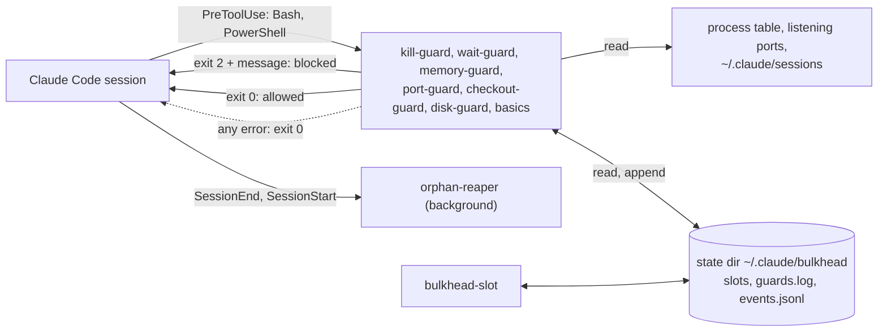

<h1 align="center">claude-bulkhead</h1>

<p align="center">
  <strong>Claude Code が他の dev server に <code>pkill node</code> を実行したり、そのポートを奪ったり、<code>git add -A</code> で別セッションの編集をコミットしたりするのを止めます。</strong>
</p>

<p align="center">どのプロセス、ポート、git ツリーがどの Claude Code セッションやサブエージェントのものかを把握する hook です。他に害が出るコマンドだけをブロックし、代わりに実行すべき安全なコマンドを Claude に伝えます。</p>

<p align="center">Windows、macOS、Linux に対応。tmux、sudo、常駐デーモン、ネットワーク呼び出し、依存パッケージは一切不要です。Codex、Gemini CLI、Copilot CLI、Cursor ほか 6 つのエージェントも保護できます。</p>

<p align="center">
  <a href="https://www.npmjs.com/package/claude-bulkhead"></a>
  <a href="https://github.com/dooly6276/claude-bulkhead/actions/workflows/test.yml"></a>
  <a href="#インストール"></a>
  <a href="docs/other-agents.md"></a>
  <br>
  
  
  
  <a href="LICENSE"></a>
</p>

<p align="center">
  
</p>

<p align="center"><sub><a href="README.md">English</a> | <a href="README.ko.md">한국어</a> | <a href="README.zh-CN.md">简体中文</a> | <a href="README.es.md">Español</a> | <a href="README.pt-BR.md">Português (Brasil)</a></sub></p>

## インストール

Claude Code 内で実行します。

```
/plugin marketplace add dooly6276/claude-bulkhead
/plugin install bulkhead@bulkhead
```

次に、何も変更せずに、直近 1 か月の自分の記録で何を止めていたかを確認します。

```
/bulkhead:scan 30d
```

ほかのエージェントは、同じガードをプラグインとして読み込めます。

| エージェント | インストール |
|---|---|
| Copilot CLI | `copilot plugin marketplace add dooly6276/claude-bulkhead` のあと `copilot plugin install bulkhead@bulkhead` |
| Cursor | `git clone https://github.com/dooly6276/claude-bulkhead ~/.cursor/plugins/local/bulkhead` のあと **Developer: Reload Window** |
| opencode | `opencode.json` に `"plugin": ["claude-bulkhead"]` を追加 |
| Gemini CLI | `gemini extensions install https://github.com/dooly6276/claude-bulkhead` |
| Codex | `codex plugin marketplace add dooly6276/claude-bulkhead` のあと `codex plugin add bulkhead@bulkhead`、最後に `/hooks` でフックを承認 |

それ以外のエージェント（Windsurf、Droid、Devin、Cline、Amp）は [Codex や Gemini などの他のエージェント](#codex-や-gemini-などの他のエージェント) を参照してください。

Node 18 以降が `PATH` に通っている必要があります（Claude Code のネイティブインストーラーは Node をインストールしないので、`node --version` で確認してください）。

| インストール | 得られるもの |
|---|---|
| プラグイン（上記） | Bash、PowerShell、Read、Edit の呼び出しごとに動くガード、スラッシュコマンド `/bulkhead:scan`、`status`、`log`、`doctor`、`reap`、`remote`、そして Claude に安全な習慣を教えるスキル。あなたを守るのはこの部分です。 |
| `npm install -g claude-bulkhead`（任意） | 自分のターミナルで使える `bulkhead` コマンド（`status`、`top`、`explain`、`allow`、`worktree`、`scan`、`doctor`）、ステータスライン、`bulkhead-slot`、Codex、Gemini などを設定する `bulkhead setup <agent>`。インストールせずに `npx claude-bulkhead status` を使うこともできます。 |

動いているかどうか不安なときは、`bulkhead doctor` を実行してください。各ガードに無害なコマンドを通し、ブロックされたことと所要時間を表示します。

## 止めるもの

| bulkhead なし | bulkhead あり |
|---|---|
| エージェントが `pkill node` で dev server を再起動し、他の worktree のサーバーまで全部落ちる。 | kill-guard がコマンドをブロックし、自分の PID を探して止める方法を伝える。 |
| 2 つのセッションが 1 つのチェックアウトを共有している。一方が `git add -A && git commit` を実行し、もう一方の書きかけの編集がそのコミットに入ってしまう。 | checkout-guard がブロックし、ファイル名を指定するよう求める。 |
| 2 つの worktree が `npm run dev` を実行する。2 つ目は 3001 に移るが、エージェントは `localhost:3000` をテストし続け、別ブランチの画面を見てしまう。 | port-guard が 2 つ目の起動をブロックし、空きポートを示す。 |
| 3 つのセッションが同じ 1 分間に `next build`、`npm test`、Playwright を起動し、マシンがフリーズする。 | memory-guard は RAM が少ないとき、重いコマンドをブロックする。`bulkhead-slot` を通せば、3 つ目のジョブは空きができるまでキューで待つ。 |

<details>
<summary>さらに 5 件</summary>

| bulkhead なし | bulkhead あり |
|---|---|
| あるセッションが、別のセッションが編集中のツリーで別のブランチをチェックアウトする。 | checkout-guard がブロックし、`git worktree add` を提案する。 |
| セッションが終了しても、その dev server、テストワーカー、ウォッチャーが動き続け、RAM とポートを握ったままになる。 | orphan-reaper がセッション終了後、数秒以内にそれらを止める。 |
| サブエージェントがフォアグラウンドで 10 分間ポーリングする。セッションはあなたに応答できず、プロンプトキャッシュも切れる。 | wait-guard がループをブロックし、`run_in_background: true` を使うよう求める。 |
| エージェントがディスク使用量を調べようとして、ホームフォルダに対して `du` を 10 個同時に実行する。全セッションのビルドと `git status` が数分間ほとんど進まなくなる。 | disk-guard がブロックし、フォルダを 1 つずつ調べるよう求める。 |
| 「worktree を整理して」というタスクが、別のセッションがまだ作業中の worktree に `git worktree remove` を実行する。 | checkout-guard がブロックし、まだそこにいるセッションを示す。 |

</details>

セッションが 1 つだけの場合でも、kill-guard、memory-guard、wait-guard、disk-guard、basics（`rm -rf ~`、`main` への force-push、未コミットの作業を消す `reset --hard` を禁止）は働きます。port-guard と checkout-guard は、2 つ目のセッションまたはサブエージェントが動いている間に働きます。

## bulkheadとは

<p align="center">
  <picture>
    <source media="(prefers-color-scheme: light)" srcset="docs/hero-light.svg">
    
  </picture>
</p>

Claude Code の hook は、シェルコマンドを実行する前に Claude Code が毎回実行する小さなプログラムで、コマンドを止めて理由を Claude に伝えられます。bulkhead はその hook 集です。Bash や PowerShell を呼ぶ前に、そのコマンドを同じマシン上の他のセッションの動きと照らし合わせます。どのプロセスとポートがどのセッションのものか、RAM がどれだけ残っているか、各セッションがどの git ツリーで作業しているかを見ます。他のセッションに害が出るコマンドならブロックし、代わりに実行すべき安全なコマンドを Claude に伝えます。Claude はそれを読み、たいてい確認なしで作業を続けます。

## 必要かどうかはトランスクリプトに聞く

推測する必要はありません。Claude Code は全セッションのトランスクリプトを `~/.claude/projects` に保存しています。`bulkhead scan` はその中のシェルコマンドをガードに照らして再生し、実際に何セッションが同時に動いていたか、bulkhead がブロックする操作がどれだけ起きていたかを示します。

<p align="center">
  <picture>
    <source media="(prefers-color-scheme: light)" srcset="docs/scan-light.svg">
    
  </picture>
</p>

```
/plugin install bulkhead@bulkhead      # then, inside Claude Code:
/bulkhead:scan 30d
```

読み取るだけで、秘密情報らしきものは出力前にマスクし、何も外部へ送信しません。port-guard と低 RAM チェックは再生しません。トランスクリプトには、どのポートが使われ、RAM がどれだけ使われていたかが記録されていないためです。checkout-guard は、その時刻に同じ git ツリーで動いていたセッションから再構成します。`bulkhead scan --share` は、件数だけ（パスもコマンドも含まない）の 5〜8 行の要約を出力するので、投稿やチャットにそのまま貼り付けられます。`--explain 1` は、1 件の例を一致した部分とともに全文表示します。詳細: [docs/commands.md](docs/commands.md#bulkhead-scan)。

## なぜ必要か

Claude Code で作業を速くする一般的な方法は、1 つのリポジトリで複数のセッションを動かすことです。それぞれが自分の git worktree を持ち、それぞれにサブエージェントがいます。git はブランチを分けてくれますが、マシンは分けてくれません。どのセッションも同じポート、同じプロセステーブル、同じ RAM を共有します。衝突が起きるのはそこです。

- 同じアプリの 2 つの worktree が、どちらも `npm run dev` を実行する。2 つ目はポート 3000 で失敗するか、黙って 3001 に移る。その間エージェントは `localhost:3000` をテストし続け、別ブランチを見てしまう。
- エージェントが `pkill node` や `taskkill /IM node.exe` で自分のサーバーを再起動し、他のすべての worktree の dev server とテスト実行、ときには自分のセッションまで落としてしまう。
- 3 つのセッションが同じ 1 分間に `npm test`、`next build`、Playwright を起動し、マシンが応答しなくなる。
- セッションが終わっても、そのセッションが起動した dev server が動き続ける。

Claude Code のトラッカーには、まさにこの種の報告が数多く上がっています。

- [#13941](https://github.com/anthropics/claude-code/issues/13941): dev server の再起動を頼まれた Claude が `taskkill //IM node.exe` や `pkill node` を実行し、自分のセッションを落とした。
- [#34754](https://github.com/anthropics/claude-code/issues/34754): ユーザーが PID を触らないよう指定していたにもかかわらず、`taskkill //F //IM python.exe` が長時間実行中のシミュレーション 2 つを落とした。
- [#43225](https://github.com/anthropics/claude-code/issues/43225): ボット 1 つの再起動を頼まれた Claude が、マシン上の Python プロセスを全部強制終了した。約 20 のサービスが対象になった。
- [#53229](https://github.com/anthropics/claude-code/issues/53229): 使っていない dev server だけを止めるよう指示されたエージェントが、正体を確認していないゲートウェイと Postgres のプロセスまで落とした。
- [#15487](https://github.com/anthropics/claude-code/issues/15487): 24 個のサブエージェントのプロセスが 4 GB の VPS を飽和させ、再起動が必要になった。コメントでは、同じ方法で 24 GB の Mac がフリーズした例も報告されている。
- [#11502](https://github.com/anthropics/claude-code/issues/11502) と [#25180](https://github.com/anthropics/claude-code/issues/25180): エージェントが起動したプロセスがエージェントより長く生き残る。一方の報告では Node プロセスが 60 個、もう一方では pytest ワーカーが 550 個。

claude-bulkhead は、これらを一つずつブロックまたは後始末する小さな hook の集まりです。どれも個別にオフにできます。名前は隔壁（bulkhead）パターンに由来します。1 つの区画に浸水しても、船全体を沈めてはいけない、という考え方です。

## できること

| | |
|---|---|
| **[kill-guard](docs/guards/kill-guard.md)**<br>`pkill node`、`taskkill /IM`、`Stop-Process -Name` など、プログラム名による kill をブロックします。PID 指定の kill は通ります。 | **[port-guard](docs/guards/port-guard.md)**<br>他のセッションがすでに使っているポートで dev server を起動することと、そのセッションのサーバーをポート指定で kill することをブロックします。 |
| **[memory-guard と bulkhead-slot](docs/guards/memory-guard.md)**<br>RAM が少ないときに重いコマンドをブロックします。また、全セッションで共有する 1 つの RAM 予算に対して、重いジョブをキューに入れます。 | **[checkout-guard](docs/guards/checkout-guard.md)**<br>別の生きたセッションが同じツリーで作業中のとき、`git checkout`、`stash`、`reset --hard`、`git add -A` などと、他セッションが作業中のフォルダの削除をブロックします。 |
| **[wait-guard](docs/guards/wait-guard.md)**<br>3 分を超えるフォアグラウンドの sleep ループをブロックします。このループは、次のリクエストでプロンプトキャッシュ全体を書き直させます。 | **[orphan-reaper](docs/guards/orphan-reaper.md)**<br>セッション終了時に、そのセッションが残した dev server、テストワーカー、ウォッチャー、ヘッドレスブラウザを止めます。意図的に残したいものは `BULKHEAD_KEEP=1` で残せます。トンネルとデータベースは最初から残ります。 |
| **[disk-guard](docs/guards/disk-guard.md)**<br>`du -sh ~`、`-maxdepth` なしの `find /`、並列実行のディスクスキャンをブロックします。これらは全セッションが共有するディスクを止めてしまいます。 | **[`bulkhead scan`](#必要かどうかはトランスクリプトに聞く)**<br>過去の Claude Code トランスクリプトをガードに照らして再生し、何を止めたはずか、何セッションが同時に動いていたかを示します。 |
| **[basics](docs/guards/basics.md)**<br>ルート、ホーム、ホーム直下のフォルダに対する `rm -rf`、`main` への force push、未コミットの作業を失うリセット、Claude を作者にしたコミットをブロックします。 | **[`bulkhead status`、`top`、`log`、`doctor`](#実行中のものを確認する)**<br>全セッション、その RAM、ポート、キュー中のジョブ、ガードがブロックしたものを表示します。 |
| **[edit-guard](docs/guards/edit-guard.md)** <sup>new</sup><br>別の生きたセッションが直近 30 分以内に同じファイルを編集していた場合（同じツリーでも、リポジトリの別の worktree でも）、エージェントに知らせます。既定では通知のみで、サーバーは不要です。 | **[secrets-guard](docs/guards/secrets-guard.md)** <sup>new、既定ではオフ</sup><br>Read ツールまたはシェルコマンドによる `.env`、秘密鍵、クラウドの認証情報、環境変数全体の読み取りと出力をブロックします。`.env.example`、`ls ~/.ssh`、`.pub` ファイルは通ります。 |
| **[`bulkhead explain` と `bulkhead allow`](#意図したものをブロックされたとき)** <sup>new</sup><br>コマンドを実行する前に、各ガードがそのコマンドに何と言うかを確認できます。また、ブロックメッセージに含まれるコードで、ブロックされたコマンド 1 回だけを通せます。Claude が自分でブロックを承認することはできません。 | **[`bulkhead worktree`](#worktree-を-1-ステップで作る)** <sup>new</sup><br>`.env` ファイルのコピー、依存関係のインストール、専用の固定ポートの割り当てまで、新しい worktree を 1 ステップで作ります。`prune` は、スカッシュマージを含めてマージ済みの worktree を削除し、セッションが作業中のものには触れません。 |
| **[自動キュー](docs/commands.md#auto-queue)** <sup>new</sup><br>`memoryGuard.autoQueue` を設定すると、重いコマンドは拒否されずに順番待ちになります。hook がコマンドを `bulkhead-slot` で包み、空きができたら開始します。 | **[Codex、Gemini などの他のエージェント](#codex-や-gemini-などの他のエージェント)** <sup>new</sup><br>Codex、Gemini CLI、Copilot CLI、Cursor、Windsurf、Droid、Devin、Cline、opencode、Amp にも同じガードを適用できます。設定は `bulkhead setup <agent>` で行います。 |
| **[ステータスライン](#ステータスライン)**<br>Claude Code のステータスラインに `3 sessions  2 heavy  9.1 GB free` と表示します。所要時間は約 100 ms です。 | **[設定とスラッシュコマンド](#設定)**<br>許可リスト付きの、マシン単位とプロジェクト単位の設定に加え、`/bulkhead:scan`、`/bulkhead:status`、`/bulkhead:log`、`/bulkhead:doctor`、`/bulkhead:reap` が使えます。 |

オプション: **[`bulkhead remote`](#別のマシンで重い処理を実行する-任意)** は、このマシンに RAM の余裕がないとき、テストスイート、ビルド、ブラウザ実行を SSH 経由で別のマシンで実行します。

## その他のデモ


`bulkhead status`、port-guard、kill-guard、wait-guard を順に実行するスクリプトを [docs/demo.sh](docs/demo.sh) で録画したものです。2 つのセッションは `claude` という名前の代役プロセスで、表示されている内容はすべて hook スクリプトと `bulkhead status` の出力です。このページ上部の録画は実際の Claude Code セッションで、作り方は [docs/demo.tape](docs/demo.tape) にあります。

## クイックスタート

1. 上記の手順でプラグインをインストールし、新しい Claude Code セッションを開始します。
2. 何を検出できたはずかを確認します。`/bulkhead:scan 30d` を実行するか、Bash ツールで `bulkhead scan` を実行します。直近 1 か月のトランスクリプトを読むだけで、何も変更しません。
3. セットアップを確認します。Claude Code 内で `/bulkhead:doctor` を実行するか、Bash ツールで `bulkhead doctor` を実行します。すべての行が `OK` になるはずです。`WARN` や `FAIL` の行には、ガード名と理由が出ます。末尾の Enforcement セクションは、hook が実際にブロックすることを確かめます。インストール済みの hook をカナリアコマンドで実行し、終了コード、メッセージ、レイテンシを確認します。`disableAllHooks`、無効化されたプラグイン、`node` の欠如も警告します。
4. セッションの隣にターミナルを開き、`npx claude-bulkhead top`（`npm install -g claude-bulkhead` の後なら `bulkhead top`）を実行すると、セッション、RAM、ポート、重いジョブをリアルタイムで確認できます。`q` で終了します。

あとは何もする必要はありません。ガードは Bash と PowerShell の呼び出しごとに動きます。何が止められたかは `bulkhead log` または `/bulkhead:log` で確認できます。`bulkhead log --summary` は、このマシンでガードごとのブロック数を集計します。しきい値を変えたりコマンドを許可したりするには、[docs/configuration.md](docs/configuration.md) を参照してください。全コマンドの一覧は [docs/commands.md](docs/commands.md) にあります。

## worktree を 1 ステップで作る

別のセッションがあなたのツリーで作業しているとき、checkout-guard はエージェントを worktree に誘導します。ただし、素の worktree には `.env` も `node_modules` もなく、dev server のポートもメインのチェックアウトと同じです。`bulkhead worktree add` は、この 3 つをまとめて解決します。

```
$ bulkhead worktree add fix-login
created ~/dev/shop-fix-login on new branch fix-login from HEAD
copied .env (default set)
pnpm install --frozen-lockfile: done in 14.2s
wrote PORT=3800 to .env.local
next: cd ~/dev/shop-fix-login && claude
```

`.worktreeinclude`（Claude Code も読むファイルです）に書かれたファイル、または安全な既定の `.env` ファイル群をコピーします。`node_modules`、ビルド出力、5 MB を超えるものは決してコピーしません。インストールはプロジェクトのロックファイルに従って行い、worktree には毎回変わらない固定のポートを割り当てます。`bulkhead worktree list` は、各 worktree のブランチ、状態、生きているセッション、ポートを表示します。`bulkhead worktree prune` は、マージ済みで、変更がなく、使われていない worktree を一覧表示し、`--yes` を付けると `git worktree remove` と `git branch -d` で削除します。`--force` は使わず、生きているセッションのフォルダには触れません。詳細は [docs/commands.md](docs/commands.md#bulkhead-worktree) にあります。

## 別のマシンで重い処理を実行する (任意)

複数のセッションが同時にテストスイートやビルドを実行すると、1 台のマシンでは RAM が足りなくなります。memory-guard がコマンドをブロックするか、bulkhead-slot が待ち行列に並ばせます（`memoryGuard.autoQueue` を設定すれば自動で行われます）。ほとんど遊んでいる 2 台目のマシンがあるなら、`bulkhead remote` で重いコマンドをそちらで実行できます。

<p align="center">
  
</p>

```
bulkhead remote add buildbox dev@192.168.1.20 --ssh-option=IdentityFile=~/.ssh/buildbox
bulkhead remote run -- npm test
```

```
[bulkhead remote] buildbox: 3f2a1c9 already there, 3 changed files (24 KB), 1 deleted
[bulkhead remote] buildbox  copy a  /home/dev/bulkhead-remote/acme-web-3f9a1c  port 7172
...test output...
[bulkhead remote] exit 0 after 1m 12s (copy a)
```

- **送るもの。** 現在のコミットを git bundle として（リモートにまだないコミットだけ）、および未コミットの変更（削除を含む）を送ります。無視されているファイルは、`--files` で指定しない限りこちらに残ります。リポジトリの外にあるものは何も送りません。
- **実行場所。** リモート上に最大 8 つあるリポジトリのコピーのうち 1 つで実行するので、並列実行同士が作業ツリーを共有しません。`node_modules` は実行間で保持されます。実行ごとに専用のポートが `$BULKHEAD_PORT` に入ります。
- **空き。** リモート側のロックがコピーとジョブスロットを確保し、`--gb=N` を指定するとリモートの空きが N GB になるまで待ちます。`--wait` 分以内に空きができなければ、終了コード 3 で終了します。
- **後始末。** コマンドが終了したとき、または SSH 接続が切れたとき（Ctrl-C、ツールのタイムアウト）には、リモートで起動したものがすべて止まります。そのポートに残ったサーバーも含みます。
- **リモート側に必要なもの** は、SSH サーバー、`bash`、`git`、`tar` だけです。Linux、macOS、Git for Windows を入れた Windows のどれでも動きます。

`bulkhead remote fetch PATH` は、直近の実行が使ったコピーからファイルを取り戻します。`bulkhead remote status` は各リモートの空き RAM と実行中のジョブを表示します。Claude Code では、`/bulkhead:remote <command>` でバックグラウンドからそちらでコマンドを実行できます。セットアップ、オプション、終了コード: [docs/remote.md](docs/remote.md)。

## 仕組み



各ガードは、依存のない独立した Node スクリプトです。Claude Code はツール呼び出しを JSON にして、パイプで渡します。ガードはコマンドの文字列を読み、一致したときだけ詳しく調べます。調べる対象は、プロセステーブル、待ち受けポート、Claude Code が `~/.claude/sessions` に置くセッションファイル、空き RAM、`git status` などです。ブロックは、終了コード 2 と、代わりにすべきことを Claude に伝えるメッセージで行います。ガード内部でエラーが起きたときは呼び出しを通すので、壊れたガードが作業を止めることはありません。

マシン上の全セッションが、1 つの状態ディレクトリを共有します。bulkhead-slot はそこに RAM の予約を保持し、すべてのブロックもそこに記録されます。状態ディレクトリの構成や、OS ごとのセッションの見つけ方など、詳しくは [docs/architecture.md](docs/architecture.md) を参照してください。

## ガード

各ガードには専用のページがあり、ブロックするコマンドの正確な一覧、通るもの、Claude に表示されるメッセージ、限界が書かれています。要点は次のとおりです。

<details>
<summary><strong>kill-guard</strong>: プログラム名による kill</summary>

`taskkill /IM`、PID なしの `taskkill /FI`、`Stop-Process -Name`、`Get-Process node | Stop-Process`、`pkill`、`killall`、`kill $(pgrep node)`、`wmic ... delete` などを、`node`、`python`、`java`、`chrome`、`git`、`vite` のように他のセッションと共有するプログラムが対象のときにブロックします。PID 指定とプロジェクトパス指定の kill は通ります。ポート指定の kill も、別のセッションがそのポートを持っていなければ通ります。持っている場合は port-guard が判定します。Claude には、自分の PID を見つける方法を伝えます。

オフにするには: `BULKHEAD_DISABLE=kill-guard`。詳細: [docs/guards/kill-guard.md](docs/guards/kill-guard.md)。
</details>

<details>
<summary><strong>port-guard</strong>: 別のセッションが持つポート</summary>

別の Claude セッションのプロセスツリーが待ち受けているポートで dev server（`npm run dev`、`next dev`、`vite`、`uvicorn`、`rails s` など）を起動することをブロックし、空きポートを提案します。また、別のセッションがそのポートを持っているとき、`npx kill-port 3000`、`fuser -k 3000/tcp`、`lsof -ti :3000 | xargs kill` のようなポート指定の kill もブロックします。

オフにするには: `BULKHEAD_DISABLE=port-guard`。詳細: [docs/guards/port-guard.md](docs/guards/port-guard.md)。
</details>

<details>
<summary><strong>memory-guard と bulkhead-slot</strong>: RAM</summary>

memory-guard は、空き RAM が 3 GB 未満（RAM が 20 GB 未満のマシンでは RAM の 15% 未満）のとき、重いコマンド（テストランナー、`next build`、`tsc`、Gradle、Android エミュレーター、Playwright、`cargo test`、`docker build` など）をブロックします。`bulkhead-slot run --gb=4 -- <command>` は、共有 RAM 予算に空きができるまで待ち、コマンドを実行し、終了時にスロットを解放します。

オフにするには: `BULKHEAD_DISABLE=memory-guard`。詳細: [docs/guards/memory-guard.md](docs/guards/memory-guard.md)。

`"memoryGuard": { "autoQueue": true }` を設定すると、スロットのことを誰も覚えておく必要がなくなります。memory-guard が重いコマンド（テスト、ビルド、ブラウザ実行、コンテナのビルド）をすべて `bulkhead-slot` 経由で実行するよう書き換えるので、すべてのセッションはブロックされる代わりに、1 つの公平なキューで待ちます。待機中のジョブは 30 秒ごとに順番を表示し、`bulkhead status` はキュー中の各ジョブがどのセッションとプロジェクトのものかを表示します。`"memoryGuard": { "subagents": true }` を設定すると、メモリ逼迫が深刻な間は新しいサブエージェントを起動しません。[docs/commands.md](docs/commands.md#auto-queue) を参照してください。
</details>

<details>
<summary><strong>checkout-guard</strong>: 1 つの git ツリーに 2 つのセッション</summary>

別の生きたセッションが同じツリーで作業しているとき、`git checkout <branch>`、`switch`、`stash`、`reset --hard`、`clean -f`、`rebase`、`merge`、`restore .`、変更のある状態での `pull` をブロックし、`git worktree add` を提案します。同様に、ここでの `git add -A`、`git add .`、`git commit -a` もブロックします（`stage-all`。`git add -A src/` と `git add -n` は通ります）。これらは相手の書きかけの編集を自分のコミットに紛れ込ませてしまうためです。別の生きたセッションが作業中のフォルダへの `rm -rf` や `git worktree remove`（`remove-session-dir`）もブロックします。Windows では、ジャンクションを含む worktree への `git worktree remove --force` もブロックします。git がジャンクションをたどってメインのチェックアウトに入ってしまうためです。

オフにするには: `BULKHEAD_DISABLE=checkout-guard`。ルール単位なら `BULKHEAD_DISABLE=stage-all` または `remove-session-dir`。詳細: [docs/guards/checkout-guard.md](docs/guards/checkout-guard.md)。
</details>

<details>
<summary><strong>disk-guard</strong>: ディスク全体と並列のスキャン</summary>

ドライブ全体、ホームフォルダ、全ユーザーのホームに対する `du`、`ncdu`、`dust`、`ls -R`、`Get-ChildItem -Recurse`、`dir /s`（`du -sh ~`、`du -sh ~/*`、`ncdu /`）、`-maxdepth` なしの `find /` と `find ~`、さらに対象に関係なく並列で動くディスクスキャン（`xargs -P 10 du`、GNU `parallel`、ループ内の `du ... &`、`ForEach-Object -Parallel`）をブロックします。フォルダを 1 つずつ調べるもの（`du -sh node_modules`、`du -sh ~/Library/Caches`）は通ります。

オフにするには: `BULKHEAD_DISABLE=disk-guard`。詳細: [docs/guards/disk-guard.md](docs/guards/disk-guard.md)。
</details>

<details>
<summary><strong>wait-guard</strong>: フォアグラウンドでの長い待機</summary>

sleep の合計が 180 秒を超えうるフォアグラウンドのコマンドをブロックします。プロンプトキャッシュはリクエストなしで約 5 分たつと切れるので、フォアグラウンドでポーリングするサブエージェントは、起きるたびにコンテキスト全体を書き直すことになります。Claude には、ループを `run_in_background: true` で実行するよう伝えます。バックグラウンドジョブ内の sleep（`sleep 600 &`）は通ります。ツールのタイムアウトが既定の 120 秒なら、待機が既定の上限を超えることはないので、呼び出しがタイムアウトを延ばしているときだけブロックされます。

オフにするには: `BULKHEAD_DISABLE=wait-guard`、または `BULKHEAD_WAIT_MAX_SEC` で上限を引き上げます。詳細: [docs/guards/wait-guard.md](docs/guards/wait-guard.md)。
</details>

<details>
<summary><strong>orphan-reaper</strong>: 終了したセッションが残したプロセス</summary>

セッションが終了すると、隠れたバックグラウンドの待機プロセスが、そのセッションがツールのシェルから起動して残したものを止めます。対象は、dev server やポートで待ち受けているもの全般、テストランナーとそのワーカー（Vitest、Jest、Playwright、pytest と xdist、`cargo test`、`go test` など）、`tsc --watch` や nodemon のようなウォッチャー、`next build` のようなビルド、ヘッドレスブラウザです。セッション開始時にも一度走査し、クラッシュで残ったものを拾います。エディター、ターミナル、Gradle や adb のような共有デーモン、自分で起動したものには一切触れません。`bulkhead reap --dry-run` で、何をなぜ止めるかを確認できます。意図的に起動して残しておきたいものは `BULKHEAD_KEEP=1 <command>` で残せます（ssh トンネル、cloudflared、ngrok、Jupyter、Redis、Postgres、MySQL、MongoDB、Docker は指定なしでも残ります）。次のセッションでは、何を止めたかが 1 行で通知されます。Windows、Linux、macOS に対応しています（macOS は実機の Mac でテスト済み）。

オフにするには: `BULKHEAD_DISABLE=orphan-reaper`。詳細: [docs/guards/orphan-reaper.md](docs/guards/orphan-reaper.md)。
</details>

<details>
<summary><strong>basics</strong>: 取り返しのつかない 5 つのミス</summary>

`rm-root`（ルート、`/srv` のようなトップレベルのフォルダ、ホーム、`~/Documents` のようなホーム直下のフォルダ、またはリポジトリより上に対する `rm -rf`）、`force-push-main`（`main` または `master` への `git push --force`。`--force-with-lease` は通ります）、`protected-delete`（`git push origin :main`、`git push --delete origin main`、`git branch -D main`）、`discard-changes`（未コミットの作業を失う `git reset --hard` や `git clean -fd`）、`agent-author`（`--author="Claude <noreply@anthropic.com>"` や `git config user.name Claude` など。あなたのコミットがあなたの実績として数えられ続けるようにするため）をブロックします。

オフにするには: `BULKHEAD_DISABLE=basics`、またはルール名を指定して 1 つだけオフにします。詳細: [docs/guards/basics.md](docs/guards/basics.md)。
</details>

## Codex や Gemini などの他のエージェント

Codex CLI、Gemini CLI、Copilot CLI、Cursor、opencode、Amp、Cline、Factory Droid、Windsurf、Devin を Claude Code と同じマシンで動かしている場合、bulkhead はそれらのシェルコマンドにも同じガードを適用し、セッションも数えます。あるエージェントの dev server が他のエージェントから守られ、`bulkhead status` には `AGENT` 列が加わります。

```
bulkhead setup codex            # prints the config for ~/.codex/hooks.json
bulkhead setup codex --write    # merges it (original saved as hooks.json.bulkhead-backup)
```

Copilot CLI、Cursor、opencode では bulkhead をプラグインとしても読み込めます（[インストール](#インストール) を参照）。この方法なら `npm install -g` も、自分の設定ファイルの変更も要りません。`bulkhead setup <agent>` は `codex`、`gemini`、`copilot`、`cursor`、`windsurf`、`droid`、`devin`、`cline`、`opencode`、`amp` で使えます。各エージェントはシェルコマンドの前に `bulkhead hook --agent <name>` を呼び出し、そのエージェント固有の形式でブロック結果を受け取ります。対応するエージェント、設定ファイル、保護の対象、各行を確認した根拠となったドキュメントは [docs/other-agents.md](docs/other-agents.md) にあります。

## 他の hook 集との関係

汎用の安全 hook 集は、危険なコマンドからセッションを守ります。たとえば [claude-forge](https://github.com/sangrokjung/claude-forge) には、出力に漏れた秘密情報を除去する hook、パイプで渡されるリモートスクリプトのブロック、破壊的な SQL の阻止が含まれます。[dcg](https://github.com/Dicklesworthstone/destructive_command_guard) と [cc-safety-net](https://github.com/kenryu42/claude-code-safety-net) は、破壊的なシェルコマンドと git コマンドを幅広くカバーします。どれも使う価値があります。

bulkhead が扱うのは別の問題です。1 台のマシン上のセッションが、プロセスの所有、ポート、共有 RAM、共有 git ツリーを通じて互いの邪魔をする問題です。それらの hook 集と重なるのは `basics` のルールだけで、他の hook 集がすでにカバーしているなら `BULKHEAD_DISABLE=basics` でオフにできます。bulkhead は他の hook と併用できます。Claude Code は、ツール呼び出しに一致するすべての hook を実行し、どれか 1 つでもブロックすれば呼び出しは止まります。

## 設定

既定値のままで、設定は不要です。変えたいときは設定ファイルを使います。マシン全体には `~/.claude/bulkhead/config.json`、1 つのプロジェクトには `<repo>/.claude/bulkhead.json`（`.git` のあるフォルダまで親をたどって探します）です。

プロジェクトの設定ファイルはリポジトリに含まれて届きます（clone したリポジトリも同じです）。そのため、bulkhead をより厳しくする設定だけが有効です。たとえば、kill-guard のブロック対象に名前を追加する、保護するブランチを増やす、待機の上限を下げる、RAM の下限を上げる、ガードをオンにする、といった設定です。`killGuard.allowNames`、`portGuard.ignorePorts`、より長い待機、`"enabled": false` のように、ガードを緩める設定はグローバルのファイルからだけ読みます。プロジェクトのファイルにあっても無視され、警告が出ます。この警告は `bulkhead config` とセッション開始時の通知で確認できます。リモートのホスト、ssh オプション、通知コマンドもグローバルのファイルからだけ読みます。

たとえば、`ffmpeg` を意図的に実行し、時間のかかる結合テストがあるマシンでは、`~/.claude/bulkhead/config.json` に次のように書きます。

```json
{
  "killGuard": { "allowNames": ["ffmpeg"] },
  "waitGuard": { "limitSeconds": 300 },
  "portGuard": { "ignorePorts": [9229] }
}
```

そして `release` からデプロイするプロジェクトでは、`.claude/bulkhead.json` に次のように書きます。

```json
{
  "basics": { "protectedBranches": ["release"] },
  "secretsGuard": { "enabled": true }
}
```

どのガードも、グローバルのファイルで `"<guard>": { "enabled": false }` とすればオフにできます。`bulkhead config` は、すべての設定項目、その値、どこから来た値かを表示します。壊れたファイルは無視され、ガードは既定値のまま動作し、セッション開始時に通知が 1 回表示されます。全キーは [docs/configuration.md](docs/configuration.md) にあり、[config.example.json](config.example.json) ではすべてのキーを設定しています。

環境変数も引き続き使え、2 つのファイルより優先されます。設定先としていちばん簡単なのは、`~/.claude/settings.json` の `env` ブロックです。

<details>
<summary>すべての環境変数</summary>

| 変数 | 既定値 | 対応する設定 |
|---|---|---|
| `BULKHEAD_DISABLE` | 空 | オフにするガードをカンマ区切りで指定します。`kill-guard`、`wait-guard`、`memory-guard`、`port-guard`、`checkout-guard`、`disk-guard`、`orphan-reaper`、`basics`、または `all`。個別のルールもオフにできます。`rm-root`、`force-push-main`、`protected-delete`、`discard-changes`、`agent-author`、`stage-all`、`remove-session-dir`。ここに書いた名前は、ファイルの内容にかかわらずオフになります |
| `BULKHEAD_PRESET` | `normal` | プリセット: `quiet`、`normal`、`strict` |
| `BULKHEAD_WAIT_MAX_SEC` | 180 | `waitGuard.limitSeconds` |
| `BULKHEAD_MIN_FREE_GB` | 3、または RAM の 15% のうち小さい方 | `memory.minFreeGb` |
| `BULKHEAD_SLOT_FLOOR_GB` | 5、または RAM の 25% のうち小さい方 | `memory.slotFloorGb` |
| `BULKHEAD_MAX_COMMIT_PCT` | 75 | `memory.maxCommitPct`（Windows のみ） |
| `BULKHEAD_NO_LOG` | 空 | `1` にすると `log.enabled: false` と同じ |
| `BULKHEAD_STATE_DIR` | `~/.claude/bulkhead` | スロット、イベントログ、`guards.log`、グローバル設定ファイルの置き場所 |
| `BULKHEAD_SSH` | `PATH` 上の `ssh` | `bulkhead remote` が実行する ssh クライアント |

</details>

## 意図したものをブロックされたとき

ブロックは判決ではなく、確認の問いかけです。対処は 3 通りあり、影響の小さいものから並べています。

1. 1 回だけ許可する。ブロックメッセージの末尾には、必ず短いコードが付いています。自分のターミナルで `bulkhead allow 7F3K` を実行します。すると、エージェントの次の同一の呼び出し（同じコマンド、同じフォルダ）が、10 分以内に 1 回だけ通ります。エージェントがこれを代行することはできません。bulkhead は、`bulkhead allow` の実行や状態ファイルへの書き込みの試みをすべてブロックします。
2. 先に理由を確認する。`bulkhead explain -- <command>` は、実行中のセッション、ポート、git ツリーに照らして、コマンドを実行せずに全ガードに通します。そして、何が妨げになっているか、その持ち主、エージェントに表示される正確なメッセージ、許可の方法を表示します。
3. 恒久的に許可する、またはブロックの強さを変える。ルールを `.claude/bulkhead.json` に書く（下の表）か、プリセットを選びます。`bulkhead config --preset quiet` はセッション間のガードと、取り返しのつかない 2 つのルールだけを残します。`strict` はすべてをオンにして制限を厳しくし、`normal` が既定です。自分で設定したキーや環境変数は、プリセットより優先されます。

### 意図したものをブロックされたときの早見表

1 回だけ許可する方法は、常にあなたが実行する `bulkhead allow <code>` です。作動したルールを恒久的に許可する方法は次のとおりです。

| ガード | ルール | 恒久設定（`.claude/bulkhead.json`） |
|---|---|---|
| kill-guard | `pkill`、`taskkill-im`、`stop-process-name` など、名前による kill | `{"killGuard":{"allowNames":["ffmpeg"]}}` |
| kill-guard | `other-session-pid`: 別のセッションのツリーにある PID | `{"killGuard":{"ownerCheck":false}}` |
| kill-guard | `broad-pattern`: デスクトップアプリや多数のプロセスに届く `pkill -f` パターン | `{"killGuard":{"broadPattern":false}}` |
| kill-guard | `mass-kill`, `docker-mass`, `device-kill`, `app-quit`, `service-stop`: その他のルール（別のセッションが動いているときだけ） | `{"killGuard":{"massKill":false}}`, 他も同じ形 (`dockerMass`, `deviceKill`, `appQuit`, `serviceStop`) |
| wait-guard | `long-sleep`、`poll-loop`、`follow` | `{"waitGuard":{"limitSeconds":600}}` |
| memory-guard | `low-memory` | `{"memory":{"minFreeGb":1}}` |
| memory-guard | `slot-files` | `{"memoryGuard":{"enabled":false}}` |
| port-guard | `port-in-use`、`kill-by-port` | `{"portGuard":{"ignorePorts":[3000]}}` |
| checkout-guard | `stage-all` | `{"checkoutGuard":{"stageAll":false}}` |
| checkout-guard | `remove-session-dir` | `{"checkoutGuard":{"removeSessionDir":false}}` |
| checkout-guard | `git-checkout`、`git-pull` など、ツリーを変更する操作 | `{"checkoutGuard":{"enabled":false}}` |
| disk-guard | `disk-wide-find`、`parallel-disk-scan`、`disk-wide-scan` | `{"diskGuard":{"enabled":false}}` |
| basics | `rm-root` | `{"basics":{"rmRoot":false}}` |
| basics | `force-push-main` | `{"basics":{"forcePushMain":false}}` |
| basics | `discard-changes` | `{"basics":{"discardChanges":false}}` |
| basics | `agent-author` | `{"basics":{"agentAuthor":false}}` |
| basics | `self-allow` | 1 回限りの許可はできません。承認できるのはあなただけです |

同じ切り替えは、環境変数 `BULKHEAD_DISABLE=<ガード名またはルール名>` でも行えます。すべての設定は [docs/configuration.md](docs/configuration.md) と [docs/commands.md](docs/commands.md) にあります。

## 実行中のものを確認する

`bulkhead` は、`bulkhead-slot` と並んで Bash ツールの `PATH` に入っています。Claude Code 内では、`/bulkhead:scan [30d]`、`/bulkhead:status`、`/bulkhead:log [24h|7d]`、`/bulkhead:doctor`、`/bulkhead:reap` が対応するコマンドを実行し、結果を要約します。自分のターミナルでは、`npx claude-bulkhead top` を実行するか、`npm install -g claude-bulkhead` で一度インストールしてから `bulkhead top` を実行します。npm パッケージはプラグインと同じコードです。表を出力するコマンドはすべて `--json` を受け付けます。完全なリファレンスは [docs/commands.md](docs/commands.md) です。

### bulkhead status

マシン上のすべての Claude Code セッションについて、何をしているか（作業中、あなたの入力待ち、許可待ち）、git ブランチと worktree かどうか、プロセスツリーが使うメモリ、待ち受けているポート、bulkhead-slot が確保しているジョブと待機中のジョブ、空き RAM、そしてセッションをまたいで複数コピーで動いている MCP サーバーを表示します。

```
$ bulkhead status
SESSION  STATE                STARTED  RSS     BRANCH              PROJECT
18672    working              09:52    1.4 GB  main                ~/src/acme-web
  :3000  node  pid 24632
21888    needs permission 4m  10:05    353 MB  feat/login (wt)     ~/src/acme-web-auth
26448    waiting 3m           11:40    625 MB  feat/checkout (wt)  ~/src/acme-web-checkout
  :3001  node  pid 31020
duplicate MCP: 3 copies of @playwright/mcp, 1.2 GB (sessions 18672, 21888, 26448)

SLOT    GB  PID    AGE    SESSION  PROJECT          COMMAND
slot-1  4   30112  6 min  18672    ~/src/acme-web   npx playwright test

WAITING  GB  PID    FOR    SESSION  PROJECT                 COMMAND
#1       3   30200  2 min  26448    ~/src/acme-web-checkout npm run build

9.9 GB free of 31.8 GB, commit 68%
```

`bulkhead top` は、あなたの対応が必要なセッションを先頭に表示します。`bulkhead port --stable` は、現在の git worktree に紐づき、毎回同じになるポートを表示します。セッションが待機状態になったときにデスクトップ通知を受け取るには、`notify.command` を設定します（[commands.md](docs/commands.md#session-state-and-notifications)）。

`bulkhead slot ...` は `bulkhead-slot ...` と同じです。

### bulkhead top

同じ内容を、全画面でリアルタイムに表示します。Linux と macOS では 2 秒ごと、Windows では 4 秒ごとに更新します（Windows ではプロセスのスキャンに 1〜2 秒かかるため）。スキャンはワーカースレッドで実行するので、キー入力が待たされることはありません。`q`、`Esc`、`Ctrl-C` で終了し、`r` で再読み込みします。

```
bulkhead top  14:30:05                                         scan 1.4s  every 4s  q quit  r refresh
RAM ████████████████░░░░░░░░░░░░░░  9.9 GB free of 31.8 GB  commit 68%

SESSIONS 3
PID      STARTED       PROJECT                         RSS              PROCS  PORTS
18672    Oct 12 17:49  ~/src/acme-web               1.4 GB  ██████████     12  :3000 :24678
21888    Oct 12 17:52  ~/src/acme-web-auth          353 MB  ███░░░░░░░      3  -
26448    03:43         ~/src/acme-web-checkout      625 MB  ████░░░░░░      5  :3001

HEAVY JOBS  1 running, 1 waiting
slot-1  4 GB   30112   6 min   npx playwright test
wait #1 3 GB   30200   2 min   npm run build  (this machine has 16 GB; one heavy job at a time)

RECENT BLOCKS
14:29  kill-guard     taskkill-im    ~/src/acme-web-auth      taskkill /F /IM node.exe
14:12  wait-guard     poll-loop      ~/src/acme-web-checkout  until [ -f out/DONE ]; do sleep 30; done
```

幅の狭いターミナルでは、折り返さずに列を省略します。出力先がターミナルでないとき、または `--once` を付けたときは、スナップショットを 1 回出力して終了します。

### bulkhead log

すべてのブロックと、orphan-reaper が止めたすべてのプロセスは、`<state dir>/events.jsonl` に 1 行の JSON として記録されます。時刻、ガード、ルール、セッション、プロジェクト、200 文字に切り詰めたコマンドが入ります。このファイルはあなたのマシンから出ることはなく、1 MB でローテーションし、古いファイルを 1 つだけ残します。`BULKHEAD_NO_LOG=1` でオフにできます。

```
$ bulkhead log --summary --since 7d
10 blocks in the last 7 days, 3 projects, 4 sessions

GUARD         RULE             COUNT  LAST
wait-guard    poll-loop            3  06:40  ████████████████████████
wait-guard    long-sleep           2  06:40  ████████████████
basics        force-push-main      1  06:40  ████████
basics        rm-root              1  06:40  ████████
kill-guard    pkill                1  06:40  ████████
kill-guard    taskkill-im          1  06:40  ████████
memory-guard  slot-files           1  06:40  ████████

PROJECT                  COUNT
~/src/acme-web               4
~/src/acme-web-auth          3
~/src/acme-web-checkout      3
```

`bulkhead log -n 20` はイベントそのものを一覧表示し、`--since 30m|24h|7d|2w|<date>` で期間を、`--guard kill-guard` でガードを絞り込めます。

### bulkhead doctor

Node、プラグインのファイル、状態ディレクトリ、設定ファイル、各ガード（オンかオフか、その理由）、プロセスリーダーとその所要時間、セッションファイル、このマシン向けに計算された RAM の上限、確保中のスロット、イベントログ、git を確認します。続く Enforcement セクションでは、インストール済みの hook が実際にブロックすることを確かめます。確認するのは、インストールと `enabledPlugins`、重複インストール、hook をオフにする設定、hook の `PATH` 上の `node`、そして各ガードの hook コマンドをカナリアに対して実際に実行した結果とそのレイテンシです。いずれかのチェックが失敗すると、終了コードは 1 になります。

```
$ bulkhead doctor
OK    node             v24.22.1
OK    package          this copy ~/.claude/plugins/cache/bulkhead/bulkhead/0.3.0, hooks: 3 SessionStart, 2 SessionEnd, 1 UserPromptSubmit, 1 Stop, 1 Notification, 2 PostToolUse, 1 PostToolUseFailure, 4 PreToolUse
OK    state dir        ~/.claude/bulkhead is writable
OK    config           no config files, defaults in use
OK    preset           normal (default)
OK    kill-guard       on
OK    wait-guard       on, limit 180s
OK    memory-guard     on
OK    port-guard       on
OK    checkout-guard   on
OK    disk-guard       on
OK    basics           on, protected branches: main, master
OK    edit-guard       on
OK    secrets-guard    off (default)
OK    orphan-reaper    on, at session start and after each session ends
OK    session-state    on
OK    processes        589 processes, 11 listening ports, 10 Claude sessions (10 with a session file) in 0.2s
OK    sessions         ~/.claude/sessions (10 session files; a running session without one is still found from the process list, but checkout-guard cannot tell which folder it works in)
OK    memory           28.3 of 48.0 GB free, memory-guard blocks heavy commands below 3 GB, bulkhead-slot keeps 5 GB free for a second job
OK    slots            none held
OK    event log        ~/.claude/bulkhead/events.jsonl, 2 events, 254 B (rotates at 1 MB)
OK    git              2.56.0

Enforcement
OK    install          bulkhead@bulkhead 0.3.0 at ~/.claude/plugins/cache/bulkhead/bulkhead/0.3.0, enabled in user settings
OK    hooks on         no disableAllHooks or allowManagedHooksOnly in user, project, local or managed settings
OK    hooks.json       installed copy: 4 PreToolUse hooks, all synchronous
OK    hook node        /opt/homebrew/bin/node v24.22.1
OK    hook kill-guard  blocked "pkill node" (exit 2, message shown to Claude) in 71 ms
OK    hook wait-guard  blocked "sleep 100000" (exit 2, message shown to Claude) in 64 ms
OK    hook disk-guard  blocked "du -sh /" (exit 2, message shown to Claude) in 70 ms
OK    hook basics      blocked "rm -rf /" (exit 2, message shown to Claude) in 63 ms

30 OK, 0 WARN, 0 FAIL
```

### bulkhead port

どのプロセスも待ち受けていないポートを、IPv4 と IPv6 の両方で確認して表示します。2 つ目の worktree が、当てずっぽうなしでサーバーを起動できます。

```
npm run dev -- --port $(bulkhead port --near 3000)
```

### bulkhead reap

orphan-reaper を今すぐ実行します。`--dry-run` は、何も止めずに、止める対象、一致したルール、そのセッションが終了したと判断した理由を一覧表示します。

```
$ bulkhead reap --dry-run
would stop 30112  test-runner  node ~/src/acme-web/node_modules/vitest/dist/workers/forks.js
  Vitest and its worker pool (tinypool); its session has exited and removed snapshot-bash-1791860359256-ezwkie.sh; 6 processes from 30080
1 tree would be stopped. Run `bulkhead reap` to stop it.
```

### ステータスライン

`bulkhead-statusline` は、Claude Code のステータスライン用に 1 行を出力します。

```
3 sessions  2 heavy  9.1 GB free
```

sessions は `~/.claude/sessions` にある生きたエントリ、heavy は bulkhead-slot を確保しているジョブの数、free は memory-guard が使うのと同じ指標です。あなたの入力を待っているセッションがあるときは、セッション数の後ろに `2 waiting` が付きます。すべてのプロセスは一覧にせず（セッションの PID に対する `ps` を 1 回だけ実行）、プロセス数 650 の Mac でコールドスタート時に約 100 ms かかり、結果は状態ディレクトリに 5 秒間キャッシュされます。書き込みは一時ファイルを経由するので、並行するセッションが書きかけの内容を読むことはありません。

プラグインからはメインのステータスラインを設定できないため（プラグインの設定が対応するのは `agent` と `subagentStatusLine` だけです）、`~/.claude/settings.json` に自分で追加してください。

```json
{
  "statusLine": {
    "type": "command",
    "command": "bulkhead-statusline",
    "refreshInterval": 10
  }
}
```

これには `npm install -g claude-bulkhead` が必要で、`bulkhead-statusline` が `PATH` に入ります。すでにステータスラインのスクリプトがあるなら、そこから `bulkhead-statusline` を呼び出して、出力を追記してください。

## FAQ

**Claude Code が遅くなりますか？**
わずかに遅くなります。Bash 用のガードはすべて、依存のない 1 つの短い Node プロセスの中で動き、MacBook Pro（Node 24）ではツール呼び出し 1 回あたり約 76 ms で、そのうち 32 ms は Node の起動です。10 個のセッションが同時にツールを呼び出すと、各セッションの待ち時間は約 89 ms です（0.2 のように各ガードが別プロセスだった場合は 318 ms）。ブロックをイベントログに書き込む分は、測定できるほどの時間がかかりません。プロセス一覧の読み取り（Windows では 1〜2 秒）のような重い処理は、コマンドが一致したときだけ実行します。すでに応答のあるポートでの dev server 起動、kill、重いコマンドなどです。ステータスラインはコールドで約 100 ms で、5 秒間キャッシュされます。

**ブロックすべきでないものをブロックされました。どうすればいいですか？**
`bulkhead log` を実行して、正確なコマンドと理由を確認してください。一度だけ通すには、ブロックのメッセージに表示されたコードを使って `bulkhead allow <code>` を実行します。恒久的に通すには、グローバルの設定 `~/.claude/bulkhead/config.json` に設定します。プログラム名なら `killGuard.allowNames`、共有ポートなら `portGuard.ignorePorts`、長い待機なら `waitGuard.limitSeconds`、ガード全体をオフにするなら `"enabled": false` です。プロジェクトの `.claude/bulkhead.json` ではガードを緩められません。[docs/configuration.md](docs/configuration.md) を参照してください。そのうえで、`bulkhead log` の該当行を添えて [false positive issue](https://github.com/dooly6276/claude-bulkhead/issues/new?template=false-positive.yml) を作成していただければ、パターンを全員のために修正できます。

**セッションが 1 つだけでも役に立ちますか？**
はい。kill-guard、wait-guard、memory-guard、basics は、1 つのセッションとそのサブエージェントも同じように守ります。port-guard と checkout-guard は別のセッションが生きているときだけ働き、orphan-reaper は終了したセッションの後始末をします。

**対応しているシステムは？**
Windows、Linux、macOS で、Node 18 以降が必要です。macOS の orphan-reaper は `ps` 出力のフィクスチャーと実機の Mac でテストしています（代役のセッションを終了させ、その残骸だけが止まることを確認しました）。Linux では、ツールのシェルに `CLAUDE_PID` を設定する Claude Code のバージョンが必要です。Windows では、`bulkhead-slot` は Git Bash が入っていれば Git Bash 経由で、なければ `cmd.exe` 経由でコマンドを実行します。

**どこかにデータを送信しますか？**
いいえ。テレメトリーもネットワーク呼び出しもありません。開くソケットは、ポートが応答するかを調べるために port-guard が `localhost` へ接続を試みるときだけです。ログは状態ディレクトリに残ります。唯一の例外は `bulkhead remote` で、あなたが設定したマシンへ SSH で接続しますが、それはあなたが実行したときだけです。

ほかの質問、たとえばガードを回避する方法や RAM の数値の測り方などは、[docs/faq.md](docs/faq.md) にあります。

## 制限事項

- ガードが読むのはコマンドの文字列です。コマンドを分割し、`bash -c`、`cmd /c`、`powershell -EncodedCommand`、`sudo` のようなラッパーを最大 3 階層まで開きますが、スクリプトファイル、シェル関数、エイリアスの中に隠れた kill や sleep は見えません。よくある形は捕捉できますが、意図的な回避策までは防げません。
- memory-guard と bulkhead-slot が見るのは RAM だけです。CPU、ディスク、GPU は制限しません。
- bulkhead-slot は、呼び出したときだけ使われます。全セッションにこれを通してキューに並ばせる仕組みはありません。
- 各ガードのページに、それぞれの制限が書かれています。

## アンインストール

```
/plugin uninstall bulkhead@bulkhead
/plugin marketplace remove bulkhead
```

代わりに npm パッケージをインストールした場合は、`npm uninstall -g claude-bulkhead` を実行してください。すでに動いている SessionEnd の待機プロセスは 3 分以内に自分で終了するので、アンインストールしたあとに動き続けるものはありません。

そのあと、状態ディレクトリ（`~/.claude/bulkhead`、`BULKHEAD_STATE_DIR` を設定した場合はそのパス）を削除し、追加していた場合は `~/.claude/settings.json` の `statusLine` エントリも削除してください。

## bulkhead を使っていますか？ バッジで知らせましょう

プロジェクトの README に、次のバッジを追加できます。

```markdown
[](https://github.com/dooly6276/claude-bulkhead)
```

表示はこうなります: [](https://github.com/dooly6276/claude-bulkhead)

## コントリビュート

[CONTRIBUTING.md](CONTRIBUTING.md) を参照してください。セキュリティ報告: [SECURITY.md](SECURITY.md)。変更履歴は [CHANGELOG.md](CHANGELOG.md)、bulkhead が何を保存し何を送信するかは [PRIVACY.md](PRIVACY.md) にあります。

## ライセンス

[MIT](LICENSE)
