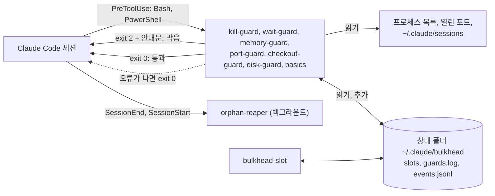

<h1 align="center">claude-bulkhead</h1>

<p align="center">
  <strong>Claude Code 가 비어 있는 변수로 <code>rm -rf $DIR/</code> 를 실행하거나, <code>pkill node</code> 로 다른 개발 서버를 종료하거나, 다른 세션의 포트를 사용하거나, <code>git add -A</code> 로 다른 세션의 수정 사항을 커밋하는 일을 막습니다.</strong>
</p>

<p align="center">어느 프로세스, 포트, git 트리가 어느 Claude Code 세션과 서브에이전트 것인지 아는 훅입니다. 다른 세션에 영향을 주는 명령만 막고, 대신 실행할 안전한 명령을 Claude 에게 알려 줍니다.</p>

<p align="center">Windows, macOS, Linux 를 지원합니다. tmux, sudo, 백그라운드 데몬, 네트워크 호출, 의존성이 모두 필요 없습니다. Codex, Gemini CLI, Copilot CLI, Cursor 와 다른 에이전트 여섯 가지도 지킵니다.</p>

<p align="center">
  <a href="https://www.npmjs.com/package/claude-bulkhead"></a>
  <a href="https://github.com/dooly6276/claude-bulkhead/actions/workflows/test.yml"></a>
  <a href="#설치"></a>
  <a href="docs/other-agents.md"></a>
  <br>
  
  
  
  <a href="LICENSE"></a>
</p>

<p align="center">
  
</p>

<p align="center"><sub><a href="README.md">English</a> | <a href="README.zh-CN.md">简体中文</a> | <a href="README.ja.md">日本語</a> | <a href="README.es.md">Español</a> | <a href="README.pt-BR.md">Português (Brasil)</a></sub></p>

## 설치

먼저 아무것도 설치하지 않고, 내 세션 기록에서 무엇을 막았을지 확인합니다.

```
npx -y claude-bulkhead scan --since 30d --share
```

`~/.claude/projects` 의 기록을 읽기만 하고 어디로도 보내지 않습니다.

그다음 Claude Code 안에서 플러그인을 설치합니다.

```
/plugin marketplace add dooly6276/claude-bulkhead
/plugin install bulkhead@bulkhead
```

설치한 뒤에는 같은 보고서를 Claude Code 안에서 볼 수 있습니다.

```
/bulkhead:scan 30d
```

다른 에이전트는 같은 가드를 플러그인으로 불러옵니다.

| 에이전트 | 설치 |
|---|---|
| Copilot CLI | `copilot plugin marketplace add dooly6276/claude-bulkhead` 다음 `copilot plugin install bulkhead@bulkhead` |
| Cursor | `git clone https://github.com/dooly6276/claude-bulkhead ~/.cursor/plugins/local/bulkhead` 다음 **Developer: Reload Window** |
| opencode | `opencode.json` 에 `"plugin": ["claude-bulkhead"]` 추가 |
| Gemini CLI | `gemini extensions install https://github.com/dooly6276/claude-bulkhead` |
| Codex | `codex plugin marketplace add dooly6276/claude-bulkhead` 다음 `codex plugin add bulkhead@bulkhead`, 마지막으로 `/hooks` 에서 훅 승인 |

그 밖의 에이전트(Windsurf, Droid, Devin, Cline, Amp)는 [Codex, Gemini 와 다른 에이전트](#codex-gemini-와-다른-에이전트)를 보세요.

`PATH` 에 Node 18 이상이 있어야 합니다(Claude Code 네이티브 설치 프로그램은 Node 를 깔지 않으니 `node --version` 으로 확인하세요).

| 설치 | 얻는 것 |
|---|---|
| 플러그인(위) | Bash, PowerShell, Read, Edit 호출마다 도는 가드, 슬래시 명령 `/bulkhead:scan`, `status`, `log`, `doctor`, `reap`, `remote`, 그리고 Claude 에게 안전한 습관을 가르치는 스킬입니다. 실제로 보호해 주는 부분입니다. |
| `npm install -g claude-bulkhead`(선택) | 내 터미널의 `bulkhead` 명령(`status`, `top`, `explain`, `allow`, `worktree`, `scan`, `doctor`), 상태 줄, `bulkhead-slot`, Codex, Gemini 같은 에이전트용 `bulkhead setup <agent>` 입니다. 설치 없이 `npx claude-bulkhead status` 도 됩니다. |

제대로 동작하는지 모르겠다면 `bulkhead doctor` 를 실행하세요. 가드마다 해롭지 않은 명령을 하나씩 넣어 막히는지, 얼마나 걸리는지 보여 줍니다.

## 막는 것

| bulkhead 없이 | bulkhead 와 함께 |
|---|---|
| 에이전트가 `pkill node` 로 자기 개발 서버를 재시작하고, 다른 worktree 의 서버가 같이 죽습니다. | kill-guard 가 막고, 자기 PID 를 찾아 그것만 끄는 방법을 알려 줍니다. |
| 세션 두 개가 한 체크아웃을 같이 씁니다. 한 세션이 `git add -A && git commit` 을 치면 다른 세션이 쓰던 수정이 그 커밋에 실려 나갑니다. | checkout-guard 가 막고 파일 이름을 적으라고 알려 줍니다. |
| worktree 두 개가 `npm run dev` 를 칩니다. 두 번째는 3001 로 옮겨 가는데 에이전트는 계속 `localhost:3000` 을 보고 다른 브랜치 화면을 확인합니다. | port-guard 가 두 번째 실행을 막고 빈 포트를 알려 줍니다. |
| 세 세션이 같은 1분 안에 `next build`, `npm test`, Playwright 를 시작하고 컴퓨터가 멈춥니다. | memory-guard 가 램이 모자랄 때 무거운 명령을 막습니다. `bulkhead-slot` 을 거치면 세 번째 작업은 자리가 날 때까지 대기열에서 기다립니다. |

<details>
<summary>6개 더</summary>

| bulkhead 없이 | bulkhead 와 함께 |
|---|---|
| 다른 세션이 고치고 있는 트리에서 한 세션이 다른 브랜치로 checkout 합니다. | checkout-guard 가 막고 `git worktree add` 를 권합니다. |
| 세션이 끝났는데 그 세션의 개발 서버, 테스트 워커, 감시 프로세스가 램과 포트를 잡은 채 계속 돕니다. | 세션이 끝나고 몇 초 안에 orphan-reaper 가 끕니다. |
| 서브에이전트가 포그라운드에서 10분 동안 기다립니다. 그동안 세션은 대답을 못 하고 프롬프트 캐시도 만료됩니다. | wait-guard 가 막고 `run_in_background: true` 로 돌리라고 알려 줍니다. |
| 에이전트가 무엇이 디스크를 차지하는지 알아보겠다고 홈 폴더 전체에 `du` 를 열 개 동시에 돌립니다. 모든 세션의 빌드와 `git status` 가 몇 분씩 느려집니다. | disk-guard 가 막고 폴더를 하나씩 보라고 알려 줍니다. |
| "worktree 정리" 작업이 다른 세션이 아직 일하는 worktree 에 `git worktree remove` 를 칩니다. | checkout-guard 가 막고 아직 그 안에 있는 세션을 알려 줍니다. |
| 정리 작업이 `BUILD_DIR` 이 비어 있는 채로 `rm -rf "$BUILD_DIR"/*` 를 실행해 `rm -rf /*` 가 되거나, `rm -rf .git` 으로 저장소 기록이 사라집니다. | basics 가 막고 안전한 형태 `rm -rf "${BUILD_DIR:?}"/*` 를 알려 줍니다. |

</details>

세션이 하나뿐이어도 kill-guard, memory-guard, wait-guard, disk-guard, basics(`rm -rf ~`, `D` 가 비면 `rm -rf /` 가 되는 `rm -rf $D/`, `rm -rf .git`, `main` 강제 푸시, 커밋하지 않은 작업 위의 `reset --hard` 를 막음)는 적용됩니다. port-guard 와 checkout-guard 는 두 번째 세션이나 서브에이전트가 살아 있을 때 동작합니다.

## 무엇인가

<p align="center">
  <picture>
    <source media="(prefers-color-scheme: light)" srcset="docs/hero-light.svg">
    
  </picture>
</p>

Claude Code 훅은 셸 명령을 실행하기 직전마다 Claude Code 가 돌리는 작은 프로그램으로, 명령을 멈추고 Claude 에게 이유를 알려 줄 수 있습니다. bulkhead 는 그런 훅 모음입니다. Bash 나 PowerShell 을 부르기 전에 그 명령을 같은 컴퓨터의 다른 세션이 하는 일과 맞춰 봅니다. 어떤 프로세스와 포트가 어느 세션 것인지, 램이 얼마나 남았는지, 각 세션이 어느 git 트리에서 일하는지를 봅니다. 다른 세션을 다치게 할 명령이면 막고, 대신 실행할 안전한 명령을 Claude 에게 알려 줍니다. Claude 는 그것을 읽고 대개 사용자에게 묻지 않고 이어 갑니다.

## 필요한지 기록에 물어보세요

짐작할 필요가 없습니다. Claude Code 는 세션마다 기록을 `~/.claude/projects` 에 남깁니다. `bulkhead scan` 은 그 기록 속 셸 명령을 가드에 다시 대 봅니다. 실제로 세션을 몇 개나 동시에 돌렸는지, bulkhead 가 막는 일을 이미 얼마나 자주 했는지 알려 줍니다.

<p align="center">
  <picture>
    <source media="(prefers-color-scheme: light)" srcset="docs/scan-light.svg">
    
  </picture>
</p>

```
/plugin install bulkhead@bulkhead      # then, inside Claude Code:
/bulkhead:scan 30d
```

읽기만 하고, 출력 전에 비밀 값처럼 보이는 것은 가리며, 어디로도 보내지 않습니다. port-guard 와 램 부족 검사는 다시 돌리지 않습니다. 기록에는 어떤 포트가 쓰였고 램이 얼마나 찼는지가 남지 않기 때문입니다. checkout-guard 는 그 시각에 같은 git 트리에서 어떤 세션이 활동 중이었는지로 다시 구성합니다. `bulkhead scan --share` 는 개수만 담은 5줄에서 8줄짜리 요약(경로도 명령도 없음)을 출력하므로 게시글이나 채팅에 붙일 수 있고, `--explain 1` 은 예시 하나를 걸린 부분과 함께 전부 보여 줍니다. 자세히: [docs/commands.md](docs/commands.md#bulkhead-scan)

## 왜 필요한가

Claude Code 로 일을 빨리 끝내는 흔한 방법은 한 저장소에 세션을 여러 개 띄우는 것입니다. 세션마다 git worktree 를 하나씩 주고, 세션마다 서브에이전트가 따로 돕니다. 브랜치는 git 이 나눠 줍니다. 하지만 컴퓨터는 나눠 주지 않습니다. 모든 세션이 같은 포트, 같은 프로세스 목록, 같은 램을 씁니다. 여기서 부딪힙니다.

- 같은 앱의 worktree 두 개가 둘 다 `npm run dev` 를 칩니다. 두 번째는 3000 번 포트에서 실패하거나, 조용히 3001 로 옮겨 갑니다. 그런데 에이전트는 계속 `localhost:3000` 을 열어 보고 다른 브랜치 화면을 봅니다.
- 에이전트가 자기 서버를 재시작하려고 `pkill node` 나 `taskkill /IM node.exe` 를 칩니다. 다른 worktree 의 개발 서버와 테스트가 다 죽고, 때로는 자기 세션도 죽습니다.
- 세 세션이 같은 1분 안에 `npm test`, `next build`, Playwright 를 시작하고 컴퓨터가 멈춥니다.
- 세션이 끝나도 그 세션이 띄운 개발 서버는 계속 돕니다.

Claude Code 이슈 트래커에 바로 이런 보고가 많습니다.

- [#13941](https://github.com/anthropics/claude-code/issues/13941): 개발 서버를 재시작하라고 했더니 `taskkill //IM node.exe` 나 `pkill node` 를 쳐서 자기 세션까지 죽였습니다.
- [#34754](https://github.com/anthropics/claude-code/issues/34754): 사용자가 건드리지 말라고 PID 를 적어 뒀는데도 `taskkill //F //IM python.exe` 로 오래 돌던 시뮬레이션 두 개를 죽였습니다.
- [#43225](https://github.com/anthropics/claude-code/issues/43225): 봇 하나를 재시작하라고 했더니 컴퓨터의 Python 프로세스를 전부, 서비스 약 20개를 강제 종료했습니다.
- [#53229](https://github.com/anthropics/claude-code/issues/53229): 안 쓰는 개발 서버만 끄라고 했는데 정체를 확인하지 않은 게이트웨이와 Postgres 프로세스까지 껐습니다.
- [#15487](https://github.com/anthropics/claude-code/issues/15487): 서브에이전트 프로세스 24개가 4 GB VPS 를 가득 채워 재부팅해야 했습니다. 댓글에는 24 GB Mac 이 같은 식으로 멈췄다는 보고도 있습니다.
- [#11502](https://github.com/anthropics/claude-code/issues/11502), [#25180](https://github.com/anthropics/claude-code/issues/25180): 에이전트가 띄운 프로세스가 에이전트보다 오래 남습니다. 한 보고는 Node 프로세스 60개, 다른 보고는 pytest 워커 550개였습니다.

claude-bulkhead 는 이런 일을 하나씩 막거나 치우는 작은 훅 모음입니다. 훅마다 따로 끌 수 있습니다. 이름은 bulkhead(격벽) 패턴에서 왔습니다. 배의 한 칸에 물이 차도 배 전체가 가라앉으면 안 된다는 뜻입니다.

## 하는 일

| | |
|---|---|
| **[kill-guard](docs/guards/kill-guard.md)**<br>`pkill node`, `taskkill /IM`, `Stop-Process -Name` 처럼 프로그램 이름으로 끄는 명령을 막습니다. PID 로 끄는 건 통과합니다. | **[port-guard](docs/guards/port-guard.md)**<br>다른 세션이 쓰는 포트에 개발 서버를 띄우거나, 그 포트로 남의 서버를 끄는 명령을 막습니다. |
| **[memory-guard, bulkhead-slot](docs/guards/memory-guard.md)**<br>램이 모자랄 때 무거운 명령을 막고, 모든 세션이 같이 쓰는 램 예산에 무거운 작업을 줄 세웁니다. | **[checkout-guard](docs/guards/checkout-guard.md)**<br>다른 세션이 같은 작업 트리에 있을 때 `git checkout`, `stash`, `reset --hard`, `git add -A` 등을 막고, 다른 세션이 일하는 폴더를 지우는 것도 막습니다. |
| **[wait-guard](docs/guards/wait-guard.md)**<br>3분이 넘는 포그라운드 sleep 반복을 막습니다. 다음 요청이 프롬프트 캐시 전체를 다시 쓰게 되기 때문입니다. | **[orphan-reaper](docs/guards/orphan-reaper.md)**<br>세션이 끝나면, 그 세션이 남긴 개발 서버, 테스트 워커, 감시 프로세스, 헤드리스 브라우저를 끕니다. 일부러 남기려면 `BULKHEAD_KEEP=1` 을 붙입니다. 터널과 데이터베이스는 이미 남겨 둡니다. |
| **[disk-guard](docs/guards/disk-guard.md)**<br>`du -sh ~`, `-maxdepth` 없는 `find /`, 병렬로 돌리는 디스크 스캔을 막습니다. 모든 세션이 같이 쓰는 디스크가 멈추기 때문입니다. | **[`bulkhead scan`](#필요한지-기록에-물어보세요)**<br>지난 Claude Code 세션 기록을 가드에 대 봅니다. 무엇을 막았을지, 세션이 몇 개나 동시에 돌았는지 알려 줍니다. |
| **[basics](docs/guards/basics.md)**<br>루트, 홈, 홈 바로 아래 폴더를 향한 `rm -rf`, `main` 강제 푸시, 커밋 안 한 변경을 날리는 리셋, Claude 를 작성자로 한 커밋을 막습니다. | **[`bulkhead status`, `top`, `log`, `doctor`](#지금-도는-것-보기)**<br>세션마다 램, 포트, 대기 중인 작업, 가드가 막은 기록을 보여 줍니다. |
| **[edit-guard](docs/guards/edit-guard.md)** <sup>new</sup><br>같은 파일을 다른 살아 있는 세션이 최근 30분 안에 수정했으면 에이전트에게 알려 줍니다. 같은 트리든 저장소의 다른 worktree 든 같습니다. 기본은 알림만 하고, 서버는 필요 없습니다. | **[secrets-guard](docs/guards/secrets-guard.md)** <sup>new, 기본은 꺼짐</sup><br>`.env`, 개인 키, 클라우드 자격 증명, 환경 변수 전체를 Read 도구나 셸 명령으로 읽거나 출력하는 것을 막습니다. `.env.example`, `ls ~/.ssh`, `.pub` 파일은 통과합니다. |
| **[`bulkhead explain` 과 `bulkhead allow`](#의도한-명령이-막혔을-때)** <sup>new</sup><br>명령을 실행하기 전에 모든 가드가 뭐라고 할지 미리 보고, 막힌 명령 하나를 막힘 안내문의 코드로 한 번만 통과시킵니다. Claude 는 자기가 막힌 것을 스스로 승인할 수 없습니다. | **[`bulkhead worktree`](#worktree-를-한-번에-만들기)** <sup>new</sup><br>`.env` 파일을 복사하고 의존성을 설치하고 고정된 포트를 주는 새 worktree 를 한 번에 만듭니다. `prune` 은 스쿼시 머지를 포함해 머지된 worktree 를 지우며, 세션이 일하는 worktree 는 절대 지우지 않습니다. |
| **[자동 대기열](docs/commands.md#auto-queue)** <sup>new</sup><br>`memoryGuard.autoQueue` 를 켜면 무거운 명령을 거절하지 않고 줄을 세웁니다. 훅이 명령을 `bulkhead-slot` 으로 감싸고, 자리가 나면 시작합니다. | **[Codex, Gemini 와 다른 에이전트](#codex-gemini-와-다른-에이전트)** <sup>new</sup><br>Codex, Gemini CLI, Copilot CLI, Cursor, Windsurf, Droid, Devin, Cline, opencode, Amp 에도 같은 가드를 적용합니다. `bulkhead setup <agent>` 로 설정합니다. |
| **[상태 줄](#상태-줄)**<br>Claude Code 상태 줄에 `3 sessions  2 heavy  9.1 GB free` 를 띄웁니다. 100 ms 안에 끝납니다. | **[설정과 슬래시 명령](#설정)**<br>컴퓨터 단위, 프로젝트 단위 설정 파일과 허용 목록. `/bulkhead:scan`, `/bulkhead:status`, `/bulkhead:log`, `/bulkhead:doctor`, `/bulkhead:reap`. |

선택 기능: **[`bulkhead remote`](#다른-컴퓨터에서-무거운-일-돌리기-선택)** 는 이 컴퓨터의 램이 모자랄 때 시험 묶음, 빌드, 브라우저 실행을 SSH 로 다른 컴퓨터에서 돌립니다.

## 더 많은 데모


`bulkhead status`, port-guard, kill-guard, wait-guard 를 차례로 돌리는 스크립트 실행을 [docs/demo.sh](docs/demo.sh) 로 녹화했습니다. 두 세션은 이름만 `claude` 인 대역 프로세스입니다. 화면에 찍힌 글은 전부 실제 훅 스크립트와 `bulkhead status` 가 낸 것입니다. 이 페이지 맨 위의 녹화는 실제 Claude Code 세션이며, 만든 방법은 [docs/demo.tape](docs/demo.tape) 에 있습니다.

## 빠른 시작

1. 위처럼 플러그인을 설치하고 Claude Code 세션을 새로 엽니다.
2. 무엇을 막았을지 봅니다. `/bulkhead:scan 30d` 를 치거나, Bash 도구로 `bulkhead scan` 을 실행합니다. 지난 한 달 치 기록을 읽기만 하고 아무것도 바꾸지 않습니다.
3. 설정을 점검합니다. Claude Code 안에서 `/bulkhead:doctor` 를 치거나, Bash 도구로 `bulkhead doctor` 를 실행합니다. 모든 줄이 `OK` 여야 합니다. `WARN` 이나 `FAIL` 줄에는 가드 이름과 이유가 나옵니다. 끝의 Enforcement 절은 훅이 실제로 막는다는 것을 증명합니다. 설치된 훅을 시험용 명령으로 실행해 종료 코드, 안내문, 걸린 시간을 확인하고, `disableAllHooks`, 꺼진 플러그인, 없는 `node` 를 짚어 줍니다.
4. 세션 옆에 터미널을 하나 열고 `npx claude-bulkhead top` (`npm install -g claude-bulkhead` 로 설치했다면 `bulkhead top`)을 실행합니다. 세션, 램, 포트, 무거운 작업이 실시간으로 보입니다. `q` 로 나갑니다.

그다음은 할 일이 없습니다. Bash 와 PowerShell 호출마다 가드가 돕니다. 무엇을 막았는지는 `bulkhead log` 나 `/bulkhead:log` 로 봅니다. `bulkhead log --summary` 는 내 컴퓨터에서 가드별로 몇 번 막았는지 셉니다. 기준값을 바꾸거나 특정 명령을 허용하려면 [docs/configuration.md](docs/configuration.md) 를 보세요. 명령 전체 목록은 [docs/commands.md](docs/commands.md) 에 있습니다.

## worktree 를 한 번에 만들기

다른 세션이 내 트리에서 일하고 있으면 checkout-guard 가 에이전트를 worktree 로 보냅니다. 그냥 만든 worktree 에는 `.env` 도 `node_modules` 도 없고, 개발 서버 포트는 메인 체크아웃과 같습니다. `bulkhead worktree add` 가 이 세 가지를 해결합니다.

```
$ bulkhead worktree add fix-login
created ~/dev/shop-fix-login on new branch fix-login from HEAD
copied .env (default set)
pnpm install --frozen-lockfile: done in 14.2s
wrote PORT=3800 to .env.local
next: cd ~/dev/shop-fix-login && claude
```

`.worktreeinclude`(Claude Code 도 읽는 파일)에 적힌 파일이나 안전한 기본 `.env` 파일 묶음을 복사합니다. `node_modules`, 빌드 결과물, 5 MB 가 넘는 파일은 복사하지 않습니다. 프로젝트의 lock 파일로 의존성을 설치하고, worktree 에 매번 같은 포트를 줍니다. `bulkhead worktree list` 는 worktree 마다 브랜치, 상태, 살아 있는 세션, 포트를 보여 줍니다. `bulkhead worktree prune` 은 머지되었고, 깨끗하고, 쓰는 세션이 없는 worktree 를 나열하고, `--yes` 를 주면 `git worktree remove` 와 `git branch -d` 로 지웁니다. `--force` 는 쓰지 않고, 살아 있는 세션의 폴더는 지우지 않습니다. 자세히: [docs/commands.md](docs/commands.md#bulkhead-worktree)

## 다른 컴퓨터에서 무거운 일 돌리기 (선택)

여러 세션이 한꺼번에 시험 묶음과 빌드를 돌리면 컴퓨터 한 대의 램이 모자랍니다. memory-guard 가 명령을 막거나 bulkhead-slot 이 줄을 세웁니다(`memoryGuard.autoQueue` 를 켜면 자동으로). 거의 놀고 있는 컴퓨터가 한 대 더 있다면 `bulkhead remote` 로 무거운 명령을 그쪽에서 돌릴 수 있습니다.

<p align="center">
  
</p>

```
bulkhead remote add buildbox dev@192.168.1.20 --ssh-option=IdentityFile=~/.ssh/buildbox
bulkhead remote run -- npm test
```

```
[bulkhead remote] buildbox: 3f2a1c9 already there, 3 changed files (24 KB), 1 deleted
[bulkhead remote] buildbox  copy a  /home/dev/bulkhead-remote/acme-web-3f9a1c  port 7172
...test output...
[bulkhead remote] exit 0 after 1m 12s (copy a)
```

- **보내는 것.** 지금 커밋을 git 번들로 보냅니다. 원격에 아직 없는 커밋만 갑니다. 커밋하지 않은 변경도 지운 파일까지 함께 갑니다. 무시된 파일은 `--files` 로 이름을 댈 때만 갑니다. 저장소 밖의 파일은 보내지 않습니다.
- **도는 곳.** 원격에 있는 저장소 사본(최대 8개) 가운데 하나에서 돕니다. 그래서 동시에 돌아도 작업 트리를 나눠 쓰지 않습니다. `node_modules` 는 실행 사이에 남아 있습니다. 실행마다 `$BULKHEAD_PORT` 에 자기 포트를 받습니다.
- **자리.** 원격의 잠금이 사본 하나와 작업 칸 하나를 잡습니다. `--gb=N` 을 주면 원격에 N GB 가 빌 때까지 기다립니다. `--wait` 분 안에 자리가 안 나면 exit 3 으로 끝납니다.
- **정리.** 명령이 끝나거나 SSH 연결이 끊기면(Ctrl-C, 도구 시간 초과) 원격에서 그 명령이 띄운 것을 모두 끕니다. 그 포트에 남은 서버도 끕니다.
- **원격 컴퓨터** 에는 SSH 서버, `bash`, `git`, `tar` 만 있으면 됩니다. Linux, macOS, Git for Windows 를 깐 Windows 모두 됩니다.

`bulkhead remote fetch PATH` 는 마지막 실행이 쓴 사본에서 파일을 가져옵니다. `bulkhead remote status` 는 원격마다 남은 램과 도는 작업을 보여 줍니다. Claude Code 안에서는 `/bulkhead:remote <명령>` 이 그 명령을 원격에서 백그라운드로 돌립니다. 설정, 옵션, exit 코드는 [docs/remote.md](docs/remote.md) 에 있습니다(영어).

## 동작 방식



가드는 각각 의존성 없는 Node 스크립트입니다. Claude Code 가 도구 호출을 JSON 으로 넘겨 줍니다. 가드는 명령 글을 먼저 보고, 맞는 모양일 때만 더 들여다봅니다. 프로세스 목록, 열린 포트, Claude Code 가 `~/.claude/sessions` 에 남기는 세션 파일, 남은 램, `git status` 같은 것들입니다. 막을 때는 exit 2 와 함께 대신 무엇을 하면 되는지 Claude 에게 알려 줍니다. 가드 안에서 오류가 나면 호출을 그냥 통과시킵니다. 가드가 고장 나도 작업이 멈추지는 않습니다.

컴퓨터의 모든 세션이 상태 폴더 하나를 같이 씁니다. bulkhead-slot 의 램 예약과 막은 기록이 여기에 남습니다. 상태 폴더 구조와 OS 별로 세션을 찾는 방법은 [docs/architecture.md](docs/architecture.md) 에 있습니다.

## 가드

가드마다 막는 명령, 통과하는 명령, Claude 가 보는 안내문, 한계를 적은 문서가 있습니다(영어). 짧게 정리하면 이렇습니다.

<details>
<summary><strong>kill-guard</strong>: 이름으로 끄기</summary>

`taskkill /IM`, PID 없는 `taskkill /FI`, `Stop-Process -Name`, `Get-Process node | Stop-Process`, `pkill`, `killall`, `kill $(pgrep node)`, `wmic ... delete` 처럼 여러 세션이 같이 쓰는 프로그램(`node`, `python`, `java`, `chrome`, `git`, `vite` 등)을 이름으로 끄는 명령을 막습니다. PID 와 프로젝트 경로로 끄는 건 통과합니다. 포트로 끄는 것도 통과하지만, 다른 세션의 포트면 port-guard 가 막습니다. 막을 때 자기 PID 를 찾는 방법을 알려 줍니다.

끄기: `BULKHEAD_DISABLE=kill-guard`. 자세히: [docs/guards/kill-guard.md](docs/guards/kill-guard.md)
</details>

<details>
<summary><strong>port-guard</strong>: 다른 세션의 포트</summary>

다른 Claude 세션이 이미 듣고 있는 포트에 개발 서버(`npm run dev`, `next dev`, `vite`, `uvicorn`, `rails s` 등)를 띄우려 하면 막고 빈 포트를 알려 줍니다. 다른 세션의 포트를 `npx kill-port 3000`, `fuser -k 3000/tcp`, `lsof -ti :3000 | xargs kill` 처럼 포트로 끄는 명령도 막습니다.

끄기: `BULKHEAD_DISABLE=port-guard`. 자세히: [docs/guards/port-guard.md](docs/guards/port-guard.md)
</details>

<details>
<summary><strong>memory-guard, bulkhead-slot</strong>: 램</summary>

남은 램이 3 GB 미만이면(램 20 GB 미만 컴퓨터는 전체의 15% 미만이면) 무거운 명령(테스트 러너, `next build`, `tsc`, Gradle, 안드로이드 에뮬레이터, Playwright, `cargo test`, `docker build` 등)을 막습니다. `bulkhead-slot run --gb=4 -- <명령>` 은 같이 쓰는 램 예산에 자리가 날 때까지 기다렸다가 명령을 돌리고, 끝나면 자리를 돌려줍니다.

끄기: `BULKHEAD_DISABLE=memory-guard`. 자세히: [docs/guards/memory-guard.md](docs/guards/memory-guard.md)

`"memoryGuard": { "autoQueue": true }` 를 켜면 슬롯을 기억할 필요가 없습니다. memory-guard 가 무거운 명령(테스트, 빌드, 브라우저 실행, 컨테이너 빌드)을 모두 `bulkhead-slot` 을 거쳐 돌도록 고쳐 쓰므로, 모든 세션이 막히는 대신 공정한 대기열 하나에서 기다립니다. 기다리는 작업은 30초마다 자기 순번을 출력하고, `bulkhead status` 는 대기 중인 작업이 어느 세션과 프로젝트 것인지 보여 줍니다. `"memoryGuard": { "subagents": true }` 를 켜면 메모리 압박이 심각한 동안 새 서브에이전트를 시작하지 않습니다. [docs/commands.md](docs/commands.md#auto-queue) 를 보세요.
</details>

<details>
<summary><strong>checkout-guard</strong>: 한 git 트리에 세션 두 개</summary>

다른 세션이 살아 있고 같은 작업 트리에 있을 때 `git checkout <브랜치>`, `switch`, `stash`, `reset --hard`, `clean -f`, `rebase`, `merge`, `restore .`, 변경이 남은 상태의 `pull` 을 막고 `git worktree add` 를 권합니다. 같은 조건에서 `git add -A`, `git add .`, `git commit -a`(`stage-all`. `git add -A src/` 와 `git add -n` 은 통과)도 막습니다. 다른 세션이 쓰던 수정이 내 커밋에 딸려 가기 때문입니다. 다른 세션이 일하는 폴더의 `rm -rf` 나 `git worktree remove`(`remove-session-dir`)도 막습니다. Windows 에서는 junction 이 들어 있는 worktree 에 `git worktree remove --force` 를 치는 것도 막습니다. git 이 junction 을 따라 메인 체크아웃까지 지우기 때문입니다.

끄기: `BULKHEAD_DISABLE=checkout-guard`, 규칙 하나만 끄려면 `BULKHEAD_DISABLE=stage-all` 또는 `remove-session-dir`. 자세히: [docs/guards/checkout-guard.md](docs/guards/checkout-guard.md)
</details>

<details>
<summary><strong>disk-guard</strong>: 디스크 전체 스캔과 병렬 스캔</summary>

드라이브 전체, 홈 폴더, 모든 사용자의 홈을 향한 `du`, `ncdu`, `dust`, `ls -R`, `Get-ChildItem -Recurse`, `dir /s`(`du -sh ~`, `du -sh ~/*`, `ncdu /`)와 `-maxdepth` 없는 `find /`, `find ~` 를 막습니다. 어디를 향하든 병렬로 돌리는 디스크 스캔(`xargs -P 10 du`, GNU `parallel`, 반복문 안의 `du ... &`, `ForEach-Object -Parallel`)도 막습니다. 폴더 하나씩 보는 것은 통과합니다(`du -sh node_modules`, `du -sh ~/Library/Caches`).

끄기: `BULKHEAD_DISABLE=disk-guard`. 자세히: [docs/guards/disk-guard.md](docs/guards/disk-guard.md)
</details>

<details>
<summary><strong>wait-guard</strong>: 긴 포그라운드 대기</summary>

sleep 을 합쳐 180초가 넘을 수 있는 포그라운드 명령을 막습니다. 요청이 5분쯤 없으면 프롬프트 캐시가 만료됩니다. 그래서 서브에이전트가 포그라운드에서 기다리다 깨어날 때마다 문맥 전체를 캐시에 다시 씁니다. 막을 때 `run_in_background: true` 로 돌리라고 알려 줍니다. 백그라운드 작업 안의 sleep(`sleep 600 &`)은 통과합니다. 도구 시간 제한이 기본값 120초면 대기가 한도를 넘을 수 없어서, 호출이 시간 제한을 늘렸을 때만 막습니다.

끄기: `BULKHEAD_DISABLE=wait-guard`. 한도는 `BULKHEAD_WAIT_MAX_SEC` 로 바꿉니다. 자세히: [docs/guards/wait-guard.md](docs/guards/wait-guard.md)
</details>

<details>
<summary><strong>orphan-reaper</strong>: 끝난 세션이 남긴 프로세스</summary>

세션이 끝나면 숨은 백그라운드 대기 프로세스가, 그 세션이 도구 셸에서 띄우고 남겨 둔 것을 끕니다. 포트를 듣는 개발 서버와 그 밖의 프로세스, 테스트 러너와 워커(Vitest, Jest, Playwright, pytest 와 xdist, `cargo test`, `go test` 등), `tsc --watch` 나 nodemon 같은 감시 프로세스, `next build` 같은 빌드, 헤드리스 브라우저가 대상입니다. 세션이 비정상으로 끝나 남은 것은 다음 세션이 시작될 때 한 번 더 훑어 끕니다. 에디터, 터미널, Gradle 이나 adb 같은 공용 데몬, 사용자가 직접 띄운 것은 건드리지 않습니다. `bulkhead reap --dry-run` 으로 무엇을 왜 끌지 미리 볼 수 있습니다. 계속 떠 있게 하려고 일부러 띄운 것은 `BULKHEAD_KEEP=1 <명령>` 으로 남깁니다(ssh 터널, cloudflared, ngrok, Jupyter, Redis, Postgres, MySQL, MongoDB, Docker 는 붙이지 않아도 남습니다). 무엇을 끝냈는지는 다음 세션이 한 줄로 알려 줍니다. Windows, Linux, macOS 를 지원합니다(macOS 는 실제 Mac 에서 시험).

끄기: `BULKHEAD_DISABLE=orphan-reaper`. 자세히: [docs/guards/orphan-reaper.md](docs/guards/orphan-reaper.md)
</details>

<details>
<summary><strong>basics</strong>: 되돌릴 수 없는 실수 여덟 가지</summary>

`rm-root`(루트, `/srv` 같은 최상위 폴더, 홈, `~/Documents` 같은 홈 바로 아래 폴더, 저장소 위 폴더를 향한 `rm -rf`), `rm-empty-var`(변수나 출력이 비면 `/` 가 되는 `rm -rf $D/`, `rm -rf "$(cygpath -u ...)"`, `$D/` 로 가는 `rsync --delete`. `"${D:?}/"` 는 통과), `rm-unquoted-var`(값에 공백이 있는데 따옴표 없이 쓴 `rm -rf $D`. bash 가 조각마다 지움), `rm-git-dir`(저장소에서 `rm -rf .git`), `force-push-main`(`main` 이나 `master` 로 `git push --force`. `--force-with-lease` 는 통과), `protected-delete`(`git push origin :main`, `git push --delete origin main`, `git branch -D main`), `discard-changes`(커밋 안 한 작업을 날리는 `git reset --hard`, `git clean -fd`), `agent-author`(`--author="Claude <noreply@anthropic.com>"`, `git config user.name Claude` 등. 내 커밋이 계속 내 것으로 집계되게 합니다).

끄기: `BULKHEAD_DISABLE=basics`, 또는 규칙 이름으로 하나씩. 자세히: [docs/guards/basics.md](docs/guards/basics.md)
</details>

## Codex, Gemini 와 다른 에이전트

Claude Code 와 같은 컴퓨터에서 Codex CLI, Gemini CLI, Copilot CLI, Cursor, opencode, Amp, Cline, Factory Droid, Windsurf, Devin 을 쓴다면, bulkhead 는 그 에이전트들의 셸 명령도 같은 가드로 지키고 그 세션도 셉니다. 한 에이전트의 개발 서버가 다른 에이전트로부터 보호되고, `bulkhead status` 에 `AGENT` 열이 생깁니다.

```
bulkhead setup codex            # prints the config for ~/.codex/hooks.json
bulkhead setup codex --write    # merges it (original saved as hooks.json.bulkhead-backup)
```

Copilot CLI, Cursor, opencode 는 bulkhead 를 플러그인으로도 불러올 수 있습니다([설치](#설치) 참고). 이 길은 `npm install -g` 도, 내 설정 파일 수정도 필요 없습니다. `bulkhead setup <agent>` 는 `codex`, `gemini`, `copilot`, `cursor`, `windsurf`, `droid`, `devin`, `cline`, `opencode`, `amp` 에서 됩니다. 각 에이전트는 셸 명령 전에 `bulkhead hook --agent <name>` 을 부르고, 자기 형식의 막힘 응답을 받습니다. 에이전트별 설정 파일, 지키는 범위, 각 항목을 확인한 문서는 [docs/other-agents.md](docs/other-agents.md) 에 있습니다.

## 다른 훅 모음과의 관계

일반 안전 훅 모음은 세션 하나를 위험한 명령에서 지킵니다. 예를 들어 [claude-forge](https://github.com/sangrokjung/claude-forge) 에는 출력에 섞인 비밀 값을 걸러 내고, 파이프로 받는 원격 스크립트와 파괴적인 SQL 을 막는 훅이 있습니다. [dcg](https://github.com/Dicklesworthstone/destructive_command_guard) 와 [cc-safety-net](https://github.com/kenryu42/claude-code-safety-net) 은 파괴적인 셸 명령과 git 명령을 폭넓게 다룹니다. 같이 쓸 만한 도구들입니다.

bulkhead 는 다른 문제를 다룹니다. 한 컴퓨터의 세션들이 프로세스 소유, 포트, 같이 쓰는 램, 같이 쓰는 git 트리 때문에 서로 부딪히는 문제입니다. 위 도구들과 겹치는 건 `basics` 규칙뿐이고, 다른 도구가 이미 다룬다면 `BULKHEAD_DISABLE=basics` 로 끄면 됩니다. bulkhead 는 다른 훅과 함께 돕니다. Claude Code 는 도구 호출에 맞는 훅을 모두 돌리고, 그중 하나라도 막으면 그 호출은 멈춥니다.

## 설정

기본값 그대로 쓰면 따로 정할 것이 없습니다. 바꾸려면 설정 파일을 씁니다. 컴퓨터 단위는 `~/.claude/bulkhead/config.json`, 프로젝트 단위는 `<repo>/.claude/bulkhead.json` 입니다(`.git` 이 있는 폴더까지 위로 올라가며 찾습니다).

프로젝트 설정 파일은 저장소와 함께 오고, 직접 받은(clone) 저장소의 파일도 마찬가지이므로 bulkhead 를 더 엄격하게 만드는 설정만 적용됩니다. kill-guard 의 막는 목록에 이름 추가, 보호할 브랜치 추가, 대기 한도 낮추기, 최소 RAM 높이기, 가드 켜기가 해당합니다. `killGuard.allowNames`, `portGuard.ignorePorts`, 더 긴 대기, `"enabled": false` 처럼 가드를 느슨하게 만드는 설정은 전역 파일에서만 읽습니다. 프로젝트 파일에 있으면 무시되고 경고가 나오며, 이 경고는 `bulkhead config` 와 세션 시작 알림에서 볼 수 있습니다. 원격 호스트, ssh 옵션, 알림 명령도 전역 파일에서만 읽습니다.

예를 들어 일부러 `ffmpeg` 를 쓰고 통합 테스트가 오래 걸리는 컴퓨터라면 `~/.claude/bulkhead/config.json` 에 이렇게 둡니다.

```json
{
  "killGuard": { "allowNames": ["ffmpeg"] },
  "waitGuard": { "limitSeconds": 300 },
  "portGuard": { "ignorePorts": [9229] }
}
```

그리고 `release` 에서 배포하는 프로젝트라면 `.claude/bulkhead.json` 에 이렇게 둡니다.

```json
{
  "basics": { "protectedBranches": ["release"] },
  "secretsGuard": { "enabled": true }
}
```

가드는 전역 파일에서 `"<가드>": { "enabled": false }` 로 끌 수 있습니다. `bulkhead config` 는 설정마다 실제 값과 그 값이 어디서 왔는지 보여 줍니다. 파일이 깨져 있으면 그 파일은 무시하고 기본값으로 돌며, 세션을 시작할 때 알림을 한 번 띄웁니다. 키 전체는 [docs/configuration.md](docs/configuration.md) 에 있고, [config.example.json](config.example.json) 에 모든 키가 들어 있습니다.

환경 변수도 그대로 되고, 두 파일보다 우선합니다. `~/.claude/settings.json` 의 `env` 칸에 넣는 게 가장 쉽습니다.

<details>
<summary>환경 변수 전체</summary>

| 변수 | 기본값 | 같은 설정 |
|---|---|---|
| `BULKHEAD_DISABLE` | 비어 있음 | 끌 가드를 쉼표로 나열: `kill-guard`, `wait-guard`, `memory-guard`, `port-guard`, `checkout-guard`, `disk-guard`, `orphan-reaper`, `basics`, `all`. 규칙 하나씩 끌 수도 있습니다: `rm-root`, `rm-empty-var`, `rm-unquoted-var`, `rm-git-dir`, `force-push-main`, `protected-delete`, `discard-changes`, `agent-author`, `stage-all`, `remove-session-dir`. 여기 적은 가드는 파일 설정과 상관없이 꺼집니다 |
| `BULKHEAD_PRESET` | `normal` | 프리셋: `quiet`, `normal`, `strict` |
| `BULKHEAD_WAIT_MAX_SEC` | 180 | `waitGuard.limitSeconds` |
| `BULKHEAD_MIN_FREE_GB` | 3, 또는 램의 15% 중 작은 값 | `memory.minFreeGb` |
| `BULKHEAD_SLOT_FLOOR_GB` | 5, 또는 램의 25% 중 작은 값 | `memory.slotFloorGb` |
| `BULKHEAD_MAX_COMMIT_PCT` | 75 | `memory.maxCommitPct`(Windows 만) |
| `BULKHEAD_NO_LOG` | 비어 있음 | `1` 이면 `log.enabled: false` |
| `BULKHEAD_STATE_DIR` | `~/.claude/bulkhead` | 슬롯, 이벤트 기록, `guards.log`, 전역 설정 파일이 있는 곳 |
| `BULKHEAD_SSH` | `PATH` 의 `ssh` | `bulkhead remote` 가 쓰는 ssh 클라이언트 |

</details>

## 의도한 명령이 막혔을 때

막힌 명령도 실행할 방법이 있습니다. 범위가 작은 것부터 세 가지입니다.

1. 한 번만 허용합니다. 막힘 안내문마다 끝에 짧은 코드가 붙습니다. 내 터미널에서 `bulkhead allow 7F3K` 를 실행하면, 에이전트의 다음 똑같은 호출(같은 명령, 같은 폴더)이 10분 안에 한 번 통과합니다. 에이전트는 이것을 대신 할 수 없습니다. bulkhead 는 `bulkhead allow` 를 실행하거나 상태 파일에 쓰려는 시도를 모두 막습니다.
2. 먼저 이유를 봅니다. `bulkhead explain -- <명령>` 은 그 명령을 실행하지 않고, 지금 떠 있는 세션, 포트, git 트리를 기준으로 모든 가드에 통과시켜 봅니다. 무엇이 누구 것이라 막히는지, 에이전트가 보는 안내문 그대로, 허용하는 방법을 출력합니다.
3. 영구히 허용하거나, 막는 정도를 바꿉니다. 규칙을 `.claude/bulkhead.json` 에 넣거나(아래 표) 프리셋을 고릅니다. `bulkhead config --preset quiet` 는 세션 사이를 지키는 가드와 되돌릴 수 없는 규칙 두 개만 남기고, `strict` 는 모든 것을 더 엄격한 한도로 켜고, `normal` 이 기본입니다. 직접 정한 키와 환경 변수가 프리셋보다 우선합니다.

### 의도한 명령이 막혔을 때: 요약표

한 번만 허용하는 방법은 언제나 사용자가 실행하는 `bulkhead allow <코드>` 입니다. 걸린 규칙을 영구히 허용하는 방법은 다음과 같습니다.

| 가드 | 규칙 | 영구 허용, `.claude/bulkhead.json` |
|---|---|---|
| kill-guard | `pkill`, `taskkill-im`, `stop-process-name` 과 이름으로 끄는 다른 명령 | `{"killGuard":{"allowNames":["ffmpeg"]}}` |
| kill-guard | `other-session-pid`: 다른 세션 트리의 PID | `{"killGuard":{"ownerCheck":false}}` |
| kill-guard | `broad-pattern`: 데스크톱 앱이나 많은 프로세스에 닿는 `pkill -f` 패턴 | `{"killGuard":{"broadPattern":false}}` |
| kill-guard | `bsd-pkill`: macOS 에서 긴 옵션이나 두 번째 패턴이 붙은 `pkill`. BSD `pkill` 은 이를 패턴으로 읽음 | `{"killGuard":{"bsdPkill":false}}` |
| kill-guard | `mass-kill`, `docker-mass`, `device-kill`, `app-quit`, `service-stop`: 다른 세션이 떠 있을 때만 걸리는 규칙 | `{"killGuard":{"massKill":false}}`, 나머지도 같은 방식 (`dockerMass`, `deviceKill`, `appQuit`, `serviceStop`) |
| wait-guard | `long-sleep`, `poll-loop`, `follow` | `{"waitGuard":{"limitSeconds":600}}` |
| memory-guard | `low-memory` | `{"memory":{"minFreeGb":1}}` |
| memory-guard | `slot-files` | `{"memoryGuard":{"enabled":false}}` |
| port-guard | `port-in-use`, `kill-by-port` | `{"portGuard":{"ignorePorts":[3000]}}` |
| checkout-guard | `stage-all` | `{"checkoutGuard":{"stageAll":false}}` |
| checkout-guard | `remove-session-dir` | `{"checkoutGuard":{"removeSessionDir":false}}` |
| checkout-guard | `git-checkout`, `git-pull` 과 트리를 바꾸는 다른 명령 | `{"checkoutGuard":{"enabled":false}}` |
| disk-guard | `disk-wide-find`, `parallel-disk-scan`, `disk-wide-scan` | `{"diskGuard":{"enabled":false}}` |
| basics | `rm-root` | `{"basics":{"rmRoot":false}}` |
| basics | `rm-empty-var`, `rm-unquoted-var`, `rm-git-dir` | `{"basics":{"rmEmptyVar":false}}`, 나머지도 같은 방식 (`rmUnquotedVar`, `rmGitDir`) |
| basics | `force-push-main` | `{"basics":{"forcePushMain":false}}` |
| basics | `discard-changes` | `{"basics":{"discardChanges":false}}` |
| basics | `agent-author` | `{"basics":{"agentAuthor":false}}` |
| basics | `self-allow` | 한 번 허용할 수 없습니다. 사용자만 승인할 수 있습니다 |

같은 스위치를 환경 변수로 쓰면 `BULKHEAD_DISABLE=<가드 또는 규칙 이름>` 입니다. 전체 내용은 [docs/configuration.md](docs/configuration.md) 와 [docs/commands.md](docs/commands.md) 에 있습니다.

## 지금 도는 것 보기

`bulkhead` 는 `bulkhead-slot` 과 함께 Bash 도구의 `PATH` 에 들어갑니다. Claude Code 안에서는 `/bulkhead:scan [30d]`, `/bulkhead:status`, `/bulkhead:log [24h|7d]`, `/bulkhead:doctor`, `/bulkhead:reap` 이 해당 명령을 돌리고 결과를 정리해 줍니다. 내 터미널에서는 `npx claude-bulkhead top` 을 실행하거나, `npm install -g claude-bulkhead` 로 한 번 설치한 뒤 `bulkhead top` 을 실행합니다. npm 패키지는 플러그인과 같은 코드입니다. 표를 내는 명령은 모두 `--json` 을 받습니다. 전체 설명은 [docs/commands.md](docs/commands.md) 에 있습니다.

### bulkhead status

컴퓨터의 모든 Claude Code 세션을 보여 줍니다. 세션이 무엇을 하는지(작업 중, 사용자를 기다리는 중, 권한이 필요함), git 브랜치와 그것이 worktree 인지, 프로세스 트리의 메모리, 듣고 있는 포트, bulkhead-slot 이 잡은 작업과 기다리는 작업, 남은 램, 세션마다 여러 복사본으로 도는 MCP 서버까지 나옵니다.

```
$ bulkhead status
SESSION  STATE                STARTED  RSS     BRANCH              PROJECT
18672    working              09:52    1.4 GB  main                ~/src/acme-web
  :3000  node  pid 24632
21888    needs permission 4m  10:05    353 MB  feat/login (wt)     ~/src/acme-web-auth
26448    waiting 3m           11:40    625 MB  feat/checkout (wt)  ~/src/acme-web-checkout
  :3001  node  pid 31020
duplicate MCP: 3 copies of @playwright/mcp, 1.2 GB (sessions 18672, 21888, 26448)

SLOT    GB  PID    AGE    SESSION  PROJECT          COMMAND
slot-1  4   30112  6 min  18672    ~/src/acme-web   npx playwright test

WAITING  GB  PID    FOR    SESSION  PROJECT                 COMMAND
#1       3   30200  2 min  26448    ~/src/acme-web-checkout npm run build

9.9 GB free of 31.8 GB, commit 68%
```

`bulkhead top` 은 사용자가 필요한 세션을 맨 위에 둡니다. `bulkhead port --stable` 은 현재 git worktree 에 속하고 매번 같은 포트를 출력합니다. 세션이 기다리기 시작할 때 데스크톱 알림을 받으려면 `notify.command` 를 설정하세요([commands.md](docs/commands.md#session-state-and-notifications)).

`bulkhead slot ...` 은 `bulkhead-slot ...` 과 같습니다.

### bulkhead top

같은 내용을 전체 화면으로 실시간으로 보여 줍니다. Linux 와 macOS 는 2초마다, Windows 는 4초마다 새로 그립니다. Windows 에서는 프로세스를 한 번 훑는 데 1, 2초가 걸리기 때문입니다. 훑기는 워커 스레드에서 돌아서 키 입력이 기다리지 않습니다. `q`, `Esc`, `Ctrl-C` 로 나가고 `r` 로 바로 새로 고칩니다.

```
bulkhead top  14:30:05                                         scan 1.4s  every 4s  q quit  r refresh
RAM ████████████████░░░░░░░░░░░░░░  9.9 GB free of 31.8 GB  commit 68%

SESSIONS 3
PID      STARTED       PROJECT                         RSS              PROCS  PORTS
18672    Oct 12 17:49  ~/src/acme-web               1.4 GB  ██████████     12  :3000 :24678
21888    Oct 12 17:52  ~/src/acme-web-auth          353 MB  ███░░░░░░░      3  -
26448    03:43         ~/src/acme-web-checkout      625 MB  ████░░░░░░      5  :3001

HEAVY JOBS  1 running, 1 waiting
slot-1  4 GB   30112   6 min   npx playwright test
wait #1 3 GB   30200   2 min   npm run build  (this machine has 16 GB; one heavy job at a time)

RECENT BLOCKS
14:29  kill-guard     taskkill-im    ~/src/acme-web-auth      taskkill /F /IM node.exe
14:12  wait-guard     poll-loop      ~/src/acme-web-checkout  until [ -f out/DONE ]; do sleep 30; done
```

터미널이 좁으면 줄을 넘기지 않고 칸을 뺍니다. 출력이 터미널이 아니거나 `--once` 를 주면 화면 하나만 찍고 끝납니다.

### bulkhead log

가드가 막을 때마다, orphan-reaper 가 프로세스를 끌 때마다 `<상태 폴더>/events.jsonl` 에 JSON 한 줄을 씁니다. 시각, 가드, 규칙, 세션, 프로젝트, 200자로 자른 명령이 들어갑니다. 이 파일은 내 컴퓨터에만 있고, 1 MB 에서 교체되며 이전 파일 하나를 남깁니다. `BULKHEAD_NO_LOG=1` 로 끕니다.

```
$ bulkhead log --summary --since 7d
10 blocks in the last 7 days, 3 projects, 4 sessions

GUARD         RULE             COUNT  LAST
wait-guard    poll-loop            3  06:40  ████████████████████████
wait-guard    long-sleep           2  06:40  ████████████████
basics        force-push-main      1  06:40  ████████
basics        rm-root              1  06:40  ████████
kill-guard    pkill                1  06:40  ████████
kill-guard    taskkill-im          1  06:40  ████████
memory-guard  slot-files           1  06:40  ████████

PROJECT                  COUNT
~/src/acme-web               4
~/src/acme-web-auth          3
~/src/acme-web-checkout      3
```

`bulkhead log -n 20` 은 기록 자체를 나열합니다. `--since 30m|24h|7d|2w|<날짜>` 로 기간을, `--guard kill-guard` 로 가드를 고릅니다.

### bulkhead doctor

Node, 플러그인 파일, 상태 폴더, 설정 파일, 가드마다 켜졌는지와 그 이유, 시간이 얼마나 걸리는지를 포함한 프로세스 읽기, 세션 파일, 이 컴퓨터에 맞춰 계산한 램 기준, 잡힌 슬롯, 이벤트 기록, git 을 점검합니다. 그다음 Enforcement 절이 설치된 훅이 실제로 막는다는 것을 증명합니다. 설치와 `enabledPlugins`, 중복 설치, 훅을 끄는 설정, 훅 `PATH` 의 `node`, 그리고 가드마다 훅 명령을 시험용 명령으로 실제 실행한 결과와 걸린 시간을 확인합니다. 하나라도 실패하면 종료 코드가 1 입니다.

```
$ bulkhead doctor
OK    node             v24.22.1
OK    package          this copy ~/.claude/plugins/cache/bulkhead/bulkhead/0.3.0, hooks: 3 SessionStart, 2 SessionEnd, 1 UserPromptSubmit, 1 Stop, 1 Notification, 2 PostToolUse, 1 PostToolUseFailure, 4 PreToolUse
OK    state dir        ~/.claude/bulkhead is writable
OK    config           no config files, defaults in use
OK    preset           normal (default)
OK    kill-guard       on
OK    wait-guard       on, limit 180s
OK    memory-guard     on
OK    port-guard       on
OK    checkout-guard   on
OK    disk-guard       on
OK    basics           on, protected branches: main, master
OK    edit-guard       on
OK    secrets-guard    off (default)
OK    orphan-reaper    on, at session start and after each session ends
OK    session-state    on
OK    processes        589 processes, 11 listening ports, 10 Claude sessions (10 with a session file) in 0.2s
OK    sessions         ~/.claude/sessions (10 session files; a running session without one is still found from the process list, but checkout-guard cannot tell which folder it works in)
OK    memory           28.3 of 48.0 GB free, memory-guard blocks heavy commands below 3 GB, bulkhead-slot keeps 5 GB free for a second job
OK    slots            none held
OK    event log        ~/.claude/bulkhead/events.jsonl, 2 events, 254 B (rotates at 1 MB)
OK    git              2.56.0

Enforcement
OK    install          bulkhead@bulkhead 0.3.0 at ~/.claude/plugins/cache/bulkhead/bulkhead/0.3.0, enabled in user settings
OK    hooks on         no disableAllHooks or allowManagedHooksOnly in user, project, local or managed settings
OK    hooks.json       installed copy: 4 PreToolUse hooks, all synchronous
OK    hook node        /opt/homebrew/bin/node v24.22.1
OK    hook kill-guard  blocked "pkill node" (exit 2, message shown to Claude) in 71 ms
OK    hook wait-guard  blocked "sleep 100000" (exit 2, message shown to Claude) in 64 ms
OK    hook disk-guard  blocked "du -sh /" (exit 2, message shown to Claude) in 70 ms
OK    hook basics      blocked "rm -rf /" (exit 2, message shown to Claude) in 63 ms

30 OK, 0 WARN, 0 FAIL
```

### bulkhead port

IPv4 와 IPv6 모두에서 아무도 듣지 않는 포트를 찍습니다. 두 번째 worktree 가 짐작 없이 서버를 띄울 수 있습니다.

```
npm run dev -- --port $(bulkhead port --near 3000)
```

### bulkhead reap

orphan-reaper 를 지금 바로 돌립니다. `--dry-run` 은 아무것도 끄지 않고, 끌 대상과 걸린 규칙, 그 세션을 끝난 것으로 본 이유를 보여 줍니다.

```
$ bulkhead reap --dry-run
would stop 30112  test-runner  node ~/src/acme-web/node_modules/vitest/dist/workers/forks.js
  Vitest and its worker pool (tinypool); its session has exited and removed snapshot-bash-1791860359256-ezwkie.sh; 6 processes from 30080
1 tree would be stopped. Run `bulkhead reap` to stop it.
```

### 상태 줄

`bulkhead-statusline` 은 Claude Code 상태 줄에 쓸 한 줄을 냅니다.

```
3 sessions  2 heavy  9.1 GB free
```

sessions 는 `~/.claude/sessions` 에서 살아 있는 세션 수, heavy 는 bulkhead-slot 을 잡은 작업 수, free 는 memory-guard 가 쓰는 것과 같은 방식으로 잰 남은 램입니다. 사용자를 기다리는 세션이 있으면 세션 수 뒤에 `2 waiting` 이 붙습니다. 모든 프로세스를 나열하지 않고(세션 PID 만 `ps` 로 한 번 조회), 프로세스 650개인 Mac 에서 캐시 없이 약 100 ms 가 걸립니다. 줄은 상태 폴더에 5초 동안 캐시하며, 임시 파일을 거쳐 쓰기 때문에 동시에 도는 세션이 반쯤 쓴 내용을 읽는 일은 없습니다.

플러그인은 메인 상태 줄을 정할 수 없습니다(플러그인 설정은 `agent` 와 `subagentStatusLine` 만 지원합니다). `~/.claude/settings.json` 에 직접 넣어 주세요.

```json
{
  "statusLine": {
    "type": "command",
    "command": "bulkhead-statusline",
    "refreshInterval": 10
  }
}
```

이 설정에는 `npm install -g claude-bulkhead` 가 필요합니다. 이것이 `bulkhead-statusline` 을 `PATH` 에 넣습니다. 이미 쓰는 상태 줄 스크립트가 있으면 그 안에서 `bulkhead-statusline` 을 불러 뒤에 붙이면 됩니다.

## 자주 묻는 질문

**Claude Code 가 느려지나요?**
조금 느려집니다. Bash 가드는 모두 의존성 없는 짧은 Node 프로세스 하나에서 돌고, MacBook Pro(Node 24)에서 도구 호출당 약 76 ms 가 걸립니다. 그중 32 ms 는 Node 를 띄우는 시간입니다. 세션 10개가 같은 순간에 도구를 호출하면 각각 약 89 ms 를 기다립니다(가드마다 프로세스를 따로 띄우던 0.2 에서는 318 ms). 막은 기록을 이벤트 로그에 쓰는 시간은 재지 못할 만큼 작습니다. 프로세스 목록 읽기(Windows 에서 1, 2초)처럼 느린 일은 명령이 맞는 모양일 때만 합니다. 이미 응답하는 포트에 개발 서버를 띄울 때, 무언가를 끌 때, 무거운 명령일 때입니다. 상태 줄은 캐시 없이 약 100 ms 가 걸리고 5초 동안 캐시합니다.

**막지 말아야 할 걸 막았어요.**
`bulkhead log` 로 정확한 명령과 이유를 봅니다. 한 번만 통과시키려면 차단 메시지에 나온 코드로 `bulkhead allow <code>` 를 실행합니다. 계속 통과시키려면 전역 설정 `~/.claude/bulkhead/config.json` 에 정합니다. 프로그램 이름은 `killGuard.allowNames`, 같이 쓰는 포트는 `portGuard.ignorePorts`, 더 긴 대기는 `waitGuard.limitSeconds`, 가드 전체를 끄려면 `"enabled": false` 입니다. 프로젝트의 `.claude/bulkhead.json` 으로는 가드를 느슨하게 할 수 없습니다. [docs/configuration.md](docs/configuration.md) 를 보세요. 그리고 `bulkhead log` 의 그 줄을 붙여 [오탐 이슈](https://github.com/dooly6276/claude-bulkhead/issues/new?template=false-positive.yml)를 남겨 주세요. 패턴을 고쳐 모두에게 반영하겠습니다.

**세션을 하나만 써도 쓸모가 있나요?**
있습니다. kill-guard, wait-guard, memory-guard, basics 는 세션 하나와 그 서브에이전트도 똑같이 지킵니다. port-guard 와 checkout-guard 는 다른 세션이 살아 있을 때만 움직입니다. orphan-reaper 는 끝난 세션이 남긴 것을 치웁니다.

**어떤 OS 를 지원하나요?**
Windows, Linux, macOS 이고 Node 18 이상이 필요합니다. orphan-reaper 의 macOS 지원은 `ps` 출력 픽스처와 실제 Mac 에서 시험했습니다(대역 세션을 끝내고 그 잔여물만 끄는지 확인). Linux 에서는 도구 셸에 `CLAUDE_PID` 를 넣어 주는 Claude Code 버전이 필요합니다. Windows 에서 `bulkhead-slot` 은 Git Bash 가 있으면 Git Bash 로, 없으면 `cmd.exe` 로 명령을 돌립니다.

**어디로 뭔가를 보내나요?**
아니요. 텔레메트리도 네트워크 호출도 없습니다. 여는 소켓은 port-guard 가 포트가 응답하는지 보려고 `localhost` 에 붙어 보는 것 하나뿐입니다. 기록은 상태 폴더에만 남습니다. 예외는 `bulkhead remote` 하나입니다. 직접 설정한 컴퓨터에, 직접 실행할 때만 SSH 로 붙습니다.

다른 질문(가드를 우회할 수 있는지, 램 숫자를 어떻게 재는지 등)은 [docs/faq.md](docs/faq.md) 에 있습니다(영어).

## 한계

- 가드는 명령 글을 읽습니다. 글을 명령 단위로 나누고 `bash -c`, `cmd /c`, `powershell -EncodedCommand`, `sudo` 같은 감싸개를 세 겹까지 엽니다. 그래도 스크립트 파일, 셸 함수, 별칭 안에 숨은 kill 이나 sleep 은 보지 못합니다. 흔한 모양을 잡을 뿐, 작정한 우회는 못 막습니다.
- memory-guard 와 bulkhead-slot 은 램만 봅니다. CPU, 디스크, GPU 는 제한하지 않습니다.
- bulkhead-slot 은 불렀을 때만 씁니다. 모든 세션이 줄을 서게 강제하지는 않습니다.
- 가드별 한계는 각 가드 문서에 있습니다.

## 지우기

```
/plugin uninstall bulkhead@bulkhead
/plugin marketplace remove bulkhead
```

npm 패키지로 설치했다면 `npm uninstall -g claude-bulkhead` 를 실행합니다. 이미 돌고 있는 SessionEnd 대기 프로세스는 3분 안에 스스로 끝나므로, 지운 뒤에 계속 도는 것은 없습니다.

그다음 상태 폴더(`~/.claude/bulkhead`, 또는 정해 둔 `BULKHEAD_STATE_DIR`)를 지우고, 상태 줄을 넣었다면 `~/.claude/settings.json` 에서 `statusLine` 항목을 뺍니다.

## bulkhead 를 쓰고 있다면

프로젝트 README 에 이 배지를 붙여 보세요.

```markdown
[](https://github.com/dooly6276/claude-bulkhead)
```

이렇게 보입니다: [](https://github.com/dooly6276/claude-bulkhead)

## 기여

[CONTRIBUTING.md](CONTRIBUTING.md) 를 보세요. 보안 문제는 [SECURITY.md](SECURITY.md) 로 알려 주세요. 변경 기록은 [CHANGELOG.md](CHANGELOG.md) 에, 저장하고 보내는 정보는 [PRIVACY.md](PRIVACY.md) 에 있습니다.

## 라이선스

[MIT](LICENSE)
