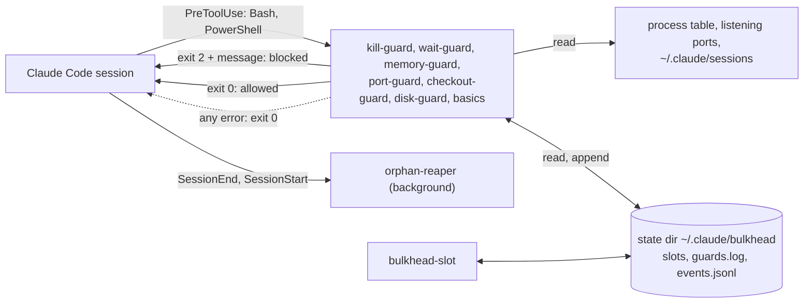

<h1 align="center">claude-bulkhead</h1>

<p align="center">
  <strong>Impede que o Claude Code rode <code>pkill node</code> nos seus outros servidores de desenvolvimento, tome as portas deles e faça commit das edições de outra sessão com <code>git add -A</code>.</strong>
</p>

<p align="center">Hooks que sabem quais processos, portas e árvores git pertencem a cada sessão e subagent do Claude Code, então bloqueiam só o que prejudicaria outra coisa e dizem ao Claude qual comando seguro rodar no lugar.</p>

<p align="center">Windows, macOS e Linux. Sem tmux, sem sudo, sem daemon em segundo plano, sem chamadas de rede, sem dependências. Também protege Codex, Gemini CLI, Copilot CLI, Cursor e mais seis agentes.</p>

<p align="center">
  <a href="https://www.npmjs.com/package/claude-bulkhead"></a>
  <a href="https://github.com/dooly6276/claude-bulkhead/actions/workflows/test.yml"></a>
  <a href="#instalação"></a>
  <a href="docs/other-agents.md"></a>
  <br>
  
  
  
  <a href="LICENSE"></a>
</p>

<p align="center">
  
</p>

<p align="center"><sub><a href="README.md">English</a> | <a href="README.ko.md">한국어</a> | <a href="README.zh-CN.md">简体中文</a> | <a href="README.ja.md">日本語</a> | <a href="README.es.md">Español</a></sub></p>

## Instalação

Dentro do Claude Code:

```
/plugin marketplace add dooly6276/claude-bulkhead
/plugin install bulkhead@bulkhead
```

Depois, veja o que ele teria bloqueado no seu último mês, sem mudar nada:

```
/bulkhead:scan 30d
```

Outros agentes carregam os mesmos guards como plugin:

| Agente | Instalação |
|---|---|
| Copilot CLI | `copilot plugin marketplace add dooly6276/claude-bulkhead` e depois `copilot plugin install bulkhead@bulkhead` |
| Cursor | `git clone https://github.com/dooly6276/claude-bulkhead ~/.cursor/plugins/local/bulkhead` e depois **Developer: Reload Window** |
| opencode | adicione `"plugin": ["claude-bulkhead"]` ao `opencode.json` |
| Gemini CLI | `gemini extensions install https://github.com/dooly6276/claude-bulkhead` |
| Codex | `codex plugin marketplace add dooly6276/claude-bulkhead`, depois `codex plugin add bulkhead@bulkhead` e aprove o hook com `/hooks` |

Para os outros (Windsurf, Droid, Devin, Cline, Amp), veja [Codex, Gemini e outros agentes](#codex-gemini-e-outros-agentes).

O Node 18 ou mais recente precisa estar no `PATH` (o instalador nativo do Claude Code não o instala; confira com `node --version`).

| Instalação | O que você recebe |
|---|---|
| O plugin (acima) | Os guards, que rodam em toda chamada de Bash, PowerShell, Read e Edit; os slash commands `/bulkhead:scan`, `status`, `log`, `doctor`, `reap`, `remote`; a skill que ensina ao Claude os hábitos seguros. Essa é a parte que protege você. |
| `npm install -g claude-bulkhead` (opcional) | O comando `bulkhead` no seu próprio terminal (`status`, `top`, `explain`, `allow`, `worktree`, `scan`, `doctor`), a status line, o `bulkhead-slot` e o `bulkhead setup <agent>` para Codex, Gemini e os outros. O `npx claude-bulkhead status` funciona sem instalar. |

Não tem certeza de que está funcionando? O `bulkhead doctor` roda um comando inofensivo por cada guard e mostra que ele foi bloqueado, e quanto tempo levou.

## O que ele bloqueia

| Sem o bulkhead | Com o bulkhead |
|---|---|
| Um agente reinicia o próprio dev server com `pkill node`, e o servidor de todos os outros worktrees morre junto. | O kill-guard bloqueia o comando e ensina o agente a achar e encerrar o próprio PID. |
| Duas sessões compartilham um checkout. Uma roda `git add -A && git commit`, e as edições pela metade da outra vão parar nesse commit. | O checkout-guard bloqueia e pede os nomes dos arquivos. |
| Dois worktrees rodam `npm run dev`. O segundo passa para a 3001, mas o agente dele continua testando `localhost:3000` e vê a outra branch. | O port-guard bloqueia a segunda inicialização e indica uma porta livre. |
| Três sessões iniciam `next build`, `npm test` e Playwright no mesmo minuto, e a máquina trava. | O memory-guard bloqueia comandos pesados quando a RAM está baixa. Pelo `bulkhead-slot`, o terceiro job espera na fila até haver espaço. |

<details>
<summary>Mais cinco</summary>

| Sem o bulkhead | Com o bulkhead |
|---|---|
| Uma sessão troca de branch em uma árvore que uma segunda sessão está editando. | O checkout-guard bloqueia e sugere `git worktree add`. |
| Uma sessão termina, e seus dev servers, test workers e watchers continuam rodando, ocupando RAM e portas. | O orphan-reaper os encerra segundos depois de a sessão terminar. |
| Um subagent fica fazendo polling em primeiro plano por dez minutos. A sessão não consegue responder a você, e o prompt cache expira. | O wait-guard bloqueia o loop e pede `run_in_background: true`. |
| Um agente quer saber o que está ocupando espaço em disco e roda dez `du` ao mesmo tempo na sua pasta pessoal. Os builds e o `git status` de todas as sessões se arrastam por minutos. | O disk-guard bloqueia e pede uma pasta por vez. |
| Uma tarefa de "limpar os worktrees" roda `git worktree remove` em um worktree onde uma segunda sessão ainda está trabalhando. | O checkout-guard bloqueia e informa qual sessão ainda está lá. |

</details>

Com uma única sessão, kill-guard, memory-guard, wait-guard, disk-guard e basics (sem `rm -rf ~`, sem force-push para `main`, sem `reset --hard` sobre trabalho não commitado) continuam valendo. port-guard e checkout-guard agem quando existe uma segunda sessão ou subagent ativo.

## O que é?

<p align="center">
  <picture>
    <source media="(prefers-color-scheme: light)" srcset="docs/hero-light.svg">
    
  </picture>
</p>

Hooks do Claude Code são programas pequenos que o Claude Code executa antes de cada comando de shell e que podem bloquear o comando e dizer ao Claude o motivo. O bulkhead é um conjunto deles. Antes de cada chamada ao Bash ou ao PowerShell, ele confere o comando com o que as outras sessões da máquina estão fazendo: quais processos e portas são de cada sessão, quanta RAM sobrou e em qual árvore git cada uma trabalha. Quando o comando prejudicaria outra sessão, ele é bloqueado, e o Claude recebe uma mensagem com o comando mais seguro para rodar. O Claude lê e segue em frente, em geral sem perguntar a você.

## Você precisa disso? Pergunte às suas transcrições

Você não precisa adivinhar. O Claude Code guarda a transcrição de cada sessão em `~/.claude/projects`, e o `bulkhead scan` reproduz os comandos de shell dessas transcrições contra os guards: quantas sessões você realmente roda ao mesmo tempo e com que frequência elas já fizeram o que o bulkhead bloqueia.

<p align="center">
  <picture>
    <source media="(prefers-color-scheme: light)" srcset="docs/scan-light.svg">
    
  </picture>
</p>

```
/plugin install bulkhead@bulkhead      # then, inside Claude Code:
/bulkhead:scan 30d
```

Ele só lê, mascara qualquer coisa que pareça um segredo antes de imprimir e não envia nada para lugar nenhum. O port-guard e a verificação de pouca RAM não são reproduzidos, porque as transcrições não registram quais portas e quanta RAM estavam em uso; o checkout-guard é reconstruído a partir de quais sessões estavam ativas na mesma árvore git naquele minuto. O `bulkhead scan --share` imprime um resumo de 5 a 8 linhas só com contagens (sem caminhos, sem comandos) que você pode colar em um post ou em um chat, e o `--explain 1` mostra um exemplo completo, com o trecho que casou. Detalhes: [docs/commands.md](docs/commands.md#bulkhead-scan).

## Por que isso existe

Uma forma comum de acelerar o trabalho com o Claude Code é rodar várias sessões no mesmo repositório, cada uma em seu próprio git worktree e com seus próprios subagents. O git mantém as branches separadas. A máquina não: todas as sessões compartilham as mesmas portas, a mesma tabela de processos e a mesma RAM. É aí que elas colidem.

- Dois worktrees do mesmo app rodam `npm run dev`. O segundo falha na porta 3000, ou passa discretamente para a 3001 enquanto o agente dele continua testando `localhost:3000` e vê a outra branch.
- Um agente reinicia o próprio servidor com `pkill node` ou `taskkill /IM node.exe` e derruba os dev servers e as execuções de teste de todos os outros worktrees, e às vezes a própria sessão.
- Três sessões iniciam `npm test`, `next build` e uma execução do Playwright no mesmo minuto, e a máquina para de responder.
- Uma sessão termina e os dev servers que ela iniciou continuam rodando.

O tracker do Claude Code tem muitos relatos exatamente disso:

- [#13941](https://github.com/anthropics/claude-code/issues/13941): ao receber o pedido de reiniciar um dev server, o Claude rodou `taskkill //IM node.exe` ou `pkill node` e matou a própria sessão.
- [#34754](https://github.com/anthropics/claude-code/issues/34754): `taskkill //F //IM python.exe` matou duas simulações de longa duração, depois de o usuário ter marcado os PIDs delas como proibidos.
- [#43225](https://github.com/anthropics/claude-code/issues/43225): ao receber o pedido de reiniciar um bot, o Claude matou à força todos os processos Python da máquina, cerca de 20 serviços.
- [#53229](https://github.com/anthropics/claude-code/issues/53229): instruído a encerrar apenas dev servers sem uso, um agente também matou um gateway e um processo do Postgres que não havia identificado.
- [#15487](https://github.com/anthropics/claude-code/issues/15487): 24 processos de subagent saturaram um VPS de 4 GB até ele precisar ser reiniciado; um comentarista travou um Mac de 24 GB do mesmo jeito.
- [#11502](https://github.com/anthropics/claude-code/issues/11502) e [#25180](https://github.com/anthropics/claude-code/issues/25180): processos iniciados por agentes sobrevivem a eles, 60 processos Node em um relato e 550 workers do pytest no outro.

O claude-bulkhead é um conjunto de hooks pequenos que bloqueiam ou limpam cada um desses casos. Cada um pode ser desativado individualmente. O nome vem do padrão bulkhead: um compartimento que está enchendo de água não deve afundar o navio.

## O que ele faz

| | |
|---|---|
| **[kill-guard](docs/guards/kill-guard.md)**<br>Bloqueia `pkill node`, `taskkill /IM`, `Stop-Process -Name` e outros kills por nome de programa. Kills por PID passam. | **[port-guard](docs/guards/port-guard.md)**<br>Bloqueia iniciar um dev server em uma porta que outra sessão já usa, e matar por porta o servidor dessa sessão. |
| **[memory-guard e bulkhead-slot](docs/guards/memory-guard.md)**<br>Bloqueia comandos pesados quando a RAM está baixa e enfileira jobs pesados contra um orçamento de RAM compartilhado por todas as sessões. | **[checkout-guard](docs/guards/checkout-guard.md)**<br>Bloqueia `git checkout`, `stash`, `reset --hard`, `git add -A` e similares quando outra sessão ativa trabalha na mesma árvore, e a exclusão de uma pasta onde outra sessão trabalha. |
| **[wait-guard](docs/guards/wait-guard.md)**<br>Bloqueia loops de sleep em primeiro plano com mais de 3 minutos, que fazem a próxima requisição reescrever todo o prompt cache. | **[orphan-reaper](docs/guards/orphan-reaper.md)**<br>Quando uma sessão termina, encerra os dev servers, test workers, watchers e navegadores headless que ela deixou rodando. Mantenha um de propósito com `BULKHEAD_KEEP=1`; túneis e bancos de dados já são mantidos. |
| **[disk-guard](docs/guards/disk-guard.md)**<br>Bloqueia `du -sh ~`, `find /` sem `-maxdepth` e varreduras de disco em paralelo, que travam o disco que todas as sessões compartilham. | **[`bulkhead scan`](#você-precisa-disso-pergunte-às-suas-transcrições)**<br>Reproduz suas transcrições passadas do Claude Code contra os guards: o que eles teriam bloqueado e quantas sessões rodaram ao mesmo tempo. |
| **[basics](docs/guards/basics.md)**<br>Bloqueia `rm -rf` na raiz, na home ou em uma pasta diretamente dentro dela, force-push na `main`, resets que perderiam trabalho não commitado e commits com Claude como autor. | **[`bulkhead status`, `top`, `log`, `doctor`](#veja-o-que-está-rodando)**<br>Mostra cada sessão, sua RAM, suas portas, os jobs na fila e o que os guards bloquearam. |
| **[edit-guard](docs/guards/edit-guard.md)** <sup>novo</sup><br>Avisa o agente quando outra sessão ativa editou o mesmo arquivo nos últimos 30 minutos, nesta árvore ou em outro worktree do repositório. Apenas consultivo por padrão, sem servidor. | **[secrets-guard](docs/guards/secrets-guard.md)** <sup>novo, desativado por padrão</sup><br>Bloqueia a leitura ou a impressão de `.env`, chaves privadas, credenciais de nuvem e de todo o ambiente, pela ferramenta Read ou por um comando de shell, enquanto `.env.example`, `ls ~/.ssh` e arquivos `.pub` passam. |
| **[`bulkhead explain` e `bulkhead allow`](#quando-ele-bloqueia-algo-que-você-queria)** <sup>novo</sup><br>Veja o que cada guard diria sobre um comando antes de ele rodar e libere uma única vez um comando bloqueado com o código da mensagem de bloqueio. O Claude não consegue aprovar os próprios bloqueios. | **[`bulkhead worktree`](#worktrees-em-um-passo)** <sup>novo</sup><br>Um worktree novo em um passo, com seus arquivos `.env` copiados, as dependências instaladas e uma porta estável própria; o `prune` remove os já mesclados, inclusive por squash merge, e nunca um em que uma sessão esteja trabalhando. |
| **[Auto-queue](docs/commands.md#auto-queue)** <sup>novo</sup><br>Com `memoryGuard.autoQueue`, os comandos pesados não são recusados, mas postos na fila: o hook os envolve no `bulkhead-slot`, e eles começam quando há espaço. | **[Codex, Gemini e outros agentes](#codex-gemini-e-outros-agentes)** <sup>novo</sup><br>Os mesmos guards para Codex, Gemini CLI, Copilot CLI, Cursor, Windsurf, Droid, Devin, Cline, opencode e Amp, configurados com `bulkhead setup <agent>`. |
| **[Status line](#status-line)**<br>`3 sessions  2 heavy  9.1 GB free` na status line do Claude Code, em cerca de 100 ms. | **[Configuração e slash commands](#configuração)**<br>Configuração por máquina e por projeto com listas de permissão, além de `/bulkhead:scan`, `/bulkhead:status`, `/bulkhead:log`, `/bulkhead:doctor` e `/bulkhead:reap`. |

Opcional: o **[`bulkhead remote`](#rode-tarefas-pesadas-em-outra-máquina-opcional)** roda uma suíte de testes, um build ou uma execução de navegador em outra máquina via SSH, quando esta não tem RAM sobrando.

## Mais demonstrações


Uma execução roteirizada de `bulkhead status`, port-guard, kill-guard e wait-guard, gravada com o [docs/demo.sh](docs/demo.sh). As duas sessões são processos de mentira chamados `claude`; tudo o que aparece vem dos scripts de hook e do `bulkhead status`. A gravação no topo desta página é uma sessão real do Claude Code; como ela foi feita está em [docs/demo.tape](docs/demo.tape).

## Início rápido

1. Instale o plugin como acima e inicie uma nova sessão do Claude Code.
2. Veja o que ele teria pegado: rode `/bulkhead:scan 30d`, ou `bulkhead scan` na ferramenta Bash. Ele lê o último mês de transcrições e não altera nada.
3. Verifique a instalação. Dentro do Claude Code, rode `/bulkhead:doctor`, ou rode `bulkhead doctor` na ferramenta Bash. Todas as linhas devem dizer `OK`. Uma linha `WARN` ou `FAIL` informa o guard e o motivo. A seção Enforcement no final prova que os hooks bloqueiam: ela executa o hook instalado com um comando de teste (canary) e confere o código de saída, a mensagem e a latência, e avisa sobre `disableAllHooks`, um plugin desativado ou a falta do `node`.
4. Abra um terminal ao lado das suas sessões e rode `npx claude-bulkhead top` (ou `bulkhead top` depois de `npm install -g claude-bulkhead`) para acompanhar ao vivo sessões, RAM, portas e jobs pesados. Pressione `q` para sair.

Depois disso não há mais nada a fazer. Os guards rodam em toda chamada de Bash e PowerShell. Para ver o que eles bloquearam, rode `bulkhead log` ou `/bulkhead:log`; `bulkhead log --summary` conta os bloqueios por guard na sua máquina. Para mudar um limite ou liberar um comando, veja [docs/configuration.md](docs/configuration.md). Todos os comandos estão listados em [docs/commands.md](docs/commands.md).

## Worktrees em um passo

Quando outra sessão trabalha na sua árvore, o checkout-guard manda o agente para um worktree. Um worktree comum não tem `.env`, não tem `node_modules` e usa a mesma porta de dev server do checkout principal. O `bulkhead worktree add` resolve esses três pontos:

```
$ bulkhead worktree add fix-login
created ~/dev/shop-fix-login on new branch fix-login from HEAD
copied .env (default set)
pnpm install --frozen-lockfile: done in 14.2s
wrote PORT=3800 to .env.local
next: cd ~/dev/shop-fix-login && claude
```

Ele copia os arquivos indicados no `.worktreeinclude` (o arquivo que o Claude Code também lê) ou um conjunto padrão e seguro de arquivos `.env`, nunca `node_modules`, saída de build nem nada acima de 5 MB; instala com o lockfile do projeto; e dá ao worktree uma porta que é sempre a mesma. O `bulkhead worktree list` mostra cada worktree com sua branch, estado, sessão ativa e porta. O `bulkhead worktree prune` lista os que já foram mesclados, estão limpos e sem uso, e os remove com `--yes` usando `git worktree remove` e `git branch -d`, nunca com `--force`, nunca a pasta de uma sessão ativa. Detalhes em [docs/commands.md](docs/commands.md#bulkhead-worktree).

## Rode tarefas pesadas em outra máquina (opcional)

Quando várias sessões rodam suítes de testes e builds ao mesmo tempo, uma máquina fica sem RAM: o memory-guard bloqueia os comandos, ou o bulkhead-slot os coloca na fila (automaticamente, com `memoryGuard.autoQueue`). Se você tem uma segunda máquina quase sempre ociosa, o `bulkhead remote` roda o comando pesado nela.

<p align="center">
  
</p>

```
bulkhead remote add buildbox dev@192.168.1.20 --ssh-option=IdentityFile=~/.ssh/buildbox
bulkhead remote run -- npm test
```

```
[bulkhead remote] buildbox: 3f2a1c9 already there, 3 changed files (24 KB), 1 deleted
[bulkhead remote] buildbox  copy a  /home/dev/bulkhead-remote/acme-web-3f9a1c  port 7172
...test output...
[bulkhead remote] exit 0 after 1m 12s (copy a)
```

- **O que é enviado.** O commit atual como um git bundle (somente os commits que o remoto ainda não tem) e suas alterações não commitadas, inclusive exclusões. Arquivos ignorados ficam aqui, a menos que você os indique com `--files`. Nada fora do repositório é enviado.
- **Onde roda.** Em uma de até 8 cópias do repositório no remoto, para que execuções paralelas não compartilhem uma árvore de trabalho. O `node_modules` é mantido entre execuções. Cada execução recebe a própria porta em `$BULKHEAD_PORT`.
- **Espaço.** Locks no remoto reservam uma cópia e um slot de job, e `--gb=N` espera até haver N GB livres lá. Se não houver espaço dentro de `--wait` minutos, sai com código 3.
- **Limpeza.** Quando o comando termina, ou a conexão SSH cai (Ctrl-C, timeout da ferramenta), tudo o que ele iniciou no remoto é encerrado, inclusive um servidor deixado em sua porta.
- **O remoto** precisa apenas de um servidor SSH, `bash`, `git` e `tar`. Linux, macOS e Windows com Git for Windows funcionam.

`bulkhead remote fetch PATH` traz de volta arquivos da cópia usada na última execução, e `bulkhead remote status` mostra a RAM livre e os jobs em execução de cada remoto. No Claude Code, `/bulkhead:remote <command>` roda um comando lá em segundo plano. Configuração, opções e códigos de saída: [docs/remote.md](docs/remote.md).

## Como funciona



Cada guard é um script Node separado, sem dependências. O Claude Code envia a chamada da ferramenta a ele como JSON. O guard lê o texto do comando e só olha mais a fundo quando o comando casa: a tabela de processos, as portas em escuta, os arquivos de sessão que o Claude Code mantém em `~/.claude/sessions`, a RAM livre ou o `git status`. Um bloqueio é o código de saída 2 com uma mensagem que diz ao Claude o que fazer no lugar. Qualquer erro dentro de um guard deixa a chamada passar, então um guard quebrado nunca interrompe o seu trabalho.

Todas as sessões da máquina compartilham um único diretório de estado. O bulkhead-slot guarda ali suas reservas de RAM, e cada bloqueio é registrado ali. Mais detalhes, incluindo a estrutura do diretório de estado e como as sessões são encontradas em cada sistema operacional, estão em [docs/architecture.md](docs/architecture.md).

## Guards

Cada guard tem uma página com os comandos exatos que ele bloqueia, o que passa, a mensagem que o Claude vê e seus limites. A versão resumida:

<details>
<summary><strong>kill-guard</strong>: kills por nome de programa</summary>

Bloqueia `taskkill /IM`, `taskkill /FI` sem PID, `Stop-Process -Name`, `Get-Process node | Stop-Process`, `pkill`, `killall`, `kill $(pgrep node)`, `wmic ... delete` e similares quando miram um programa que outras sessões compartilham, como `node`, `python`, `java`, `chrome`, `git` ou `vite`. Kills por PID e por caminho do projeto passam. Kills por porta também passam, a menos que outra sessão seja dona da porta; quem confere isso é o port-guard. O Claude recebe instruções de como achar os próprios PIDs.

Para desativar: `BULKHEAD_DISABLE=kill-guard`. Detalhes: [docs/guards/kill-guard.md](docs/guards/kill-guard.md).
</details>

<details>
<summary><strong>port-guard</strong>: portas de outra sessão</summary>

Bloqueia iniciar um dev server (`npm run dev`, `next dev`, `vite`, `uvicorn`, `rails s` e outros) em uma porta na qual a árvore de processos de outra sessão do Claude já está escutando, e sugere uma porta livre. Também bloqueia comandos de kill por porta, como `npx kill-port 3000`, `fuser -k 3000/tcp` e `lsof -ti :3000 | xargs kill`, quando outra sessão é dona dessa porta.

Para desativar: `BULKHEAD_DISABLE=port-guard`. Detalhes: [docs/guards/port-guard.md](docs/guards/port-guard.md).
</details>

<details>
<summary><strong>memory-guard e bulkhead-slot</strong>: RAM</summary>

O memory-guard bloqueia comandos pesados (test runners, `next build`, `tsc`, Gradle, o emulador Android, Playwright, `cargo test`, `docker build` e similares) quando a RAM livre está abaixo de 3 GB, ou abaixo de 15% da RAM em máquinas com menos de 20 GB. O `bulkhead-slot run --gb=4 -- <command>` espera até o orçamento de RAM compartilhado ter espaço, roda o comando e libera o slot quando ele termina.

Para desativar: `BULKHEAD_DISABLE=memory-guard`. Detalhes: [docs/guards/memory-guard.md](docs/guards/memory-guard.md).

Com `"memoryGuard": { "autoQueue": true }`, ninguém precisa se lembrar do slot: o memory-guard reescreve todo comando pesado (testes, builds, execuções de navegador, builds de contêiner) para rodar pelo `bulkhead-slot`, e assim todas as sessões esperam em uma única fila justa em vez de serem bloqueadas. Um job em espera imprime sua posição a cada 30 segundos, e o `bulkhead status` mostra a que sessão e a que projeto cada job da fila pertence. Com `"memoryGuard": { "subagents": true }`, um novo subagent não é iniciado enquanto a pressão de memória estiver crítica. Veja [docs/commands.md](docs/commands.md#auto-queue).
</details>

<details>
<summary><strong>checkout-guard</strong>: duas sessões na mesma árvore git</summary>

Bloqueia `git checkout <branch>`, `switch`, `stash`, `reset --hard`, `clean -f`, `rebase`, `merge`, `restore .` e um `pull` com alterações pendentes quando outra sessão ativa trabalha na mesma árvore, e sugere `git worktree add`. Também bloqueia ali `git add -A`, `git add .` e `git commit -a` (`stage-all`; `git add -A src/` e `git add -n` passam), que levariam as edições pela metade da outra sessão para o seu commit, e `rm -rf` ou `git worktree remove` em uma pasta onde outra sessão ativa trabalha (`remove-session-dir`). No Windows, bloqueia `git worktree remove --force` em um worktree que contém junctions, que o git já seguiu até o checkout principal.

Para desativar: `BULKHEAD_DISABLE=checkout-guard`, ou uma regra só com `BULKHEAD_DISABLE=stage-all` ou `remove-session-dir`. Detalhes: [docs/guards/checkout-guard.md](docs/guards/checkout-guard.md).
</details>

<details>
<summary><strong>disk-guard</strong>: varreduras do disco inteiro e em paralelo</summary>

Bloqueia `du`, `ncdu`, `dust`, `ls -R`, `Get-ChildItem -Recurse` e `dir /s` sobre o drive inteiro, a pasta pessoal ou a pasta pessoal de todos os usuários (`du -sh ~`, `du -sh ~/*`, `ncdu /`), `find /` e `find ~` sem `-maxdepth`, e varreduras de disco rodadas em paralelo, não importa para onde apontem: `xargs -P 10 du`, GNU `parallel`, `du ... &` em um loop, `ForEach-Object -Parallel`. Uma pasta por vez passa (`du -sh node_modules`, `du -sh ~/Library/Caches`).

Para desativar: `BULKHEAD_DISABLE=disk-guard`. Detalhes: [docs/guards/disk-guard.md](docs/guards/disk-guard.md).
</details>

<details>
<summary><strong>wait-guard</strong>: esperas longas em primeiro plano</summary>

Bloqueia um comando em primeiro plano cujos sleeps podem somar mais de 180 segundos. O prompt cache expira depois de cerca de cinco minutos sem requisição, então um subagent fazendo polling em primeiro plano reescreve todo o contexto a cada vez que acorda. O Claude recebe a instrução de rodar o loop com `run_in_background: true`. Sleeps em um job em segundo plano (`sleep 600 &`) passam. Com o timeout padrão de 120 segundos da ferramenta, uma espera não consegue passar do limite padrão, então o bloqueio só ocorre quando a chamada aumenta o timeout.

Para desativar: `BULKHEAD_DISABLE=wait-guard`, ou aumente o limite com `BULKHEAD_WAIT_MAX_SEC`. Detalhes: [docs/guards/wait-guard.md](docs/guards/wait-guard.md).
</details>

<details>
<summary><strong>orphan-reaper</strong>: processos deixados por sessões que terminaram</summary>

Quando uma sessão termina, um waiter oculto em segundo plano encerra o que ela iniciou nos shells das ferramentas e deixou rodando: dev servers e qualquer outra coisa escutando em uma porta, test runners e seus workers (Vitest, Jest, Playwright, pytest e xdist, `cargo test`, `go test` e outros), watchers como `tsc --watch` e nodemon, builds como `next build` e navegadores headless. Uma varredura no início da sessão pega o que um crash deixou para trás. Editores, terminais, daemons compartilhados como Gradle ou adb e qualquer coisa que você mesmo iniciou nunca são tocados. O `bulkhead reap --dry-run` mostra o que ele encerraria e por quê. O que você iniciou de propósito para continuar no ar é mantido com `BULKHEAD_KEEP=1 <command>` (túneis ssh, cloudflared, ngrok, Jupyter, Redis, Postgres, MySQL, MongoDB e Docker são mantidos sem isso), e a sessão seguinte informa em uma linha o que foi encerrado. Windows, Linux e macOS (macOS testado em um Mac de verdade).

Para desativar: `BULKHEAD_DISABLE=orphan-reaper`. Detalhes: [docs/guards/orphan-reaper.md](docs/guards/orphan-reaper.md).
</details>

<details>
<summary><strong>basics</strong>: cinco erros que não têm volta</summary>

`rm-root` (`rm -rf` na raiz, em uma pasta de nível superior como `/srv`, na home, em uma pasta diretamente dentro da home como `~/Documents`, ou acima do repositório), `force-push-main` (`git push --force` para `main` ou `master`; `--force-with-lease` passa), `protected-delete` (`git push origin :main`, `git push --delete origin main`, `git branch -D main`), `discard-changes` (`git reset --hard` ou `git clean -fd` que perderiam trabalho não commitado) e `agent-author` (`--author="Claude <noreply@anthropic.com>"`, `git config user.name Claude` e similares, para que seus commits continuem contando como seus).

Para desativar: `BULKHEAD_DISABLE=basics`, ou uma regra pelo nome. Detalhes: [docs/guards/basics.md](docs/guards/basics.md).
</details>

## Codex, Gemini e outros agentes

Se você roda Codex CLI, Gemini CLI, Copilot CLI, Cursor, opencode, Amp, Cline, Factory Droid, Windsurf ou Devin na mesma máquina que o Claude Code, o bulkhead protege os comandos de shell deles com os mesmos guards e conta as sessões deles: o dev server de um agente fica protegido dos demais, e o `bulkhead status` ganha uma coluna `AGENT`.

```
bulkhead setup codex            # prints the config for ~/.codex/hooks.json
bulkhead setup codex --write    # merges it (original saved as hooks.json.bulkhead-backup)
```

Copilot CLI, Cursor e opencode também podem carregar o bulkhead como plugin (veja [Instalação](#instalação)), sem `npm install -g` e sem mexer nos seus próprios arquivos de configuração. O `bulkhead setup <agent>` funciona para `codex`, `gemini`, `copilot`, `cursor`, `windsurf`, `droid`, `devin`, `cline`, `opencode` e `amp`. Cada agente chama `bulkhead hook --agent <name>` antes de um comando de shell e recebe de volta o bloqueio no seu próprio formato. Os agentes, os arquivos de configuração, o que é protegido e a documentação com a qual cada linha foi conferida estão em [docs/other-agents.md](docs/other-agents.md).

## Como o bulkhead se relaciona com outros pacotes de hooks

Pacotes gerais de segurança protegem uma sessão de comandos perigosos. Por exemplo, o [claude-forge](https://github.com/sangrokjung/claude-forge) inclui hooks que filtram segredos vazados na saída, bloqueiam scripts remotos passados por pipe e impedem SQL destrutivo, e o [dcg](https://github.com/Dicklesworthstone/destructive_command_guard) e o [cc-safety-net](https://github.com/kenryu42/claude-code-safety-net) cobrem de forma ampla comandos destrutivos de shell e git. Vale a pena usá-los.

O bulkhead cobre um problema diferente: sessões na mesma máquina atrapalhando umas às outras por posse de processos, portas, RAM compartilhada e uma árvore git compartilhada. Só as regras do `basics` se sobrepõem a esses pacotes, e você pode desativá-las com `BULKHEAD_DISABLE=basics` se outro pacote já as cobrir. O bulkhead roda junto com outros hooks: o Claude Code executa todos os hooks que casam com uma chamada de ferramenta, e a chamada é bloqueada se qualquer um deles a bloquear.

## Configuração

Os padrões não exigem nenhuma configuração. Para alterá-los, use um arquivo de configuração: `~/.claude/bulkhead/config.json` para a máquina e `<repo>/.claude/bulkhead.json` para um projeto (encontrado subindo até a pasta com `.git`).

Um arquivo de projeto vem com o repositório, inclusive um que você clonar, então ele só pode deixar o bulkhead mais rígido: adicionar nomes à lista de bloqueio do kill-guard, proteger mais branches, reduzir o limite de espera, aumentar o mínimo de RAM, ligar um guard. Tudo que afrouxa um guard, como `killGuard.allowNames`, `portGuard.ignorePorts`, uma espera maior ou `"enabled": false`, é lido apenas do arquivo global; em um arquivo de projeto é ignorado, com um aviso que o `bulkhead config` e o aviso de inicialização da sessão mostram. Hosts remotos, opções de ssh e o comando de notificação também são somente globais.

Por exemplo, uma máquina em que você roda `ffmpeg` de propósito e tem uma suíte de integração lenta, em `~/.claude/bulkhead/config.json`:

```json
{
  "killGuard": { "allowNames": ["ffmpeg"] },
  "waitGuard": { "limitSeconds": 300 },
  "portGuard": { "ignorePorts": [9229] }
}
```

E um projeto que faz deploy a partir de `release`, no seu `.claude/bulkhead.json`:

```json
{
  "basics": { "protectedBranches": ["release"] },
  "secretsGuard": { "enabled": true }
}
```

Todo guard pode ser desativado com `"<guard>": { "enabled": false }` no arquivo global. O `bulkhead config` imprime cada configuração, seu valor e de onde ele veio. Um arquivo quebrado é ignorado, os guards mantêm seus padrões e a sessão mostra um aviso na inicialização. Todas as chaves estão em [docs/configuration.md](docs/configuration.md), e o [config.example.json](config.example.json) define cada uma delas.

As variáveis de ambiente continuam funcionando e vencem os dois arquivos. O lugar mais simples para colocá-las é o bloco `env` do `~/.claude/settings.json`.

<details>
<summary>Todas as variáveis de ambiente</summary>

| Variável | Padrão | Equivale a |
|---|---|---|
| `BULKHEAD_DISABLE` | vazio | Guards a desativar, separados por vírgula: `kill-guard`, `wait-guard`, `memory-guard`, `port-guard`, `checkout-guard`, `disk-guard`, `orphan-reaper`, `basics`, ou `all`. Regras individuais também podem ser desativadas: `rm-root`, `force-push-main`, `protected-delete`, `discard-changes`, `agent-author`, `stage-all`, `remove-session-dir`. Um nome aqui fica desativado, diga o que disser os arquivos |
| `BULKHEAD_PRESET` | `normal` | O preset: `quiet`, `normal` ou `strict` |
| `BULKHEAD_WAIT_MAX_SEC` | 180 | `waitGuard.limitSeconds` |
| `BULKHEAD_MIN_FREE_GB` | 3, ou 15% da RAM se for menos | `memory.minFreeGb` |
| `BULKHEAD_SLOT_FLOOR_GB` | 5, ou 25% da RAM se for menos | `memory.slotFloorGb` |
| `BULKHEAD_MAX_COMMIT_PCT` | 75 | `memory.maxCommitPct` (somente Windows) |
| `BULKHEAD_NO_LOG` | vazio | `log.enabled: false` quando definida como `1` |
| `BULKHEAD_STATE_DIR` | `~/.claude/bulkhead` | Onde ficam os slots, o log de eventos, o `guards.log` e o arquivo de configuração global |
| `BULKHEAD_SSH` | `ssh` no `PATH` | O cliente ssh que o `bulkhead remote` executa |

</details>

## Quando ele bloqueia algo que você queria

Um bloqueio é uma pergunta, não um veredito. Há três saídas, da menor para a maior:

1. Libere uma única vez. Toda mensagem de bloqueio termina com um código curto. No seu próprio terminal, rode `bulkhead allow 7F3K`. A próxima chamada idêntica do agente (mesmo comando, mesma pasta) passa, uma vez, em até 10 minutos. O agente não consegue fazer isso por você: o bulkhead bloqueia qualquer tentativa de rodar `bulkhead allow` ou de gravar nos arquivos de estado dele.
2. Veja o motivo primeiro. O `bulkhead explain -- <command>` passa o comando por todos os guards, contra as sessões, portas e árvore git ativas, sem executá-lo, e imprime quem é dono do que está no caminho, a mensagem exata que o agente vê e como liberá-lo.
3. Libere de vez, ou mude o quanto ele bloqueia. Coloque a regra no `.claude/bulkhead.json` (a tabela abaixo) ou escolha um preset: `bulkhead config --preset quiet` mantém só os guards entre sessões e as duas regras que não têm volta, `strict` liga tudo com limites mais apertados, e `normal` é o padrão. Suas próprias chaves e variáveis de ambiente vencem um preset.

### Bloqueou algo que você queria? Guia rápido

A forma de liberar uma única vez é sempre `bulkhead allow <code>`, rodado por você. A forma permanente, para a regra que disparou:

| Guard | Regra | Permanente, em `.claude/bulkhead.json` |
|---|---|---|
| kill-guard | `pkill`, `taskkill-im`, `stop-process-name` e os outros kills por nome | `{"killGuard":{"allowNames":["ffmpeg"]}}` |
| kill-guard | `other-session-pid`: um PID da árvore de outra sessão | `{"killGuard":{"ownerCheck":false}}` |
| kill-guard | `broad-pattern`: um padrão de `pkill -f` que alcança um app de desktop ou muitos processos | `{"killGuard":{"broadPattern":false}}` |
| kill-guard | `mass-kill`, `docker-mass`, `device-kill`, `app-quit`, `service-stop`: as outras regras (só enquanto outra sessão roda) | `{"killGuard":{"massKill":false}}`, e assim por diante (`dockerMass`, `deviceKill`, `appQuit`, `serviceStop`) |
| wait-guard | `long-sleep`, `poll-loop`, `follow` | `{"waitGuard":{"limitSeconds":600}}` |
| memory-guard | `low-memory` | `{"memory":{"minFreeGb":1}}` |
| memory-guard | `slot-files` | `{"memoryGuard":{"enabled":false}}` |
| port-guard | `port-in-use`, `kill-by-port` | `{"portGuard":{"ignorePorts":[3000]}}` |
| checkout-guard | `stage-all` | `{"checkoutGuard":{"stageAll":false}}` |
| checkout-guard | `remove-session-dir` | `{"checkoutGuard":{"removeSessionDir":false}}` |
| checkout-guard | `git-checkout`, `git-pull` e as outras mudanças na árvore | `{"checkoutGuard":{"enabled":false}}` |
| disk-guard | `disk-wide-find`, `parallel-disk-scan`, `disk-wide-scan` | `{"diskGuard":{"enabled":false}}` |
| basics | `rm-root` | `{"basics":{"rmRoot":false}}` |
| basics | `force-push-main` | `{"basics":{"forcePushMain":false}}` |
| basics | `discard-changes` | `{"basics":{"discardChanges":false}}` |
| basics | `agent-author` | `{"basics":{"agentAuthor":false}}` |
| basics | `self-allow` | não pode ser liberada uma única vez; só você pode aprovar |

O mesmo interruptor como variável de ambiente é `BULKHEAD_DISABLE=<nome do guard ou da regra>`. Tudo está em [docs/configuration.md](docs/configuration.md) e [docs/commands.md](docs/commands.md).

## Veja o que está rodando

O `bulkhead` está no `PATH` da ferramenta Bash, ao lado do `bulkhead-slot`. Dentro do Claude Code, `/bulkhead:scan [30d]`, `/bulkhead:status`, `/bulkhead:log [24h|7d]`, `/bulkhead:doctor` e `/bulkhead:reap` rodam o comando correspondente e resumem o resultado. No seu próprio terminal, rode `npx claude-bulkhead top`, ou instale uma vez com `npm install -g claude-bulkhead` e rode `bulkhead top`. O pacote npm é o mesmo código do plugin. Todo comando que imprime uma tabela aceita `--json`. A referência completa está em [docs/commands.md](docs/commands.md).

### bulkhead status

Todas as sessões do Claude Code na máquina: o que cada uma está fazendo (trabalhando, esperando você, precisando de permissão), sua branch git e se ela é um worktree, a memória que a árvore de processos usa, o que ela mantém escutando em uma porta, os jobs retidos no bulkhead-slot e os que estão esperando, a RAM livre e os servidores MCP que rodam em várias cópias entre as sessões:

```
$ bulkhead status
SESSION  STATE                STARTED  RSS     BRANCH              PROJECT
18672    working              09:52    1.4 GB  main                ~/src/acme-web
  :3000  node  pid 24632
21888    needs permission 4m  10:05    353 MB  feat/login (wt)     ~/src/acme-web-auth
26448    waiting 3m           11:40    625 MB  feat/checkout (wt)  ~/src/acme-web-checkout
  :3001  node  pid 31020
duplicate MCP: 3 copies of @playwright/mcp, 1.2 GB (sessions 18672, 21888, 26448)

SLOT    GB  PID    AGE    SESSION  PROJECT          COMMAND
slot-1  4   30112  6 min  18672    ~/src/acme-web   npx playwright test

WAITING  GB  PID    FOR    SESSION  PROJECT                 COMMAND
#1       3   30200  2 min  26448    ~/src/acme-web-checkout npm run build

9.9 GB free of 31.8 GB, commit 68%
```

O `bulkhead top` coloca primeiro as sessões que precisam de você. O `bulkhead port --stable` imprime uma porta que pertence ao worktree git atual e é sempre a mesma. Para receber uma notificação de desktop quando uma sessão começar a esperar, defina `notify.command` ([commands.md](docs/commands.md#session-state-and-notifications)).

`bulkhead slot ...` é o mesmo que `bulkhead-slot ...`.

### bulkhead top

A mesma visão, ao vivo e em tela cheia. Ela atualiza a cada 2 segundos no Linux e no macOS e a cada 4 segundos no Windows, onde uma varredura de processos leva de 1 a 2 segundos. A varredura roda em uma worker thread, então as teclas nunca esperam por ela. `q`, `Esc` ou `Ctrl-C` saem, `r` atualiza.

```
bulkhead top  14:30:05                                         scan 1.4s  every 4s  q quit  r refresh
RAM ████████████████░░░░░░░░░░░░░░  9.9 GB free of 31.8 GB  commit 68%

SESSIONS 3
PID      STARTED       PROJECT                         RSS              PROCS  PORTS
18672    Oct 12 17:49  ~/src/acme-web               1.4 GB  ██████████     12  :3000 :24678
21888    Oct 12 17:52  ~/src/acme-web-auth          353 MB  ███░░░░░░░      3  -
26448    03:43         ~/src/acme-web-checkout      625 MB  ████░░░░░░      5  :3001

HEAVY JOBS  1 running, 1 waiting
slot-1  4 GB   30112   6 min   npx playwright test
wait #1 3 GB   30200   2 min   npm run build  (this machine has 16 GB; one heavy job at a time)

RECENT BLOCKS
14:29  kill-guard     taskkill-im    ~/src/acme-web-auth      taskkill /F /IM node.exe
14:12  wait-guard     poll-loop      ~/src/acme-web-checkout  until [ -f out/DONE ]; do sleep 30; done
```

Em um terminal estreito, ele remove colunas em vez de quebrar linhas. Quando a saída não é um terminal, ou com `--once`, ele imprime um único retrato do momento e sai.

### bulkhead log

Cada bloqueio, e cada processo que o orphan-reaper encerra, é uma linha JSON em `<state dir>/events.jsonl` com horário, guard, regra, sessão, projeto e o comando cortado em 200 caracteres. O arquivo fica na sua máquina, é rotacionado em 1 MB e mantém um arquivo antigo. `BULKHEAD_NO_LOG=1` desativa o log.

```
$ bulkhead log --summary --since 7d
10 blocks in the last 7 days, 3 projects, 4 sessions

GUARD         RULE             COUNT  LAST
wait-guard    poll-loop            3  06:40  ████████████████████████
wait-guard    long-sleep           2  06:40  ████████████████
basics        force-push-main      1  06:40  ████████
basics        rm-root              1  06:40  ████████
kill-guard    pkill                1  06:40  ████████
kill-guard    taskkill-im          1  06:40  ████████
memory-guard  slot-files           1  06:40  ████████

PROJECT                  COUNT
~/src/acme-web               4
~/src/acme-web-auth          3
~/src/acme-web-checkout      3
```

`bulkhead log -n 20` lista os próprios eventos, `--since 30m|24h|7d|2w|<date>` limita o período e `--guard kill-guard` limita o guard.

### bulkhead doctor

Verifica o Node, os arquivos do plugin, o diretório de estado, os arquivos de configuração, cada guard (ativo ou desativado, e por quê), o leitor de processos com seu tempo, os arquivos de sessão, os limites de RAM calculados para esta máquina, os slots retidos, o log de eventos e o git. Depois, uma seção Enforcement prova que os hooks instalados bloqueiam: a instalação e o `enabledPlugins`, instalações duplicadas, configurações que desligam hooks, o `node` no `PATH` dos hooks e uma execução real do comando de hook de cada guard contra um comando de teste (canary), com sua latência. O código de saída é 1 quando qualquer verificação falha.

```
$ bulkhead doctor
OK    node             v24.22.1
OK    package          this copy ~/.claude/plugins/cache/bulkhead/bulkhead/0.3.0, hooks: 3 SessionStart, 2 SessionEnd, 1 UserPromptSubmit, 1 Stop, 1 Notification, 2 PostToolUse, 1 PostToolUseFailure, 4 PreToolUse
OK    state dir        ~/.claude/bulkhead is writable
OK    config           no config files, defaults in use
OK    preset           normal (default)
OK    kill-guard       on
OK    wait-guard       on, limit 180s
OK    memory-guard     on
OK    port-guard       on
OK    checkout-guard   on
OK    disk-guard       on
OK    basics           on, protected branches: main, master
OK    edit-guard       on
OK    secrets-guard    off (default)
OK    orphan-reaper    on, at session start and after each session ends
OK    session-state    on
OK    processes        589 processes, 11 listening ports, 10 Claude sessions (10 with a session file) in 0.2s
OK    sessions         ~/.claude/sessions (10 session files; a running session without one is still found from the process list, but checkout-guard cannot tell which folder it works in)
OK    memory           28.3 of 48.0 GB free, memory-guard blocks heavy commands below 3 GB, bulkhead-slot keeps 5 GB free for a second job
OK    slots            none held
OK    event log        ~/.claude/bulkhead/events.jsonl, 2 events, 254 B (rotates at 1 MB)
OK    git              2.56.0

Enforcement
OK    install          bulkhead@bulkhead 0.3.0 at ~/.claude/plugins/cache/bulkhead/bulkhead/0.3.0, enabled in user settings
OK    hooks on         no disableAllHooks or allowManagedHooksOnly in user, project, local or managed settings
OK    hooks.json       installed copy: 4 PreToolUse hooks, all synchronous
OK    hook node        /opt/homebrew/bin/node v24.22.1
OK    hook kill-guard  blocked "pkill node" (exit 2, message shown to Claude) in 71 ms
OK    hook wait-guard  blocked "sleep 100000" (exit 2, message shown to Claude) in 64 ms
OK    hook disk-guard  blocked "du -sh /" (exit 2, message shown to Claude) in 70 ms
OK    hook basics      blocked "rm -rf /" (exit 2, message shown to Claude) in 63 ms

30 OK, 0 WARN, 0 FAIL
```

### bulkhead port

Imprime uma porta em que nada está escutando, verificada em IPv4 e IPv6, para que um segundo worktree possa iniciar seu servidor sem adivinhar:

```
npm run dev -- --port $(bulkhead port --near 3000)
```

### bulkhead reap

Roda o orphan-reaper agora. `--dry-run` lista o que ele encerraria, a regra que casou e por que a sessão conta como encerrada, sem encerrar nada:

```
$ bulkhead reap --dry-run
would stop 30112  test-runner  node ~/src/acme-web/node_modules/vitest/dist/workers/forks.js
  Vitest and its worker pool (tinypool); its session has exited and removed snapshot-bash-1791860359256-ezwkie.sh; 6 processes from 30080
1 tree would be stopped. Run `bulkhead reap` to stop it.
```

### Status line

O `bulkhead-statusline` imprime uma linha para a status line do Claude Code:

```
3 sessions  2 heavy  9.1 GB free
```

Sessions são as entradas ativas em `~/.claude/sessions`, heavy é o número de jobs que seguram um bulkhead-slot, e free é a mesma medida que o memory-guard usa. Quando há sessões esperando por você, a linha acrescenta `2 waiting` depois da contagem de sessões. Ele não lista todos os processos (um único `ps` só para os PIDs das sessões), leva cerca de 100 ms a frio em um Mac com 650 processos e mantém a linha em cache por 5 segundos no diretório de estado, gravada por um arquivo temporário para que sessões concorrentes nunca leiam metade dela.

Um plugin não consegue definir a status line principal (as configurações de plugin só aceitam `agent` e `subagentStatusLine`), então adicione-a você mesmo ao `~/.claude/settings.json`:

```json
{
  "statusLine": {
    "type": "command",
    "command": "bulkhead-statusline",
    "refreshInterval": 10
  }
}
```

Isso exige `npm install -g claude-bulkhead`, que coloca o `bulkhead-statusline` no `PATH`. Se você já tem um script de status line, chame o `bulkhead-statusline` a partir dele e acrescente a saída.

## FAQ

**Ele deixa o Claude Code mais lento?**
Um pouco. Todos os guards do Bash rodam em um único processo Node curto e sem dependências, cerca de 76 ms por chamada de ferramenta em um MacBook Pro (Node 24), dos quais 32 ms são só para iniciar o Node. Quando 10 sessões fazem uma chamada de ferramenta no mesmo instante, cada uma espera cerca de 89 ms (318 ms quando cada guard era um processo separado, como na 0.2). Gravar um bloqueio no log de eventos não acrescenta tempo mensurável. Os guards só fazem trabalho lento, como ler a lista de processos (um ou dois segundos no Windows), quando o comando casa: a inicialização de um dev server em uma porta que já responde, um kill, um comando pesado. A status line leva cerca de 100 ms a frio e fica em cache por 5 segundos.

**Ele bloqueou algo que não devia. O que eu faço?**
Rode `bulkhead log` para ver o comando exato e o motivo. Libere-o uma vez com `bulkhead allow <code>`, o código da mensagem de bloqueio. Para liberar de forma permanente, defina na configuração global, `~/.claude/bulkhead/config.json`: `killGuard.allowNames` para um nome de programa, `portGuard.ignorePorts` para uma porta compartilhada, `waitGuard.limitSeconds` para uma espera mais longa, ou `"enabled": false` para o guard inteiro. O `.claude/bulkhead.json` de um projeto não pode afrouxar um guard. Veja [docs/configuration.md](docs/configuration.md). Depois, por favor, abra uma [issue de falso positivo](https://github.com/dooly6276/claude-bulkhead/issues/new?template=false-positive.yml) com a linha do `bulkhead log`, para que o padrão seja corrigido para todo mundo.

**Ele é útil com uma única sessão?**
Sim. O kill-guard, o wait-guard, o memory-guard e o basics protegem uma única sessão e seus subagents da mesma forma. O port-guard e o checkout-guard só agem quando há outra sessão ativa, e o orphan-reaper limpa o que ficou de sessões que já terminaram.

**Quais sistemas ele suporta?**
Windows, Linux e macOS, com Node 18 ou mais recente. O orphan-reaper no macOS é testado com fixtures da saída do `ps` e em um Mac de verdade (uma sessão de mentira foi encerrada e só o que ela deixou foi parado), e no Linux ele precisa de uma versão do Claude Code que defina `CLAUDE_PID` nos shells das ferramentas. No Windows, o `bulkhead-slot` roda comandos pelo Git Bash quando ele está instalado e pelo `cmd.exe` caso contrário.

**Ele envia algo para algum lugar?**
Não. Não há telemetria nem chamadas de rede. O único socket que ele abre é a tentativa de conexão do port-guard a `localhost` para ver se uma porta responde. Os logs ficam no diretório de estado. A única exceção é o `bulkhead remote`, que se conecta por SSH a uma máquina que você configurou, e somente quando você o executa.

Mais perguntas, incluindo como os guards podem ser contornados e como os números de RAM são medidos, estão em [docs/faq.md](docs/faq.md).

## Limitações

- Os guards leem o texto do comando. Eles o dividem em comandos e abrem wrappers como `bash -c`, `cmd /c`, `powershell -EncodedCommand` e `sudo` até três níveis de profundidade, mas um kill ou um sleep escondido em um arquivo de script, em uma função de shell ou em um alias não é visto. Eles pegam os formatos comuns, não um contorno deliberado.
- O memory-guard e o bulkhead-slot só enxergam a RAM. Eles não limitam CPU, disco nem GPU.
- O bulkhead-slot só é usado quando é chamado. Nada obriga todas as sessões a passarem por sua fila.
- A página de cada guard lista seus próprios limites.

## Desinstalação

```
/plugin uninstall bulkhead@bulkhead
/plugin marketplace remove bulkhead
```

Se você instalou o pacote npm, rode `npm uninstall -g claude-bulkhead`. Um waiter de SessionEnd que já esteja rodando termina sozinho em até 3 minutos, então nada continua rodando depois da desinstalação.

Depois, apague o diretório de estado (`~/.claude/bulkhead`, ou `BULKHEAD_STATE_DIR` se você o definiu) e remova a entrada `statusLine` do `~/.claude/settings.json`, caso a tenha adicionado.

## Usa o bulkhead? Mostre

Adicione este badge ao README do seu projeto:

```markdown
[](https://github.com/dooly6276/claude-bulkhead)
```

Ele aparece assim: [](https://github.com/dooly6276/claude-bulkhead)

## Contribuindo

Veja o [CONTRIBUTING.md](CONTRIBUTING.md). Relatos de segurança: [SECURITY.md](SECURITY.md). O changelog está no [CHANGELOG.md](CHANGELOG.md), e o que o bulkhead armazena e envia está no [PRIVACY.md](PRIVACY.md).

## Licença

[MIT](LICENSE)
