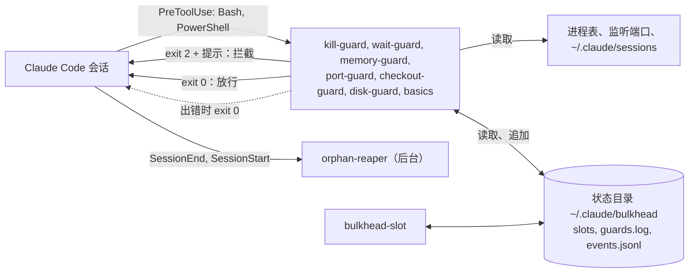

<h1 align="center">claude-bulkhead</h1>

<p align="center">
  <strong>阻止 Claude Code 在 <code>$DIR</code> 为空时执行 <code>rm -rf $DIR/</code>、对你其他的开发服务器执行 <code>pkill node</code>、抢占它们的端口，以及用 <code>git add -A</code> 提交另一个会话的修改。</strong>
</p>

<p align="center">这组 hook 清楚哪些进程、端口和 git 工作树属于哪个 Claude Code 会话和子代理，只拦截会伤到其他东西的命令，并告诉 Claude 应该改用哪条安全的命令。</p>

<p align="center">支持 Windows、macOS 和 Linux。不需要 tmux，不需要 sudo，没有常驻后台进程，不发起网络请求，零依赖。也能保护 Codex、Gemini CLI、Copilot CLI、Cursor 等另外六种代理。</p>

<p align="center">
  <a href="https://www.npmjs.com/package/claude-bulkhead"></a>
  <a href="https://github.com/dooly6276/claude-bulkhead/actions/workflows/test.yml"></a>
  <a href="#安装"></a>
  <a href="docs/other-agents.md"></a>
  <br>
  
  
  
  <a href="LICENSE"></a>
</p>

<p align="center">
  
</p>

<p align="center"><sub><a href="README.md">English</a> | <a href="README.ko.md">한국어</a> | <a href="README.ja.md">日本語</a> | <a href="README.es.md">Español</a> | <a href="README.pt-BR.md">Português (Brasil)</a></sub></p>

## 安装

先不安装任何东西，看看它在你自己的会话里会拦下什么：

```
npx -y claude-bulkhead scan --since 30d --share
```

它只读取 `~/.claude/projects` 里的记录，不会发送任何内容。

然后在 Claude Code 中安装插件：

```
/plugin marketplace add dooly6276/claude-bulkhead
/plugin install bulkhead@bulkhead
```

安装后，在 Claude Code 中也能看到同样的报告：

```
/bulkhead:scan 30d
```

其他代理可以把同样的防护作为插件加载：

| 代理 | 安装 |
|---|---|
| Copilot CLI | `copilot plugin marketplace add dooly6276/claude-bulkhead`，然后 `copilot plugin install bulkhead@bulkhead` |
| Cursor | `git clone https://github.com/dooly6276/claude-bulkhead ~/.cursor/plugins/local/bulkhead`，然后执行 **Developer: Reload Window** |
| opencode | 在 `opencode.json` 中加入 `"plugin": ["claude-bulkhead"]` |
| Gemini CLI | `gemini extensions install https://github.com/dooly6276/claude-bulkhead` |
| Codex | `codex plugin marketplace add dooly6276/claude-bulkhead`，然后 `codex plugin add bulkhead@bulkhead`，最后用 `/hooks` 批准钩子 |

其他代理（Windsurf、Droid、Devin、Cline、Amp）见 [Codex、Gemini 和其他代理](#codexgemini-和其他代理)。

`PATH` 里需要有 Node 18 或更高版本（Claude Code 的原生安装程序不会装 Node，请用 `node --version` 确认）。

| 安装方式 | 你会得到什么 |
|---|---|
| 插件（见上） | 对每一次 Bash、PowerShell、Read 和 Edit 调用生效的 guard；斜杠命令 `/bulkhead:scan`、`status`、`log`、`doctor`、`reap`、`remote`；教 Claude 养成安全习惯的 skill。真正保护你的是这一部分。 |
| `npm install -g claude-bulkhead`（可选） | 在你自己的终端里使用 `bulkhead` 命令（`status`、`top`、`explain`、`allow`、`worktree`、`scan`、`doctor`）、状态栏、`bulkhead-slot`，以及为 Codex、Gemini 等代理配置的 `bulkhead setup <agent>`。也可以不安装，直接用 `npx claude-bulkhead status`。 |

不确定它有没有在工作？`bulkhead doctor` 会让一条无害的命令经过每个 guard，显示它是否被拦下，以及耗时多少。

## 它拦截什么

| 没有 bulkhead | 有 bulkhead |
|---|---|
| 代理用 `pkill node` 重启自己的开发服务器，其他 worktree 的服务器也一起挂掉。 | kill-guard 拦下这条命令，并告诉代理如何找到并只结束自己的 PID。 |
| 两个会话共用一个检出目录。其中一个运行 `git add -A && git commit`，另一个会话写到一半的改动就进了这次提交。 | checkout-guard 拦下它，并要求写出具体文件名。 |
| 两个 worktree 都执行 `npm run dev`。第二个换到了 3001，但它的代理还在测 `localhost:3000`，看到的是另一个分支。 | port-guard 拦下第二次启动并给出空闲端口。 |
| 三个会话在同一分钟里启动 `next build`、`npm test` 和 Playwright，机器卡死。 | 内存不足时 memory-guard 拦截重命令。通过 `bulkhead-slot`，第三个任务会排队，等有空间再运行。 |

<details>
<summary>再看 6 条</summary>

| 没有 bulkhead | 有 bulkhead |
|---|---|
| 一个会话在另一个会话正在编辑的工作树里 checkout 了别的分支。 | checkout-guard 拦下它，并建议使用 `git worktree add`。 |
| 会话结束了，它的开发服务器、测试 worker 和监视进程还在跑，占着内存和端口。 | 会话退出后几秒内，orphan-reaper 就会停掉它们。 |
| 子代理在前台轮询了十分钟。这期间会话无法回应你，提示缓存也过期了。 | wait-guard 拦下这个循环，让它改用 `run_in_background: true`。 |
| 代理想知道什么占了磁盘空间，在你的家目录上同时运行十个 `du`。所有会话的构建和 `git status` 都慢上好几分钟。 | disk-guard 拦下它，并要求一次只看一个文件夹。 |
| 一个“清理 worktree”的任务对另一个会话还在使用的 worktree 运行 `git worktree remove`。 | checkout-guard 拦下它，并指出仍在里面的会话。 |
| 清理任务在 `BUILD_DIR` 未设置时运行 `rm -rf "$BUILD_DIR"/*`，实际变成 `rm -rf /*`；或者运行 `rm -rf .git`，仓库历史就没了。 | basics 拦下它，并给出安全写法 `rm -rf "${BUILD_DIR:?}"/*`。 |

</details>

只有一个会话时，kill-guard、memory-guard、wait-guard、disk-guard 和 basics（禁止 `rm -rf ~`、禁止在 `D` 为空时会变成 `rm -rf /` 的 `rm -rf $D/`、禁止 `rm -rf .git`、禁止强制推送到 `main`、禁止在有未提交修改时 `reset --hard`）仍然生效。port-guard 和 checkout-guard 在出现第二个会话或子代理后才起作用。

## 这是什么

<p align="center">
  <picture>
    <source media="(prefers-color-scheme: light)" srcset="docs/hero-light.svg">
    
  </picture>
</p>

Claude Code 的 hook 是 Claude Code 在每次执行 shell 命令之前运行的小程序，可以拦下命令并告诉 Claude 原因。bulkhead 就是一组这样的 hook。每次调用 Bash 或 PowerShell 之前，它会把命令和这台机器上其他会话正在做的事对照：哪些进程和端口属于哪个会话、还剩多少内存、每个会话在哪棵 git 工作树里工作。如果命令会伤到其他会话，就拦下它，并给 Claude 一条更安全的替代命令。Claude 读到后继续工作，通常不需要问你。

## 需要它吗？让你的会话记录来回答

不用猜。Claude Code 把每个会话的记录保存在 `~/.claude/projects`，`bulkhead scan` 会把其中的 shell 命令拿来对着 guard 回放：你实际上同时运行了多少个会话，以及 bulkhead 会拦下的那些操作，你的会话已经做过多少次。

<p align="center">
  <picture>
    <source media="(prefers-color-scheme: light)" srcset="docs/scan-light.svg">
    
  </picture>
</p>

```
/plugin install bulkhead@bulkhead      # then, inside Claude Code:
/bulkhead:scan 30d
```

它只读取，输出前会遮盖看起来像密钥的内容，也不会把任何东西发到任何地方。port-guard 和低内存检查不会回放，因为会话记录里没有当时用了哪些端口、占了多少内存；checkout-guard 则根据那一分钟里哪些会话在同一个 git 工作树里活动来重建。`bulkhead scan --share` 会输出 5 到 8 行只含数量的摘要（不含路径，不含命令），可以直接贴到帖子或聊天里；`--explain 1` 会完整展示一个示例，并标出匹配的部分。详情：[docs/commands.md](docs/commands.md#bulkhead-scan)。

## 为什么需要它

用 Claude Code 提速的常见做法，是在同一个仓库上开多个会话：每个会话一个 git worktree，每个会话再带自己的子代理。分支由 git 隔开，机器却没有隔开。所有会话共用同一组端口、同一张进程表、同一份内存。冲突就出在这里：

- 同一个应用的两个 worktree 都执行 `npm run dev`。第二个要么在 3000 端口上启动失败，要么悄悄换到 3001，而它的代理还在测 `localhost:3000`，看到的是另一个分支。
- 代理想重启自己的服务器，执行了 `pkill node` 或 `taskkill /IM node.exe`，结果其他 worktree 的开发服务器和测试全挂了，有时连自己的会话也一起结束。
- 三个会话在同一分钟里启动 `npm test`、`next build` 和 Playwright，机器卡死。
- 会话结束了，它启动的开发服务器还在跑。

Claude Code 的 issue 里有很多这样的报告：

- [#13941](https://github.com/anthropics/claude-code/issues/13941)：让 Claude 重启开发服务器，它执行了 `taskkill //IM node.exe` 或 `pkill node`，把自己的会话也杀掉了。
- [#34754](https://github.com/anthropics/claude-code/issues/34754)：用户已经标明某些 PID 不能动，`taskkill //F //IM python.exe` 还是杀掉了两个长时间运行的仿真。
- [#43225](https://github.com/anthropics/claude-code/issues/43225)：只让重启一个机器人，Claude 强制结束了机器上所有 Python 进程，约 20 个服务。
- [#53229](https://github.com/anthropics/claude-code/issues/53229)：只让停掉没用的开发服务器，代理连一个没认出来的网关和 Postgres 进程也停了。
- [#15487](https://github.com/anthropics/claude-code/issues/15487)：24 个子代理进程占满一台 4 GB 的 VPS，只能重启。评论里还有人用同样的方式卡死了一台 24 GB 的 Mac。
- [#11502](https://github.com/anthropics/claude-code/issues/11502) 和 [#25180](https://github.com/anthropics/claude-code/issues/25180)：代理启动的进程比代理活得久，一个报告里是 60 个 Node 进程，另一个是 550 个 pytest worker。

claude-bulkhead 是一组小 hook，分别拦下或清理上面这些情况。每个都可以单独关闭。名字来自舱壁（bulkhead）模式：一个舱进水，不应该让整艘船沉没。

## 功能

| | |
|---|---|
| **[kill-guard](docs/guards/kill-guard.md)**<br>拦截 `pkill node`、`taskkill /IM`、`Stop-Process -Name` 等按程序名结束进程的命令。按 PID 结束的命令放行。 | **[port-guard](docs/guards/port-guard.md)**<br>拦截在其他会话已占用的端口上启动开发服务器，以及按端口结束别人服务器的命令。 |
| **[memory-guard 与 bulkhead-slot](docs/guards/memory-guard.md)**<br>内存不足时拦截重命令，并让重任务在所有会话共享的内存预算里排队。 | **[checkout-guard](docs/guards/checkout-guard.md)**<br>另一个活着的会话在同一工作树里时，拦截 `git checkout`、`stash`、`reset --hard`、`git add -A` 等命令，也拦截删除其他会话正在使用的文件夹。 |
| **[wait-guard](docs/guards/wait-guard.md)**<br>拦截超过 3 分钟的前台 sleep 循环，这类循环会让下一次请求重写整个提示缓存。 | **[orphan-reaper](docs/guards/orphan-reaper.md)**<br>会话退出时，停掉它留下的开发服务器、测试 worker、监视进程和无头浏览器。需要保留的进程可以用 `BULKHEAD_KEEP=1` 特意留下；隧道和数据库默认就会保留。 |
| **[disk-guard](docs/guards/disk-guard.md)**<br>拦截 `du -sh ~`、不带 `-maxdepth` 的 `find /`，以及并行运行的磁盘扫描，它们会拖垮所有会话共用的磁盘。 | **[`bulkhead scan`](#需要它吗让你的会话记录来回答)**<br>用 guard 回放你过去的 Claude Code 会话记录：它们本来会拦下什么，以及有多少个会话同时在运行。 |
| **[basics](docs/guards/basics.md)**<br>拦截对根目录、家目录或其下一级文件夹的 `rm -rf`、对 `main` 的强制推送、会丢掉未提交改动的 reset，以及以 Claude 作为作者的提交。 | **[`bulkhead status`、`top`、`log`、`doctor`](#查看正在运行的内容)**<br>显示每个会话的内存、端口、排队的任务，以及 guard 拦下了什么。 |
| **[edit-guard](docs/guards/edit-guard.md)** <sup>new</sup><br>当另一个活着的会话在最近 30 分钟内编辑过同一个文件时（无论在这棵工作树还是仓库的另一个 worktree），提醒代理。默认只提示，不需要服务器。 | **[secrets-guard](docs/guards/secrets-guard.md)** <sup>new，默认关闭</sup><br>拦截通过 Read 工具或 shell 命令读取或打印 `.env`、私钥、云凭据和整个环境变量；`.env.example`、`ls ~/.ssh` 和 `.pub` 文件放行。 |
| **[`bulkhead explain` 与 `bulkhead allow`](#拦截了你本意要做的操作)** <sup>new</sup><br>在命令运行之前，查看每个 guard 会对它说什么；也可以用拦截提示里的代码，让一条被拦的命令放行一次。Claude 无法批准自己被拦下的操作。 | **[`bulkhead worktree`](#一步创建-worktree)** <sup>new</sup><br>一步创建新 worktree，自动复制你的 `.env` 文件、安装依赖，并分配固定不变的端口；`prune` 会删除已合并的 worktree（包括 squash 合并的），但绝不会删除有会话正在使用的。 |
| **[自动排队](docs/commands.md#auto-queue)** <sup>new</sup><br>开启 `memoryGuard.autoQueue` 后，重命令不再被拒绝，而是排队：hook 会用 `bulkhead-slot` 包装它们，有空间时再开始运行。 | **[Codex、Gemini 和其他代理](#codexgemini-和其他代理)** <sup>new</sup><br>为 Codex、Gemini CLI、Copilot CLI、Cursor、Windsurf、Droid、Devin、Cline、opencode 和 Amp 提供同一组 guard，用 `bulkhead setup <agent>` 配置。 |
| **[状态栏](#状态栏)**<br>在 Claude Code 状态栏显示 `3 sessions  2 heavy  9.1 GB free`，耗时约 100 ms。 | **[配置与斜杠命令](#配置)**<br>机器级和项目级配置文件，支持放行列表。另有 `/bulkhead:scan`、`/bulkhead:status`、`/bulkhead:log`、`/bulkhead:doctor`、`/bulkhead:reap`。 |

可选功能：当本机内存不够时，**[`bulkhead remote`](#在另一台机器上运行重任务可选)** 通过 SSH 在另一台机器上运行测试套件、构建或浏览器测试。

## 更多演示


这是一段脚本化的演示，依次运行 `bulkhead status`、port-guard、kill-guard 和 wait-guard，用 [docs/demo.sh](docs/demo.sh) 录制。两个会话是名为 `claude` 的替身进程，屏幕上的输出全部来自真实的 hook 脚本和 `bulkhead status`。本页顶部的录像是真实的 Claude Code 会话，制作方法见 [docs/demo.tape](docs/demo.tape)。

## 快速开始

1. 按上面的方式安装插件，然后新开一个 Claude Code 会话。
2. 看看它本来会拦下什么：运行 `/bulkhead:scan 30d`，或在 Bash 工具里运行 `bulkhead scan`。它会读取你最近一个月的会话记录，不会改动任何东西。
3. 检查安装。在 Claude Code 里执行 `/bulkhead:doctor`，或在 Bash 工具里运行 `bulkhead doctor`。每一行都应该是 `OK`。`WARN` 或 `FAIL` 行会写明是哪个 guard、什么原因。最后的 Enforcement 部分会证明 hook 确实在拦截：它用一条测试命令运行已安装的 hook，检查退出码、提示信息和延迟，并标出 `disableAllHooks`、被禁用的插件或缺失的 `node`。
4. 在会话旁边开一个终端，运行 `npx claude-bulkhead top`（执行 `npm install -g claude-bulkhead` 之后也可以用 `bulkhead top`），实时查看会话、内存、端口和重任务。按 `q` 退出。

之后就不用再做什么。每次 Bash 和 PowerShell 调用都会经过 guard。想看拦下了什么，运行 `bulkhead log` 或 `/bulkhead:log`；`bulkhead log --summary` 按 guard 统计你这台机器上的拦截次数。要调整阈值或放行某条命令，见 [docs/configuration.md](docs/configuration.md)。全部命令见 [docs/commands.md](docs/commands.md)。

## 一步创建 worktree

另一个会话在你的工作树里工作时，checkout-guard 会让代理改用 worktree。但普通的 worktree 没有 `.env`，没有 `node_modules`，开发服务器端口也和主检出目录相同。`bulkhead worktree add` 一次解决这三件事：

```
$ bulkhead worktree add fix-login
created ~/dev/shop-fix-login on new branch fix-login from HEAD
copied .env (default set)
pnpm install --frozen-lockfile: done in 14.2s
wrote PORT=3800 to .env.local
next: cd ~/dev/shop-fix-login && claude
```

它会复制 `.worktreeinclude`（Claude Code 也读取这个文件）里列出的文件，没有这个文件时复制一组安全的默认 `.env` 文件，绝不复制 `node_modules`、构建产物或任何超过 5 MB 的文件；按项目的 lockfile 安装依赖；并给这个 worktree 分配一个每次都相同的端口。`bulkhead worktree list` 会列出每个 worktree 的分支、状态、活着的会话和端口。`bulkhead worktree prune` 会列出已合并、干净且没人使用的 worktree，加上 `--yes` 后用 `git worktree remove` 和 `git branch -d` 删除，绝不使用 `--force`，也绝不会删除有活着的会话在用的文件夹。详情见 [docs/commands.md](docs/commands.md#bulkhead-worktree)。

## 在另一台机器上运行重任务（可选）

多个会话同时跑测试套件和构建时，一台机器的内存会不够用：memory-guard 会拦下命令，或者 bulkhead-slot 让它们排队（开启 `memoryGuard.autoQueue` 后会自动排队）。如果你还有一台基本空闲的机器，可以用 `bulkhead remote` 把重命令放到那台机器上运行。

<p align="center">
  
</p>

```
bulkhead remote add buildbox dev@192.168.1.20 --ssh-option=IdentityFile=~/.ssh/buildbox
bulkhead remote run -- npm test
```

```
[bulkhead remote] buildbox: 3f2a1c9 already there, 3 changed files (24 KB), 1 deleted
[bulkhead remote] buildbox  copy a  /home/dev/bulkhead-remote/acme-web-3f9a1c  port 7172
...test output...
[bulkhead remote] exit 0 after 1m 12s (copy a)
```

- **发送什么。** 当前提交以 git bundle 形式发送，只包含远程还没有的提交。未提交的修改也一起发送，删除的文件同样会在远程删除。被忽略的文件只有用 `--files` 指定时才会发送。仓库以外的文件不会发送。
- **在哪里运行。** 在远程最多 8 份仓库副本中的一份里运行，因此并行的任务不会共用工作区。`node_modules` 在多次运行之间保留。每次运行都会在 `$BULKHEAD_PORT` 中拿到自己的端口。
- **资源。** 远程上的锁会占住一份副本和一个任务名额。`--gb=N` 会等到远程有 N GB 空闲内存。如果在 `--wait` 分钟内等不到，以 exit 3 退出。
- **清理。** 命令结束或 SSH 连接断开（Ctrl-C、工具超时）时，它在远程启动的所有进程都会被停止，包括留在它端口上的服务器。
- **远程机器** 只需要 SSH 服务器、`bash`、`git` 和 `tar`。Linux、macOS 以及装了 Git for Windows 的 Windows 都可以。

`bulkhead remote fetch PATH` 从上一次运行用过的副本取回文件，`bulkhead remote status` 显示每台远程机器的空闲内存和正在运行的任务。在 Claude Code 里，`/bulkhead:remote <命令>` 会在后台把命令放到远程运行。配置、选项和退出码见 [docs/remote.md](docs/remote.md)。

## 工作原理



每个 guard 都是一个没有依赖的独立 Node 脚本。Claude Code 把工具调用以 JSON 传给它。guard 先看命令文本，只有命令匹配时才进一步检查：进程表、监听端口、Claude Code 写在 `~/.claude/sessions` 里的会话文件、空闲内存或 `git status`。拦截就是 exit 2，同时告诉 Claude 应该改用什么做法。guard 内部出任何错都会放行，所以 guard 坏了也不会挡住你的工作。

机器上所有会话共用一个状态目录。bulkhead-slot 的内存预留和每条拦截记录都放在这里。状态目录结构和各系统上如何发现会话，见 [docs/architecture.md](docs/architecture.md)。

## 各个 guard

每个 guard 都有单独的页面，列出拦截的命令、放行的命令、Claude 看到的提示和已知限制。简要说明如下：

<details>
<summary><strong>kill-guard</strong>：按名字结束进程</summary>

拦截针对多个会话共用程序（如 `node`、`python`、`java`、`chrome`、`git`、`vite`）的 `taskkill /IM`、不带 PID 的 `taskkill /FI`、`Stop-Process -Name`、`Get-Process node | Stop-Process`、`pkill`、`killall`、`kill $(pgrep node)`、`wmic ... delete` 等命令。按 PID 或项目路径结束的命令放行。按端口结束的命令也放行，除非端口属于另一个会话，那种情况由 port-guard 检查。拦截时会告诉 Claude 如何找到自己的 PID。

关闭：`BULKHEAD_DISABLE=kill-guard`。详情：[docs/guards/kill-guard.md](docs/guards/kill-guard.md)。
</details>

<details>
<summary><strong>port-guard</strong>：其他会话的端口</summary>

如果另一个 Claude 会话的进程树已经在监听某个端口，在这个端口上启动开发服务器（`npm run dev`、`next dev`、`vite`、`uvicorn`、`rails s` 等）会被拦下，并给出一个空闲端口。另一个会话占用的端口，用 `npx kill-port 3000`、`fuser -k 3000/tcp`、`lsof -ti :3000 | xargs kill` 这类命令按端口结束，也会被拦下。

关闭：`BULKHEAD_DISABLE=port-guard`。详情：[docs/guards/port-guard.md](docs/guards/port-guard.md)。
</details>

<details>
<summary><strong>memory-guard 与 bulkhead-slot</strong>：内存</summary>

空闲内存低于 3 GB 时（内存小于 20 GB 的机器为总内存的 15%），memory-guard 拦截重命令（测试运行器、`next build`、`tsc`、Gradle、Android 模拟器、Playwright、`cargo test`、`docker build` 等）。`bulkhead-slot run --gb=4 -- <命令>` 会等到共享内存预算有空位，再运行命令，结束后释放位置。

关闭：`BULKHEAD_DISABLE=memory-guard`。详情：[docs/guards/memory-guard.md](docs/guards/memory-guard.md)。

设置 `"memoryGuard": { "autoQueue": true }` 后，就不需要任何人记得使用 slot：memory-guard 会把每条重命令（测试、构建、浏览器运行、容器构建）改写成通过 `bulkhead-slot` 运行，所有会话在同一个公平的队列里等待，而不是被拦截。等待中的任务每 30 秒打印一次自己的排位，`bulkhead status` 会显示每个排队任务属于哪个会话和哪个项目。设置 `"memoryGuard": { "subagents": true }` 后，内存压力达到严重级别时不会再启动新的子代理。见 [docs/commands.md](docs/commands.md#auto-queue)。
</details>

<details>
<summary><strong>checkout-guard</strong>：两个会话在同一个 git 工作树</summary>

另一个活着的会话在同一工作树里时，拦截 `git checkout <分支>`、`switch`、`stash`、`reset --hard`、`clean -f`、`rebase`、`merge`、`restore .` 以及有未提交改动时的 `pull`，并建议使用 `git worktree add`。在同样的情况下还会拦截 `git add -A`、`git add .` 和 `git commit -a`（`stage-all`；`git add -A src/` 和 `git add -n` 放行），因为它们会把其他会话写到一半的改动卷进你的提交；也会拦截对其他活着的会话正在使用的文件夹执行 `rm -rf` 或 `git worktree remove`（`remove-session-dir`）。在 Windows 上，它还会拦截对含有 junction 的 worktree 执行 `git worktree remove --force`，因为 git 会顺着 junction 进入主检出目录。

关闭：`BULKHEAD_DISABLE=checkout-guard`，或用 `BULKHEAD_DISABLE=stage-all`、`remove-session-dir` 只关闭其中一条规则。详情：[docs/guards/checkout-guard.md](docs/guards/checkout-guard.md)。
</details>

<details>
<summary><strong>disk-guard</strong>：整盘扫描和并行扫描</summary>

拦截对整个驱动器、家目录或所有用户家目录的 `du`、`ncdu`、`dust`、`ls -R`、`Get-ChildItem -Recurse` 和 `dir /s`（`du -sh ~`、`du -sh ~/*`、`ncdu /`），不带 `-maxdepth` 的 `find /` 和 `find ~`，以及无论指向哪里的并行磁盘扫描：`xargs -P 10 du`、GNU `parallel`、循环里的 `du ... &`、`ForEach-Object -Parallel`。一次只看一个文件夹的命令放行（`du -sh node_modules`、`du -sh ~/Library/Caches`）。

关闭：`BULKHEAD_DISABLE=disk-guard`。详情：[docs/guards/disk-guard.md](docs/guards/disk-guard.md)。
</details>

<details>
<summary><strong>wait-guard</strong>：长时间前台等待</summary>

拦截 sleep 加起来可能超过 180 秒的前台命令。大约 5 分钟没有请求，提示缓存就会过期，所以在前台轮询的子代理每次醒来都要把整个上下文重新写入缓存。拦截时会让 Claude 改用 `run_in_background: true`。后台任务里的 sleep（`sleep 600 &`）放行。工具超时为默认的 120 秒时，等待不可能超过上限，所以只有调用调高了超时才会拦截。

关闭：`BULKHEAD_DISABLE=wait-guard`，或用 `BULKHEAD_WAIT_MAX_SEC` 调高上限。详情：[docs/guards/wait-guard.md](docs/guards/wait-guard.md)。
</details>

<details>
<summary><strong>orphan-reaper</strong>：已退出会话留下的进程</summary>

会话退出时，一个隐藏的后台等待进程会停掉该会话从工具 shell 启动并遗留下来的进程：监听端口的开发服务器及其他进程、测试运行器及其 worker（Vitest、Jest、Playwright、pytest 和 xdist、`cargo test`、`go test` 等）、`tsc --watch` 和 nodemon 这类监视进程、`next build` 这类构建，以及无头浏览器。会话崩溃后遗留的进程，会在下一个会话启动时再扫一遍清理。编辑器、终端、Gradle 或 adb 这类共享守护进程，以及你自己启动的进程，都不会被碰。`bulkhead reap --dry-run` 可以先看它会停掉什么、为什么。你特意要让它一直运行的进程，用 `BULKHEAD_KEEP=1 <命令>` 启动即可保留（ssh 隧道、cloudflared、ngrok、Jupyter、Redis、Postgres、MySQL、MongoDB 和 Docker 不需要这个设置，默认就会保留），下一个会话会用一行话告诉你停掉了什么。支持 Windows、Linux 和 macOS（macOS 已在真机上测试）。

关闭：`BULKHEAD_DISABLE=orphan-reaper`。详情：[docs/guards/orphan-reaper.md](docs/guards/orphan-reaper.md)。
</details>

<details>
<summary><strong>basics</strong>：八种无法撤销的操作</summary>

`rm-root`（对根目录、`/srv` 这样的顶级文件夹、家目录、`~/Documents` 这样家目录下一级的文件夹，或仓库上层目录的 `rm -rf`）、`rm-empty-var`（变量或命令输出为空时会变成 `/` 的 `rm -rf $D/`、`rm -rf "$(cygpath -u ...)"` 和目标为 `$D/` 的 `rsync --delete`；`"${D:?}/"` 可以通过）、`rm-unquoted-var`（值里有空格却没加引号的 `rm -rf $D`，bash 会把每一段分别删除）、`rm-git-dir`（在仓库里执行 `rm -rf .git`）、`force-push-main`（对 `main` 或 `master` 的 `git push --force`，`--force-with-lease` 放行）、`protected-delete`（`git push origin :main`、`git push --delete origin main`、`git branch -D main`）、`discard-changes`（会丢掉未提交改动的 `git reset --hard` 或 `git clean -fd`）和 `agent-author`（`--author="Claude <noreply@anthropic.com>"`、`git config user.name Claude` 等，让你的提交继续算作你自己的）。

关闭：`BULKHEAD_DISABLE=basics`，也可以按规则名逐个关闭。详情：[docs/guards/basics.md](docs/guards/basics.md)。
</details>

## Codex、Gemini 和其他代理

如果你在运行 Claude Code 的同一台机器上还运行 Codex CLI、Gemini CLI、Copilot CLI、Cursor、opencode、Amp、Cline、Factory Droid、Windsurf 或 Devin，bulkhead 会用同样的 guard 保护它们的 shell 命令，并统计它们的会话：一个代理的开发服务器会受到保护，不被其他代理误伤，`bulkhead status` 也会多出一列 `AGENT`。

```
bulkhead setup codex            # prints the config for ~/.codex/hooks.json
bulkhead setup codex --write    # merges it (original saved as hooks.json.bulkhead-backup)
```

Copilot CLI、Cursor 和 opencode 也可以把 bulkhead 作为插件加载（见[安装](#安装)），这样既不需要 `npm install -g`，也不用改你自己的配置文件。`bulkhead setup <agent>` 支持 `codex`、`gemini`、`copilot`、`cursor`、`windsurf`、`droid`、`devin`、`cline`、`opencode` 和 `amp`。每个代理在执行 shell 命令之前调用 `bulkhead hook --agent <name>`，并拿到属于自己的拦截格式。各个代理、配置文件、受保护的内容，以及每一行所依据的官方文档，见 [docs/other-agents.md](docs/other-agents.md)。

## 与其他 hook 集合的关系

通用的安全 hook 集合保护单个会话不执行危险命令。例如 [claude-forge](https://github.com/sangrokjung/claude-forge) 带有过滤输出中泄露的密钥、拦截管道执行远程脚本和破坏性 SQL 的 hook；[dcg](https://github.com/Dicklesworthstone/destructive_command_guard) 和 [cc-safety-net](https://github.com/kenryu42/claude-code-safety-net) 广泛覆盖破坏性的 shell 和 git 命令。它们都值得使用。

bulkhead 解决的是另一个问题：同一台机器上的会话因为进程归属、端口、共享内存和共享 git 工作树而互相干扰。和这些工具重叠的只有 `basics` 的规则，如果其他工具已经覆盖，可以用 `BULKHEAD_DISABLE=basics` 关闭。bulkhead 可以和其他 hook 一起使用：Claude Code 会运行所有匹配某次工具调用的 hook，只要其中一个拦截，这次调用就会停止。

## 配置

默认值不需要任何设置。要修改时使用配置文件：机器级 `~/.claude/bulkhead/config.json`，项目级 `<repo>/.claude/bulkhead.json`（从当前目录向上查找到含 `.git` 的目录）。

项目配置文件随仓库一起而来，clone 下来的仓库也一样，所以它只能让 bulkhead 更严格：向 kill-guard 的拦截列表添加名字、保护更多分支、降低等待上限、提高 RAM 下限、开启某个 guard。任何会放宽 guard 的设置，例如 `killGuard.allowNames`、`portGuard.ignorePorts`、更长的等待或 `"enabled": false`，都只从全局文件读取；写在项目文件里会被忽略并给出警告，`bulkhead config` 和会话启动时的提示都会显示这条警告。远程主机、ssh 选项和通知命令也只从全局文件读取。

比如一台有意使用 `ffmpeg`、集成测试又很慢的机器，在 `~/.claude/bulkhead/config.json` 中这样写：

```json
{
  "killGuard": { "allowNames": ["ffmpeg"] },
  "waitGuard": { "limitSeconds": 300 },
  "portGuard": { "ignorePorts": [9229] }
}
```

再比如一个从 `release` 部署的项目，在它的 `.claude/bulkhead.json` 中这样写：

```json
{
  "basics": { "protectedBranches": ["release"] },
  "secretsGuard": { "enabled": true }
}
```

每个 guard 都可以在全局文件中用 `"<guard>": { "enabled": false }` 关闭。`bulkhead config` 列出每项设置的实际值及其来源。文件损坏时会被忽略，guard 使用默认值，并在会话启动时提示一次。全部键见 [docs/configuration.md](docs/configuration.md)，[config.example.json](config.example.json) 里列出了每一个键。

环境变量仍然有效，并且优先于两个文件。最简单的位置是 `~/.claude/settings.json` 的 `env` 块。

<details>
<summary>全部环境变量</summary>

| 变量 | 默认值 | 对应配置 |
|---|---|---|
| `BULKHEAD_DISABLE` | 空 | 要关闭的 guard，用逗号分隔：`kill-guard`、`wait-guard`、`memory-guard`、`port-guard`、`checkout-guard`、`disk-guard`、`orphan-reaper`、`basics` 或 `all`。单条规则也可以单独关闭：`rm-root`、`rm-empty-var`、`rm-unquoted-var`、`rm-git-dir`、`force-push-main`、`protected-delete`、`discard-changes`、`agent-author`、`stage-all`、`remove-session-dir`。写在这里的 guard 无论文件怎么设置都会关闭 |
| `BULKHEAD_PRESET` | `normal` | 预设：`quiet`、`normal` 或 `strict` |
| `BULKHEAD_WAIT_MAX_SEC` | 180 | `waitGuard.limitSeconds` |
| `BULKHEAD_MIN_FREE_GB` | 3，或内存的 15%，取较小者 | `memory.minFreeGb` |
| `BULKHEAD_SLOT_FLOOR_GB` | 5，或内存的 25%，取较小者 | `memory.slotFloorGb` |
| `BULKHEAD_MAX_COMMIT_PCT` | 75 | `memory.maxCommitPct`（仅 Windows） |
| `BULKHEAD_NO_LOG` | 空 | 设为 `1` 等同于 `log.enabled: false` |
| `BULKHEAD_STATE_DIR` | `~/.claude/bulkhead` | slot、事件日志、`guards.log` 和全局配置文件所在目录 |
| `BULKHEAD_SSH` | `PATH` 上的 `ssh` | `bulkhead remote` 使用的 ssh 客户端 |

</details>

## 拦截了你本意要做的操作

拦截是一次询问，不是判决。有三种解决办法，从影响最小的开始：

1. 放行一次。每条拦截提示的末尾都有一个短代码。在你自己的终端里运行 `bulkhead allow 7F3K`。代理接下来的同一条调用（同一条命令、同一个文件夹）会在 10 分钟内放行一次。代理无法替你做这件事：bulkhead 会拦截任何运行 `bulkhead allow` 或写入它状态文件的尝试。
2. 先弄清原因。`bulkhead explain -- <命令>` 会针对当前的会话、端口和 git 工作树，让命令经过每个 guard，但不真正运行它，并打印挡路的东西归谁所有、代理看到的确切提示，以及如何放行。
3. 永久放行，或调整拦截的松紧。把规则写进 `.claude/bulkhead.json`（见下表），或选择一个预设：`bulkhead config --preset quiet` 只保留跨会话的 guard 和两条无法撤销的规则，`strict` 以更严格的限制开启所有规则，`normal` 是默认值。你自己写的配置键和环境变量优先于预设。

### 拦错了？速查表

一次性的办法永远是由你运行 `bulkhead allow <code>`。针对触发的规则，永久的办法如下：

| Guard | 规则 | 永久放行，写在 `.claude/bulkhead.json` |
|---|---|---|
| kill-guard | `pkill`、`taskkill-im`、`stop-process-name` 以及其他按名字结束进程的规则 | `{"killGuard":{"allowNames":["ffmpeg"]}}` |
| kill-guard | `other-session-pid`: 属于其他会话进程树的 PID | `{"killGuard":{"ownerCheck":false}}` |
| kill-guard | `broad-pattern`: 会命中桌面应用或大量进程的 `pkill -f` 模式 | `{"killGuard":{"broadPattern":false}}` |
| kill-guard | `bsd-pkill`: macOS 上带长选项或第二个模式的 `pkill`，BSD `pkill` 会把它们都当成模式 | `{"killGuard":{"bsdPkill":false}}` |
| kill-guard | `mass-kill`, `docker-mass`, `device-kill`, `app-quit`, `service-stop`: 其他规则（仅当有其他会话在运行时） | `{"killGuard":{"massKill":false}}`, 其余同理 (`dockerMass`, `deviceKill`, `appQuit`, `serviceStop`) |
| wait-guard | `long-sleep`、`poll-loop`、`follow` | `{"waitGuard":{"limitSeconds":600}}` |
| memory-guard | `low-memory` | `{"memory":{"minFreeGb":1}}` |
| memory-guard | `slot-files` | `{"memoryGuard":{"enabled":false}}` |
| port-guard | `port-in-use`、`kill-by-port` | `{"portGuard":{"ignorePorts":[3000]}}` |
| checkout-guard | `stage-all` | `{"checkoutGuard":{"stageAll":false}}` |
| checkout-guard | `remove-session-dir` | `{"checkoutGuard":{"removeSessionDir":false}}` |
| checkout-guard | `git-checkout`、`git-pull` 以及其他改动工作树的规则 | `{"checkoutGuard":{"enabled":false}}` |
| disk-guard | `disk-wide-find`、`parallel-disk-scan`、`disk-wide-scan` | `{"diskGuard":{"enabled":false}}` |
| basics | `rm-root` | `{"basics":{"rmRoot":false}}` |
| basics | `rm-empty-var`, `rm-unquoted-var`, `rm-git-dir` | `{"basics":{"rmEmptyVar":false}}`, 其余同理 (`rmUnquotedVar`, `rmGitDir`) |
| basics | `force-push-main` | `{"basics":{"forcePushMain":false}}` |
| basics | `discard-changes` | `{"basics":{"discardChanges":false}}` |
| basics | `agent-author` | `{"basics":{"agentAuthor":false}}` |
| basics | `self-allow` | 不能放行一次；只有你自己才能批准 |

用环境变量实现同样的开关是 `BULKHEAD_DISABLE=<guard 或规则名>`。完整说明见 [docs/configuration.md](docs/configuration.md) 和 [docs/commands.md](docs/commands.md)。

## 查看正在运行的内容

`bulkhead` 和 `bulkhead-slot` 一起位于 Bash 工具的 `PATH` 上。在 Claude Code 里，`/bulkhead:scan [30d]`、`/bulkhead:status`、`/bulkhead:log [24h|7d]`、`/bulkhead:doctor`、`/bulkhead:reap` 会运行对应命令并总结结果。在自己的终端里，运行 `npx claude-bulkhead top`，或者先用 `npm install -g claude-bulkhead` 安装一次，再运行 `bulkhead top`。npm 包与插件是同一份代码。所有输出表格的命令都支持 `--json`。完整说明见 [docs/commands.md](docs/commands.md)。

### bulkhead status

列出机器上所有 Claude Code 会话：它正在做什么（工作中、等你、需要授权）、git 分支以及是否是 worktree、进程树占用的内存、监听的端口、bulkhead-slot 持有和等待中的任务、空闲内存，以及在多个会话里各跑一份的 MCP 服务器：

```
$ bulkhead status
SESSION  STATE                STARTED  RSS     BRANCH              PROJECT
18672    working              09:52    1.4 GB  main                ~/src/acme-web
  :3000  node  pid 24632
21888    needs permission 4m  10:05    353 MB  feat/login (wt)     ~/src/acme-web-auth
26448    waiting 3m           11:40    625 MB  feat/checkout (wt)  ~/src/acme-web-checkout
  :3001  node  pid 31020
duplicate MCP: 3 copies of @playwright/mcp, 1.2 GB (sessions 18672, 21888, 26448)

SLOT    GB  PID    AGE    SESSION  PROJECT          COMMAND
slot-1  4   30112  6 min  18672    ~/src/acme-web   npx playwright test

WAITING  GB  PID    FOR    SESSION  PROJECT                 COMMAND
#1       3   30200  2 min  26448    ~/src/acme-web-checkout npm run build

9.9 GB free of 31.8 GB, commit 68%
```

`bulkhead top` 会把需要你处理的会话排在最前面。`bulkhead port --stable` 会输出一个属于当前 git worktree、每次都相同的端口。想在会话开始等待时收到桌面通知，设置 `notify.command`（[commands.md](docs/commands.md#session-state-and-notifications)）。

`bulkhead slot ...` 等同于 `bulkhead-slot ...`。

### bulkhead top

以全屏实时显示同样的信息。Linux 和 macOS 每 2 秒刷新一次，Windows 每 4 秒一次，因为在 Windows 上扫描一次进程需要 1 到 2 秒。扫描在工作线程中进行，按键不会被卡住。`q`、`Esc` 或 `Ctrl-C` 退出，`r` 立即刷新。

```
bulkhead top  14:30:05                                         scan 1.4s  every 4s  q quit  r refresh
RAM ████████████████░░░░░░░░░░░░░░  9.9 GB free of 31.8 GB  commit 68%

SESSIONS 3
PID      STARTED       PROJECT                         RSS              PROCS  PORTS
18672    Oct 12 17:49  ~/src/acme-web               1.4 GB  ██████████     12  :3000 :24678
21888    Oct 12 17:52  ~/src/acme-web-auth          353 MB  ███░░░░░░░      3  -
26448    03:43         ~/src/acme-web-checkout      625 MB  ████░░░░░░      5  :3001

HEAVY JOBS  1 running, 1 waiting
slot-1  4 GB   30112   6 min   npx playwright test
wait #1 3 GB   30200   2 min   npm run build  (this machine has 16 GB; one heavy job at a time)

RECENT BLOCKS
14:29  kill-guard     taskkill-im    ~/src/acme-web-auth      taskkill /F /IM node.exe
14:12  wait-guard     poll-loop      ~/src/acme-web-checkout  until [ -f out/DONE ]; do sleep 30; done
```

终端较窄时会去掉部分列，而不是换行。输出不是终端，或加了 `--once` 时，只打印一次快照后退出。

### bulkhead log

每次拦截、以及 orphan-reaper 每停掉一个进程，都会在 `<状态目录>/events.jsonl` 写入一行 JSON，包含时间、guard、规则、会话、项目和截断到 200 字符的命令。这个文件只在你的机器上，达到 1 MB 时轮换并保留一个旧文件。`BULKHEAD_NO_LOG=1` 可关闭。

```
$ bulkhead log --summary --since 7d
10 blocks in the last 7 days, 3 projects, 4 sessions

GUARD         RULE             COUNT  LAST
wait-guard    poll-loop            3  06:40  ████████████████████████
wait-guard    long-sleep           2  06:40  ████████████████
basics        force-push-main      1  06:40  ████████
basics        rm-root              1  06:40  ████████
kill-guard    pkill                1  06:40  ████████
kill-guard    taskkill-im          1  06:40  ████████
memory-guard  slot-files           1  06:40  ████████

PROJECT                  COUNT
~/src/acme-web               4
~/src/acme-web-auth          3
~/src/acme-web-checkout      3
```

`bulkhead log -n 20` 列出具体记录，`--since 30m|24h|7d|2w|<日期>` 限定时间，`--guard kill-guard` 限定 guard。

### bulkhead doctor

检查 Node、插件文件、状态目录、配置文件、每个 guard 是否开启及原因、进程读取及耗时、会话文件、按本机计算的内存阈值、已持有的 slot、事件日志和 git。随后的 Enforcement 部分会证明已安装的 hook 确实在拦截：安装情况和 `enabledPlugins`、重复安装、关闭 hook 的设置、hook `PATH` 上的 `node`，以及用一条测试命令真实运行每个 guard 的 hook 命令并给出延迟。任何一项失败时退出码为 1。

```
$ bulkhead doctor
OK    node             v24.22.1
OK    package          this copy ~/.claude/plugins/cache/bulkhead/bulkhead/0.3.0, hooks: 3 SessionStart, 2 SessionEnd, 1 UserPromptSubmit, 1 Stop, 1 Notification, 2 PostToolUse, 1 PostToolUseFailure, 4 PreToolUse
OK    state dir        ~/.claude/bulkhead is writable
OK    config           no config files, defaults in use
OK    preset           normal (default)
OK    kill-guard       on
OK    wait-guard       on, limit 180s
OK    memory-guard     on
OK    port-guard       on
OK    checkout-guard   on
OK    disk-guard       on
OK    basics           on, protected branches: main, master
OK    edit-guard       on
OK    secrets-guard    off (default)
OK    orphan-reaper    on, at session start and after each session ends
OK    session-state    on
OK    processes        589 processes, 11 listening ports, 10 Claude sessions (10 with a session file) in 0.2s
OK    sessions         ~/.claude/sessions (10 session files; a running session without one is still found from the process list, but checkout-guard cannot tell which folder it works in)
OK    memory           28.3 of 48.0 GB free, memory-guard blocks heavy commands below 3 GB, bulkhead-slot keeps 5 GB free for a second job
OK    slots            none held
OK    event log        ~/.claude/bulkhead/events.jsonl, 2 events, 254 B (rotates at 1 MB)
OK    git              2.56.0

Enforcement
OK    install          bulkhead@bulkhead 0.3.0 at ~/.claude/plugins/cache/bulkhead/bulkhead/0.3.0, enabled in user settings
OK    hooks on         no disableAllHooks or allowManagedHooksOnly in user, project, local or managed settings
OK    hooks.json       installed copy: 4 PreToolUse hooks, all synchronous
OK    hook node        /opt/homebrew/bin/node v24.22.1
OK    hook kill-guard  blocked "pkill node" (exit 2, message shown to Claude) in 71 ms
OK    hook wait-guard  blocked "sleep 100000" (exit 2, message shown to Claude) in 64 ms
OK    hook disk-guard  blocked "du -sh /" (exit 2, message shown to Claude) in 70 ms
OK    hook basics      blocked "rm -rf /" (exit 2, message shown to Claude) in 63 ms

30 OK, 0 WARN, 0 FAIL
```

### bulkhead port

打印一个在 IPv4 和 IPv6 上都没有程序监听的端口，第二个 worktree 不用猜就能启动服务器：

```
npm run dev -- --port $(bulkhead port --near 3000)
```

### bulkhead reap

立即运行 orphan-reaper。`--dry-run` 不停任何进程，只列出会停掉什么、匹配的规则，以及为什么认定那个会话已经退出：

```
$ bulkhead reap --dry-run
would stop 30112  test-runner  node ~/src/acme-web/node_modules/vitest/dist/workers/forks.js
  Vitest and its worker pool (tinypool); its session has exited and removed snapshot-bash-1791860359256-ezwkie.sh; 6 processes from 30080
1 tree would be stopped. Run `bulkhead reap` to stop it.
```

### 状态栏

`bulkhead-statusline` 为 Claude Code 状态栏输出一行：

```
3 sessions  2 heavy  9.1 GB free
```

sessions 是 `~/.claude/sessions` 里活着的会话数，heavy 是持有 bulkhead-slot 的任务数，free 与 memory-guard 使用的空闲内存口径相同。有会话在等你时，这一行会在会话数后面加上 `2 waiting`。它不会列出所有进程（只对会话 PID 执行一次 `ps`），在一台有 650 个进程的 Mac 上冷启动约需 100 ms，并在状态目录中缓存 5 秒；缓存先写入临时文件再替换，所以并发的会话不会读到写了一半的内容。

插件无法设置主状态栏（插件设置只支持 `agent` 和 `subagentStatusLine`），需要自己加到 `~/.claude/settings.json`：

```json
{
  "statusLine": {
    "type": "command",
    "command": "bulkhead-statusline",
    "refreshInterval": 10
  }
}
```

这需要先运行 `npm install -g claude-bulkhead`，它会把 `bulkhead-statusline` 放到 `PATH` 上。如果已经有自己的状态栏脚本，在脚本里调用 `bulkhead-statusline` 并把输出拼接到后面即可。

## 常见问题

**会拖慢 Claude Code 吗？**
会慢一点。所有 Bash guard 在同一个没有依赖的短命 Node 进程里运行，在 MacBook Pro（Node 24）上每次工具调用约 76 ms，其中 32 ms 是启动 Node 的时间。10 个会话在同一时刻发起工具调用时，每个约等待 89 ms（每个 guard 各占一个进程时是 318 ms，0.2 版就是这样）。把拦截写入事件日志的开销测不出来。读取进程列表（Windows 上需要一两秒）这类慢操作只在命令匹配时才做：在已有响应的端口上启动开发服务器、结束进程、运行重命令。状态栏冷启动约 100 ms，并缓存 5 秒。

**它拦了不该拦的命令，怎么办？**
用 `bulkhead log` 查看具体命令和原因。只放行这一次，用拦截提示里的代码运行 `bulkhead allow <code>`。要长期放行，在全局配置 `~/.claude/bulkhead/config.json` 里设置：程序名用 `killGuard.allowNames`，共用端口用 `portGuard.ignorePorts`，更长的等待用 `waitGuard.limitSeconds`，要关闭整个 guard 就写 `"enabled": false`。项目里的 `.claude/bulkhead.json` 不能放宽 guard。见 [docs/configuration.md](docs/configuration.md)。然后请附上 `bulkhead log` 里的那一行提交一个 [误报 issue](https://github.com/dooly6276/claude-bulkhead/issues/new?template=false-positive.yml)，方便修正规则。

**只开一个会话有用吗？**
有用。kill-guard、wait-guard、memory-guard、basics 对单个会话及其子代理同样有效。port-guard 和 checkout-guard 只在有其他会话存活时才起作用。orphan-reaper 会清理已退出会话留下的进程。

**支持哪些系统？**
Windows、Linux 和 macOS，需要 Node 18 或更高版本。orphan-reaper 在 macOS 上既用 `ps` 输出的测试数据验证过，也在真机上测试过（结束一个替身会话，只停掉它遗留的进程）；在 Linux 上需要会给工具 shell 设置 `CLAUDE_PID` 的 Claude Code 版本。在 Windows 上，`bulkhead-slot` 优先通过 Git Bash 运行命令，没有 Git Bash 时使用 `cmd.exe`。

**会向外发送数据吗？**
不会。没有遥测，也没有网络请求。唯一打开的套接字是 port-guard 连接 `localhost` 来判断某个端口是否有响应。日志只保存在状态目录里。唯一的例外是 `bulkhead remote`：只有在你配置了远程机器并主动运行它时，才会通过 SSH 连接那台机器。

更多问题（例如能否绕过 guard、内存数值如何测量）见 [docs/faq.md](docs/faq.md)。

## 限制

- guard 读取命令文本。它把文本拆成单条命令，并最多打开三层 `bash -c`、`cmd /c`、`powershell -EncodedCommand`、`sudo` 这类包装。藏在脚本文件、shell 函数或别名里的 kill 或 sleep 仍然看不到。它们能拦住常见写法，拦不住刻意绕过。
- memory-guard 和 bulkhead-slot 只看内存，不限制 CPU、磁盘或 GPU。
- bulkhead-slot 只在被调用时生效，不会强制所有会话排队。
- 各 guard 的具体限制见各自页面。

## 卸载

```
/plugin uninstall bulkhead@bulkhead
/plugin marketplace remove bulkhead
```

如果你安装的是 npm 包，运行 `npm uninstall -g claude-bulkhead`。已经在运行的 SessionEnd 等待进程会在 3 分钟内自行退出，所以卸载之后不会有东西继续运行。

然后删除状态目录（`~/.claude/bulkhead`，或你设置的 `BULKHEAD_STATE_DIR`），如果添加过状态栏，再从 `~/.claude/settings.json` 中删掉 `statusLine` 项。

## 在用 bulkhead？

可以把这个徽章加到你项目的 README：

```markdown
[](https://github.com/dooly6276/claude-bulkhead)
```

效果：[](https://github.com/dooly6276/claude-bulkhead)

## 参与贡献

见 [CONTRIBUTING.md](CONTRIBUTING.md)。安全问题请按 [SECURITY.md](SECURITY.md) 报告。变更记录见 [CHANGELOG.md](CHANGELOG.md)，存储和发送的数据见 [PRIVACY.md](PRIVACY.md)。

## 许可证

[MIT](LICENSE)
