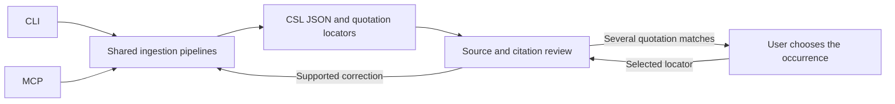

# CiteIndex
### Ingest PDFs, web pages, audio, video, Office documents, and DjVu
### Verify CSL JSON and trace quotations to a page, section, or timestamp
### Use the same pipelines from the Python CLI or an agent through MCP

CiteIndex turns original sources into citation records and quotation evidence
that research tools can reuse. It supports CJK OCR for scanned pages and records
Merkle hashes for integrity checks. An agent in Codex, Claude Code, OpenCode,
Pi, or OMP can call the MCP server to ingest or check a source.

[](https://pepy.tech/projects/citeindex)

## Quickstart

```bash
pip install citeindex
citeindex paper.pdf
```

Outputs land next to where you run it: `corpus/<doc-id>/` (CSL JSON, Merkle
manifest, ingestion log), `library/<doc-id>.md`, and `logs/`. See
[Install](#install) for OCR/media/browser extras and [CLI](#cli) for every
flag.

## How it works



1. Ingest the source. CiteIndex picks the extraction pipeline and saves the
   record with the source coordinates it can recover.
2. Check a CSL field or quotation against the record. An agent can inspect
   the original and use its browser to resolve missing or disputed evidence.
3. If a quotation occurs in several places, choose from the matches and
   verify the selected locator. If the evidence supports a correction,
   submit a repair proposal to regenerate the record.

For pipeline and storage details, see the [architecture notes](docs/design.md).

Reproduce the citation benchmark on a checkout (reviewed local gold manifest
required — model output is never gold):

```bash
python benchmarks/citations/run.py manifest.jsonl predictions.jsonl
```

See [benchmarks/citations/README.md](benchmarks/citations/README.md).

## Install

```bash
pip install citeindex
# Add only the engines you use, for example:
pip install 'citeindex[ocr-mineru,layout]'
```

The default install handles digital PDFs and ordinary HTML URLs. For HTML
URLs, Highwire Press, Dublin Core, OpenGraph, and Schema.org JSON-LD metadata
is extracted deterministically from the page `<head>` without any external
service. Scanned PDFs
need `ocr-mineru` (MinerU's pipeline backend) or `ocr-paddle` with
`--ocr-engine glm-ocr`. Media transcription with WhisperX needs `media`; the
separate Wenbi environment needs only `media-wenbi` here. JavaScript-rendered
pages need `web-browser` plus `playwright install chromium`, while
`--all-url-article` needs `crawl`. The legacy OCR helpers need `ocr-legacy`.
Enhanced PDF layout extraction uses `layout`; otherwise it falls back to the
built-in heuristic. The optional MCP server needs `mcp`. Install several
extras together as needed.

### Docker

```bash
docker build -t citeindex .
docker run --rm -v "$PWD:/data" citeindex /data/paper.pdf
```

The image installs the base package (digital PDFs and HTML URLs) and writes
corpus outputs under `/data/corpus` on the mounted directory. Add the extras
you need to the `pip install` line in the `Dockerfile` for OCR or media.

## CLI

```bash
# Ingest a PDF
citeindex paper.pdf

# Structured logs: one JSON object per line on stderr
citeindex paper.pdf --log-format json

# Ingest a scanned PDF with the default MinerU backend
citeindex scanned.pdf --ocr-engine mineru

# Opt in to Wenbi raw ASR with an explicit local provider
citeindex lecture.mp4 --media-asr-backend wenbi --wenbi-asr-provider funasr

# Or keep Wenbi dependencies isolated in Wenbi's own environment
citeindex lecture.mp4 --media-asr-backend wenbi --wenbi-asr-provider funasr \
  --wenbi-python ../wenbi/.venv/bin/python

# Use the optional GLM-OCR backend via local Ollama
citeindex scanned.pdf --ocr-engine glm-ocr --ocr-model glm-ocr:latest

# Ingest a URL
citeindex https://example.com/article

# Crawl and ingest all articles from a site
citeindex https://example.com/articles --all-url-article --crawl-depth 2

# Crawl and re-ingest only changed pages
citeindex https://example.com/articles --update-url-article

# Options
citeindex paper.pdf --llm ollama/qwen3 --type thesis --is-primary
citeindex paper.pdf --text-direction vertical --vertical-lang ch
citeindex scanned.pdf --ocr-engine mineru --lang auto --page-range "1-10"
citeindex paper.pdf --no-layout  # disable column/footnote detection
citeindex paper.pdf --force-ocr  # override PDF classification
citeindex -q paper.pdf           # disable default debug logging

# Evidence-backed citation verification (Crossref exact DOI lookup)
citeindex paper.pdf --verify-citations --registry-contact-email you@example.org

# Ask a stronger provider-qualified model only to resolve remaining conflicts
citeindex paper.pdf --verify-citations --citation-verifier-model openai/gpt-5

# Explicit alternative engine for digital PDFs; requires a running GROBID service
citeindex paper.pdf --citation-engine grobid
```

Verification is opt-in. Crossref receives only an exact DOI, never document
text. A model correction is accepted only when it supplies a matching source
quote and stable locator; unavailable models leave the record unchanged for
review. Use `--no-crossref` to disable registry lookup or
`--offline-verification` to disable registry and verifier-model requests.

An independent harness audit is available only through an explicit Codex,
Claude Code, OpenCode, or Pi skill/command; running `citeindex` directly does
not auto-trigger one.

## MCP server (optional)

Run CiteIndex as a local MCP server so agent harnesses call tools directly
instead of shelling out:

```bash
pip install 'citeindex[mcp]'
citeindex-mcp --corpus-root corpus                      # stdio
citeindex-mcp --http 127.0.0.1:8765 --corpus-root corpus  # shared Streamable HTTP
# or without a global install:
uvx --from 'citeindex[mcp]' citeindex-mcp --corpus-root corpus
```

`ingest_source` uses the same pipelines as the CLI for PDFs, Office, DjVu,
media, and public URLs. Enable writes with `--allow-write` or
`CITEINDEX_MCP_ALLOW_WRITE=1`. Enable local inputs with repeatable
`--input-root /path/to/sources` options. Poll `ingestion_status` with the
returned job ID. Job handles are retained in the server process. The older
`ingest_url` tool keeps its deterministic HTML defaults and also returns a
job ID if ingestion is still running.

For citation-only ingestion, call `ingest_source` with tool arguments like
`{"input_ref": "/path/to/sources/paper.pdf", "output_mode": "csl_only"}`.
Both ingestion tools accept `full` (default), `csl_evidence`, and `csl_only`.
Read the citation from the completed job’s `csl` field. Citation-only mode
still saves the run summary, and URL or media records may retain source snapshots.
Re-ingesting an existing full record in this mode can remove its full-output artifacts.

Use `citation_verify` with the exact record ID to check CSL fields or a supplied
quotation, with an optional locator to narrow the check. It reports agreement with stored extraction and,
when available, checks the original bytes against the recorded digest. The
`reverify-citation` prompt guides the agent host through inspecting the
original and using its web or browser tools to resolve missing evidence.
Record the supporting quote, locator and URL, and confirm the edition.
Registry corroboration has its own status. Apply requested corrections
through a repair proposal and the standard ingestion path.

Full and CSL-with-evidence outputs persist `quotation_locators.json` for
extracted PDF, HTML, and media spans. A PDF locator carries the physical page
and, when available, the printed label and its provenance. The MCP returns
context and exact coordinates when several occurrences match. The host asks
the user to choose and submits the selected locator for verification.

Use Shutong for corpus discovery and research questions. Pass the CiteIndex
record ID to `library_get` or `citation_verify` for evidence. The server also
exposes CSL, manifests, verification reports, and the citation verification
skill as resources. `library_list` and `library_search` remain available for
existing clients.

Client registration snippets for OpenCode, Codex, Pi, and OMP:
[docs/2026-11-17-citeindex-mcp-plan.html](docs/2026-11-17-citeindex-mcp-plan.html).

## Benchmarking

The pilot benchmark measures extraction and evidence verification only; it
does not evaluate document question answering. Keep reviewed source manifests,
predictions, reports, and copied source files local because they may contain
private or licensed material.

```bash
# First create candidate rows; this does not invent gold labels.
python benchmarks/citations/prepare_manifest.py \
  /home/ajiap/Downloads/Orthodox-China \
  benchmarks/citations/manifest.jsonl --limit 40

# Run all manifest rows serially; every attempted source becomes a prediction row.
python benchmarks/citations/ingest.py benchmarks/citations/manifest.jsonl \
  benchmarks/citations/predictions/dspy.jsonl

# Score host metadata against the human-reviewed labels.
python benchmarks/citations/run.py benchmarks/citations/manifest.jsonl \
  benchmarks/citations/predictions/dspy.jsonl
```

The 40-source pilot composition, annotation contract, modality-specific
controls, and reporting gates are documented in
[`docs/plans/2026-09-14-multimodal-citation-benchmark.md`](docs/plans/2026-09-14-multimodal-citation-benchmark.md).
Validate independent reviewers before scoring with
`python benchmarks/citations/validate_manifest.py manifest.jsonl`; create a
reproducible split with `python benchmarks/citations/split.py manifest.jsonl
split-manifest.jsonl`; compare saved reports with
`python benchmarks/citations/compare.py baseline.json candidate.json`.
The reviewed 40-source pilot has 36 citations with usable gold metadata
(16 digital PDFs, 12 scanned PDFs, 8 URLs). The original 2026-09-24 cloud run
scored 6/36 exact records (16.7%) under the earlier scorer, with 3 scanned-PDF
timeouts and 4 media failures. A later sampled run completed all 36 PDF/URL
sources. Under scorer `host-v4-run-accessed-equivalence`, which uses the actual
retrieval date and rejects redirect-only article snapshots, it scores 3/36
strict records (8.3%); two GCDFL snapshots are redirect-only. These are
development results, not a production accuracy estimate.

The repaired 40-source cloud candidate completed all 28 PDFs, 8 URLs and 4
media files. On the 36 reviewed PDF/URL citations, strict record accuracy is
4/36 (11.1%) and separately defined bibliographic equivalence is 9/36 (25.0%).
By modality, equivalent record accuracy is 2/16 digital PDFs, 1/12 scanned PDFs
and 6/8 URLs. The candidate follows both GCDFL redirects to final articles, so
its URL snapshots differ from the old baseline; do not treat the aggregate as
a same-snapshot causal comparison. The four media files returned empty
transcripts and explicit incomplete citation status without guessed metadata;
they remain unscored, as requested. **The 90% production target is not met** for
this multimodal pilot.
Predictions and source review are local ignored artifacts under
`benchmarks/citations/predictions/` and `benchmarks/citations/reports/`.

### Digital PDF two-category core-requirement benchmark (2026-09-26)

A focused 16-source **digital-PDF** slice was re-benchmarked against the
re-reviewed `digital-16-2026-09-26-gold-v2` manifest under the two-category
citation model (article = cited with page numbers; book = cited without) and a
category-aware **core-requirement** metric with equivalence-normalized matching:

- **book core**: type, author/editor/translator, title, publisher, issued
- **article core**: type, author, title, container/journal, number, page range
- fields not printed in the supplied PDF (for example a volume number absent
  from an article offprint) are marked `outside_scope` and are not required

Result: **15/16 core records (93.75%)**, title F1 0.875, type F1 1.0. The single
miss is a work whose author and editor are printed only in Latinized form
(`GREGORII NYSSENI`, `WERNERUS JAEGER`). Trajectory under this metric:
11/16 → 13/16 → 12/16 (one intermediate regression from over-constrained prompt
rules) → 15/16, after moving deterministic normalization (OCR numeral repair,
CIP author/translator role parsing) out of the prompt and into code.

Scope and caveats: this covers 16 digital PDFs only; the scanned/URL/media
slices above are not measured by this metric, so the multimodal pilot statement
stands. With n=16 single-run variance is material, and the two confirming runs
were replays of the same cached model responses, not independent samples.
Reviewed labels, predictions, and reports stay local under
`benchmarks/citations/predictions/`.

### Scanned PDF two-category core-requirement benchmark (2026-09-26)

A focused 12-source **scanned-PDF** slice was re-benchmarked against the
re-reviewed `scanned-12-2026-09-26-gold-v2` manifest under the same
two-category citation model and core-requirement metric as the digital slice.
Scanned sources run the full ingestion pipeline; only the page sampler is
narrowed (`1-10, -3`) and page-index/layout are disabled.

Result: **12/12 core records (100%)** — every scanned core field recovered.
Against the pre-review frozen labels the same run scores 8/12, and every
per-source flip from the baseline is forward (no regressions). Four sources
needed label re-review where the frozen labels asked for something the scan
cannot support (an OCR-omitted title; name forms printed only in catalog or
CIP shape); the diff is in
`docs/2026-09-26-scanned-gold-v2-diff-for-signoff.md`.

The work moved scanned title/credit recovery out of prompts and into gated
deterministic seeds — heading-based title/subtitle, imprint publisher, and
copyright-year branch priority, plus translator/editor credits and
Roman-numeral imprint years — each verified against an offline OCR probe before
any model run. One deliberately non-obvious case: a publisher that is garbled
on the title page is still printable cleanly on a sampled tail page, so the
imprint seed reads whichever copy is intact rather than trusting the first
occurrence.

## Python API

### Optional translation plugin

Install Fanyi into the same environment to add on-demand translation of an
already ingested PDF corpus. Fanyi may be a private local checkout:

```sh
python -m pip install -e /path/to/citeindex -e /path/to/fanyi
citeindex-plugin list
```

Save translation settings as `fanyi-options.json`:

```json
{"target_lang": "ZH", "engine": "dspy", "format": "mdx"}
```

```sh
citeindex-plugin run fanyi corpus/Author_Title_hash \
  --options fanyi-options.json --output translations/Author_Title_hash/zh
# Optional: --timeout 7200 for a long document.
```

The plugin reads the completed corpus without re-ingesting or requiring the
original PDF. It writes bilingual MDX, aligned JSON, copied image assets, and
`plugin_result.json` provenance into a separate output directory. The destination
must be absent or empty. Partial translations go into `<output>.partial` and
return a nonzero exit status; failed runs do not replace earlier output.
Translations are derived text, not original-source quotation evidence.

Plugins register a callable in the `citeindex.plugins.v1` Python entry-point
group. `citeindex.plugins.run_plugin(name, document_path, output_dir=...,
options={...}, timeout=3600)` is the equivalent Python API. The selected callable
receives a version-1 dictionary with `document_path`, `output_dir`, and `options`,
and returns `protocol_version`, `status`, relative `artifacts` paths, QA details,
errors/warnings, and optional sanitized `manifest_options`. Only explicitly
requested plugins execute, in a child process using the same Python environment.
Installed plugins are trusted code; this process boundary is not a sandbox.

```sh
python -m pip uninstall fanyi
citeindex-plugin list
```

Removing Fanyi detaches translation while preserving CiteIndex and existing
corpora/output. CiteIndex's base installation has no Fanyi dependency. See the
[implementation plan](docs/plans/2026-10-14-plugin-system-fanyi.md) for the contract
and supported workflow.

### Ingestion

```python
from citeindex import ingest, IngestionConfig, IngestionFailure, PipelineResult

# Simple
result = ingest("paper.pdf")
print(result["status"])  # "ok"

# With config
config = IngestionConfig(
    llm_model="ollama/qwen3",
    text_direction="vertical",
    is_primary=True,
)
result = ingest("paper.pdf", corpus_root="my_corpus", config=config)
```

## Code Structure

- `citeindex/cli.py` maps CLI options into `IngestionConfig`.
- `citeindex/ingestion/master.py` detects input types, routes pipelines, verifies metadata, and persists results.
- `citeindex/ingestion/pipelines/` contains the digital PDF, scanned PDF, URL, media, GROBID, PageIndex, and metadata-extraction implementations.
- `citeindex/ingestion/storage.py` and `markdown_export.py` write corpus artifacts and companion library Markdown.
- `citeindex/mcp/` serves citation verification, shared ingestion, and the bundled host audit skill.
- `.agents/`, `.claude/`, `.codex/`, `.opencode/`, and `.pi/` expose the optional citation-evidence audit to supported agent harnesses.

## Ingestion Pipelines

CiteIndex automatically detects the input type and routes to the correct pipeline:

PDF routing is based on **usable existing text**, not whether the file was born
digital. Searchable scans with readable text layers use the digital pipeline,
including invisible OCR text over full-page images. At least 90% of nonblank
pages must have usable text; up to 10% may be image-only or sparse pages (such as
illustrations or title pages). For example, 91 text pages and 9 image-only pages
use the digital pipeline. Those image-only pages are kept in the document but
are not OCR'd; text contained only in their images is not extracted. Completely
blank pages do not count against the threshold.

Clearly garbled text still triggers OCR. These local quality checks cannot
detect every transcription error; use `--force-ocr` when the existing text is
wrong, or `--force-digital` to explicitly reuse it. Digital layout extraction
also disables automatic OCR in PyMuPDF4LLM.

### Digital PDF

```
PDF → PyMuPDF4LLM layout/text (PyMuPDF fallback) + image extraction
    → page-paragraph document structure → DSPy citation extraction
    → PageIndex tree (default) → optional explicit GROBID engine
    → Merkle tree → section_tree + heading injection
    → store document.json and library Markdown
```

- **PyMuPDF4LLM** performs layout-aware extraction when enabled; raw **PyMuPDF** is the fallback
- **DSPy** is the default citation metadata engine for digital PDFs
- **GROBID** is an explicitly selected alternative requiring a separate service
- Builds page-based document structure and augments it with PageIndex section headings
- **PageIndex** builds LLM-driven section hierarchy, persists it to corpus, and feeds library markdown headings

### Scanned PDF

```
PDF → scanned backend selector
    → MinerU (default) OR GLM-OCR + PaddleOCR LayoutDetection
    → normalized content_list / markdown / extracted figures
    → pattern extraction with DSPy-priority metadata
    → document structure → Merkle tree → PageIndex tree (default)
    → store only CiteIndex-native artifacts to corpus/
```

- **MinerU** is the default scanned backend
- **GLM-OCR** is an optional backend that runs through local **Ollama** using the native `/api/generate` endpoint
- **PaddleOCR LayoutDetection** (`PP-DocLayout_plus-L`) supplies external region proposals for GLM-OCR from the start
- Scanned PDFs do **not** use GROBID; metadata is extracted from structured backend output via DSPy-backed extraction
- DSPy is allowed to overwrite pattern-extracted metadata fields for scanned documents
- **PageIndex** runs by default for scanned PDFs, just like digital PDFs
- Only extracted figures / illustrations are exported into the corpus `images/` folder; raw backend artifacts are not preserved
- Supports `--ocr-engine mineru` or `--ocr-engine glm-ocr`

### Scanned PDF Backend Selection

Use the scanned backend flags only for image-based PDFs:

```bash
# Default scanned backend
citeindex scanned.pdf --ocr-engine mineru

# Local GLM-OCR through Ollama
citeindex scanned.pdf --ocr-engine glm-ocr --ocr-model glm-ocr:latest

# Custom Ollama host
citeindex scanned.pdf --ocr-engine glm-ocr --ollama-host http://localhost:11434
```

- `mineru` is the default and recommended general-purpose backend
- `glm-ocr` requires a local Ollama model plus PaddleOCR layout-detection dependencies
- `--mineru-backend` is forwarded directly to the MinerU CLI backend selector

### URL Article

```
URL → Playwright/requests (fetch) → HTML head metadata (deterministic)
    → trafilatura/readability (content)
    → Zotero / in-page citation guidance (candidates) → web-specific DSPy + source evidence
    → _field_evidence binding → snapshot SHA-256
    → section-hierarchical paragraphs → PageIndex tree (optional)
    → hashes → Merkle tree → store to corpus/
```

- **Playwright** renders JavaScript-heavy pages (fallback to **requests**)
- **Deterministic HTML head parsing** runs before any LLM call and extracts structured metadata from:
  - **Highwire Press / Google Scholar** tags (`citation_title`, `citation_doi`, `citation_author` multi-value, `citation_journal_title`, `citation_volume`, `citation_issue`, `citation_firstpage`/`lastpage`, `citation_publisher`, `citation_issn`, `citation_isbn`)
  - **Dublin Core** (`dc.title`, `dc.creator`, `dc.date`, `dc.publisher`, `dc.identifier`)
  - **OpenGraph** (`og:title`, `og:site_name`, `article:published_time`, `article:author`)
  - **Prism** (`prism.doi`, `prism.publicationname`, `prism.publicationdate`)
  - **Schema.org JSON-LD** inline scripts (`ScholarlyArticle`, `Article`, `NewsArticle`, `BlogPosting`, `Book`, `Chapter`)
- **trafilatura** extracts clean markdown with heading structure (fallback to **readability-lxml**); `trafilatura` is an optional dependency — the base pipeline works without it
- **Zotero** extracts citation metadata via translation-server (title, authors, date, DOI)
- Discovers in-page citation guidance: 若要引用 / 引用格式 / Cite this / Zitierweise / Pour citer
- Web-specific DSPy uses original HTML text/metadata, preserves bibliographic subtype and date precision, and requires field quotations.
- Extracted HTML-head metadata fields are automatically bound to `source_blocks` as `_field_evidence` with block ID, quote, and locator; `source_snapshot_digest` (SHA-256 of the fetched HTML) is stored in `csl.json` extra data alongside `source_snapshot_path`.
- Regex/provider candidates remain unverified without evidence; access and revision dates are not publication dates.
- Supports batch crawling with `--all-url-article` and `--update-url-article`

### Media

```
Recognized media URL/local file → yt-dlp or local copy → ffmpeg (audio) → WhisperX (transcription)
        → pyannote (diarization, optional) → media-specific DSPy + source evidence → CSL JSON
        → chunking → hashes → Merkle tree → store to corpus/
```

- **yt-dlp** downloads from YouTube, Vimeo, podcasts, etc.
- **WhisperX** transcribes with word-level timestamps
- **pyannote** speaker diarization (optional)
- Preserves speaker/interviewee, interviewer, host, director and producer roles; uploader is not automatically author, nor platform publisher.
- Recording duration (`dimensions`) is separate from quotation timestamps. Failed transcription leaves an empty transcript, not invented quotation text.
- Each web/media extraction uses one bounded DSPy call (12,000 source-text characters); unsupported metadata stays missing or unverified. No live accuracy claim follows from this contract.
- Supports audio (`.mp3`, `.wav`, `.m4a`) and video (`.mp4`, `.mkv`, `.webm`)
- Remote media routing recognizes YouTube, Vimeo, podcast, SoundCloud, and `youtu.be` hosts; other URLs use the article pipeline

### Office & DJVU

Office documents (`.docx`, `.doc`, `.rtf`, `.odt`, `.pptx`, `.ppt`, `.odp`) are converted to PDF via **LibreOffice**, and DJVU (`.djvu`) via **ddjvu**, then routed to the digital or scanned PDF pipeline. Default DJVU conversion is limited to the first 10 pages.

### Citation Enrichment Cascade

For digital PDF inputs, CiteIndex uses DSPy citation extraction by default. A
separately installed GROBID service is available only when explicitly selected
with `--citation-engine grobid`; it is never an automatic fallback.

Extraction targets the ingested source's own citation metadata—not works cited
inside it. DSPy uses original source blocks and validates quote spans; this
does not by itself prove correct work/edition attribution. PDF metadata remains
a last-resort, unverified identity hint.

Scanned PDFs do not use GROBID. Their structured OCR output is parsed with
document-specific patterns, then DSPy values take priority when available.

With `--verify-citations`, the finalized draft follows this additional
evidence-first stage before CSL IDs, hashes, filenames, and Markdown are
written:

```
candidate CSL → DOI extraction → exact Crossref lookup
              → source quote + page/paragraph or URL snapshot evidence
              → deterministic reconciliation → optional conflict model
              → standardized CSL + verification report
```

Registry-only values are never applied automatically. They must also appear in
the original source evidence; otherwise CiteIndex records `needs_review`.

## Configuration Reference

| Option | CLI Flag | Default | Description |
|--------|----------|---------|-------------|
| `llm_model` | `--llm` | `ollama/deepseek-v4.1-flash:cloud` | LLM model (`ollama/name` or `gemini/name`) |
| `ocr_engine` | `--ocr-engine` | `mineru` | Scanned PDF OCR backend: `mineru` or `glm-ocr` |
| `ocr_model` | `--ocr-model` | `glm-ocr:latest` | Ollama model name used by model-backed OCR engines such as GLM-OCR |
| `ollama_host` | `--ollama-host` | `http://localhost:11434` | Ollama base URL for GLM-OCR requests |
| `mineru_backend` | `--mineru-backend` | `pipeline` | Backend value forwarded to the MinerU CLI |
| `mineru_timeout` | `--mineru-timeout` | `3600` | MinerU subprocess timeout in seconds, up to `3600` |
| `mineru_chunk_pages` | `--mineru-chunk-pages` | `auto` | Split large PDFs into adaptive MinerU chunks; use a page count to override or `0` to disable |
| `text_direction` | `--text-direction`, `-td` | `horizontal` | `horizontal`, `auto`, or `vertical` |
| `vertical_lang` | `--vertical-lang` | `ch` | CJK language: `ch` (Chinese) or `japan` |
| `lang` | `--lang`, `-l` | `auto` | OCR language (auto-detect or Tesseract code) |
| `page_range` | `--page-range`, `--citation-pages`, `-p` | `1-10, -3` | DSPy citation search window: 1-based physical PDF pages; `-3` means the last three pages. Does not limit full-document ingestion or the separately selected GROBID engine. |
| `doc_type_override` | `--type`, `-t` | auto | `book`, `thesis`, `journal`, or `bookchapter` |
| `use_layout_analysis` | `--no-layout` | `True` | Disable column/footnote detection |
| `is_primary` | `--is-primary` | `False` | Line-level granularity (vs paragraph-level) |
| `use_pageindex` | `--no-pageindex` | `True` | PageIndex hierarchy is enabled by default; pass `--no-pageindex` to disable it |
| `use_llm_metadata` | (API/MCP only) | `True` | Disable DSPy web metadata extraction for deterministic offline runs; MCP `ingest_url` sets `False` by default |
| `pageindex_model` | `--pageindex-model` | `ollama/deepseek-v4.1-flash:cloud` | LLM for PageIndex tree building |
| `force_pdf_kind` | `--force-ocr`, `--force-digital` | auto | Override automatic PDF classification |
| `verify_citations` | `--verify-citations` | `False` | Enable evidence-backed metadata verification |
| `citation_verifier_model` | `--citation-verifier-model` | none | Provider-qualified model used only for unresolved conflicts |
| `crossref_enabled` | `--no-crossref` | `True` | Disable exact DOI Crossref lookup |
| `offline_verification` | `--offline-verification` | `False` | Block Crossref and verifier-model requests (not normal ingestion fetching) |
| `registry_contact_email` | `--registry-contact-email` | none | Optional polite Crossref contact email; not persisted |
| `citation_style` | (API only) | `chicago-author-date` | CSL citation style for output |
| `corpus_root` | `--corpus-root` | `corpus` | Output directory for ingested artifacts |
| `schema_version` | `--schema-version` | `1.0.0` | Output schema version tag |
| (CLI only) | `--crawl-depth` | `2` | Max BFS crawl depth for `--all-url-article` |
| (CLI only) | `--crawl-max-pages` | `100` | Max pages for `--all-url-article` |
| (CLI only) | `--verbose`, `-v` | on | Enable verbose/debug logging |
| (CLI only) | `--quiet`, `-q` | off | Disable verbose/debug logging |

## Output

Each ingestion produces a content-addressed corpus folder (for example, `corpus/Author_2024_Title_a1b2c3d4e5f6/`) and a companion library Markdown file.

### Corpus artifacts (`corpus/Author_2024_Title_<12-char-hash>/`)

| File | Description |
|------|-------------|
| `csl.json` | Citation metadata (CSL-JSON with CiteIndex fields: `content_hash`, `merkle_root`, `source_type`, `ingestion_timestamp`) |
| `csl-export.json` | CSL item array for processors; supported fields at top level, internal/unsupported data under `custom`, subtitle composed into title |
| `source_blocks.json` | Web/media evidence blocks with source coordinates |
| `web_metadata.json`, `retrieval_metadata.json` | Provider candidates and observed retrieval metadata, when applicable |
| `quotation_locators.json` | Extracted PDF, HTML, and media quotation spans with the final citation ID and source coordinates |
| `document.json` | Structured document tree — pages, paragraphs, and `section_tree` for URL articles and PageIndex-augmented PDFs |
| `pageindex_tree.json` | Persisted CiteIndex/PageIndex hierarchy with page ranges and summaries when PageIndex runs |
| `merkle.json` | SHA-256 Merkle tree for integrity verification |
| `transcript.json` | Timestamped transcript with speaker segments (media only) |
| `media_metadata.json` | Source media metadata (media only) |
| `ingestion_output.json` | Full ingestion result with all pipeline outputs |
| `citation_verification.json` | Evidence, Crossref provenance/digest, accepted corrections, and `needs_review` items (when verification is enabled) |
| `source.html` | Fetched HTML snapshot used as URL evidence (URL articles only) |
| `source.media` | Retained downloaded media asset for remote media, when available |
| `images/` | Extracted figures and illustrations when available |

### Library markdown (`library/Author_2024_Title_<12-char-hash>.md`)

Human-readable markdown with YAML front-matter, inline citation, page/section/timestamp headers with CSL-level detail, full extracted text, and footnotes. When PageIndex is available, digital PDFs emit section headings into the markdown instead of only flat page labels. Written to `library/` (sibling of `corpus/`).

### Agent-harness final audit

Codex, OpenCode, Claude Code, and Pi can load the shared
`citation-verification` skill after ingestion. The audit reads the original
source and `citation_verification.json`, then returns quotation-backed repair
recommendations. It never edits persisted `csl.json` directly.

The CLI itself always performs the core verification when
`--verify-citations` is supplied. The additional agent audit runs only through
an explicit harness workflow (for example OpenCode `/ingest-verified`); a raw
`citeindex` subprocess cannot detect or launch an agent harness.

### Online enrichment (opt-in)

```sh
citeindex paper.pdf --online-enrich
citeindex paper.pdf --online-enrich --online-enrich-ai-fallback --online-enrich-ai-provider openai
```

Digital and scanned PDFs share this order: source extraction, optional quotation-backed
repair, registry enrichment, then final CSL identifiers, artifact copies and Chicago
Markdown rendering. Accepted Crossref/DataCite DOI records (T1) and OpenLibrary ISBN
editions (T2) can automatically overwrite existing fields, including source repairs.
The audit sidecar `online_enrichment.json` retains values, identity checks and provenance.
Ambiguous matches abstain. Converted non-PDF inputs are outside this first release.

AI discovery requires `--online-enrich-ai-fallback` and an explicit provider: `claude`
(`ANTHROPIC_API_KEY`), `gemini` (`GEMINI_API_KEY`), or `openai` (`OPENAI_API_KEY`).
Each uses its native online search tool; search execution and cited identifier evidence
are required. The discovered DOI/ISBN must independently resolve in a registry before
T4 can fill missing fields. AI cannot overwrite fields. Supported model defaults and
allowlisted source domains can be selected with `--online-enrich-ai-model` and
`--online-enrich-ai-domains`.

Requests share a default 20-second budget, at most 12 attempts, five seconds per request,
and a 2 MiB response limit. Registry caching lives in `corpus/.registry-cache`.
`--offline-verification` blocks verification and enrichment network requests;
`--no-online-enrich` disables automatic discovery. A supplied `--enrich-proposal` still
requires fresh registry validation and is rejected in offline mode. With
`--online-enrich`, validated proposals run first, then discovery considers remaining
missing fields. Source repair proposals remain source-only.

Enrichment stays disabled by default until independent held-out release gates pass.
See [the implementation plan](docs/2026-09-27-online-enrichment-plan-v2.md) and
[benchmark instructions](benchmarks/citations/README.md). Live provider checks are
separate from fixture tests and require `CITEINDEX_AI_LIVE_SMOKE=1` plus credentials.

### Ingestion log (`corpus/ingestion_log.jsonl`)

Appended on every ingestion with `input_ref`, `resource_type`, `csl_id`, `merkle_root`, and `ingestion_timestamp`.

### URL content hashes (`corpus/_url_content_hashes.json`)

Persisted URL → content-hash mapping used by `--update-url-article` for change detection.

### Return Value

The `ingest()` function returns a dict:

```python
{
    "schema_version": "1.0.0",
    "status": "ok",                    # "ok" or "blocked"
    "document_path": "corpus/Author_2024_Title",
    "standardized_csl_json": { ... },  # Full CSL-JSON with ci_ extensions
    "sub_pipeline_outputs": { ... },   # Raw pipeline results
    "ingestion_log_entry": { ... },     # Log entry with merkle_root
    "library_md_path": "library/Author_2024_Title.md",
}

# On failure:
{
    "status": "blocked",
    "source_id": "unknown",
    "stage": "detect_resource_type",
    "error_code": "unsupported_input",
    "error_message": "Unsupported input: ...",
    "next_action": "Provide PDF, URL, or media file",
}
```

### Batch URL Ingestion Return

The `ingest_all_urls()` method (triggered by `--all-url-article` / `--update-url-article`) returns:

```python
{
    "status": "ok",
    "root_url": "https://example.com/articles",
    "discovered": 25,      # total article URLs found
    "ingested": 20,        # newly ingested
    "updated": 2,           # re-ingested (content changed)
    "skipped": 3,           # unchanged (--update-url-article only)
    "failed": 0,            # errors
    "results": [            # per-URL status list
        {"url": "...", "status": "ok"},
        {"url": "...", "status": "unchanged"},
        ...
    ]
}
```

## Supported Formats

| Format | Extension / Protocol |
|--------|----------------------|
| Digital PDF | `.pdf` (with embedded text) |
| Scanned PDF | `.pdf` (image-based, OCR applied) |
| URL Article | `http://` / `https://` |
| Media | `.mp3`, `.wav`, `.m4a`, `.mp4`, `.mkv`, `.webm` |
| Office | `.docx`, `.doc`, `.rtf`, `.odt`, `.pptx`, `.ppt`, `.odp` |
| DJVU | `.djvu` |

## Citation

If you use CiteIndex in your work, please cite it:

**APA:**

> ajia. (2026). *CiteIndex: Ingest sources with proper citation* (Version 0.16.0). MIT. https://github.com/Areopaguaworkshop/citeindex

**BibTeX:**

```bibtex
@software{citeindex2025,
  author  = {Yongjia, Yuan},
  title   = {CiteIndex: Ingest sources with proper citation},
  version = {0.16.0},
  year    = {2026},
  license = {MIT},
  url     = {https://github.com/Areopaguaworkshop/citeindex},
}
```

## Status (2026-11-18)

- Tests: 662 passing, 6 skipped in the full local suite; CI (ruff + mypy +
  pytest) on Python 3.12/3.13 (`.github/workflows/tests.yml`). MCP tests are
  skipped when the optional `mcp` extra is absent. Branch-coverage gate at
  ~40%, ratcheting toward 85% as legacy modules gain tests.
- PyPI: `citeindex` **0.16.0** published 2026-11-18; the optional `[mcp]` extra
  and bundled `citation-verification` skill are included in the release.
- MCP server: optional `citeindex[mcp]` extra and `citeindex-mcp` entry point
  expose library search/read, `citation_verify`, `citation_format`, and
  write-gated `ingest_url` over stdio or Streamable HTTP. The
  `citation-verification` skill is served as `citeindex://skills/citation-verification`
  and embedded in the `cite-this-source` / `ingest-verified` prompts.
- HTML URL pipeline: deterministic HTML head metadata extraction added
  (Highwire Press, Dublin Core, OpenGraph, Prism, Schema.org JSON-LD); evidence
  binding and `source_snapshot_digest` now recorded without requiring Zotero or
  trafilatura. Page ranges bind to joined first/last-page metadata spans, and
  CNKI/Wanfang GB/T 7714 guidance strings ("引用本文：…"), gcdfl/ctcfol
  copyright preambles, and title-matched unlabeled GB/T self-citations are
  parsed into CSL fields. Dedicated tests cover these paths
  (`tests/test_html_article_pipeline.py`).
  A live 20-URL, no-LLM benchmark lives in
  [benchmarks/html/README.md](benchmarks/html/README.md).
- Scale benchmark (default pipeline, digital PDFs, 3 workers):
  **10,052 pages across 14 volumes** at **44.1 ok-pages/min wall**; per-document
  results and failure modes in [benchmarks/scale/README.md](benchmarks/scale/README.md).
- Docker: 494 MB image (`python:3.12-slim`, non-root); the Quickstart flow is verified.
- PyPI downloads: 8,614 total / 1,951 last 30 days (pepy.tech snapshot 2026-10-16).

## License

MIT
