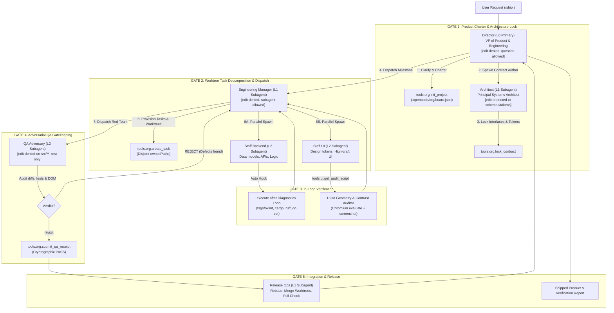

# OpenCode SwarmOS (Big Brother Argon 4.0)

[](LICENSE)
[](https://github.com/anomalyco/opencode)
[](https://bun.sh)
[](https://www.typescriptlang.org)

**OpenCode SwarmOS** transforms OpenCode V2 from a single-threaded assistant that generates inconsistent code and generic UIs into an **autonomous multi-tier software engineering organization and visual design engine**—while maintaining **100% upstream wire compatibility with OpenCode Go ($10 / 10B tokens)** and requiring zero core fork maintenance.

---

## 1. Why Coding Harnesses Produce "Hot Garbage" & "AI Slop" UIs

Traditional AI coding harnesses fail when tasked with shipping non-trivial products due to two structural failure modes:

1. **The Single-Brain Self-Grading Trap ("Hot Garbage" Code)**: In stock harnesses, a single build agent attempts to hold product requirements, system architecture, database schemas, backend logic, frontend components, and test suites inside one drifting context window. Worse, **the same agent that takes a lazy shortcut grades its own homework**. When an import breaks or a test fails, a solo agent frequently deletes the assertion, widens types to `any`, or mocks out the broken function just to finish the turn.
2. **Blind JSX Authoring ("AI Slop" UIs)**: Coding models author CSS and JSX blind to DOM geometry, font metrics, and rendering layouts. Without an explicit design-token system, models regress to the statistical average of GitHub training data (unaligned cards, neon purple/blue gradients, arbitrary padding like `p-3` next to `p-5`). Without a live DOM geometry loop, a text model cannot detect that `line-height: 1` clips descenders (`g`, `y`, `p`, `q`), that two flex siblings collide, or that muted text fails WCAG luminance contrast (< 4.5:1).

---

## 2. Exploiting Five Hidden OpenCode V2 Primitives

SwarmOS exploits five built-in OpenCode V2 runtime capabilities via a single plugin:

1. **4-Tier Organizational Depth (`experimental.subagent_depth: 4`)**: Unlocks a 4-level corporate hierarchy (`Director [L0]` -> `Architect & Manager [L1]` -> `Staff Backend, Staff UI & QA Adversary [L2]` -> `Explore & Test [L3]`). Every child session is created with `parentID: context.sessionID`, automatically sending valid `x-opencode-session-id` and `x-opencode-parent-session-id` headers to OpenCode Go.
2. **Hardware-Enforced Separation of Powers (`agent.permissions` + `permission.hook("evaluate")`)**: OpenCode V2 filters both tool visibility and child subagent dispatch per agent based on `agent.permissions`. Leadership agents (`director`, `manager`) are denied `edit` permissions (they cannot write hasty hotfixes); reporting lines are hardware-locked; and `qa-adversary` is denied `edit` on `src/**` and restricted strictly to test suites (`*.test.*`, `e2e/**`). In v0.3.0+, a runtime `permission.hook("evaluate")` guard also blocks non-architects from mutating locked contract files, prevents cross-lane edits across disjoint task `ownedPaths`, and blocks mutating shell commands from read-only/QA roles.
3. **Shared Organizational Blackboard (`tools.org.*`)**: Replaces lossy natural language "telephone game" handoffs with a schema-validated, atomic state ledger (`.opencode/org/board.json`) tracking project charters, locked TypeScript/JSON contracts, disjoint task ownership, Best-of-N worktree tournaments (`plan_tournament` / `resolve_tournament`), cryptographic QA receipts, and mathematical release readiness gates (`verify_release_ready`).
4. **Deterministic Visual & DOM Geometry Engine (`tools.ui.get_audit_script`)**: Pairs the opinionated `ui-craft` skill with an in-browser mathematical inspector executed inside Chromium via `tools.browser.evaluate` to detect layout overflows, collisions, baseline jitter, and contrast failures across viewports.
5. **Instant Post-Mutation Diagnostic Loop**: An automatic `execute.after` hook runs file-scoped syntax and typecheck diagnostics (`tsgo`/`oxlint`, `python3 -m py_compile`, `cargo check`, `go vet`) on every file mutation and appends `<diagnostics>` blocks directly to tool results for immediate self-correction.

---

## 3. The 5-Gate Engineering Protocol



---

## 4. Organizational Roster & Tooling Matrix

| Role ID | Tier & Mode | Organizational Mission | Allowed Tools | Allowed Subagents | Gatekeeping Constraints |
| :--- | :--- | :--- | :--- | :--- | :--- |
| **`director`** | `L0` (`primary`) | **VP of Product & Engineering** | `read`, `glob`, `grep`, `question`, `execute` (`tools.org.*`, `tools.opencode.*`) | `architect`, `manager`, `explore`, `release-ops` | **Edit denied.** Interviews user via `question`, initializes charter, orchestrates fleet. Cannot start implementation without locked contracts. |
| **`architect`** | `L1` (`subagent`) | **Principal Systems & UI Architect** | `read`, `glob`, `grep`, `edit`/`write` (contracts & design tokens only), `shell` (typecheck) | `explore` | **Contract-First.** Authors shared TypeScript/Zod schemas and CSS design tokens before feature engineers write code. Zero `any` allowed. |
| **`manager`** | `L1` (`subagent`) | **Engineering Manager / Tech Lead** | `read`, `glob`, `grep`, `shell` (read-only git/test), `execute` (`tools.org.*`, `tools.opencode.worktree_*`) | `staff-backend`, `staff-ui`, `qa-adversary`, `explore` | **Edit denied.** Decomposes milestones into tasks with disjoint `ownedPaths`. **Cannot mark a task complete without a signed `PASS` receipt from QA Adversary.** |
| **`staff-backend`** | `L2` (`subagent`) | **Principal Backend & Systems Engineer** | `read`, `edit`, `write`, `patch`, `glob`, `grep`, `shell`, `execute` (`tools.fs.*`, `tools.org.*`) | `explore` | Implements data models, state machines, APIs, and unit tests against locked contracts. Automatically receives post-mutation compiler diagnostics. |
| **`staff-ui`** | `L2` (`subagent`) | **Principal Design Engineer & UI Crafter** | `read`, `edit`, `write`, `patch`, `glob`, `grep`, `shell`, `execute` (`tools.browser.*`, `tools.ui.*`, `tools.org.*`) | `explore` | Injected with `ui-craft` skill. Bound by the Anti-Slop Aesthetic Contract. Must verify components in live browser viewports (`defectCount === 0`). |
| **`qa-adversary`** | `L2` (`subagent`) | **Adversarial QA & Security Gatekeeper** | `read`, `glob`, `grep`, `shell`, `edit`/`write` (`*.test.*`, `*.spec.*`, `e2e/**`), `execute` | `explore` | **Zero-Trust Red Team.** Forbidden from editing production source files (`src/**`). Audits diffs, runs tests, checks console/network, issues `PASS` or `REJECT`. |
| **`release-ops`** | `L1` (`subagent`) | **Staff Release & Integration Engineer** | `read`, `edit`, `write`, `patch`, `glob`, `grep`, `shell`, `execute` (`tools.opencode.worktree_*`, `tools.org.*`) | `explore`, `qa-adversary` | Merges verified worktrees, resolves integration conflicts, runs full repository test suite (`bun test`, `npm test`), prepares release report. |

---

## 5. Visual & DOM Geometry Engine

Executed inside attached Chromium via `tools.ui.get_audit_script` and `tools.browser.evaluate`, the geometry inspector walks every visible DOM node and mathematically catches six defect classes that text models miss:

1. **`page-horizontal-overflow` & `element-overflow-x`**: Detects elements where `scrollWidth > clientWidth + 2` without deliberate scrolling.
2. **`tiny-interactive-target`**: Flags interactive `<button>`, `<a>`, `<input>` elements smaller than `24x24px`.
3. **`low-contrast`**: Traverses up the DOM tree through transparent layers to compute the effective background color and calculates WCAG 2.1 relative luminance against the text foreground (flagging body text `< 4.5:1` or large text `< 3.0:1`).
4. **`descender-clip-risk`**: Flags text elements where `lineHeight / fontSize < 1.15` is combined with `overflow: hidden`, clipping descenders (`g`, `y`, `p`, `q`, `j`).
5. **`sibling-collision`**: Computes bounding-box intersections across sibling elements to catch overlapping badges, buttons, or cards (`overlapX > 2 && overlapY > 2`).
6. **`row-baseline-jitter`**: Flags sibling cards or controls in horizontal rows whose top coordinates drift by `0.5px–3.5px` due to mismatched padding or line heights.

---

## 6. Installation & Configuration

### Option A: Using the Scoped npm Package

Add `@heretek-ai/swarmos` to your `plugins` array in `~/.config/opencode/opencode.json`:

```jsonc
{
  "$schema": "https://opencode.ai/config.json",
  "plugins": [
    "@heretek-ai/swarmos"
  ],
  "experimental": {
    "subagent_depth": 4
  },
  "compaction": {
    "auto": true,
    "keep": 48000,
    "buffer": 24000
  }
}
```

### Option B: Drop-In Single-File Bundle (Zero NPM Install)

Copy the bundled `swarmos-plugin.ts` directly into your local OpenCode plugins directory:

```bash
mkdir -p ~/.config/opencode/plugins
cp swarmos-plugin.ts ~/.config/opencode/plugins/swarmos-plugin.ts
```

In `~/.config/opencode/opencode.json`:

```jsonc
{
  "plugins": [
    "~/.config/opencode/plugins/swarmos-plugin.ts"
  ],
  "experimental": {
    "subagent_depth": 4
  }
}
```

---

## 7. How to Use SwarmOS

### Shifting into Director Mode: `/ship`

In any OpenCode session, launch the entire multi-agent company with the `/ship` command:

```text
/ship Build a full-stack real-time collaborative whiteboarding canvas with authentication, webhooks, and high-craft dark mode UI.
```

1. **Director** interviews you if anything is ambiguous, initializes `.opencode/org/board.json`, and records the Product Charter and chosen Aesthetic Archetype.
2. **Architect** writes and typechecks core schemas, API interfaces, and CSS design tokens, locking them in `tools.org.lock_contract`.
3. **Manager** breaks features into atomic tasks with disjoint `ownedPaths` and Git worktrees, spawning **Staff Backend** and **Staff UI** in parallel.
4. **Staff UI** renders components in attached Chromium, runs the DOM Geometry Auditor across viewports (mobile, tablet, desktop), and captures screenshots.
5. **QA Adversary** audits the diff, runs unit/E2E test suites, verifies 0 console/network errors, and logs a cryptographic `PASS` receipt.
6. **Release Ops** merges verified worktrees, runs the full monorepo check, and hands the completed product back to the Director for final presentation.

### Inspecting Organizational State: `/swarm`

At any time during a build, run `/swarm` to view the active project charter, locked contracts, task owners, and QA receipt verdicts:

```text
/swarm
```

### Omni-Harness Product Modes (v0.4.0+): `/gui`, `/research`, `/office`, `/artifacts`

SwarmOS v0.4.0 expands OpenCode V2 beyond software engineering into a **Universal Product, GUI, Research & Office Adapter**:

- **`/gui <spec>` (`studio-gui`)**: Designs and verifies both Web/Electron/Tauri UIs (via live Chromium DOM geometry & contrast audits) and Native Desktop GUIs (macOS `screencapture`, Wayland `grim`, X11 `scrot`/`import`) with a 4-Pillar Visual Quality Checklist (`tools.gui.*`).
- **`/research <topic>` (`researcher`)**: Unlocks OpenCode's native `websearch` and `webfetch` inside Code Mode (`execute`) for parallel multi-hop discovery, records verified sources in `.opencode/artifacts/research_sources.json`, and audits drafts via `tools.research.audit_citations` to block fabricated or bare-root URLs.
- **`/office <request>` (`office-analyst`)**: Upgrades OpenCode's native `read` tool in-place to transparently extract `.docx`, `.xlsx`, `.pptx`, `.sqlite`, and `.csv` files, and adds `tools.office.render_preview` to convert generated PDFs, Word docs, Excel sheets, and PowerPoint decks into page PNGs for multimodal visual self-critique.
- **Oh-My-Pi Precision Hashline Editing (`tools.fs.hash_read` & `tools.fs.hash_edit`)**: Tags every line with a 2-hex FNV-1a content hash (`42#a7: const x = 1;`) and applies multi-hunk line-range replacements with automatic $\pm 3$-line drift recovery.
- **Antigravity Persistent Artifacts (`/artifacts` & `tools.artifacts.*`)**: Automatically syncs `.opencode/artifacts/task.md` and `plan.md` into the live session context window across turns.

### Agent Reliability Engines (v0.5.0+): `/map`, Circuit Breaker, Checkpoints, Memory & PTY Tap

SwarmOS v0.5.0 adds five engines that keep long-running agents oriented, recoverable, and out of retry loops:

- **PageRank RepoMap & Blast-Radius Analyzer (`/map`, `tools.repo.map`, `tools.repo.blast_radius`)**: Parses `import`/`export` edges and top-level symbols across the repository, ranks files by PageRank centrality (`tools.repo.map({ topN })`), and lists the direct and transitive reverse-import dependents of a file (`tools.repo.blast_radius({ path })`) before you change its interface.
- **Doom-Loop Circuit Breaker (automatic)**: Tracks tool attempts per session. After **2 consecutive `edit`/`patch` failures** on the same file it injects a `<circuit-breaker-intervention>` steering the agent to `tools.fs.hash_read` / `tools.fs.hash_edit`; after **3 consecutive identical `shell` failures** it halts blind retries and requires root-cause notes in `notes.md`.
- **Zero-Git-Noise Checkpoints (`tools.checkpoints.create` / `rollback` / `list`)**: Snapshots the given `paths` into `.opencode/checkpoints/<id>.json` before a risky refactor, then restores them (and removes files that did not exist yet) in one call, without commits or touching `HEAD`.
- **Cross-Session Episodic Memory (`tools.memory.record_lesson` / `recall`)**: Stores repository lessons (`id`, `trigger`, `lesson`, optional `scopePaths`) in `.opencode/memory/lessons.json` and injects them as `<episodic-repository-memory>` into every non-compaction turn.
- **Live PTY & Dev-Server Log Tap (`tools.pty.read_logs`)**: Reads a persistent terminal (`ptyID`, via `ctx.experimental.terminal.read`) or a log file (`logFile`, default `.opencode/artifacts/devserver.log`), with `lines` (10–500, default 80) and `filterErrorsOnly` so agents can check HMR/SSR/runtime errors right after an edit.

### Measurement & Verification (v0.6.0+): `/doctor`, `tools.verify.*`, telemetry & benchmarks

SwarmOS v0.6.0 makes it possible to check that SwarmOS is actually running and actually helping:

- **Host contract check & `/doctor`**: At startup SwarmOS probes every OpenCode V2 capability it uses (`src/host/contract.ts`) and runs each module separately. `/doctor` (or `tools.swarmos.doctor`) lists which capabilities exist, which modules registered, which were skipped and why (for example `permission-guard: skipped (host lacks permission.hook)`), and any exceptions thrown inside SwarmOS hooks, which are caught instead of breaking the host's tool call. `bun run contract:check <opencode-checkout>` scans an OpenCode V2 source tree for the hook names and APIs SwarmOS relies on; `OPENCODE_V2_SRC=<checkout> bun test` runs the same check in the test suite.
- **`tools.verify.run` / `tools.verify.checks`**: Finds the repository's own typecheck, lint and test commands (from a `verifier` field in `.opencode/swarmos.json` or `opencode.json`, `AGENTS.md` lines like ``- test: `bun test` ``, `package.json` scripts, or Cargo/Go/pytest defaults). With `scope: "changed"` (default) it runs typecheck and lint plus only the tests that import changed files (via the RepoMap), strips colour codes, and returns pass/fail counts and `file:line` failures. Runs are saved in `.opencode/verify/` along with a fingerprint of the working tree.
- **Verified QA receipts**: For projects created with `tools.org.init_project`, a `PASS` receipt must cite the `verifyRunId` of a passing run taken on the task's current code, and `verify_release_ready` requires a passing `scope: "full"` run on the current tree. Editing anything afterwards makes both stale. Pass `requireVerifiedReceipts: false` to `init_project` to opt out.
- **Telemetry & observe mode**: Each session's tool calls, failures, circuit-breaker fires, turns and (when the host reports it) token usage are written to `.opencode/telemetry/<sessionID>.jsonl`. `{"mode": "observe"}` in `.opencode/swarmos.json` (or `SWARMOS_MODE=observe`) loads only telemetry and `/doctor`.
- **Benchmark harness (`bench/`)**: 12 tasks (bugs, multi-file refactors, constraint-heavy features, UI fixes, one Python task), each with hidden tests and a reference solution. `bun run bench:check` proves every task fails untouched and passes when solved; `bun bench/run.ts --driver agent` runs a real agent on each task with SwarmOS on and in observe mode, and reports success rate, turns, tool failure rate, breaker fires, tokens and cache hits. See `bench/README.md`.

### Safety (v0.7.0+): shell parsing, real worktree tournaments, edit transactions & taint tracking

- **Shell commands are parsed, not pattern-matched**: `src/agents/shell-parse.ts` splits commands on `;`, `&&`, `||`, pipes and newlines, follows `$(...)`, backticks, process substitution, heredocs, `bash -c`/`sh -c`, `eval`, and wrappers like `sudo`, `env`, `timeout` and `xargs`, records redirections, and classifies every command as read, verify, write, network, destructive or exec. `bash -c "echo x > src/a.ts"`, `tee`, `cp` and `$(rm …)` no longer get past the guard. Every file a shell command writes goes through the same contract, ownership and tournament checks as `edit`.
- **Per-role policy**: destructive commands (`git reset --hard`, `git push -f`, `git checkout -- …`, `rm -rf /`) are denied for everyone, but `--force-with-lease` is fine. `director` and `manager` cannot write, and need approval to run code or reach the network. `qa-adversary` may write only test files, and inline code (`python -c`, `node -e`) needs approval. Read-only commands from `director`, `manager`, `explore`, `plan` and `qa-adversary` run without a prompt. `explore` and `plan` need approval for anything else. Commands SwarmOS cannot parse always need approval.
- **Real worktree tournaments**: `tools.org.plan_tournament` creates a git worktree per candidate at `.worktrees/<taskId>` on branch `swarmos/<taskId>`. While a tournament is active, its files are locked in the main tree and each candidate may edit only its own worktree. `tools.verify.run({ dir })` verifies a candidate, `tools.org.score_tournament` ranks all candidates (passing first, then fewest failures, then smallest diff), and `tools.org.resolve_tournament` merges the winner with `--no-ff`, removes every candidate worktree and branch, and aborts cleanly on conflicts.
- **All-or-nothing edits**: before every `edit`, `write` or `patch`, SwarmOS snapshots the files the call will touch (patch envelopes and unified diffs are parsed for targets). If the call fails, every file is restored, files the call created are removed, and the model is told what was rolled back. Multi-file calls also leave an `auto-*` checkpoint, and only the last 20 are kept.
- **Untrusted-content tracking**: after a session reads `webfetch`, `websearch`, browser, or third-party MCP output (including Code Mode scripts that call them), saved approvals no longer cover risky actions. Network commands, writes outside the project, edits to `.opencode/`, `.git/`, CI workflows, `package.json`, `.env` or shell profiles, and inline or downloaded code need approval again until the user runs `/untaint`.
- `/doctor` now also shows how many times the host invoked each hook, so a hook stuck at 0 after real use (for example `tool.execute.before`) shows the host doesn't fire it.

### Context Efficiency (v0.8.0+): budgeted context, self-maintaining memory, multi-language RepoMap & tool profiles

- **One context budget**: a single injector replaces the separate artifact and memory hooks. Each turn it collects candidate blocks (an untrusted-content notice when relevant, a short per-role toolbox hint, `task.md`, `plan.md`, and lessons), ranks them, and packs them into `contextBudgetTokens` (default 6000). One artifact may take at most 40% of the budget and is truncated beyond that, so it can't crowd out lessons. `/doctor` shows how much of the budget each session used and what was dropped.
- **Relevant lessons, not all lessons**: lessons are scored by `scopePaths` matches against the files this session has read or edited, by keyword overlap with those paths and the agent's role, by their track record, and by age (half-life of 90 days since last use). Lessons flagged `needsReview` are never injected.
- **Memory that maintains itself**: when the circuit breaker fires and a later call on the same file or command succeeds, SwarmOS saves a lesson proposal with the evidence (`tools.memory.proposals`). Proposals are never injected until a human or agent accepts them, ideally with the real root cause written in (`tools.memory.accept_proposal` / `reject_proposal`). Injected lessons gain a success when `tools.verify.run` passes in that session and a failure when it fails or the breaker fires on a file in their scope. Two or more failures that outnumber the successes set `needsReview`; `tools.memory.forget` deletes a lesson.
- **Multi-language RepoMap**: the repo map now parses TypeScript/JavaScript, Python, Go (module path from `go.mod`, used `pkg.Symbol` selectors) and Rust (`mod`, `use crate::`/`super::`/`self::`) after stripping comments and strings, so commented-out imports no longer count. Parsing is lexer-based, not tree-sitter, so the drop-in bundle stays a single file with no WASM grammars. Edges record which symbols each importer takes, so `tools.repo.blast_radius({ path, symbol })` lists only the files that use that symbol, following re-exports and renames. PageRank now iterates to convergence, and parsed files are cached by mtime.
- **Smaller always-on tool list**: only `pinnedNamespaces` (default `org`, `fs`, `repo`, `verify`, `artifacts`) stay pinned in Code Mode; other namespaces stay registered and discoverable via search, and each role gets a one-line hint naming the namespaces it is most likely to need.

### Unified Heretek Platform (v1.0.0): 7 Repositories Consolidated into 1 Omni-Harness

`SwarmOS v1.0.0` consolidates the entire Heretek-AI OpenCode ecosystem (`SwarmOS`, `The-Agency`, `claude-4-opencode`, `IUMBTEMS`, `opencode-rea`, `godot-opencode`, and `GDevelop-Unlocked`) into a single zero-fork architecture:

1. **Pillar 1 — IUMBTEMS Epistemic & Dialectic Engine (`tools.epistemic.*`, `/grill`)**:
   - SHA-256 content-addressed source cache (`.opencode/epistemic/sources/<shortHash>.md`) with SPDX license contamination classification (`permissive`, `weak-copyleft`, `copyleft-contaminating`, `unknown`).
   - Deterministic quote verifier (`tools.epistemic.verify_claims`) that parses `[VERIFIED: <shortHash> | "exact verbatim quote"]` tags and confirms every quote exists verbatim in the cached source.
   - Socratic stress-tester (`tools.epistemic.grill_spec` & `/grill`) that challenges architecture specs before locking contracts.
2. **Pillar 2 — `claude-4-opencode` Zero-Config Compatibility Bridge (`tools.claude.*`)**:
   - Automatically discovers `.claude/commands/*.md`, `.claude/agents/*.md`, and `.claude/skills/*/SKILL.md` in the workspace or `~/.claude` and registers them as native OpenCode V2 slash commands, subagents, and skills.
3. **Pillar 3 — Quantitative 100-Point Visual Quality & UI/UX Judge (`tools.ui.score_ux`, `tools.ui.get_ux_scorecard_script`)**:
   - Deterministic 6-axis UI/UX scorecard across **Spatial & Viewport Integrity (25 pts)**, **Alignment & Grid Harmony (20 pts)**, **Typography & WCAG Contrast (20 pts)**, **Interactive & Accessibility Completeness (15 pts)**, **Design Token Discipline (10 pts)**, and **Runtime Health (10 pts)**.
   - Produces a `0..100` score, letter grade (`S`/`A`/`B`/`C`/`F`), and exact remediation checklist saved to `.opencode/artifacts/ux-scorecard.json` (passing requires `score >= 85` and `0` horizontal overflow).
4. **Pillar 4 — On-Demand Domain Packs (`tools.packs.*`, `/pack`)**:
   - Zero-overhead domain packs that stay dormant on standard software repos and auto-activate when domain markers are detected:
     - **Godot 4.x Pack (`godot-opencode`)**: `tools.packs.godot_inspect_scene` parses `.tscn`/`.tres` scene trees, node hierarchies, attached `.gd` scripts, and signal connections; registers `specialist-godot`.
     - **GDevelop 5 Pack (`GDevelop-Unlocked`)**: `tools.packs.gdevelop_inspect_game` and `tools.packs.gdevelop_unlock_ai_config` inspect `game.json` layouts/events and generate local custom AI endpoint configuration; registers `specialist-gdevelop`.
     - **Reverse Engineering Pack (`opencode-rea`)**: `tools.packs.re_inspect_binary` performs safe static triage on ELF/PE/Mach-O/WASM binaries (magic header, SHA-256, byte entropy, suspicious URLs/paths/crypto constants); registers `specialist-re`.
5. **Pillar 5 — `The-Agency` Live Swarm Command Center WebUI (`tools.org.render_dashboard`, `/dashboard`)**:
   - Generates a self-contained High-Craft Technical Dark HTML5 dashboard (`.opencode/artifacts/swarm-dashboard.html`) displaying the 5-Gate Kanban Board, Locked Contracts, Worktree Tournaments, 100-Point UI/UX Scorecards, Epistemic Cache, and Active Domain Packs.

### Complete Roadmap Edition (v0.9.0+): Task Spend Budgets, Session Replay -> Benchmarks, Warm Parallel LSP & Pinned Host Fixture

- **Per-Task Spend & Step Budgets (`tools.org.claim_task`, `tools.org.set_task_budget`)**: Tasks on `.opencode/org/board.json` now accept `budget: { maxTokens?, maxTurns?, maxToolCalls? }`. When a subagent claims a task via `tools.org.claim_task`, SwarmOS accumulates token, turn, and tool-call usage on `task.usage`. If a subagent exceeds any budget ceiling, `createTaskBudgetEvaluator` locks further file mutations, shell commands, and subagent spawns, appends a `<task-budget-exceeded>` notice, and returns control to `manager` to either raise the budget (`tools.org.set_task_budget`) or re-scope the task.
- **Session Replay -> Benchmark Regression Exporter (`/replay`, `tools.replay.*`)**: `tools.replay.list_sessions` scans `.opencode/telemetry/*.jsonl` and ranks sessions with tool failures or circuit-breaker fires first. `tools.replay.export_benchmark({ sessionID })` (or `/replay <sessionID>`) packages a recorded failure session into a runnable benchmark regression task under `bench/tasks/<taskId>/` (`task.json`, `repo/`, `replay-trace.json`, `solution/`), and `tools.replay.replay_session` replays the recorded tool timeline step-by-step.
- **Parallel & Warm-Cached Diagnostics + Symbol Intelligence (`tools.lsp.*`)**: `runParallelDiagnostics` caches file diagnostics by `(absPath, mtimeMs, size)` so unchanged files in multi-file edits return in `0ms`, runs multi-file checks in bounded parallel batches, and exposes `tools.lsp.diagnostics`, `tools.lsp.definitions`, `tools.lsp.references`, and `tools.lsp.status` inside Code Mode.
- **Pinned OpenCode V2 (`v2.0.26`) Host Contract Fixture (`test/fixtures/opencode-v2-ref/`)**: Includes a pinned reference snapshot of OpenCode V2's plugin host contract so `bun run contract:check` and `bun test` verify every required capability and hook literal out-of-the-box without requiring an external monorepo checkout.

#### Configuration (`.opencode/swarmos.json`)

```jsonc
{
  "mode": "full",                 // or "observe"; env: SWARMOS_MODE
  "telemetry": true,              // env: SWARMOS_TELEMETRY
  "autoTransactions": true,       // env: SWARMOS_AUTO_TRANSACTIONS
  "taintTracking": true,          // env: SWARMOS_TAINT_TRACKING
  "contextBudgetTokens": 6000,    // env: SWARMOS_CONTEXT_BUDGET
  "pinnedNamespaces": ["org", "fs", "repo", "verify", "artifacts"], // env: SWARMOS_PINNED=org,fs
  "verifier": { "typecheck": "bun run typecheck", "test": "bun test" }
}
```

---

## 8. Development & Testing

```bash
# Install dependencies
bun install

# Run automated test suite
bun test

# Check every benchmark task is solvable and not already passing
bun run bench:check

# Typecheck source
bun run typecheck

# Build modular package & standalone single-file bundle
bun run build
```

---

## 9. Design Lineage & Historical References

For deep background analysis, forensic audits of OpenCode V2 internals, and architectural transcripts:
- [`docs/references/blueprint.md`](docs/references/blueprint.md): The original SwarmOS 4.0 architectural blueprint.
- [`docs/references/Opencode V2 Architecture Prompt And Roadmap.markdown`](docs/references/Opencode%20V2%20Architecture%20Prompt%20And%20Roadmap.markdown): Deep architectural audit and SOTA roadmap.
- [`docs/references/OpenCode V2 Architecture Analysis - Google Gemini.html`](docs/references/OpenCode%20V2%20Architecture%20Analysis%20-%20Google%20Gemini.html): Complete transcript of the Gemini session that designed this system.

---

## License

[MIT License](LICENSE) © 2026 Heretek AI
