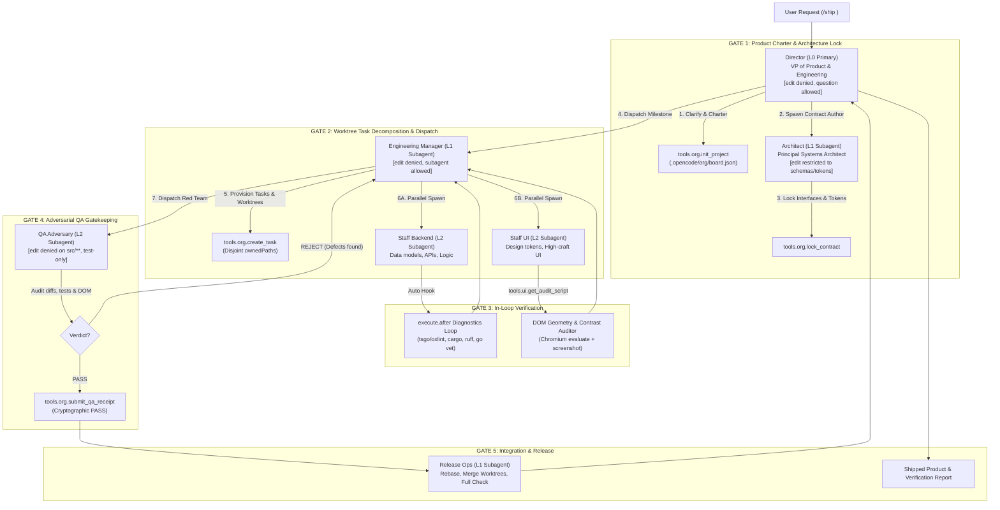

# OpenCode SwarmOS (Big Brother Argon 4.0)

[](LICENSE)
[](https://github.com/anomalyco/opencode)
[](https://bun.sh)
[](https://www.typescriptlang.org)

**OpenCode SwarmOS** transforms OpenCode V2 from a single-threaded assistant that generates inconsistent code and generic UIs into an **autonomous multi-tier software engineering organization and visual design engine**—while maintaining **100% upstream wire compatibility with OpenCode Go ($10 / 10B tokens)** and requiring zero core fork maintenance.

---

## 1. Why Coding Harnesses Produce "Hot Garbage" & "AI Slop" UIs

Traditional AI coding harnesses fail when tasked with shipping non-trivial products due to two structural failure modes:

1. **The Single-Brain Self-Grading Trap ("Hot Garbage" Code)**: In stock harnesses, a single build agent attempts to hold product requirements, system architecture, database schemas, backend logic, frontend components, and test suites inside one drifting context window. Worse, **the same agent that takes a lazy shortcut grades its own homework**. When an import breaks or a test fails, a solo agent frequently deletes the assertion, widens types to `any`, or mocks out the broken function just to finish the turn.
2. **Blind JSX Authoring ("AI Slop" UIs)**: Coding models author CSS and JSX blind to DOM geometry, font metrics, and rendering layouts. Without an explicit design-token system, models regress to the statistical average of GitHub training data (unaligned cards, neon purple/blue gradients, arbitrary padding like `p-3` next to `p-5`). Without a live DOM geometry loop, a text model cannot detect that `line-height: 1` clips descenders (`g`, `y`, `p`, `q`), that two flex siblings collide, or that muted text fails WCAG luminance contrast (< 4.5:1).

---

## 2. Exploiting Five Hidden OpenCode V2 Primitives

SwarmOS exploits five built-in OpenCode V2 runtime capabilities via a single plugin:

1. **4-Tier Organizational Depth (`experimental.subagent_depth: 4`)**: Unlocks a 4-level corporate hierarchy (`Director [L0]` -> `Architect & Manager [L1]` -> `Staff Backend, Staff UI & QA Adversary [L2]` -> `Explore & Test [L3]`). Every child session is created with `parentID: context.sessionID`, automatically sending valid `x-opencode-session-id` and `x-opencode-parent-session-id` headers to OpenCode Go.
2. **Hardware-Enforced Separation of Powers (`agent.permissions` + `permission.hook("evaluate")`)**: OpenCode V2 filters both tool visibility and child subagent dispatch per agent based on `agent.permissions`. Leadership agents (`director`, `manager`) are denied `edit` permissions (they cannot write hasty hotfixes); reporting lines are hardware-locked; and `qa-adversary` is denied `edit` on `src/**` and restricted strictly to test suites (`*.test.*`, `e2e/**`). In v0.3.0+, a runtime `permission.hook("evaluate")` guard also blocks non-architects from mutating locked contract files, prevents cross-lane edits across disjoint task `ownedPaths`, and blocks mutating shell commands from read-only/QA roles.
3. **Shared Organizational Blackboard (`tools.org.*`)**: Replaces lossy natural language "telephone game" handoffs with a schema-validated, atomic state ledger (`.opencode/org/board.json`) tracking project charters, locked TypeScript/JSON contracts, disjoint task ownership, Best-of-N worktree tournaments (`plan_tournament` / `resolve_tournament`), cryptographic QA receipts, and mathematical release readiness gates (`verify_release_ready`).
4. **Deterministic Visual & DOM Geometry Engine (`tools.ui.get_audit_script`)**: Pairs the opinionated `ui-craft` skill with an in-browser mathematical inspector executed inside Chromium via `tools.browser.evaluate` to detect layout overflows, collisions, baseline jitter, and contrast failures across viewports.
5. **Instant Post-Mutation Diagnostic Loop**: An automatic `execute.after` hook runs file-scoped syntax and typecheck diagnostics (`tsgo`/`oxlint`, `python3 -m py_compile`, `cargo check`, `go vet`) on every file mutation and appends `<diagnostics>` blocks directly to tool results for immediate self-correction.

---

## 3. The 5-Gate Engineering Protocol



---

## 4. Organizational Roster & Tooling Matrix

| Role ID | Tier & Mode | Organizational Mission | Allowed Tools | Allowed Subagents | Gatekeeping Constraints |
| :--- | :--- | :--- | :--- | :--- | :--- |
| **`director`** | `L0` (`primary`) | **VP of Product & Engineering** | `read`, `glob`, `grep`, `question`, `execute` (`tools.org.*`, `tools.opencode.*`) | `architect`, `manager`, `explore`, `release-ops` | **Edit denied.** Interviews user via `question`, initializes charter, orchestrates fleet. Cannot start implementation without locked contracts. |
| **`architect`** | `L1` (`subagent`) | **Principal Systems & UI Architect** | `read`, `glob`, `grep`, `edit`/`write` (contracts & design tokens only), `shell` (typecheck) | `explore` | **Contract-First.** Authors shared TypeScript/Zod schemas and CSS design tokens before feature engineers write code. Zero `any` allowed. |
| **`manager`** | `L1` (`subagent`) | **Engineering Manager / Tech Lead** | `read`, `glob`, `grep`, `shell` (read-only git/test), `execute` (`tools.org.*`, `tools.opencode.worktree_*`) | `staff-backend`, `staff-ui`, `qa-adversary`, `explore` | **Edit denied.** Decomposes milestones into tasks with disjoint `ownedPaths`. **Cannot mark a task complete without a signed `PASS` receipt from QA Adversary.** |
| **`staff-backend`** | `L2` (`subagent`) | **Principal Backend & Systems Engineer** | `read`, `edit`, `write`, `patch`, `glob`, `grep`, `shell`, `execute` (`tools.fs.*`, `tools.org.*`) | `explore` | Implements data models, state machines, APIs, and unit tests against locked contracts. Automatically receives post-mutation compiler diagnostics. |
| **`staff-ui`** | `L2` (`subagent`) | **Principal Design Engineer & UI Crafter** | `read`, `edit`, `write`, `patch`, `glob`, `grep`, `shell`, `execute` (`tools.browser.*`, `tools.ui.*`, `tools.org.*`) | `explore` | Injected with `ui-craft` skill. Bound by the Anti-Slop Aesthetic Contract. Must verify components in live browser viewports (`defectCount === 0`). |
| **`qa-adversary`** | `L2` (`subagent`) | **Adversarial QA & Security Gatekeeper** | `read`, `glob`, `grep`, `shell`, `edit`/`write` (`*.test.*`, `*.spec.*`, `e2e/**`), `execute` | `explore` | **Zero-Trust Red Team.** Forbidden from editing production source files (`src/**`). Audits diffs, runs tests, checks console/network, issues `PASS` or `REJECT`. |
| **`release-ops`** | `L1` (`subagent`) | **Staff Release & Integration Engineer** | `read`, `edit`, `write`, `patch`, `glob`, `grep`, `shell`, `execute` (`tools.opencode.worktree_*`, `tools.org.*`) | `explore`, `qa-adversary` | Merges verified worktrees, resolves integration conflicts, runs full repository test suite (`bun test`, `npm test`), prepares release report. |

---

## 5. Visual & DOM Geometry Engine

Executed inside attached Chromium via `tools.ui.get_audit_script` and `tools.browser.evaluate`, the geometry inspector walks every visible DOM node and mathematically catches six defect classes that text models miss:

1. **`page-horizontal-overflow` & `element-overflow-x`**: Detects elements where `scrollWidth > clientWidth + 2` without deliberate scrolling.
2. **`tiny-interactive-target`**: Flags interactive `<button>`, `<a>`, `<input>` elements smaller than `24x24px`.
3. **`low-contrast`**: Traverses up the DOM tree through transparent layers to compute the effective background color and calculates WCAG 2.1 relative luminance against the text foreground (flagging body text `< 4.5:1` or large text `< 3.0:1`).
4. **`descender-clip-risk`**: Flags text elements where `lineHeight / fontSize < 1.15` is combined with `overflow: hidden`, clipping descenders (`g`, `y`, `p`, `q`, `j`).
5. **`sibling-collision`**: Computes bounding-box intersections across sibling elements to catch overlapping badges, buttons, or cards (`overlapX > 2 && overlapY > 2`).
6. **`row-baseline-jitter`**: Flags sibling cards or controls in horizontal rows whose top coordinates drift by `0.5px–3.5px` due to mismatched padding or line heights.

---

## 6. Installation & Configuration

### Option A: Using the Scoped npm Package

Add `@heretek-ai/swarmos` to your `plugins` array in `~/.config/opencode/opencode.json`:

```jsonc
{
  "$schema": "https://opencode.ai/config.json",
  "plugins": [
    "@heretek-ai/swarmos"
  ],
  "experimental": {
    "subagent_depth": 4
  },
  "compaction": {
    "auto": true,
    "keep": 48000,
    "buffer": 24000
  }
}
```

### Option B: Drop-In Single-File Bundle (Zero NPM Install)

Copy the bundled `swarmos-plugin.ts` directly into your local OpenCode plugins directory:

```bash
mkdir -p ~/.config/opencode/plugins
cp swarmos-plugin.ts ~/.config/opencode/plugins/swarmos-plugin.ts
```

In `~/.config/opencode/opencode.json`:

```jsonc
{
  "plugins": [
    "~/.config/opencode/plugins/swarmos-plugin.ts"
  ],
  "experimental": {
    "subagent_depth": 4
  }
}
```

---

## 7. How to Use SwarmOS

### Shifting into Director Mode: `/ship`

In any OpenCode session, launch the entire multi-agent company with the `/ship` command:

```text
/ship Build a full-stack real-time collaborative whiteboarding canvas with authentication, webhooks, and high-craft dark mode UI.
```

1. **Director** interviews you if anything is ambiguous, initializes `.opencode/org/board.json`, and records the Product Charter and chosen Aesthetic Archetype.
2. **Architect** writes and typechecks core schemas, API interfaces, and CSS design tokens, locking them in `tools.org.lock_contract`.
3. **Manager** breaks features into atomic tasks with disjoint `ownedPaths` and Git worktrees, spawning **Staff Backend** and **Staff UI** in parallel.
4. **Staff UI** renders components in attached Chromium, runs the DOM Geometry Auditor across viewports (mobile, tablet, desktop), and captures screenshots.
5. **QA Adversary** audits the diff, runs unit/E2E test suites, verifies 0 console/network errors, and logs a cryptographic `PASS` receipt.
6. **Release Ops** merges verified worktrees, runs the full monorepo check, and hands the completed product back to the Director for final presentation.

### Inspecting Organizational State: `/swarm`

At any time during a build, run `/swarm` to view the active project charter, locked contracts, task owners, and QA receipt verdicts:

```text
/swarm
```

### Omni-Harness Product Modes (v0.4.0+): `/gui`, `/research`, `/office`, `/artifacts`

SwarmOS v0.4.0 expands OpenCode V2 beyond software engineering into a **Universal Product, GUI, Research & Office Adapter**:

- **`/gui <spec>` (`studio-gui`)**: Designs and verifies both Web/Electron/Tauri UIs (via live Chromium DOM geometry & contrast audits) and Native Desktop GUIs (macOS `screencapture`, Wayland `grim`, X11 `scrot`/`import`) with a 4-Pillar Visual Quality Checklist (`tools.gui.*`).
- **`/research <topic>` (`researcher`)**: Unlocks OpenCode's native `websearch` and `webfetch` inside Code Mode (`execute`) for parallel multi-hop discovery, records verified sources in `.opencode/artifacts/research_sources.json`, and audits drafts via `tools.research.audit_citations` to block fabricated or bare-root URLs.
- **`/office <request>` (`office-analyst`)**: Upgrades OpenCode's native `read` tool in-place to transparently extract `.docx`, `.xlsx`, `.pptx`, `.sqlite`, and `.csv` files, and adds `tools.office.render_preview` to convert generated PDFs, Word docs, Excel sheets, and PowerPoint decks into page PNGs for multimodal visual self-critique.
- **Oh-My-Pi Precision Hashline Editing (`tools.fs.hash_read` & `tools.fs.hash_edit`)**: Tags every line with a 2-hex FNV-1a content hash (`42#a7: const x = 1;`) and applies multi-hunk line-range replacements with automatic $\pm 3$-line drift recovery.
- **Antigravity Persistent Artifacts (`/artifacts` & `tools.artifacts.*`)**: Automatically syncs `.opencode/artifacts/task.md` and `plan.md` into the live session context window across turns.

---

## 8. Development & Testing

```bash
# Install dependencies
bun install

# Run automated test suite
bun test

# Typecheck source
bun run typecheck

# Build modular package & standalone single-file bundle
bun run build
```

---

## 9. Design Lineage & Historical References

For deep background analysis, forensic audits of OpenCode V2 internals, and architectural transcripts:
- [`docs/references/blueprint.md`](docs/references/blueprint.md): The original SwarmOS 4.0 architectural blueprint.
- [`docs/references/Opencode V2 Architecture Prompt And Roadmap.markdown`](docs/references/Opencode%20V2%20Architecture%20Prompt%20And%20Roadmap.markdown): Deep architectural audit and SOTA roadmap.
- [`docs/references/OpenCode V2 Architecture Analysis - Google Gemini.html`](docs/references/OpenCode%20V2%20Architecture%20Analysis%20-%20Google%20Gemini.html): Complete transcript of the Gemini session that designed this system.

---

## License

[MIT License](LICENSE) © 2026 Heretek AI
