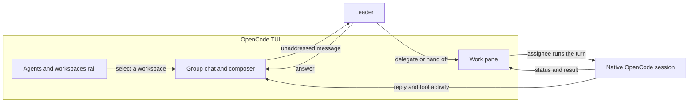

# Ensemble

**Your persistent agent team, inside OpenCode.**

Ensemble gives you one group chat with named agents, a leader who routes the
work, and a Work pane that shows what every agent is doing while each agent's
native OpenCode session runs underneath.

```sh
opencode plugin add @heyimteee/ensemble@0.1.0
```

<!-- docs visual: hero terminal recording of install, /ensemble, a first group reply, and the Work pane; ticket #309 owns the asset. -->

> **Visual placeholder.** The documentation site will open with a short terminal
> recording of the three-pane workspace: agents and workspaces on the left, the
> group chat in the middle, and Work on the right. Until the recording lands,
> the [quickstart](docs/getting-started/quickstart.md) walks through the same
> screen with copyable commands and expected output.

[Get started](docs/getting-started/README.md) ·
[What is Ensemble?](docs/getting-started/what-is-ensemble.md) ·
[Documentation](docs/README.md)

## What it does

One OpenCode session is one conversation. Real work splits
across research, review, implementation, and follow-up, so you copy context
between sessions and lose track of who is doing what. Ensemble gives those
agents one shared space: you talk to the group, the leader routes or answers,
and every unit of work stays visible until it finishes.

### The three panes

| Pane | What it shows | What you do there |
|---|---|---|
| Agents and workspaces | The roster grouped by workspace, plus a separate Workspaces list. New agents start with no workspace. | Select a workspace to open its group chat, or an agent to open a direct chat. |
| Conversation | The group chat or direct chat, with the composer pinned below it. Replies stream in and settle into Markdown. | Send an unaddressed message to the leader, address a teammate with `$Name`, or reference a file with `@path`. |
| Work | Work items for the current conversation in ACTIVE and HISTORY. `f` toggles the views. | Focus an item to inspect it, open its native session, or delegate, reassign, retry, restart, or cancel. |

Below 118 columns the shell compacts; below 96 columns Work becomes a right
drawer. The layout is tested from 80x24 up.

### What Ensemble is not

- **Not a hosted service.** Everything runs in your OpenCode installation, with
  your providers and your files. Ensemble has no telemetry and uploads nothing.
- **Not a model.** Agents use the models your OpenCode host reports; Ensemble
  does not ship one.
- **Not a replacement for OpenCode.** Ensemble is one plugin inside the host.
  The native prompt, host commands, and OpenCode's permissions stay in charge.
- **Not a permission system.** An approval in Ensemble is a team decision. It
  cannot override OpenCode's tool permissions.
- **Not a Windows product.** Linux/tmux is the supported path in `0.1.x`;
  macOS with Herdr is verified on OpenCode 2.2.7; Windows is out of scope.

### What you get

| Capability | What you get | Why it matters |
|---|---|---|
| Persistent team | Named agents with lasting instructions, models, backup models, skills, and memory. | You configure a teammate once and reuse it across projects. |
| Leader routing | Unaddressed messages go to the workspace leader, who answers or delegates with a typed brief. | You do not repeat the same context to every agent. |
| Visible work | Every turn and delegation appears as a work item with an honest state: QUEUED, WORKING, WAITING, RETRYING, NEEDS YOU, REPLIED, FAILED, STALLED, or CANCELLED. | You can see whether work is running, waiting on you, or actually broken. |
| Native sessions | Each agent executes in its own OpenCode session; press `o` on a work item to inspect it. | You keep the host's tools, logs, and transcript instead of a black box. |
| Bounded delegation | A dispatch budget caps a command, a group, and each delegation, and exhaustion is a controlled stop. | Multi-agent work cannot fan out without a ceiling. |
| One team state | Roster, workspace membership, and bindings are shared across OpenCode locations. | The same team follows you between projects and terminals. |

### How the pieces connect



## Requirements

Ensemble is one OpenCode plugin package, `@heyimteee/ensemble`, containing both
the server and TUI parts. Compatibility is verified on OpenCode **2.2.6**, **2.2.7**, and **2.3.0** on
Linux/tmux, with Node 22.23.4 or newer. The Node matrix runs on Node 22.23.4, 24.22.1, and 26.12.1; the live suites run
on Node 26.12.1. The plugin peer range is `2.2.6 || 2.2.7 || 2.3.0`, and the
workspace instruction block is contract v7.

| Component | Supported | Notes |
|---|---|---|
| Linux with tmux | OpenCode 2.2.6, 2.2.7, and 2.3.0 | The supported path. Other terminals on Linux are untested. |
| macOS with Herdr | OpenCode 2.2.7 | Installed path verified; macOS on 2.3.0 is not claimed. |
| Windows | Out of scope | Native Windows and WSL are not tested. |
| Node | 22.23.4 or newer | Older Node fails at plugin load with the supported range. |
| Other OpenCode 2.x | Untested | The plugin loads with a runtime warning; behavior is not supported. |

Read the [support matrix](docs/support/support-matrix.md) before installing on
an unverified host.

## Install

Install the stable release and confirm the plugin list entry:

```sh
opencode plugin add @heyimteee/ensemble@0.1.0
opencode plugin list
```

```text
ensemble.v2  0.1.0  @heyimteee/ensemble@0.1.0
```

Restart OpenCode, then open the workspace from the command palette or with
`/ensemble`.

Do not also load the same package from `.opencode/plugins/`; duplicate plugin
IDs break the workspace. Do not use a Git spec (`github:`, `git+https://`, or
`owner/repo#tag`) with OpenCode 2.2.7; Git dependency preparation fails
upstream. Use the npm package or a local checkout path instead.

The [install page](docs/getting-started/install.md) covers the single-plugin
rule, a local checkout, and troubleshooting. To move from a prerelease, follow
[upgrade](docs/getting-started/upgrade.md).

## Keyboard

Ensemble starts in Normal and `Esc` never quits. Press `?` for the searchable
catalog; it is the source of truth for every binding.

| Key | Action |
|---|---|
| `i` | Focus the composer in Insert. |
| `Enter` | Send in the composer, or open the focused row, result, or approval. |
| `Shift+Enter` | Add a line in the composer. |
| `Esc` | Go up one level. |
| `Space` | Open the leader menu for create, edit, settings, approvals, and work actions. |
| `:` | Open the command line with completion and history. |
| `a` / `n` | From the rail, create an agent or a workspace. |
| `e` | Edit the selected agent or workspace, including members and the leader. |
| `f` | Toggle Work between ACTIVE and HISTORY. |
| `o` | Open the focused work item's native session; on a group chat, choose a member. |
| `d` / `t` / `r` / `R` / `x` | Delegate, reassign, retry, restart, or cancel the focused work item. |
| `$Name` / `@path` | Address a teammate in the composer, or reference a workspace file. |
| `F2` | Return to Ensemble from a native session. |

## Runtime diagnosis

From a repository checkout, the doctor compares roster, workspace, membership,
binding, and dispatch-ledger state across locations:

```sh
npm run doctor -- /path/to/project /path/to/another-project
npm run doctor -- --json --service-file /path/to/service.json /path/to/project
```

It exits `0` on agreement, `1` on divergence, and `2` on a usage, connection,
snapshot, or config-read failure. It reads
`$XDG_STATE_HOME/opencode/service.json`, or
`~/.local/state/opencode/service.json` when the variable is unset. Reports omit
credentials, conversation text, and memories. A package-only install has no
`npm` scripts; use the in-app `:logs` viewer and the host logs instead. See
[data classes and retention](docs/privacy/data-and-retention.md).

## Support

Ensemble is a developer preview. Support is best effort through GitHub Issues,
with no paid support or SLA. Read the [support policy](docs/support/README.md)
before filing.

- Check the [support matrix and known limitations](docs/support/support-matrix.md)
  for the platform boundary.
- Use the [incident runbook](docs/support/incident-runbook.md) for a broken
  workspace, stuck work, a failed upgrade, or suspected data loss.
- Report vulnerabilities privately through [SECURITY.md](SECURITY.md), never in
  a public issue.

## Known limitations

- **Stable is `0.1.0`.** npm `latest` points at `0.1.0`; prereleases stay under
  `next` (`0.1.0-rc.3`). Pin the exact version for deliberate installs. This is
  a 0.x release, so minor versions may still change APIs. See the
  [changelog](CHANGELOG.md).
- **Host support is narrow.** Only OpenCode 2.2.6, 2.2.7, and 2.3.0 on
  Linux/tmux are tested. macOS/Herdr is verified on 2.2.7 only; Windows is out
  of scope. See the [support matrix](docs/support/support-matrix.md).
- **Git-spec installs fail upstream on OpenCode 2.2.7.** Use npm, a loopback
  registry, or a local checkout.
- **Diagnostics are local.** Ensemble has no telemetry and uploads no support
  bundle. The doctor ships in the repository, not in the package.
- **Terminal accessibility depends on the host.** Ensemble supplies
  glyph-and-word status, reduced motion, `NO_COLOR`, and ASCII fallbacks;
  screen-reader output, high contrast, and copy-on-release are host features.
- **Some surfaces stay native.** Arbitrary OpenCode slash commands are not
  proxied into the group chat, rich Markdown links are not clickable, and direct
  chats have no separate Ensemble search or export.

## Documentation

- **Learn:** [what Ensemble is](docs/getting-started/what-is-ensemble.md),
  [install](docs/getting-started/install.md),
  [quickstart](docs/getting-started/quickstart.md), and
  [first team](docs/getting-started/first-team.md).
- **Understand:** [Concepts](docs/concepts/README.md): agents, workspaces,
  routing, turns, work items, budgets, and native sessions.
- **Do:** [Guides](docs/guides/README.md) and the [documentation home](docs/README.md).
- **Look up:** [Reference](docs/reference/README.md): tools, commands,
  keyboard, configuration, environment, and supported hosts.
- **Operate:** [Operations](docs/operations/README.md) for backup, restore,
  upgrade, and rollback.
- **Assess:** [Security](docs/security/README.md) and
  [Privacy](docs/privacy/README.md).
- **Contribute:** [Contributing](docs/contributing/README.md),
  [CONTRIBUTING.md](CONTRIBUTING.md), and the
  [evidence index](docs/contributing/evidence.md) for architecture decisions and
  verification records.
- [Glossary](GLOSSARY.md), [changelog](CHANGELOG.md), and
  [documentation style guide](docs/style-guide.md).

## License

Ensemble is released under the [MIT License](LICENSE). Contributions are accepted under the same license.
