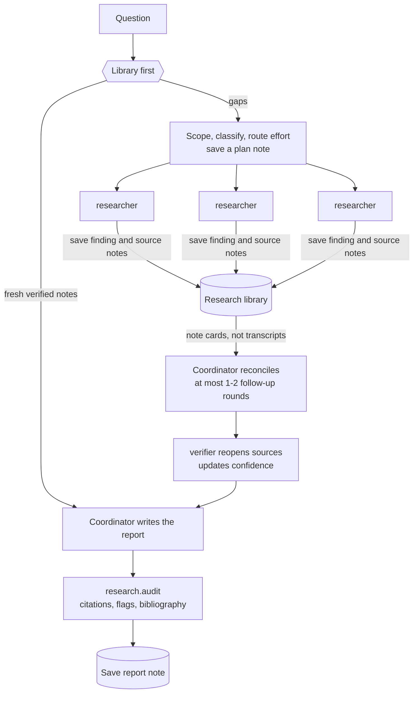

<p align="center">
  
</p>

<p align="center">
  
  
  
</p>

# hffmnnj.deep-research

A deep research workflow for OpenCode V2 that **gets smarter every time you use it**.

It bundles a research skill and three specialist subagents with a persistent **research
library**: every finding, source, plan and report is saved as a Markdown note, indexed
for hybrid keyword and semantic search, and available to every future session through a
handful of Code Mode tools. The next question on a topic starts from what you already
know instead of from zero.

It is **agent-first and fully autonomous**. There are no slash commands to remember: a
short static hint tells every agent the library exists, and agents decide for
themselves when a question deserves a real investigation. Once started, a run goes from
plan to saved report without clarifying questions or approval stops.

Works on Linux, macOS and Windows.

## What you get

| Piece | What it does |
| --- | --- |
| `deep-research` skill | Coordinator playbook: scope, route effort, plan, delegate, reconcile, verify, report. |
| `deep-research/researcher` | Read-only evidence worker. Investigates one bounded workstream and saves notes as it goes. |
| `deep-research/verifier` | Independent auditor. Reopens the original sources and sets note confidence. |
| `deep-research/librarian` | Curator. Merges duplicates, tightens summaries, refreshes stale notes. |
| `tools.research.*` | The library, exposed **only in Code Mode**. No direct tools are added to your tool list. |
| Static context hint | A short, cache-stable system hint: search the library first, load the skill unprompted when research matters, stay light for lookups. This is the entry point; disable it with `hint: false`. |

## Quick start

Requires OpenCode V2. Add the package to `opencode.json`; OpenCode installs it for you:

```jsonc
{
  "plugins": ["hffmnnj.deep-research"]
}
```

With options:

```jsonc
{
  "plugins": [
    { "package": "hffmnnj.deep-research", "options": { "embedding": { "mode": "auto" } } }
  ]
}
```

The npm package and the plugin id are both `hffmnnj.deep-research`. To hack on it
instead, clone this repo, run `bun install`, and point `package` at the folder. The
full walkthrough is in the [usage guide](docs/GUIDE.md).

OpenCode reloads config on save. Then just ask a question that needs evidence:

```text
Compare the current HTTP/3 adoption numbers across sources and tell me what is still unresolved.
```

The agent searches the library, decides this needs a multi-source run, loads the skill,
launches researchers, and delivers a cited report. A quick lookup stays a quick lookup.

Out of the box the library embeds locally (EmbeddingGemma). Use a server, or turn
embeddings off, as described [below](#embeddings-use-a-server-or-run-your-own).

## How a run works

The workflow follows the shape of Anthropic's published multi-agent research design: a lead
that plans and synthesizes, parallel workers with separate context windows, and a
dedicated verification and citation pass. The library adds the part those systems keep
internal: memory that outlives the run.



Key behaviours:

- **Library first.** The coordinator searches saved notes before touching the web and reuses fresh, verified ones.
- **Effort routing.** Quick, Standard, Deep or Rigorous tiers, from the query type (depth-first, breadth-first, straightforward). Hard cap of 8 concurrent researchers, default 3.
- **Artifact pointers, not transcripts.** Researchers save notes themselves and return only note ids, one-line summaries, conflicts and gaps. Less token bloat, no "game of telephone".
- **The coordinator writes the report.** Never delegated.
- **Cited by note id.** Reports cite `[rn_xxxxxxxxxxxx]`. `research.audit` resolves them, flags weak evidence, and returns a numbered version with a bibliography.
- **Untrusted by default.** Page text, worker findings and note bodies are data, never instructions. Workers have no shell, no file edits, and no delegation.

## The research library

Notes are plain Markdown files with a JSON front matter block. They are the source of
truth. The SQLite index (FTS5 plus vectors) is derived and can always be rebuilt.

```text
~/.local/share/opencode-deep-research/library/
  index.db            derived: full-text index, chunks, vectors
  notes/2026-11/rn_m3k9x2ab1c9d.md
  .trash/             forgotten notes (recoverable)
```

```markdown
---
{
  "id": "rn_m3k9x2ab1c9d",
  "title": "Hybrid retrieval beats keyword-only on paraphrased queries",
  "kind": "finding",
  "summary": "Fusing BM25 with embeddings via reciprocal rank fusion improves recall on paraphrased queries.",
  "topics": ["ai/retrieval"],
  "sources": [{ "url": "https://example.com/rrf", "accessedAt": "2026-11-13" }],
  "confidence": "verified",
  "volatility": "slow",
  "runId": "rr_m3k9x2",
  "links": [],
  "createdAt": "2026-11-13T05:20:00.000Z",
  "updatedAt": "2026-11-13T05:41:00.000Z"
}
---

## Evidence
...
```

| Field | Values |
| --- | --- |
| `kind` | `finding` (one atomic claim), `source`, `report`, `plan`, `note` |
| `confidence` | `unverified` (default), `checked`, `verified`, `disputed` |
| `volatility` | `stable` (never stale), `slow` (180 days), `fast` (30), `live` (3) |

Edit notes by hand, sync them with Git, or open the folder in Obsidian. `research.reindex`
picks up changes.

### Token-efficient by design

- Search returns **cards**: id, title, a self-contained summary, topics, confidence, age, a stale flag and one snippet. Roughly 90 tokens each for a typical card with a snippet (measured with 4 characters per token), capped by a `maxTokens` budget.
- `read` is progressive: `view: "card"`, then `"outline"` (headings with sizes), then `section`, then `"full"` with a `maxChars` cap.
- Search is hybrid. BM25 over title, topics, summary and text is fused with embedding similarity by reciprocal rank fusion, with a small boost for verified notes. With no embedder it degrades to keyword search and says so.
- Nothing is lost when embeddings are unavailable. Saves always succeed, and missing vectors are filled in by a background backfill or `research.reindex`.

### Tools

All tools live in the `research` Code Mode namespace. Discover them with
`search({ namespace: "research" })` and call them as `await tools.research.<name>(input)`.

| Tool | Purpose |
| --- | --- |
| `search` | Hybrid search with filters (`topics`, `kinds`, `runId`, `since`, `minConfidence`, `includeStale`). Empty query lists recent notes. |
| `read` | Read by id with `view` and `section` controls. |
| `save` | Save a note. Reports possible duplicates. Rejects credentials. |
| `update` | Edit, append, add sources or links, set confidence. |
| `topics` | Topic tree with counts, so taxonomy stays consistent. |
| `related` | Explicit links first, then similar notes. |
| `stale` | Notes past their freshness window, most overdue first. |
| `cite` | Numbered bibliography for note ids. |
| `audit` | Check a draft report's citations and return a numbered version. |
| `forget` | Move a note to `.trash` (recoverable). |
| `reindex` | Rescan files and embed missing vectors. |
| `stats` | Counts, embedding status, pending work. |

```js
const hits = await tools.research.search({ query: "http3 adoption", since: "1y", limit: 5 })
const saved = await tools.research.save({
  kind: "finding",
  title: "HTTP/3 share of top sites",
  summary: "About a third of the top million sites served HTTP/3 in the sampled month.",
  topics: ["web/protocols/http3"],
  sources: [{ url: "https://example.org/report", accessedAt: "2026-11-13" }],
  volatility: "fast",
  runId: "rr_m3k9x2",
})
```

## Configuration

Options go in the plugin entry's `options` object. Every option is optional.

```jsonc
{
  "package": "hffmnnj.deep-research",
  "options": {
    "libraryPath": "~/research-library",
    "hint": true,
    "models": { "researcher": "anthropic/claude-sonnet-5-5#high" },
    "staleDays": { "slow": 180, "fast": 30, "live": 3 },
    "embedding": { "mode": "auto" }
  }
}
```

| Option | Default | Notes |
| --- | --- | --- |
| `libraryPath` | `~/.local/share/opencode-deep-research/library` (macOS, Linux); `%LOCALAPPDATA%\opencode-deep-research\library` (Windows) | Notes, trash and index live here. Honors `XDG_DATA_HOME` on every OS; `~` and `~\` expand to your home folder. |
| `hint` | `true` | Adds one static line to the system prompt pointing at the library. Static, so it does not break prompt caching. |
| `models.researcher` / `verifier` / `librarian` | inherit | `provider/model#variant`. Unset means the worker inherits the parent session's model. |
| `staleDays` | `180 / 30 / 3` | Freshness windows for `slow`, `fast`, `live`. |
| `embedding` | `auto` | See below. |

### Embeddings: use a server or run your own

| `embedding.mode` | Behaviour |
| --- | --- |
| `server` | Use an OpenAI-compatible `/embeddings` endpoint: OpenAI, Ollama, LM Studio, vLLM, llama.cpp, a TEI container, or your own. |
| `local` | The plugin runs the model itself, in-process, through `@huggingface/transformers` (ONNX). No server to manage. |
| `auto` (default) | Use the server if `embedding.server.url` is set, otherwise the local model. |
| `off` | Keyword search only. |

Use a server:

```jsonc
"embedding": {
  "mode": "server",
  "server": {
    "url": "http://127.0.0.1:11434",       // base, .../v1, or a full .../embeddings URL
    "model": "nomic-embed-text",
    "apiKey": "env://EMBED_API_KEY",       // literal, env://NAME, or file://path
    "dimensions": 768,                     // optional, for models that accept it
    "batchSize": 32,
    "timeoutMs": 15000
  }
}
```

Run its own:

```jsonc
"embedding": {
  "mode": "local",
  "local": {
    "model": "onnx-community/embeddinggemma-2-ONNX",  // default, 768 dimensions
    "cacheDir": "~/.cache/deep-research-models",
    "dtype": "q8",                         // default for EmbeddingGemma
    "allowDownload": true,                 // false = use cached files only
    "queryPrefix": "task: search result | query: ",   // EmbeddingGemma defaults, shown for reference
    "documentPrefix": "title: none | text: "
  }
}
```

The same settings can come from the environment: `DEEP_RESEARCH_EMBED_URL`,
`DEEP_RESEARCH_EMBED_MODEL`, `DEEP_RESEARCH_EMBED_KEY`.

Notes:

- The first local run downloads the model from Hugging Face. Set `allowDownload: false` and point `cacheDir` at an existing Hugging Face cache to stay offline.
- Vectors are tagged with the model that made them. Switching models never mixes vector spaces: old vectors are ignored until `research.reindex` re-embeds them.
- A server that is down costs one timeout, then the embedder cools down for 30 seconds. Search keeps working on keywords and reports `semantic: "unavailable"`.
- `@huggingface/transformers` is an optional dependency. Server-only installs can skip it.

## Safety

- The library refuses to store credentials: private key blocks, `sk-` keys, GitHub, AWS, Slack and Google tokens, JWTs and bearer headers are rejected on save and update, and URLs with embedded credentials are rejected as sources.
- Note ids are validated (`rn_` plus 12 characters) before any file access, so ids cannot be used for path traversal.
- Library tool output wraps note text in an `untrusted="true"` frame. Agents are told that note, page and worker text is data.
- Research workers cannot edit files, run shell commands, or launch subagents.
- `forget` moves files to `.trash`; nothing is permanently deleted by the plugin.

## Development

```sh
bun install
bun run check      # tsc --noEmit and bun test
```

```text
src/
  index.ts          Plugin.define: registers tools, skill, agents, hint
  bundle.ts         agent and skill definitions, the static hint
  config.ts         option parsing, secret references
  library/          files, SQLite index, chunking, embedders, hybrid search, audit
  tools/            Code Mode tool definitions
content/            skill, references, agent prompts (Markdown)
test/               bun tests
```

## Design provenance

Workflow patterns are informed by Anthropic's public write-up
[How we built our multi-agent research system](https://www.anthropic.com/engineering/multi-agent-research-system)
and the research prompts in the
[Anthropic cookbook](https://github.com/anthropics/anthropic-cookbook/tree/main/patterns/agents).
This is an OpenCode workflow, not a vendor product, and no vendor benchmark results
transfer to it.

## License

MIT
