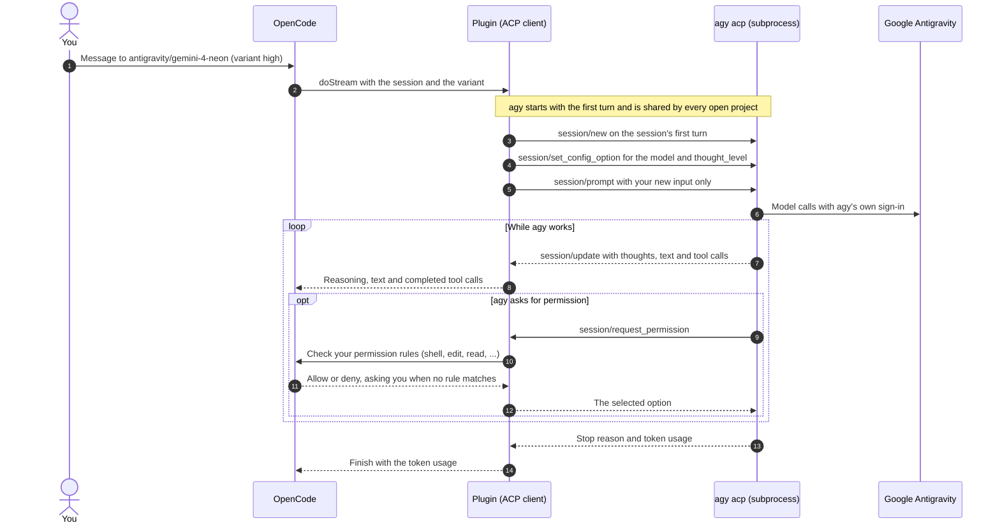

# opencode-plugin-antigravity-acp

[](https://github.com/JoseGalRe/opencode-plugin-antigravity-acp/releases/latest)
[](https://www.npmjs.com/package/@josegalre/opencode-plugin-antigravity-acp)
[](https://github.com/JoseGalRe/opencode-plugin-antigravity-acp/actions/workflows/publish.yml)
[](LICENSE)

Use your Google Antigravity subscription in [OpenCode](https://opencode.ai) through the official `agy acp` server.

> This is an independent community project. It is not affiliated with, endorsed by or sponsored by Google.
> Antigravity and Gemini are trademarks of Google LLC. Using it with your account is subject to Google's terms: read
> [Terms of service](#terms-of-service) first.

Antigravity CLI ships an [Agent Client Protocol](https://agentclientprotocol.com/) (ACP) server, `agy acp`, which
editors such as Zed, JetBrains IDEs and Xcode start as a subprocess to run the Antigravity agent in their own UI. This
plugin does the same for OpenCode: it is an ACP **client** that starts `agy acp` and speaks JSON-RPC over its stdio.

> **Status: early development.** The plugin adds an `antigravity` provider to OpenCode and runs its turns through
> `agy acp`. It is tested against a stand-in for `agy` inside a real OpenCode 2.4.1, and a real turn with
> `antigravity/gemini-3.8-flash` (agy 1.5.16) has answered.

## How it works

The plugin runs inside OpenCode and talks to `agy acp`, a subprocess on your machine, over stdio with JSON-RPC. Only
`agy` talks to Google. One turn:



- **A provider in OpenCode.** The plugin lists the Gemini models `agy` offers under `antigravity/…`, with `agy`'s
  thinking levels (`low` … `xhigh`) as variants: pick `antigravity/gemini-4-neon#high` like any other model.
- **One ACP session per OpenCode session.** `agy` keeps the conversation; each of your messages is one ACP turn.
  Its thoughts stream as reasoning and its text as the answer.
- **`agy` runs its own tools.** They appear in OpenCode as completed tool calls. When `agy` asks permission, the
  request goes through OpenCode's [permission rules](https://opencode.ai/docs/permissions/): commands as `shell`,
  edits as `edit`, reads as `read`, searches as `grep`, fetches as `webfetch`, anything else as `antigravity`. Your
  rules decide; with no matching rule OpenCode asks you.
- **Attachments.** Text files and images go in the prompt. PDFs and other files are written to a private temporary
  directory, removed when OpenCode closes, and `agy` reads them from there with its own `read` tool.
- **Skills work; background commands are refused.** Your Antigravity skills and `agy`'s other slash commands
  (`/papita`, `/plan`, `/compact`) run as usual. A message that starts with a command that runs outside your turn
  (`/schedule`, `/goal`, `/teamwork`, `/boost`, `/swarm`, `/chief-of-staff`, `/claude-handoff`) gets an error
  instead; write the request without the leading command.
- **No automatic retries.** When a turn fails, OpenCode does not send it to `agy` again on its own.
- **Titles stay local; compaction belongs to `agy`.** Titles come from your first message. `agy` keeps the
  conversation's context and compacts it on its own near its threshold. When you compact an OpenCode session
  yourself, the plugin runs `agy`'s `/compact` on its session, which spends one turn of quota; when OpenCode compacts
  on its own, the plugin records a note and leaves the context to `agy`. The summary OpenCode replays after a
  compaction is not sent to `agy`.

- **Only `agy` talks to Google.** The plugin has no Google or Antigravity URL and never makes a network request to
  them; a lint rule rejects network modules in `src/`. Sign-in, tokens, model calls and telemetry all stay inside
  `agy`, exactly as when you use it in a terminal or in Zed.
- **No borrowed credentials.** The plugin never reads `agy`'s credential files and never calls its backend directly.
- **Honest identity.** In `initialize` the plugin names itself (`@josegalre/opencode-plugin-antigravity-acp`), never another
  editor, to unlock models or features.
- **Telemetry off.** `agy` is started as `agy acp --disable-telemetry`.

## Terms of service

**Read this before using it with a subscription.** Antigravity's
[terms](https://antigravity.google/terms) (§6) call using third-party software to access the service a breach, and
the [FAQ](https://antigravity.google/docs/faq) names OpenCode as an example. Accounts have been suspended for it.

The only allowance we found is a
[reply on Google's forum](https://discuss.ai.google.dev/t/conflicting-guidance-on-using-t3-code-with-personal-google-ai-subscriptions/197131):
the official, unmodified ACP binary inside an ACP client such as Zed or T3 Code, signed in with `oauth-personal`, for
single-user interactive development with the Gemini models in your plan, is permitted. The question about OpenCode
in that same thread has no answer from Google yet. The plugin keeps to that description:

- `agy` runs its own tools; OpenCode shows them and answers its permission requests.
- Only Gemini models are offered with a subscription sign-in, although `agy` lists Claude and GPT-OSS too.
- Only your own interactive turns go to `agy`: titles and automatic compaction never reach it (a compaction you ask
  for runs `agy`'s `/compact`), and subagents and background generation with an `antigravity` model are refused. Scheduled or automated runs cannot be told apart from yours:
  do not point them at an `antigravity` model.

None of this is a guarantee: the decision is Google's, and the risk is yours. A Gemini API key
(`gemini-api-key`) is the path the FAQ recommends for third-party agents.

## Requirements

- [Antigravity CLI](https://antigravity.google/docs/install?tab=cli) 1.5.0 or later, which has `agy acp`. Check with
  `agy acp --help`.
- Signed in once: run `agy` interactively, or `agy acp --login` (works over SSH).
- OpenCode 2.4 or later.
- Node.js 26.13.1 or later and pnpm 12.16.1 or later, to build.

## Install

**From npm.** Add it to OpenCode's global configuration:

```bash
opencode plugin add @josegalre/opencode-plugin-antigravity-acp
```

Or list it in `plugins` in your `opencode.json(c)`, with options if you need them (see below), as
`"package": "@josegalre/opencode-plugin-antigravity-acp"`.

**From a release.** Download `opencode-plugin-antigravity-acp-<version>.js` from the repository's releases and put
it in `~/.config/opencode/plugins/`. OpenCode loads it on its own; it runs `agy` from your `PATH` with no extra
flags.

**From source, with options.** Build the plugin, then add the repository to `plugins` in your `opencode.json(c)`:

```bash
pnpm install && pnpm build
```

```jsonc
{
  "$schema": "https://opencode.ai/config.json",
  "plugins": [
    {
      "package": "/path/to/opencode-plugin-antigravity-acp",
      "options": {
        "command": "agy", // the Antigravity CLI; an absolute path also works
        "args": [], // extra `agy acp` flags, such as "--sandbox"
        "autoCompact": "80%", // optional: when agy compacts on its own (700000, 800K, 0.5M or 80%)
      },
    },
  ],
}
```

`dist/index.js` holds everything the plugin needs, so the folder works without `node_modules`. On its first start the
plugin asks `agy` for its models, which opens and closes an ACP session without prompting; the list is saved. Later
starts launch nothing: `agy` starts with the first Antigravity turn, and the session that turn opens refreshes the
list. One `agy` process serves every project the OpenCode server has open, and it ends when the last one closes.
Each model's context window is taken from what `agy` reports during a turn and saved with the list.

## Development

```bash
pnpm install       # also points git at the hooks in .vite-hooks/
pnpm ready         # format check, lint, type check and tests
pnpm build         # dist/index.js, dependencies included
pnpm smoke         # talks to your real `agy` without prompting: no quota spent
pnpm release       # publishes the version on Gitea (see AGENTS.md)
```

| Script                        | What it runs                                            |
| ----------------------------- | ------------------------------------------------------- |
| `test`                        | `vp test` (Vitest)                                      |
| `lint:check` / `lint:fix`     | `vp lint`: Oxlint with type-aware rules and type check  |
| `format:check` / `format:fix` | `vp format`: Oxfmt                                      |
| `build`                       | `vp pack`: one self-contained ESM file                  |
| `smoke`                       | `scripts/smoke-agy.ts --session` against the real `agy` |

The toolchain is [Vite+](https://viteplus.dev): formatting, linting, the type check (tsrs, the Rust port of the
TypeScript 7 compiler, so there is no `typescript` package), tests and git hooks. Conventions for code and comments
are in [AGENTS.md](AGENTS.md).

Tests run against an ACP server that stands in for `agy` (`tests/fixtures/fake-agy.ts`), so they need neither `agy`
nor a network.

## Limits and roadmap

- **Sessions do not survive a restart.** When OpenCode or `agy` restarts, the next message starts a new ACP session
  without the earlier context. Next: keep the mapping and reopen with `session/resume`.
- **Plans, modes and slash commands** that `agy` sends are not shown yet.
- **File access, terminals and questions** (ACP elicitation) are left to `agy`; serving them from OpenCode would put
  its diffs and prompts in OpenCode's UI.
- **Output limit is an assumption** (65,536 tokens): `agy` does not report it. The context window is assumed to be
  1,048,576 tokens only until a model has run a turn; then the window `agy` reports is used.
- **`agy` stays running once started**, until the OpenCode server closes every project. Ending it when idle needs
  sessions that survive a restart first (`session/resume`, verified to work with `agy` 1.5.16).

## License

[MIT](LICENSE). The published file bundles `@agentclientprotocol/sdk` (Apache-2.0) and `zod` (MIT); their licenses
are in its header.
