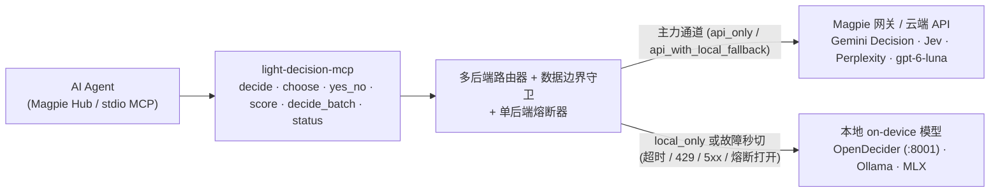

<p align="center">
  
</p>

<h1 align="center">Light Decision MCP</h1>

<p align="center">
  <strong>面向 System One 决策模型的多后端 MCP 服务与 Magpie 插件</strong><br />
  Google <code>gemini-decision-1</code> · TypeSafe <code>Jev</code> · Perplexity Decisions · OpenAI <code>gpt-6-luna</code> · 本地 <code>OpenDecider</code> / Ollama / MLX
</p>

<p align="center">
  <a href="./README.md">English</a> | <strong>简体中文</strong>
</p>

---

**Light Decision MCP**（`light-decision-mcp`）是一个**零外部依赖、厂商中立**的 MCP 服务与 [Magpie](https://usemagpie.ai) 插件，将高速、带概率校准的 **System One 决策模型**（`noul` 二选一、`choice` 多选、`score` 有序打分）统一封装为 Agent 工具——支持多模态图片输入、数据边界守卫、熔断秒切本地降级，以及基于实测硬件的本地模型推荐与交互安装向导。

## 核心特性

- **多后端 / 多供应商统一接入**：既可通过本机 **Magpie 网关**调用（插件零存 Key，自动复用 Magpie 轮换、配额与隐私脱敏 `redact`），也可按需直连 **TypeSafe Jev**、**Perplexity Decisions API**（支持可选 `web_grounding` 联网决策）、**Google Gemini Decisions** 或 **OpenAI Decisions**，并原生兼容本机 `opendecider serve` / Ollama / MLX 等**本地模型**。
- **三种路由模式 + 熔断秒切本地**：
  - `api_with_local_fallback`：云端 API 主力，遇连接异常、超时、`429`、`5xx` 或处于熔断冷却窗口（0 ms 跳过主力）时自动降级到本地模型；
  - `api_only`：仅走云端/API 后端，失败快速报错；
  - `local_only`：仅走本机 `on-device` 模型，自动锁死 `max_data_destination = "on-device"`，数据零出本机。
- **跨协议输入输出精准对齐**：自动兼容 `input` 与 `state` 序列化差异，统一对齐 `score` 响应（`level`、`label`、期望分 `expected_level`/`score`、`probabilities`、`confidence` 与上游原值 `provider_confidence`），无论云端主力还是本地降级返回结构完全一致。
- **多模态安全闸门**：支持本地图片路径（魔数 MIME 校验，≤10 MB）、Data URI 与 `https://` URL；降级到纯文本本地后端时默认拒绝静默丢弃图片（需显式开启 `allow_image_drop_on_fallback: true`）。
- **双形态交付（零第三方运行时依赖）**：
  - **Magpie Plugin Tools → Library MCP**（一键覆盖 Antigravity、Claude Code、Codex、Cursor、Zed、Pi 等 HTTP/Hub Agent）；
  - **薄 stdio MCP 入口**（`bin/stdio.mjs`，完整兼容 Claude Desktop 及任意 stdio MCP 客户端）。
- **硬件实测推荐与安装向导**：内置 `doctor`、`recommend`、`setup` CLI，实测本机 CPU/内存/GPU/磁盘后给出分档本地模型推荐，全程交互确认且绝不落盘明文 API Key。

## 路由架构



## 界面预览

### 独立本地 Web 管理后台（`light-decision-mcp ui`）

仅绑定 `127.0.0.1`（带 CSRF 防护、零 Magpie 依赖），支持后端与熔断器实时监控、自定义第三方网关增删改、`0600`/钥匙串密钥管理、在线决策试跑、硬件推荐与客户端接入片段生成。

<p align="center">
  
</p>

<details>
  <summary>展开查看：路由模式与自定义第三方网关配置界面</summary>
  <p align="center">
    
  </p>
</details>

### Magpie 内嵌插件设置页

作为 Magpie 插件安装时与 6 个 MCP 工具自动一并注册，零守护进程，自动跟随 Magpie 亮/暗主题与中英文切换。

<details>
  <summary>展开查看：Magpie 内嵌可视化配置页截图</summary>
  <p align="center">
    
  </p>
</details>

---

## 快速开始

### 1. 作为 Magpie 插件安装（推荐）

```bash
# 从 GitHub 安装（发布后）
magpie plugin add github:light-cheng/Light-Decision-MCP

# 或从本地目录安装测试
magpie plugin add /你的本地路径/Light-Decision-MCP
```

检查加载状态与工具：

```bash
magpie plugin list
magpie tools
magpie tool status
```

在 Magpie 中配置云端决策供应商（按需配置，插件不保存任何密钥）：

```bash
magpie provider add google <YOUR_GOOGLE_AI_STUDIO_API_KEY>
# Magpie 同时支持：typesafe、openai、azure、bailian-decision、qwen-decision、volcengine-decision
```

随后在 **Magpie → Library → MCP** 中按 Agent 勾选开启即可。

### 2. 脱离 Magpie 独立作为 stdio MCP 运行（兼容任意客户端、CC Switch 与其他网关）

`light-decision-mcp` 与 Magpie **完全解耦**。未检测到本机 Magpie 网关时，它会自动禁用 `magpie` 后端，并按已配置的环境变量/本地 `secrets.json`（`GEMINI_API_KEY`、`TYPESAFE_API_KEY`、`PERPLEXITY_API_KEY`、`OPENAI_API_KEY`、`OPENROUTER_API_KEY`）、云端聚合平台（**OpenRouter** `/api/alpha/decisions`）、自托管网关（**LiteLLM Proxy**）或本机 `opendecider`（`127.0.0.1:8001`）自动选择默认后端。也可以将下面的 `stdio` 配置添加到 **CC Switch → MCP 管理**，一键同步到 Claude Code、Codex、Gemini CLI、Hermes。

直接在任意 MCP 客户端（Claude Desktop、Claude Code、Cursor、Codex、Zed、Hermes、CC Switch 等）配置：

```json
{
  "mcpServers": {
    "light-decision-mcp": {
      "command": "node",
      "args": ["/你的本地路径/Light-Decision-MCP/bin/stdio.mjs"],
      "env": {
        "GEMINI_API_KEY": "可选，不配则自动回退本地 opendecider"
      }
    }
  }
}
```

也支持在 `~/.config/light-decision-mcp/config.json`（或 `light-decision-mcp ui` 预设模板）中接入 **OpenRouter**（云端聚合，`type: "systemone"`、`endpointPath: "/api/alpha/decisions"`）、**LiteLLM Proxy**（开源自托管中转）或任意自建 Decisions / System One 网关：

```json
{
  "defaultBackend": "my-gateway",
  "backends": {
    "my-gateway": {
      "type": "openai-decisions",
      "enabled": true,
      "baseUrl": "https://gateway.example.com",
      "endpointPath": "/v1/decisions",
      "defaultModel": "gemini-decision-1",
      "apiKeyEnv": "MY_GATEWAY_KEY",
      "dataDestination": "private-network"
    }
  }
}
```

若使用 Magpie Library 为 `claude-desktop` 挂载 stdio 入口：

```bash
magpie library mcp add light-decision-mcp node /你的本地路径/Light-Decision-MCP/bin/stdio.mjs agents=claude-desktop
```

### 3. 独立 Web 后台、Magpie 内嵌页、密钥管理与本地向导

- **独立本地 Web 管理后台（零 Magpie 依赖）**：运行 `node ./bin/cli.mjs ui`（或 `npm run ui`）即可打开仅绑定 `127.0.0.1:4395`（带 CSRF 防护、用完即关）的浏览器后台，支持后端与熔断器实时监控、增删自定义第三方网关、安全管理直连 Key（绝不回显明文）、在线试跑决策、查看硬件推荐与一键复制各客户端 MCP 配置；改动自动热加载进运行中的 stdio MCP 与 Magpie 插件。
- **Magpie 内嵌可视化配置页**：安装插件后，直接在 Magpie 侧栏/页面中打开 **Light Decision 决策配置**，零守护进程、自动跟随 Magpie 主题切换常用路由与模型设置。
- **直连供应商 Key 管理（如 Perplexity Decisions 或脱离 Magpie 单独使用）**：

```bash
# 写入本机 0600 仅当前用户可读的 secrets.json（macOS 可加 --keychain 存钥匙串）
# Magpie 桌面 GUI 与 stdio 模式均可自动读取，绝不写入仓库或 config.json
node ./bin/cli.mjs key set PERPLEXITY_API_KEY
node ./bin/cli.mjs key list
```

- **硬件诊断、本地模型推荐与交互安装向导**：

```bash
# 只读环境与后端健康诊断
node ./bin/cli.mjs doctor

# 基于实测硬件给出本地与云端模型推荐
node ./bin/cli.mjs recommend

# 交互式配置向导（先确认再写入，不存明文 Key）
node ./bin/cli.mjs setup
```

---

## 配置说明

配置优先级（高 → 低）：

1. 单次工具调用参数（`mode`、`backend`、`model`、`max_data_destination`、`web_grounding`）
2. Magpie 插件选项（`magpie plugin options light-decision-mcp`）
3. 用户配置文件（`~/.config/light-decision-mcp/config.json` 或 `LIGHT_DECISION_CONFIG`）
4. 环境变量（`MAGPIE_GATEWAY`、`LIGHT_DECISION_MODE`、`LIGHT_DECISION_BACKEND`、`LIGHT_DECISION_FALLBACK_BACKEND`、`LIGHT_DECISION_MODEL`、`OPENDECIDER_URL`、`TYPESAFE_API_KEY`、`PERPLEXITY_API_KEY`、`GEMINI_API_KEY`、`OPENAI_API_KEY`）
5. 零配置自动发现（本机 Magpie `gateway.json` 与本机 `http://127.0.0.1:8001/ready`）

`~/.config/light-decision-mcp/config.json` 示例（**绝不存明文 Key**，直连供应商一律通过 `apiKeyEnv` 指定环境变量名）：

```json
{
  "version": 1,
  "routingMode": "api_with_local_fallback",
  "defaultBackend": "magpie",
  "fallbackBackend": "local-opendecider",
  "defaultModel": "google/gemini-decision-1",
  "timeoutMs": 25000,
  "primaryTimeoutMs": 15000,
  "fallbackTimeoutMs": 10000,
  "fallbackOnNotConfigured": false,
  "circuitBreaker": {
    "failureThreshold": 2,
    "cooldownMs": 30000,
    "maxCooldownMs": 120000
  },
  "maxDataDestination": "third-party",
  "backends": {
    "magpie": {
      "type": "magpie",
      "enabled": true,
      "defaultModel": "google/gemini-decision-1"
    },
    "local-opendecider": {
      "type": "systemone",
      "enabled": true,
      "baseUrl": "http://127.0.0.1:8001",
      "sendModel": false,
      "dataDestination": "on-device"
    },
    "typesafe": {
      "type": "systemone",
      "enabled": false,
      "baseUrl": "https://api.typesafe.ai",
      "defaultModel": "jev-latest",
      "apiKeyEnv": "TYPESAFE_API_KEY",
      "dataDestination": "third-party"
    },
    "perplexity": {
      "type": "perplexity",
      "enabled": false,
      "baseUrl": "https://api.perplexity.ai",
      "defaultModel": "pplx-decider-v1.3",
      "apiKeyEnv": "PERPLEXITY_API_KEY",
      "dataDestination": "third-party"
    }
  }
}
```

---

## 暴露的 6 个工具

| 工具 | 用途 | 主要参数 |
| :--- | :--- | :--- |
| `decide` | 对同一状态一次并发评估多道类型化问题（`noul` / `choice` / `score`） | `state`、`questions`，可选 `images`、`mode`、`backend`、`model`、`max_data_destination`、`web_grounding` |
| `choose` | 单题多选分类快捷入口 | `state`、`question`、`options`（`string[]` 或 `{选项: 说明}`），可选路由参数与 `images` |
| `yes_no` | 单题是/否（`noul`）判断快捷入口 | `state`、`question`，可选 `true_description`、`false_description`、路由参数与 `images` |
| `score` | 单题有序量表打分（从低到高） | `state`、`question`、`levels`，可选路由参数与 `images` |
| `decide_batch` | 同一组 `questions` 批量评估最多 64 条 `states`（总题数 ≤512，受控并发） | `states`、`questions`，可选路由参数 |
| `status` | 只读健康检查：路由模式、各后端状态、熔断状态、可用模型与限额 | 可选筛选：`backend`、`data_destination`、`multimodal` |

### 统一返回格式

无论命中云端主力还是本地降级，返回结构保持完全一致：

```json
{
  "backend": "magpie",
  "model": "google/gemini-decision-1",
  "data_destination": "third-party",
  "fallback_used": false,
  "level": 2,
  "label": "high",
  "expected_level": 1.85,
  "score": 1.85,
  "probabilities": { "low": 0.02, "medium": 0.11, "high": 0.87 },
  "confidence": 0.87,
  "provider_confidence": 0.91,
  "latency_ms": 182.4,
  "usage": { "input_tokens": 42, "output_tokens": 0, "total_tokens": 42 }
}
```

若触发了本地降级，`fallback_used` 为 `true`，并附带 `fallback_info: { primary_backend, primary_model, reason, primary_status, circuit_state }`。

---

## 开发与测试

需要 Node.js ≥ 20（或 Bun），无需 `npm install`：

```bash
npm test
```

完整技术规格见 [SPEC.md](./SPEC.md)。

## 开源协议

[MIT](./LICENSE)
