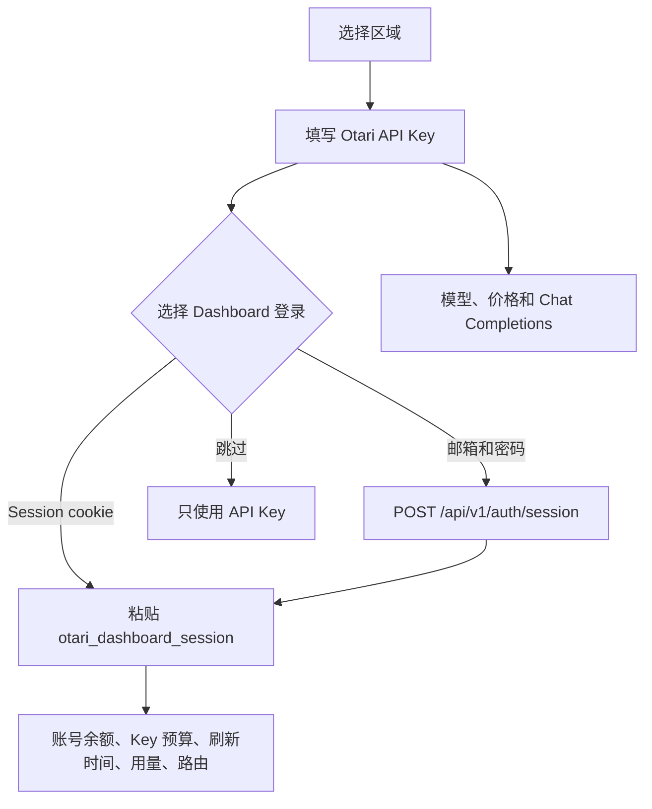

<p align="center">
  
</p>

<h1 align="center">Magpie × Otari 供应商插件</h1>

<p align="center">
  为 <a href="https://usemagpie.ai/">Magpie</a> 接入 <a href="https://otari.ai">Otari</a> AI 网关的供应商插件。<br>
  一个入口搞定模型发现、价格、余额、用量、路由可见性和 Chat Completions。
</p>

<p align="center">
  <a href="README.md">English</a> · <a href="README.zh-CN.md">简体中文</a>
</p>

<p align="center">
  
  
  
  
</p>

## 概览

这个包把 Otari 作为 Magpie 的一等供应商接入。实现方式是可运行在 Magpie Bun 插件宿主里的 OpenCode v1 供应商插件。

模型引用格式：

```text
otari/<Otari 模型 ID>
```

Otari 的模型 ID 本身可以带斜杠。Magpie 按第一个斜杠分隔供应商和模型：

```text
otari/deepseek/deepseek-v4.1-flash
```

## 功能

- 从 `GET /models` 动态读取 Chat 模型。
- 由组织自己配置的 provider key 提供的模型，会优先显示 provider key 的名字，其次组织名，最后用 `organization Inference providers: <provider>` 兜底。
- 将 Otari 的每百万 Token 价格映射到 Magpie 的模型价格字段。
- 模型列表缺少价格时，回退到 `GET /pricing/current`。
- 读取 Dashboard 账号余额、Key 预算、刷新时间、用量和路由。
- 支持 OpenAI-compatible Chat Completions，流式和非流式都可以。
- 通过 `POST /api/v1/auth/session` 自动换取 Dashboard session，无需浏览器回调。
- 支持全球站和 EU 站。
- 无运行时 npm 依赖。

## 工作方式



API Key 始终用于模型调用；Dashboard session 只用于账号级数据读取。

## 环境要求

- 支持插件系统的 Magpie。
- 以 `otk_` 开头的 Otari API Key。
- 可选：Otari Dashboard session，用于读取余额、预算、刷新时间、用量和路由。
- Node.js 20+，仅用于本地测试。

## 安装

从 npm 安装：

```bash
magpie plugin add magpie-otari-provider
```

从 git 仓库安装：

```bash
magpie plugin add github:kabaBZ/magpie-otari-provider
```

从本地目录安装：

```bash
magpie plugin add .
```

然后从 Magpie 插件页面登录，或使用终端：

```bash
magpie plugin login otari
```

### 完整登录

完整登录顺序固定为：

| 步骤 | 字段 | 必填 | 说明 |
| --- | --- | --- | --- |
| 1 | 区域 | 是 | 全球或 EU |
| 2 | Otari API Key | 是 | 会先用 `/models` 验证 |
| 3 | Dashboard 登录方式 | 是 | Session cookie、账密或跳过 |
| 4 | Session/账号字段 | 视选择 | 只有选中对应方式才显示 |

#### Dashboard session cookie

粘贴 `otari_dashboard_session` 的值：

```text
Otari Dashboard session（必填；不填无法获取账号余额、Key 预算、刷新时间和路由策略）
```

只需要 session 值，不需要 Intercom 或其他分析 cookie。

#### 邮箱和密码

插件会调用：

```text
POST /api/v1/auth/session
```

并从响应的 `Set-Cookie` 中读取 `otari_dashboard_session`。

安全行为：

- 密码只用于本次登录请求。
- 请求完成后立即从登录输入中删除密码。
- 密码不会写入 `plugin-auth.json`。
- 只保存 Dashboard session、到期时间、邮箱和账号元数据。

#### 跳过

跳过登录只保留 API Key。模型、价格和 Chat Completions 正常可用；余额、Key 预算、刷新时间和路由不可用。

### 补充现有账号

只用 API Key 登录后，账号行会出现“重新登录”入口。选择：

```text
补充现有账号的 Dashboard 登录
```

这个方式会：

- 复用 Magpie 已保存的 API Key。
- 不再询问区域。
- 不再要求重新录入 API Key。
- 只询问 Dashboard session 或邮箱/密码。
- 更新原账号，不新建第二个账号。

补充登录要求当前只有一个 Otari 账号。存在多个账号时，请使用完整登录方式明确指定账号。

### 账号管理

- 只使用 API Key 的账号仍可用于模型调用。
- 账号行会显示宿主提供的“重新登录”入口，用于后续补充 Dashboard session。
- 添加账号按钮显示“添加另一个 Otari 账号”。
- 添加新账号不会覆盖已有账号。

> [!NOTE]
> 账号行按钮的具体文字由 Magpie 宿主控制。插件可以让按钮出现并控制它的行为，但不能把宿主的“重新登录”改名为别的文字。

## 供应商行为

### 模型发现

插件读取：

```text
GET /api/v1/models
```

只暴露 Chat 模型，并映射：

- 模型 ID 和显示名称；
- 上下文窗口和最大输出 Token；
- 输入/输出模态；
- 工具调用和推理能力标记；
- 每百万 Token 价格。

模型 ID 中的后续斜杠会原样保留。

由您在 **Organization → Providers** 里添加的 provider key 提供的模型，会加显示前缀。
插件先读 `GET /organizations/me/provider-keys`，再对每把 key 请求
`GET /models?provider=<key>`：Otari 只在这条查询里把这些模型标成
`organization`，普通 `/models` 列表一律报 `configured`。前缀按以下顺序选择：

1. 实际提供该模型的那把 provider key 的名字（例如 `[mydeepseek]`）；
2. 组织名（例如 `[kaba's organization]`）；
3. `organization Inference providers: <provider>`（例如
   `[organization Inference providers: deepseek]`）；
4. provider 也不知道时用 `[organization Inference providers]`。

这个前缀只影响显示，不会改变模型 ID，也不影响请求。

### 价格

优先使用 `/models` 返回的 `pricing`。缺失时读取 `/pricing/current`，按 `model_key` 合并。

映射关系：

| Magpie 字段 | Otari 来源 |
| --- | --- |
| `cost.input` | `input_price_per_million` |
| `cost.output` | `output_price_per_million` |
| `cost.cache.read` | `cache_read_price_per_million` |
| `cost.cache.write` | `cache_write_price_per_million` |

Magpie 无法表达的分层价格不会伪造，插件使用首选 offering 的基础价。

> [!IMPORTANT]
> Otari 会在请求的可计费输入超过某一档的 `min_input_tokens` 后提高单价。
> Magpie 没有表示分层价格的字，所以模型卡片只显示基础档：长上下文请求的
> 实际花费可能高于卡片上的价格。插件不会把任何一档向下取成 0。

只有 Otari 自己声明输入、输出都是每百万 Token 0 元时，模型才会被标为
`free`。缺少价格字段按“未知”处理，不按 0 处理；带有非零
`pricing_tiers` 的模型不会被标为免费。

### 余额、用量和路由

Dashboard session 会读取以下接口：

| 接口 | 数据 |
| --- | --- |
| `GET /wallet` | 账号可用余额 |
| `GET /organizations/me/keys` | 按前缀/后缀匹配当前 Key |
| `GET /organizations/me/budgets` | 预算定义 |
| `GET /organizations/me/spend-ceilings` | Key 花费、预算和 `period_end` 刷新时间 |
| `GET /organizations/me/usage/summary` | 最近 30 天用量 |
| `GET /organizations/me/routing-policies` | 已配置的路由策略 |

显示的窗口：

- **Key 预算**：当前花费 / 最大预算，带刷新时间。
- **余额**：账号可用余额。
- **最近 30 天**：费用、请求数和 Token。
- **Otari 路由**：已配置策略，或“未配置路由策略”。

只用 API Key 的账号会返回 `signIn: "kept"` 和明确的 “sign in again” 提示。这样账号仍可用于模型调用，同时会出现宿主的补充登录入口。

### 推理能力

Otari 目前只通过 `supported_parameters` 暴露布尔型推理能力，不暴露 `low`、`medium`、`high` 这类推理档位。

插件把布尔值映射到 Magpie 的 `capabilities.reasoning`，不会虚构推理档位。

## 配置

### 供应商 ID

默认供应商 ID 是 `otari`。

如果该 ID 已被其他供应商占用，可以配置唯一 ID：

```bash
magpie plugin options otari-provider '{"providerID":"otari-provider"}'
```

然后模型前缀会变成：

```text
otari-provider/<Otari 模型 ID>
```

### 区域

登录流程目前提供：

- 全球：`https://api.otari.ai/api/v1`
- EU：`https://eu.api.otari.ai/api/v1`

自托管和自定义 base URL 登录暂时隐藏，底层 URL 规范化代码仍保留。

### Session 有效期

Dashboard session 的到期时间保存在 `dashboardExpiresAt`。过期后余额、预算和路由会消失，需要重新补充 session；API Key 仍然可以继续调用模型。

## 测试

```bash
npm run check
npm test
```

测试使用 Node 内置测试框架和 mock HTTP 响应，覆盖：

- 供应商和 Prompt 结构；
- 模型和价格映射（含免费价格判定）；
- API Key、cookie、账密登录；
- 跳过 Dashboard 登录；
- 错误账密后的重试；
- 补充登录复用原账号；
- 用量、余额和路由窗口映射。

### 真实联调

```powershell
$env:OTARI_API_KEY = "otk_..."
$env:OTARI_BASE_URL = "https://api.otari.ai/api/v1"
$env:OTARI_DASHBOARD_SESSION = "otari_dashboard_session 的值"
$env:OTARI_SMOKE_MODEL = "deepseek/deepseek-v4.1-flash"
npm run smoke
```

`OTARI_DASHBOARD_SESSION` 和 `OTARI_SMOKE_MODEL` 可选。smoke 会发真实 Chat Completions 请求，可能产生费用。

## 排错

### 价格缺失

确认 API Key 可以读取 `/models`。如果模型没有 `pricing`，插件会尝试 `/pricing/current`。

### 余额缺失

托管 Otari 的余额和 Key 预算需要 Dashboard session。只有 API Key 不够。

### 路由为空

`/organizations/me/routing-policies` 对当前 workspace 返回空列表，插件会显示“未配置路由策略”。

### 出现两个账号

补充现有账号时请使用 **补充现有账号的 Dashboard 登录**，不要走添加账号流程。

### 供应商被隐藏

`otari` ID 可能已被占用。删除旧供应商，或配置唯一的 `providerID`。

## 安全

- API Key 和 Dashboard session 由 Magpie 保存在 `plugin-auth.json`。
- 插件不会持久化账号密码。
- 插件不会打印 Key、cookie 或请求体。
- Dashboard session 是敏感凭据，会过期，请像密码一样保管。
- 托管接口请使用 HTTPS。

如果 session 或密码已经泄露，请在 Otari Dashboard 退出登录、重新登录，并把新 session 填回插件。

## 开发

```text
index.mjs          供应商插件钩子
test/otari.test.mjs 单元测试
scripts/smoke.mjs  可选的实机 smoke 测试
```

插件是纯 ESM，没有运行时依赖。

## 许可证

MIT，见 [LICENSE](LICENSE)。
