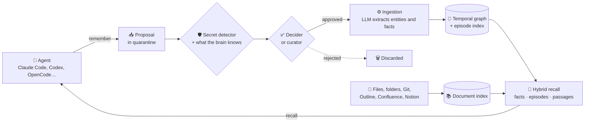

<div align="center">


# MimirSynth

**Long-term memory for your AI agents that you review, that keeps its history, and that runs on your own infrastructure.**

**English** · [Español](README.es.md)

[](#status) [](https://github.com/MimirSynth/mimirsynth/releases/latest) [](LICENSE) [](#connect-your-agent) [](https://github.com/MimirSynth/mimirsynth/wiki)

[Quick start](#quick-start) · [How it works](#how-it-works) · [Screenshots](#a-tour-of-the-interface) · [Connect your agent](#connect-your-agent) · [Wiki](https://github.com/MimirSynth/mimirsynth/wiki)

<picture>
  <source media="(prefers-color-scheme: dark)" srcset="docs/images/readme/graph-dark.png">
  
</picture>

</div>

Your agents forget everything when the session ends. MimirSynth gives them a shared memory: before they answer they **recall** what is already known, and while they work they **propose** what should be remembered. A person, or an automatic decider, reviews each proposal before it becomes memory. When something stops being true it is **invalidated, not overwritten**, so you can always see what was known and since when.

It is built on the [CoALA](https://arxiv.org/abs/2309.02427) cognitive framework and on a temporal knowledge graph ([Graphiti](https://github.com/getzep/graphiti)), with its own web interface for the people who look after the memory.

<a id="status"></a>

> [!NOTE]
> **Public beta (0.x).** It works end to end, but until 1.0 the API, the MCP tools and the database schema may change between minor versions. Migrations run on start, `update.sh` makes a backup first, and anything that needs a step on your side is in the [changelog](CHANGELOG.md). Found a problem? [Open an issue](https://github.com/MimirSynth/mimirsynth/issues/new/choose) (never paste tokens or passwords); questions go to [Discussions](https://github.com/MimirSynth/mimirsynth/discussions/categories/q-a).

## Why MimirSynth

| | |
|---|---|
| 🛡️ **Reviewed memory** | Whatever an agent writes waits in **quarantine** until a curator approves it, or until a decider approves it against the brain's scope. A secret detector masks credentials before anything is stored. What your agents recall has been checked. |
| 🕰️ **History, not overwrites** | Every fact has validity dates. When it stops being true it is invalidated, and the new fact says what it replaces. Ask what was true at any point in time. |
| 🧠 **Isolated brains** | Each knowledge domain (a team, a project, your personal notes) has its own graph, ontology, members and tokens. A brain can lend read access to another, with an expiry date. |
| 🏠 **Self-hosted and open** | Docker on your own machine, with any OpenAI-compatible model (cloud, Ollama, a proxy). Apache-2.0, no cloud service, nothing leaves the instance unless you configure it. |

### How it compares

| | Plain RAG / vector DB | Chat history | Graphiti on its own | **MimirSynth** |
|---|:---:|:---:|:---:|:---:|
| Remembers facts across sessions | ⚠️ documents only | ✅ | ✅ | ✅ |
| Knows when a fact stopped being true | ❌ | ❌ | ✅ | ✅ |
| Review before something enters memory | ❌ | ❌ | ❌ | ✅ |
| Users, roles, per-brain tokens and audit log | ❌ | ❌ | ❌ | ✅ |
| Web interface to explore and curate | ❌ | ❌ | ❌ | ✅ |
| Facts, episodes and document passages in one recall | ❌ | ❌ | ⚠️ facts and episodes | ✅ |
| MCP server and agent plugins | ⚠️ | ❌ | ⚠️ reference server | ✅ |

Graphiti is the engine: MimirSynth uses it as a library and adds the people, the review, the documents and the interface around it.

## How it works

### The memory layers

CoALA splits an agent's memory into types, and each one has its place in MimirSynth:

| Layer | What it holds | Example | Where it lives |
|---|---|---|---|
| **Working memory** | The context injected into the agent's prompt for the current question | *"auth-service stores sessions in sessions-kv (replaces: in Redis on redis-01)"* | Built on each `recall`, never stored |
| **Episodic** | What happened, exactly as it was written, never changed | *"20 Oct: auth-service moved its sessions from redis-01 to a Valkey cluster"* | Graph episodes, plus their text in PostgreSQL (vectors and full text) |
| **Semantic** | Entities and the facts between them, with the dates when each was valid | `auth-service` → *depends on* → `sessions-kv`, valid since 2026-10-20 | Temporal knowledge graph (FalkorDB or Neo4j) |
| **Documents** | What your files, folders and wikis say | A passage of the *Restore orders-db* runbook | Chunks with vectors and full text in PostgreSQL; originals on a volume |

### The loop: propose, review, remember, recall



1. **Propose.** The agent calls `remember` with what it learned. A contributor's proposal never goes straight into memory.
2. **Review.** The secret detector masks or blocks credentials, and the proposal is compared with what the brain already knows (*very similar to…*, *possibly no longer true*). A curator approves it, or the decider does if it clearly fits the brain's scope. The decider never rejects on its own.
3. **Remember.** Approved proposals are ingested in a queued job: an LLM extracts entities and facts, and facts the new one contradicts are invalidated with a date.
4. **Recall.** Before answering, the agent asks a question. Without calling an LLM, MimirSynth fuses current facts, episode fragments and document passages, puts what may be superseded last with what replaced it, and returns context ready for the prompt.

### Facts are invalidated, never overwritten

```text
2026-05-20  auth-service stores its sessions in Redis on redis-01         ─┐ invalid since 2026-10-20
2026-10-20  auth-service stores sessions in a Valkey cluster, sessions-kv ◀┘ replaces it
```

Both facts stay in the graph. An agent asking today gets the current one first, with *replaces «…redis-01»* next to it. Someone asking how it was set up in September can still find the old one.

## A tour of the interface

The web interface is for the people who look after the memory: curators, administrators, or just you curating your own brain. It is in **English and Spanish**, with light and dark themes. *The screenshots use a fictional company.*

**Explore the graph.** Find a node, see its facts and neighbours, and switch between 2D, radial, tree and 3D. Dashed edges are facts that are no longer true.

<p align="center"></p>

**Review what agents propose.** Each proposal shows what the brain already knows about it, flags the credentials it masked and warns when it may contradict a current fact. Approve or reject, also with the keyboard.

<p align="center"></p>

**Ask the memory.** See exactly what an agent would receive for a question, or get a written answer that cites the fact or episode behind each claim.

<p align="center"></p>

<table>
<tr>
<td width="50%" valign="top">
<picture>
  <source media="(prefers-color-scheme: dark)" srcset="docs/images/readme/entity-dark.png">
  
</picture>
<p><b>Entity page.</b> A summary written from its facts, related entities, current and earlier facts grouped by relation, and the episodes they came from. Pick a date to see it as it was.</p>
</td>
<td width="50%" valign="top">
<picture>
  <source media="(prefers-color-scheme: dark)" srcset="docs/images/readme/proposals-dark.png">
  
</picture>
<p><b>Proposals.</b> Sorted by risk and age. Here a new backup time looks like a fact that already stopped being true, so the curator is warned before bringing it back; what the proposal adds is underlined.</p>
</td>
</tr>
<tr>
<td width="50%" valign="top">
<picture>
  <source media="(prefers-color-scheme: dark)" srcset="docs/images/readme/ask-dark.png">
  
</picture>
<p><b>Ask.</b> The answer only uses what the recall returned, and each claim links to its source. Mark results as expected to build reference queries that catch recall regressions.</p>
</td>
<td width="50%" valign="top">
<picture>
  <source media="(prefers-color-scheme: dark)" srcset="docs/images/readme/connect-dark.png">
  
</picture>
<p><b>Connect an agent.</b> Pick your agent, create a token and copy what it needs, already filled in. The step turns green on the agent's first call.</p>
</td>
</tr>
</table>

Also in the interface: **Facts** and a **timeline** of what was learned and invalidated, the **Journal** of episodes, **Knowledge** (documents and sources), **Vocabulary** and ontology upkeep (type corrector, duplicate merging, relation aliases, contradictions), **Quality** (reference queries and recall ratings), **Jobs**, **Notifications** and **Administration**.

## Quick start

New to AI agents? **[Your first 15 minutes](https://github.com/MimirSynth/mimirsynth/wiki/Your-first-15-minutes)** takes you from an empty computer to an agent that remembers, with every step explained.

You need **Docker** and two OpenAI-compatible endpoints: one for **embeddings** and one for the **extraction LLM** ([which model](docs/CONFIGURATION.md#choosing-the-extraction-model)). The installer can start a bundled Ollama for the embeddings. Without an LLM the instance starts, but approved proposals are not turned into memory.

**Linux or macOS:**
```bash
curl -fsSL https://github.com/MimirSynth/mimirsynth/releases/latest/download/install.sh | bash
```
**Windows** (PowerShell, with Docker Desktop):
```powershell
irm https://github.com/MimirSynth/mimirsynth/releases/latest/download/install.ps1 | iex
```

On Linux the installer offers to install Docker if it is missing. It asks whether to start a bundled FalkorDB or use your own FalkorDB or Neo4j, and whether to start Ollama for embeddings. It generates the secrets, starts everything and opens the browser on the **setup wizard**: administrator account, graph database, embeddings and LLM (each with a connection test), your first brain, and a token for your agent. Options without questions, checksums and the manual installation are in [docs/INSTALL.md](docs/INSTALL.md).

| I want to… | Start here |
|---|---|
| Try it on my computer, step by step | [Your first 15 minutes](https://github.com/MimirSynth/mimirsynth/wiki/Your-first-15-minutes) |
| Install it on a server, with HTTPS and backups | [Installation](docs/INSTALL.md) · [HTTPS and reverse proxy](https://github.com/MimirSynth/mimirsynth/wiki/HTTPS-and-reverse-proxy) · [Upgrade and backups](https://github.com/MimirSynth/mimirsynth/wiki/Upgrade-and-backups) |
| Give my coding agent memory | [Connect your agent](#connect-your-agent) |
| Share a memory with my team | [Brains and members](https://github.com/MimirSynth/mimirsynth/wiki/Brains-and-members) · [Roles and permissions](https://github.com/MimirSynth/mimirsynth/wiki/Roles-and-permissions) · [OIDC identity](https://github.com/MimirSynth/mimirsynth/wiki/OIDC-identity) |
| Add my documents and wikis | [Document memory](docs/DOCUMENTS.md) |
| Understand the design | [Architecture](docs/ARCHITECTURE.md) · [Ontology](docs/ONTOLOGY.md) · [Federation](docs/FEDERATION.md) |

## Connect your agent

The wizard's last step, also under **Administration → Brain → Connect an agent**, gives you what to paste for each agent, already filled in with your server, brain and a token:

**[Claude Code](integrations/claude-code)** · **[Codex](integrations/codex)** · **[OpenCode](integrations/opencode)** · **[Hermes Agent](integrations/hermes-agent/plugin)** · **[OpenClaw](integrations/openclaw)** · **any MCP client** · **[REST API](https://github.com/MimirSynth/mimirsynth/wiki/REST-API)**

The plugins bring the recall into the agent's context before it answers, show what changed since the last session, and let it propose memories. By hand, with a **Contributor** token from **My account → API tokens** (it is shown only once) and Claude Code over MCP:

```bash
claude mcp add --transport http mimirsynth "http://localhost:8000/api/brains/my-brain/mcp" --header "Authorization: Bearer mst_..."
```

The built-in MCP server gives the agent these tools:

| Tool | What it does |
|---|---|
| `recall` | Searches the brain and returns context ready for the prompt: current facts, marked earlier ones, episode fragments and document passages |
| `remember` | Proposes knowledge that should persist (a decision, a setting, a fix). It waits in quarantine unless the token's role allows more |
| `correct` | Proposes invalidating a fact that is no longer true, with the reason |
| `facts_about` | Everything the brain knows about one entity, current and earlier |
| `timeline` | How what is known about an entity changed over time |
| `whats_new` | What was learned and invalidated since a date, for the start of a session |
| `get_document` | Reads a document passage with the text around it |
| `rate` | Tells the brain whether a recall was useful, irrelevant or wrong |

Each token is scoped to one brain, never exceeds its creator's role, and can be limited to recall, documents or proposing. More in [docs/AGENTS.md](docs/AGENTS.md).

## Features at a glance

<details>
<summary><b>Memory that keeps its history</b></summary>

- **Temporal facts** with validity dates: invalidated, never overwritten, so you can ask what was known at any moment.
- **Brains**: isolated knowledge domains, each with its own graph, ontology, members and tokens. **Federation** lends read access to another brain, with an expiry and revocable at any time.
- **Ontology packages** (general, infrastructure, team projects, personal and family, software knowledge), versioned and updatable without losing your own changes.
- **Export and import** a brain.
</details>

<details>
<summary><b>What goes in is reviewed</b></summary>

- **Proposal quarantine**, with a curator or an automatic **decider** that judges each proposal against the brain's scope.
- **Secret detector**: credentials in proposals and documents are masked, blocked or flagged, as each brain chooses.
- **Upkeep tools**: type corrector, duplicate merging, relation aliases, summary review and **contradictions** between current facts.
- **Incoming webhooks** that turn events from other systems into proposals.
</details>

<details>
<summary><b>Recall for agents</b></summary>

- **Hybrid recall** of facts, episode text and document passages, fused with reciprocal rank fusion and a recency weight, in the caller's language. No LLM call on the read path.
- **Built-in MCP server**, REST API and plugins for Claude Code, Codex, OpenCode, Hermes Agent and OpenClaw.
- **Reference queries** per brain to measure recall quality and catch regressions, for instance when changing the embedding model, which can be done from the interface.
</details>

<details>
<summary><b>Documents</b></summary>

- Upload files, or connect **folders**, **Git repositories** and **wikis** (Outline, Confluence, Notion) as sources. Duplicates are detected and indexed only once; scanned PDFs and images are read with optional OCR.
- A passage can be **promoted** to memory as a proposal.
</details>

<details>
<summary><b>Administration and operations</b></summary>

- Own accounts with **two-factor** and **passkeys**, several **OIDC** providers with group-based roles, per-brain roles and an **audit log**.
- AI engines, embeddings and deciders configured in the interface, with keys encrypted in the database, and **AI consumption** per purpose.
- **Notifications** in the app and through Telegram, ntfy, Gotify, webhook or email.
- **Prometheus metrics** and a [Grafana dashboard](docs/grafana); `update.sh` backs up, updates and rolls back in one step.
</details>

## Documentation

- **User guide:** the [wiki](https://github.com/MimirSynth/mimirsynth/wiki) (also [in Spanish](https://github.com/MimirSynth/mimirsynth/wiki/Inicio)), with a page per screen, concepts, a glossary and troubleshooting.
- **Technical:** [installation](docs/INSTALL.md), [configuration](docs/CONFIGURATION.md) (including the environment variables), [connecting agents](docs/AGENTS.md), [architecture](docs/ARCHITECTURE.md), [ontology](docs/ONTOLOGY.md), [document memory](docs/DOCUMENTS.md), [federation](docs/FEDERATION.md) and [notifications](docs/NOTIFICATIONS.md).

In production, point an external monitor at `/api/health`: the built-in alerts cannot report PostgreSQL going down ([monitoring](docs/INSTALL.md#monitoring-the-instance)).

## The name

Mímir is the guardian of the well of knowledge (Mímisbrunnr) in Norse mythology. According to the Ynglinga saga, Odin keeps his head and consults it for advice: an external memory that is queried. "Synth" alludes to synthetic memory and to synthesis: the system consolidates episodes into knowledge. It has no relation to Grafana Mimir or to other projects called Mimir.

## License

Apache-2.0. See [LICENSE](LICENSE) and [NOTICE](NOTICE). Dependencies have their own licenses; FalkorDB, for example, is *source-available* (SSPL): see [docs/ARCHITECTURE.md](docs/ARCHITECTURE.md#dependencies-and-licenses).

## Contributing

Read [CONTRIBUTING.md](CONTRIBUTING.md). The project works in English, and Spanish is welcome in issues and discussions. For vulnerabilities, see [SECURITY.md](SECURITY.md).
