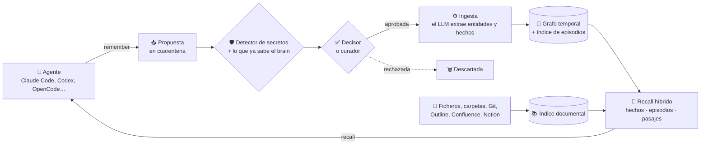

<div align="center">


# MimirSynth

**Memoria a largo plazo para tus agentes de IA: la revisas tú, conserva su historia y corre en tu propia infraestructura.**

[English](README.md) · **Español**

[](#estado) [](https://github.com/MimirSynth/mimirsynth/releases/latest) [](LICENSE) [](#conecta-tu-agente) [](https://github.com/MimirSynth/mimirsynth/wiki/Inicio)

[Inicio rápido](#inicio-rápido) · [Cómo funciona](#cómo-funciona) · [Capturas](#un-paseo-por-la-interfaz) · [Conecta tu agente](#conecta-tu-agente) · [Wiki](https://github.com/MimirSynth/mimirsynth/wiki/Inicio)

<picture>
  <source media="(prefers-color-scheme: dark)" srcset="docs/images/readme/graph-dark.png">
  
</picture>

</div>

Tus agentes lo olvidan todo al terminar la sesión. MimirSynth les da una memoria compartida: antes de responder **recuerdan** lo que ya se sabe y, mientras trabajan, **proponen** lo que merece recordarse. Una persona, o un decisor automático, revisa cada propuesta antes de que pase a la memoria. Cuando algo deja de ser cierto se **invalida, no se sobrescribe**, así que siempre puedes ver qué se sabía y desde cuándo.

Se basa en el marco cognitivo [CoALA](https://arxiv.org/abs/2309.02427) y en un grafo de conocimiento temporal ([Graphiti](https://github.com/getzep/graphiti)), con interfaz web propia para quienes cuidan la memoria.

<a id="estado"></a>

> [!NOTE]
> **Beta pública (0.x).** Funciona de extremo a extremo, pero hasta la 1.0 la API, las herramientas MCP y el esquema de la base de datos pueden cambiar entre versiones menores. Las migraciones se aplican al arrancar, `update.sh` hace antes una copia de seguridad y lo que requiera un paso por tu parte está en el [changelog](CHANGELOG.md). ¿Algo falla? [Abre una issue](https://github.com/MimirSynth/mimirsynth/issues/new/choose) (sin pegar nunca tokens ni contraseñas); las preguntas, en [Discussions](https://github.com/MimirSynth/mimirsynth/discussions/categories/q-a).

## Por qué MimirSynth

| | |
|---|---|
| 🛡️ **Memoria revisada** | Lo que escribe un agente espera en **cuarentena** hasta que lo aprueba un curador, o el decisor si encaja en el ámbito del brain. Un detector de secretos tapa las credenciales antes de guardar nada. Lo que recuerdan tus agentes está revisado. |
| 🕰️ **Historia, no sobrescrituras** | Cada hecho tiene fechas de validez. Cuando deja de ser cierto se invalida, y el hecho nuevo dice a cuál sustituye. Puedes preguntar qué era cierto en cualquier momento. |
| 🧠 **Brains aislados** | Cada dominio de conocimiento (un equipo, un proyecto, tus notas personales) tiene su grafo, su ontología, sus miembros y sus tokens. Un brain puede prestar acceso de lectura a otro, con caducidad. |
| 🏠 **Autoalojado y abierto** | Docker en tu propia máquina, con cualquier modelo compatible con OpenAI (nube, Ollama, un proxy). Apache-2.0, sin servicio en la nube; nada sale de la instancia si no lo configuras tú. |

### Comparado con otras opciones

| | RAG / base vectorial | Historial del chat | Graphiti a secas | **MimirSynth** |
|---|:---:|:---:|:---:|:---:|
| Recuerda hechos entre sesiones | ⚠️ solo documentos | ✅ | ✅ | ✅ |
| Sabe cuándo un hecho dejó de ser cierto | ❌ | ❌ | ✅ | ✅ |
| Revisión antes de entrar en la memoria | ❌ | ❌ | ❌ | ✅ |
| Usuarios, roles, tokens por brain y auditoría | ❌ | ❌ | ❌ | ✅ |
| Interfaz web para explorar y curar | ❌ | ❌ | ❌ | ✅ |
| Hechos, episodios y pasajes de documentos en un solo recall | ❌ | ❌ | ⚠️ hechos y episodios | ✅ |
| Servidor MCP y plugins para agentes | ⚠️ | ❌ | ⚠️ servidor de referencia | ✅ |

Graphiti es el motor: MimirSynth lo usa como biblioteca y le añade las personas, la revisión, los documentos y la interfaz.

## Cómo funciona

### Las capas de memoria

CoALA divide la memoria de un agente en tipos, y cada uno tiene su sitio en MimirSynth:

| Capa | Qué guarda | Ejemplo | Dónde vive |
|---|---|---|---|
| **Memoria de trabajo** | El contexto que se inyecta en el prompt del agente para la pregunta actual | *«auth-service guarda las sesiones en sessions-kv (sustituye a: en Redis en redis-01)»* | Se construye en cada `recall`, no se guarda |
| **Episódica** | Lo que pasó, tal como se escribió, sin cambiarlo nunca | *«20 oct: auth-service movió sus sesiones de redis-01 a un clúster Valkey»* | Episodios del grafo, más su texto en PostgreSQL (vectores y texto completo) |
| **Semántica** | Las entidades y los hechos entre ellas, con las fechas en que cada uno fue válido | `auth-service` → *depende de* → `sessions-kv`, válido desde 2026-10-20 | Grafo de conocimiento temporal (FalkorDB o Neo4j) |
| **Documental** | Lo que dicen tus ficheros, carpetas y wikis | Un pasaje del runbook *Restaurar orders-db* | Trozos con vectores y texto completo en PostgreSQL; originales en un volumen |

### El ciclo: proponer, revisar, recordar, consultar



1. **Proponer.** El agente llama a `remember` con lo que ha aprendido. Lo que propone un colaborador nunca entra directamente en la memoria.
2. **Revisar.** El detector de secretos tapa o bloquea las credenciales, y la propuesta se compara con lo que el brain ya sabe (*muy parecida a…*, *puede que ya no sea cierto*). La aprueba un curador, o el decisor si encaja claramente en el ámbito del brain. El decisor nunca rechaza por su cuenta.
3. **Recordar.** Las propuestas aprobadas se ingieren en un trabajo en cola: un LLM extrae entidades y hechos, y los hechos que el nuevo contradice se invalidan con fecha.
4. **Consultar.** Antes de responder, el agente pregunta. Sin llamar a ningún LLM, MimirSynth combina hechos vigentes, fragmentos de episodios y pasajes de documentos, deja al final lo que puede estar superado junto con lo que lo sustituyó, y devuelve el contexto listo para el prompt.

### Los hechos se invalidan, nunca se sobrescriben

```text
2026-05-20  auth-service stores its sessions in Redis on redis-01         ─┐ inválido desde 2026-10-20
2026-10-20  auth-service stores sessions in a Valkey cluster, sessions-kv ◀┘ lo sustituye
```

Los dos hechos siguen en el grafo. Un agente que pregunta hoy recibe primero el vigente, con *sustituye a «…redis-01»* al lado. Quien pregunte cómo estaba montado en septiembre puede seguir encontrando el antiguo.

## Un paseo por la interfaz

La interfaz web es para quienes cuidan la memoria: curadores, administradores o tú mismo curando tu propio brain. Está en **castellano e inglés**, con tema claro y oscuro. *Las capturas usan una empresa ficticia y la interfaz en inglés.*

**Explora el grafo.** Busca un nodo, mira sus hechos y sus vecinos, y cambia entre 2D, radial, árbol y 3D. Las aristas discontinuas son hechos que ya no son ciertos.

<p align="center"></p>

**Revisa lo que proponen los agentes.** Cada propuesta muestra lo que el brain ya sabe de ella, señala las credenciales que ha tapado y avisa cuando puede contradecir un hecho vigente. Aprueba o rechaza, también con el teclado.

<p align="center"></p>

**Pregunta a la memoria.** Mira exactamente lo que recibiría un agente para una pregunta, o pide una respuesta escrita que cita el hecho o el episodio de cada afirmación.

<p align="center"></p>

<table>
<tr>
<td width="50%" valign="top">
<picture>
  <source media="(prefers-color-scheme: dark)" srcset="docs/images/readme/entity-dark.png">
  
</picture>
<p><b>Página de entidad.</b> Un resumen escrito a partir de sus hechos, las entidades relacionadas, los hechos vigentes y anteriores agrupados por relación y los episodios de los que salieron. Elige una fecha para verla como estaba.</p>
</td>
<td width="50%" valign="top">
<picture>
  <source media="(prefers-color-scheme: dark)" srcset="docs/images/readme/proposals-dark.png">
  
</picture>
<p><b>Propuestas.</b> Ordenadas por riesgo y antigüedad. Aquí una hora de copia nueva se parece a un hecho que ya dejó de ser cierto, y se avisa al curador antes de que lo resucite; lo que aporta la propuesta va subrayado.</p>
</td>
</tr>
<tr>
<td width="50%" valign="top">
<picture>
  <source media="(prefers-color-scheme: dark)" srcset="docs/images/readme/ask-dark.png">
  
</picture>
<p><b>Preguntar.</b> La respuesta solo usa lo que devolvió el recall, y cada afirmación enlaza a su fuente. Marca resultados como esperados para crear consultas de referencia que detecten empeoramientos del recall.</p>
</td>
<td width="50%" valign="top">
<picture>
  <source media="(prefers-color-scheme: dark)" srcset="docs/images/readme/connect-dark.png">
  
</picture>
<p><b>Conectar un agente.</b> Elige tu agente, crea un token y copia lo que necesita, ya relleno. El paso se pone en verde con la primera llamada del agente.</p>
</td>
</tr>
</table>

También en la interfaz: **Hechos** y una **línea temporal** de lo aprendido e invalidado, el **Diario** de episodios, **Conocimiento** (documentos y fuentes), **Vocabulario** y mantenimiento de la ontología (corrector de tipos, fusión de duplicados, alias de relaciones, contradicciones), **Calidad** (consultas de referencia y valoraciones del recall), **Trabajos**, **Notificaciones** y **Administración**.

## Inicio rápido

¿Empiezas con agentes de IA? **[Tus primeros 15 minutos](https://github.com/MimirSynth/mimirsynth/wiki/Tus-primeros-15-minutos)** te lleva de un equipo vacío a un agente que recuerda, con cada paso explicado.

Necesitas **Docker** y dos endpoints compatibles con OpenAI: uno para **embeddings** y otro para el **LLM de extracción** ([qué modelo](docs/es/CONFIGURATION.md#elegir-el-modelo-de-extracción)). El instalador puede arrancar un Ollama incluido para los embeddings. Sin LLM la instancia arranca, pero las propuestas aprobadas no se convierten en memoria.

**Linux o macOS:**
```bash
curl -fsSL https://github.com/MimirSynth/mimirsynth/releases/latest/download/install.sh | bash
```
**Windows** (PowerShell, con Docker Desktop):
```powershell
irm https://github.com/MimirSynth/mimirsynth/releases/latest/download/install.ps1 | iex
```

En Linux el instalador ofrece instalar Docker si falta. Pregunta si arrancar un FalkorDB incluido o usar tu propio FalkorDB o Neo4j, y si arrancar Ollama para los embeddings. Genera los secretos, lo arranca todo y abre el navegador en el **asistente de configuración**: cuenta de administrador, base de datos del grafo, embeddings y LLM (cada uno con su prueba de conexión), tu primer brain y un token para tu agente. Opciones sin preguntas, sumas de comprobación e instalación manual: [docs/es/INSTALL.md](docs/es/INSTALL.md).

| Quiero… | Empieza aquí |
|---|---|
| Probarlo en mi equipo, paso a paso | [Tus primeros 15 minutos](https://github.com/MimirSynth/mimirsynth/wiki/Tus-primeros-15-minutos) |
| Instalarlo en un servidor, con HTTPS y copias | [Instalación](docs/es/INSTALL.md) · [HTTPS y proxy inverso](https://github.com/MimirSynth/mimirsynth/wiki/HTTPS-y-proxy-inverso) · [Actualización y copias de seguridad](https://github.com/MimirSynth/mimirsynth/wiki/Actualización-y-copias-de-seguridad) |
| Darle memoria a mi agente de programación | [Conecta tu agente](#conecta-tu-agente) |
| Compartir una memoria con mi equipo | [Brains y miembros](https://github.com/MimirSynth/mimirsynth/wiki/Administrar-brains-y-miembros) · [Roles y permisos](https://github.com/MimirSynth/mimirsynth/wiki/Roles-y-permisos) · [Identidad OIDC](https://github.com/MimirSynth/mimirsynth/wiki/Identidad-OIDC) |
| Añadir mis documentos y wikis | [Memoria documental](docs/es/DOCUMENTS.md) |
| Entender el diseño | [Arquitectura](docs/es/ARCHITECTURE.md) · [Ontología](docs/es/ONTOLOGY.md) · [Federación](docs/es/FEDERATION.md) |

## Conecta tu agente

El último paso del asistente, también en **Administración → Brain → Conectar un agente**, te da lo que hay que pegar para cada agente, ya con tu servidor, tu brain y un token:

**[Claude Code](integrations/claude-code/README.es.md)** · **[Codex](integrations/codex/README.es.md)** · **[OpenCode](integrations/opencode/README.es.md)** · **[Hermes Agent](integrations/hermes-agent/plugin/README.es.md)** · **[OpenClaw](integrations/openclaw/README.es.md)** · **cualquier cliente MCP** · **[API REST](https://github.com/MimirSynth/mimirsynth/wiki/API-REST)**

Los plugins llevan el recall al contexto del agente antes de que responda, muestran lo que cambió desde la última sesión y le dejan proponer memorias. A mano, con un token de **Colaborador** de **Mi cuenta → Tokens de API** (solo se muestra una vez) y Claude Code por MCP:

```bash
claude mcp add --transport http mimirsynth "http://localhost:8000/api/brains/mi-brain/mcp" --header "Authorization: Bearer mst_..."
```

El servidor MCP incluido le da al agente estas herramientas:

| Herramienta | Qué hace |
|---|---|
| `recall` | Busca en el brain y devuelve contexto listo para el prompt: hechos vigentes, anteriores marcados, fragmentos de episodios y pasajes de documentos |
| `remember` | Propone un conocimiento que deba persistir (una decisión, una configuración, un arreglo). Queda en cuarentena salvo que el rol del token permita más |
| `correct` | Propone invalidar un hecho que ya no es cierto, con el motivo |
| `facts_about` | Todo lo que el brain sabe de una entidad, vigente y anterior |
| `timeline` | Cómo cambió con el tiempo lo que se sabe de una entidad |
| `whats_new` | Lo aprendido e invalidado desde una fecha, para empezar una sesión |
| `get_document` | Lee un pasaje de un documento con el texto de alrededor |
| `rate` | Le dice al brain si un recall fue útil, irrelevante o incorrecto |

Cada token se limita a un brain, nunca supera el rol de quien lo crea y puede restringirse a consultar, documentos o proponer. Más en [docs/es/AGENTS.md](docs/es/AGENTS.md).

## Funciones de un vistazo

<details>
<summary><b>Una memoria que conserva su historia</b></summary>

- **Hechos temporales** con fechas de validez: se invalidan, nunca se sobrescriben, así que puedes preguntar qué se sabía en cualquier momento.
- **Brains**: dominios de conocimiento aislados, cada uno con su grafo, su ontología, sus miembros y sus tokens. La **federación** presta acceso de lectura a otro brain, con caducidad y revocable en cualquier momento.
- **Paquetes de ontología** (general, infraestructura, proyectos de equipo, personal y familia, conocimiento de software), versionados y actualizables sin perder tus propios cambios.
- **Exportar e importar** un brain.
</details>

<details>
<summary><b>Lo que entra se revisa</b></summary>

- **Cuarentena de propuestas**, con un curador o un **decisor** automático que juzga cada propuesta según el ámbito del brain.
- **Detector de secretos**: las credenciales en propuestas y documentos se tapan, se bloquean o se señalan, según elija cada brain.
- **Herramientas de mantenimiento**: corrector de tipos, fusión de duplicados, alias de relaciones, revisión de resúmenes y **contradicciones** entre hechos vigentes.
- **Webhooks de entrada** que convierten eventos de otros sistemas en propuestas.
</details>

<details>
<summary><b>Recall para agentes</b></summary>

- **Recall híbrido** de hechos, texto de episodios y pasajes de documentos, combinados con fusión por rango recíproco y un peso por recencia, en el idioma de quien pregunta. Sin llamadas a un LLM al leer.
- **Servidor MCP propio**, API REST y plugins para Claude Code, Codex, OpenCode, Hermes Agent y OpenClaw.
- **Consultas de referencia** por brain para medir la calidad del recall y detectar empeoramientos, por ejemplo al cambiar el modelo de embeddings, algo que se hace desde la interfaz.
</details>

<details>
<summary><b>Documentos</b></summary>

- Sube ficheros o conecta **carpetas**, **repositorios Git** y **wikis** (Outline, Confluence, Notion) como fuentes. Los duplicados se detectan y se indexan una sola vez; los PDF escaneados y las imágenes se leen con OCR opcional.
- Un pasaje se puede **promover** a la memoria como propuesta.
</details>

<details>
<summary><b>Administración y operación</b></summary>

- Cuentas propias con **doble factor** y **llaves de acceso** (passkeys), varios proveedores **OIDC** con roles por grupo, roles por brain y **registro de auditoría**.
- Motores de IA, embeddings y decisores configurados en la interfaz, con las claves cifradas en la base de datos, y **consumo de IA** por propósito.
- **Notificaciones** en la aplicación y por Telegram, ntfy, Gotify, webhook o correo.
- **Métricas de Prometheus** y un [dashboard de Grafana](docs/grafana); `update.sh` hace copia, actualiza y vuelve atrás en un paso.
</details>

## Documentación

- **Guía de usuario:** la [wiki](https://github.com/MimirSynth/mimirsynth/wiki/Inicio) (también [en inglés](https://github.com/MimirSynth/mimirsynth/wiki)), con una página por pantalla, conceptos, glosario y solución de problemas.
- **Técnica:** [instalación](docs/es/INSTALL.md), [configuración](docs/es/CONFIGURATION.md) (con las variables de entorno), [conectar agentes](docs/es/AGENTS.md), [arquitectura](docs/es/ARCHITECTURE.md), [ontología](docs/es/ONTOLOGY.md), [memoria documental](docs/es/DOCUMENTS.md), [federación](docs/es/FEDERATION.md) y [notificaciones](docs/es/NOTIFICATIONS.md).

En producción, apunta un monitor externo a `/api/health`: los avisos de la propia instancia no pueden informar de la caída de PostgreSQL ([vigilancia](docs/es/INSTALL.md#vigilar-la-instancia)).

## El nombre

Mímir es el guardián del pozo del conocimiento (Mímisbrunnr) en la mitología nórdica. Según la Ynglinga saga, Odín conserva su cabeza y la consulta para pedirle consejo: una memoria externa que se consulta. «Synth» alude a la memoria sintética y a la síntesis: el sistema consolida episodios en conocimiento. No tiene relación con Grafana Mimir ni con otros proyectos llamados Mimir.

## Licencia

Apache-2.0. Ver [LICENSE](LICENSE) y [NOTICE](NOTICE). Las dependencias tienen sus propias licencias; FalkorDB, por ejemplo, es *source-available* (SSPL): ver [docs/es/ARCHITECTURE.md](docs/es/ARCHITECTURE.md#dependencias-y-licencias).

## Contribuir

Lee [CONTRIBUTING.md](docs/es/CONTRIBUTING.md). El proyecto trabaja en inglés, pero puedes abrir *issues* y *discussions* en castellano: alguien del equipo añadirá el título en inglés. Para vulnerabilidades, [SECURITY.md](docs/es/SECURITY.md).
