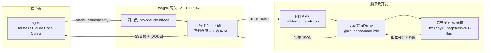

# opencode-cloudbase-auth

Magpie / OpenCode 供应商插件：把腾讯云开发（CloudBase）**小程序成长计划**赠送的模型额度接成 magpie 供应商。

## 为什么需要它

CloudBase 的 AI 网关对成长计划额度做了通道限制：

```
POST https://{envId}.api.tcloudbasegateway.com/v1/ai/hunyuan-v3/chat/completions
→ 403 AI_CHANNEL_NOT_ALLOWED  小程序成长计划仅支持小程序 SDK 和云开发 SDK 调用
```

只有「小程序 SDK / 云开发 SDK」通道能用这份额度。本插件配合一个云函数（默认名 `aiProxy`）绕开限制：

```
agent → magpie 网关 → 本插件 → CloudBase HTTP API（云函数调用）
                                        → 云函数内 @cloudbase/node-sdk（云开发 SDK 通道）
                                        → hy3 / hy4 / deepseek-v4.1-flash（扣成长计划额度）
```

云函数的公网入口只返回一次性 JSON、不支持真流式，所以插件在 `fetch` 里强制 `stream:false` 拿到完整结果，再按客户端原本的意图合成 OpenAI SSE 帧。

## 数据流



可编辑版本：[`docs/architecture.drawio`](docs/architecture.drawio)（用 [app.diagrams.net](https://app.diagrams.net) 打开）。客户端不支持 mermaid 时看静态版：[`docs/architecture.svg`](docs/architecture.svg)。

## 云函数（上游）

Node.js 运行时，依赖 `@cloudbase/node-sdk`（>= 3.16）：

```js
const tcb = require('@cloudbase/node-sdk')
let app
exports.main = async (event = {}) => {
  if (!app) app = tcb.init({ env: process.env.TCB_ENV || 'your-env-id', timeout: 120000 })
  const ai = app.ai()
  const provider = event.provider || 'hunyuan-v3'
  const model = event.model || 'hy3'
  const messages = event.messages || [{ role: 'user', content: 'hi' }]
  const r = await ai.createModel(provider).generateText({ model, messages })
  const u = r.usage || {}
  return {
    id: 'chatcmpl-' + Date.now(),
    object: 'chat.completion',
    created: Math.floor(Date.now() / 1000),
    model,
    choices: [{ index: 0, message: { role: 'assistant', content: r.text }, finish_reason: 'stop' }],
    usage: {
      prompt_tokens: u.prompt_tokens || 0,
      completion_tokens: u.completion_tokens || 0,
      total_tokens: u.total_tokens || 0
    }
  }
}
```

部署后公网入口是 `https://{envId}.api.tcloudbasegateway.com/v1/functions/aiProxy`。

## 登录

两种信息一起填：

| 字段 | 说明 |
| --- | --- |
| 云开发环境 ID | 例如 `cloudbase-xxxxxxxx`，存在账号的 `metadata.envId` |
| CloudBase API Key | 控制台「环境配置 → API Key 配置」创建，服务端密钥，永不过期 |

> API Key 是环境最高权限凭据（可绕过数据库所有访问校验），只放在本机 `~/.config/magpie/plugin-auth.json`（权限 600）。

## 模型

`hy3`、`hy4`、`hy4-preview`、`deepseek-v4.1-flash`、`deepseek-v4.1-flash-1017` —— 均为成长计划抵扣范围内的模型。

agent 里用 `cloudbase/hy3` 这样的 id 调用。

## 已知限制

- **非真流式**：上游一次性返回，插件合成 SSE，所以首字延迟 = 整段生成时间。
- 云函数默认超时 60s（可在 `cloudbaserc.json` 调大到 900s 上限），长输出会被截断。
- 成长计划额度 6 个月到期；到期后要切 `provider=cloudbase` 走资源点计费，改云函数里的 `provider` 字段即可。

## 开发

```bash
magpie plugin add ./opencode-cloudbase-auth
magpie plugin login opencode-cloudbase-auth
magpie provider test cloudbase          # 真发一次 completion
```
