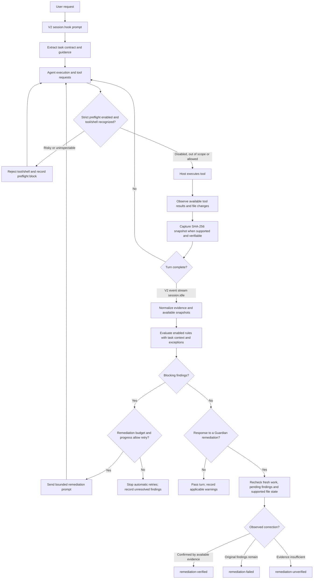
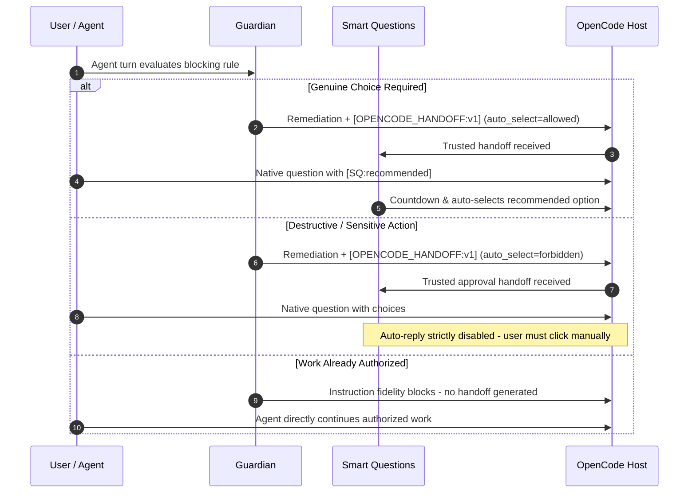

# 🛡️ OpenCode Guardian

[](https://www.npmjs.com/package/opencode-guardian)
[](https://www.npmjs.com/package/opencode-guardian)
[-10b981?logo=terminal&logoColor=white)](https://opencode.ai)
[](docs/acceptance-v2.md)
[](docs/discipline-coverage.md)
[](package.json)
[](tsconfig.json)
[](LICENSE)

[Installation](#installation) · [Rules](#the-14-guardrail-rules) · [Secret Protection](#-multi-layer-secret-protection--post-execution-redaction) · [Configuration](#configuration-opencode-guardianjson) · [TUI Interface](#tui-sidebar-interface) · [Architecture](#architecture--turn-lifecycle) · [Smart Questions Coordination](#-smart-questions-coordination-protocol) · [Verification](#verification--live-acceptance)

A high-performance, deterministic quality, safety, and verification plugin for **OpenCode** AI coding agents.

OpenCode Guardian continuously supervises agent turns: guiding model execution before calls, correlating tool results at session idle, intercepting recognized destructive shell actions and secret-bearing file writes, redacting sensitive tool outputs before model visibility, and requiring verifiable tool evidence before agents declare tasks complete.

---

## 📊 Verification & Live Acceptance


> Guardian **v0.18.5** was verified on **26 November 2026** against live **OpenCode v2.4.1** on Node **26.13.1** and Bun **1.4.4**.

- **Current Automated Verification:** **973 / 973** unit, security, mesh interoperability, project scope isolation, toast notification, and regression tests passing across 23 test files (`80` suites).
- **Sandbox Scenarios:** **21 / 21** end-to-end multi-turn agent failure, combined multi-rule batching, and recovery scenarios verified.
- **Live V2 Host Acceptance:** **10 / 10** real-host checks verified (packed `.tgz` in Node 26.13.1 + Bun 1.4.4, full V2.4.1 server hooks + `./rpc` + TUI slots/commands, and live `opencode v2.4.1` CLI host), plus live `opencode.db` replay across real V2 worker & manager sessions (`0` false positives across 31 live worker sessions) and **21 / 21** live real-LLM scenarios across all 14 rules, preflight, secret redaction, and multi-rule batching.
- **Static Analysis:** standard and strict TypeScript gates pass (`--strict --exactOptionalPropertyTypes`); Oxlint reports **0 warnings / 0 errors** across 75 files.
- **Low-I/O & Zero-Pollution Telemetry Architecture:** Default `violations` mode eliminates 90–95% of disk syscalls while tracking live in-memory inspection and secret-redaction counters, caching directory verification and nanosecond file stats (`statusFileCache`), bounding logs to 512 KiB, and isolating per-project audit logs in `~/.local/state/opencode-guardian/projects/<projectHash>/guardian-events.jsonl` (or `$XDG_STATE_HOME/opencode-guardian/...`) without polluting project `.opencode/` directories.

Read the comprehensive [V2 Acceptance Report](docs/acceptance-v2.md) and [Verification and Acceptance Report](docs/verification-report.md) for reproduction steps, methodology, and full test matrices.

See the [0.18.5 release notes](CHANGELOG.md) for the live production false-positive closure across compound/piped/heredoc verification evidence (`echo TC=$?`, `PIPESTATUS[0]`, clean `tail -N`), porcelain `git status --short` parsing, scoped subset test & subagent verification relay handling, balanced guard-clause test assertions, and structured tool retry/policy-refusal resolution in `task/completion-gate`.

## ✨ Key Highlights

- **Pure OpenCode V2 Architecture:** Built natively for **OpenCode V2** (`@opencode/plugin >=2.3.0`) with dedicated `.` (server), `./tui` (OpenTUI/Solid), and `./rpc` (typed intervention RPC) exports.
- **Compact TUI Sidebar & Auto-Expiring Conversation Banner:** A compact two-column status widget (`sidebar.content`) that expands to show Guardian diagnostics with a single click, paired with an inline conversation banner (`session.composer.top`) that auto-expires after its toast TTL (`4s` warnings / `5s` errors), clears immediately on new user prompts, and supports click-to-dismiss.
- **In-App Update Indicator:** Shows a green `(↑)` header icon and places `Update available` first in the sidebar when npm reports a newer release.
- **Guardian Commands:** Ctrl+P and slash commands display detailed status, activity, diagnostics, rules, configuration and version; confirmed statistics reset preserves audit history.
- **Isolated Per-Project Audit Log (Zero Repository Pollution):** Stores safe event codes, reasons and intervention outcomes in `~/.local/state/opencode-guardian/projects/<projectHash>/guardian-events.jsonl` with `0600` POSIX permissions, a default 512 KiB limit (configurable via `telemetry.maxBytes`) and one rotated archive. Never writes files into `<project>/.opencode/` and never stores prompt or command text.
- **Local vs. Global Scope Isolation:** Project-local installations strictly supervise only their own project directory (and subdirectories), never interfering with unrelated workspaces sharing an OpenCode background server. Global installations supervise all opened projects while respecting per-project overrides.
- **Universal V2 Plugin Mesh Bridge (`src/bridge.ts`):** Zero-dependency N-way interoperability with **[OpenCode Hi](https://github.com/huseyincig/opencode-hi)**, **[OpenCode Smart Questions](https://github.com/huseyincig/opencode-smart-questions)**, and sibling V2 plugins via cryptographic session provenance tokens, coordinated session leases (`user_interaction`, `active_remediation`, `orchestration_dispatch`), deterministic intervention records, role capability resolution, and `opencode-mesh.state` RPC.
- **V2 Session & Fork Isolation:** Native `session.deleted`, `session.moved`, and new human prompts (including attachment-only messages) cancel stale `idleQueue` work and clear stale contracts; `session.fork` / `session.forked` are treated as independent root sessions.
- **Error Redaction:** Nested Error metadata, non-enumerable causes and aggregate errors are sanitized; executable serialization callbacks are removed and reserved JSON fields remain safe own properties.
- **Evidence-Based Task Contracts:** Analyzes human requests across 13 languages to extract required verifications (tests, builds, source reviews) and detects premature completion claims. When the host provides a tool-after observation, SHA-256 evidence is tied to the observed file contents.
- **Subagent Handoff & Background Isolation:** For synchronous `subagent` calls, Guardian owns the handoff boundary: blocking findings are remediated on the child session before the parent receives the tool result, and the parent sees the revised final child report. Background subagents (`background === true`) are isolated so they never block the parent or starve sibling background subagents.
- **Decoupled Smart Questions Coordination (`[OPENCODE_HANDOFF:v1]`):** Seamlessly bridges human decisions to Smart Questions when questions or confirmations are required. Designates `auto_select=allowed` for choices and `auto_select=forbidden` for destructive actions, while preventing redundant confirmation requests.
- **14 Deterministic Rules:** Blocks shortcuts, empty stubs, unverified claims, masked errors, test weakening, leaked secrets, undeclared dependencies, and repetitive execution loops.
- **Zero Configuration:** Works instantly out of the box with production-tested defaults. Fully configurable via `opencode-guardian.json`.
- **Zero Runtime Dependencies:** Precompiled JavaScript (`dist/`) has no mandatory third-party runtime dependencies. The optional TUI utilizes the host's OpenTUI/Solid runtime.

---

## 📦 Installation

OpenCode Guardian supports **Global**, **Project-Local**, **Local `.opencode/plugins/` Loader / Symlink**, **Local Development (`file://`)**, and **Remote TUI Client (`cli.json`)** installation modes on OpenCode V2 (`>=2.3.0`).

> [!IMPORTANT]
> OpenCode V2 automatically discovers `./tui` and `./rpc` from `package.json` `exports` when loading `opencode-guardian` — do **not** duplicate `"opencode-guardian/tui"` in `opencode.json`.

### 1. Global Installation (All Projects — Recommended for Workstations)

To enable Guardian across **all** repositories and workspaces on your machine, add `opencode-guardian@latest` to your global OpenCode configuration file (`~/.config/opencode/opencode.json`, `$XDG_CONFIG_HOME/opencode/opencode.json`, or `$OPENCODE_CONFIG_DIR/opencode.json`):

```json
{
  "$schema": "https://opencode.ai/config.json",
  "plugin": [
    "opencode-guardian@latest"
  ]
}
```

- **Global Behavior:** Protects every project opened in OpenCode using your global defaults (`~/.config/opencode/opencode-guardian.json`, if present) and applies any project-specific overrides found in `<project>/opencode-guardian.json` or `<project>/.opencode/opencode-guardian.json`.
- **Per-Project Opt-Out:** To disable a globally installed Guardian for one specific repository, create `<project>/opencode-guardian.json` (or `<project>/.opencode/opencode-guardian.json`) with `{ "enabled": false }`.
- **Clean Git Working Trees:** Per-project telemetry is stored externally in `~/.local/state/opencode-guardian/projects/<projectHash>/guardian-events.jsonl` (`0600`), so global installation never creates untracked files inside any repository's `.opencode/` folder.

### 2. Project-Local Installation (Single Repository / Team Setup)

To enable Guardian **only** for a specific repository, add `opencode-guardian@latest` to `<project>/opencode.json` (or `<project>/.opencode/opencode.json`):

```json
{
  "$schema": "https://opencode.ai/config.json",
  "plugin": [
    "opencode-guardian@latest"
  ]
}
```

- **Strict Project Scope Isolation:** When installed locally in a project, Guardian scopes all hooks, stream watchers, preflight checks, and idle inspections strictly to that project's directory (and its subdirectories). It will **never** interfere with other projects running on the same shared OpenCode background server.

### 3. `.opencode/plugins/` Local Wrapper / Symlink Installation (Monorepo & Air-Gapped)

If you manage plugins via OpenCode's `.opencode/plugins/` directory (either project-locally at `<project>/.opencode/plugins/opencode-guardian` or globally at `~/.config/opencode/plugins/opencode-guardian`) with a local or symlinked package in `.opencode/node_modules/opencode-guardian`:

1. Install or symlink the package into `.opencode/node_modules/opencode-guardian`:
   ```bash
   mkdir -p .opencode/node_modules
   ln -s /path/to/opencode-guardian .opencode/node_modules/opencode-guardian
   ```
2. Create the plugin loader wrapper in `.opencode/plugins/opencode-guardian/`:
   - `.opencode/plugins/opencode-guardian/package.json`:
     ```json
     {
       "name": "opencode-guardian-local",
       "private": true,
       "type": "module",
       "exports": {
         ".": "./index.ts",
         "./tui": "./tui.tsx"
       }
     }
     ```
   - `.opencode/plugins/opencode-guardian/index.ts`:
     ```ts
     export { default } from "opencode-guardian";
     ```
   - `.opencode/plugins/opencode-guardian/tui.tsx`:
     ```tsx
     export { default } from "opencode-guardian/tui";
     ```

### 4. Local Development (`file://` Source Checkout)

To load Guardian directly from a local git checkout (after running `npm run build`):

```json
{
  "plugin": [
    "file:///path/to/opencode-guardian"
  ]
}
```

### 5. Remote Server / Split TUI Client (`cli.json`)

For CLI-only remote-server connections where the OpenCode server runs on a remote host and your local terminal runs only the TUI client, configure `"plugin": ["opencode-guardian/tui"]` in `~/.config/opencode/cli.json`:

```json
{
  "plugin": [
    "opencode-guardian/tui"
  ]
}
```

### Installation Scope & State Summary

| Installation Mode | Config / Loader Location | Active Scope | Audit Log Location (`0600`) | Touches `<project>/.opencode/`? |
| :--- | :--- | :--- | :--- | :---: |
| **Global** | `~/.config/opencode/opencode.json` or `~/.config/opencode/plugins/opencode-guardian` | All projects (unless disabled per-project) | `~/.local/state/opencode-guardian/projects/<projectHash>/guardian-events.jsonl` | **No** |
| **Project-Local** | `<project>/opencode.json`, `<project>/.opencode/opencode.json`, or `<project>/.opencode/plugins/opencode-guardian` | Strictly `<project>` (and subdirectories) | `~/.local/state/opencode-guardian/projects/<projectHash>/guardian-events.jsonl` | **No** |
| **Custom Override** | `OPENCODE_GUARDIAN_STATE_DIR=/custom/dir` | Active scope | `/custom/dir/guardian-events.jsonl` | **No** |

> **Using OpenCode 1.x?** Pin `opencode-guardian@0.14.0`, the final release supporting OpenCode V1.

Refer to the [OpenCode V2 plugin documentation](https://opencode.ai/v2/docs/build/plugins/) for host loading details.

---

## 🖥️ TUI Sidebar Interface

OpenCode Guardian includes a dedicated V2 TUI extension (`./tui`) that mounts into OpenCode's sidebar. It displays live status, intervention counters, and update notices.

### 🔌 Enabling the TUI Sidebar

In OpenCode V2, terminal UI widgets are automatically discovered from the package's `./tui` export when `"opencode-guardian@latest"` is listed in `plugins`:

1. Add `"opencode-guardian@latest"` to `"plugins"` in your `opencode.json` (or `opencode.jsonc`).
2. Start OpenCode as usual (`opencode`).
3. The Guardian widget appears in OpenCode's `sidebar.content` (and `session.composer.top`) slots without replacing existing sidebar sections.

### 🔽 Collapsed View (Default)

```text
▶ Guardian                 v0.18.5
Status                       ● Active
Interventions                 0w · 0r
```

- **Header:** Clickable header displaying the Guardian brand, current version, and an optional green `(↑)` update badge when a newer npm release is detected.
- **Status:** Most recent event, distinguishing verified, failed and unverified remediation as well as preflight decisions; counters reflect retained audit history.
- **Interventions:** Compact summary of warnings (`w`) and remediation requests (`r`); independent outcomes are available through `Guardian: Status`.

### 🔼 Expanded View (Click to Toggle)

Clicking the `▶ Guardian` header expands the widget:

```text
▼ Guardian                 v0.18.5
Preflight                  ○ disabled
Inspected                           0
Blocked                             0
Warnings                            0
Remediations                        0
```

- **Preflight:** Current shell protection mode (`○ disabled` or `● active`).
- **Inspected / Blocked:** Real-time count of commands evaluated and prevented.
- **Blocked** counts only commands denied by active preflight; post-turn remediation requests are tracked separately.
- **Warnings / Remediations:** Detailed intervention statistics for the active project.
- **Update available:** The first row immediately below the header in both views shows the newer published version; it stays hidden when there is no update.
- **Auto-Refresh:** The widget polls the isolated project event log (`~/.local/state/opencode-guardian/projects/<projectHash>/guardian-events.jsonl`) every 2.5 seconds to reflect live metrics without reloading.
- **Hiding / Disabling:** Setting `"enabled": false` in `opencode-guardian.json` automatically unregisters and hides the TUI sidebar.

### ⌨️ Guardian Commands (Ctrl+P / Command Palette)

When Guardian's TUI component is loaded, its commands appear under **Guardian** in the Ctrl+P palette:

| Command | Slash Shortcut | Purpose |
| :--- | :--- | :--- |
| **Guardian: Status** | `/guardian-status` | Project counters and remediation outcomes |
| **Guardian: Activity** | `/guardian-activity` | Recent redacted audit events |
| **Guardian: Diagnostics** | `/guardian-doctor` | Configuration and last-reported host state |
| **Guardian: Rules** | `/guardian-rules` | Effective rule severity across all 14 rules |
| **Guardian: Configuration** | `/guardian-config` | Safe, redacted configuration overview |
| **Guardian: Version** | `/guardian-version` | Installed and available stable versions |
| **Guardian: Reset Statistics** | `/guardian-reset` | Confirmed counter reset, retaining security history |

In OpenCode V2, the general `/guardian <command>` dispatcher is also available (e.g. `/guardian status`, `/guardian rules`).

Reset appends a local `statistics-reset` event rather than wiping the audit log (normal bounded rotation still applies); it does not disable protection, change rules or undo previous findings.

---

## 🔒 Privacy-Safe Audit Events

Guardian stores a structured JSONL audit in `~/.local/state/opencode-guardian/projects/<projectHash>/guardian-events.jsonl` (or `$OPENCODE_GUARDIAN_STATE_DIR/guardian-events.jsonl` when overridden) — never polluting `<project>/.opencode/`. Each entry has a timestamp, random event ID, event kind, action and outcome. Findings include only the **rule ID and a predefined reason code**, such as `masked-verification-failure`, `destructive-operation-not-authorized` or `missing-follow-up-review`. The session ID is reduced to a 16-character SHA-256 fingerprint. Custom tool names are replaced with a generic category.

```json
{"at":"2026-10-04T00:00:00.000Z","id":"123e4567-e89b-42d3-a456-426614174000","kind":"post-remediation","action":"remediation-requested","outcome":"unverified","rules":["task/completion-gate"],"reasons":[{"rule":"task/completion-gate","code":"missing-follow-up-review"}]}
```

- `unverified` means an instruction was sent, **not** that the agent completed it.
- A warning uses `reported`; a preflight denial uses `prevented` only when the command was actually rejected before execution.
- No prompts, assistant responses, raw commands, file contents, finding snippets, original session IDs, credentials or secrets are written.
- The active log is bounded to 512 KiB by default (configurable up to 2 MiB via `telemetry.maxBytes` or `OPENCODE_GUARDIAN_MAX_LOG_BYTES`), with one rotated archive (`guardian-events.jsonl.1`). In default `violations` mode, high-frequency benign events bypass disk writes completely.
- To inspect the exact log path and counters for a project, run `opencode-guardian-status /path/to/project`.

---

## 📋 The 14 Guardrail Rules

OpenCode Guardian evaluates assistant turns against 14 deterministic rules. Rules can be configured as `error`, `warn`, or `off`; remediation is bounded and post-turn findings cannot undo an already-executed command:

| Category | Rule ID | Default | What It Enforces |
| :--- | :--- | :---: | :--- |
| **Discipline** | `discipline/no-evasion` | `error` | Blocks unsupported dismissals such as claiming a test failure is "pre-existing" or "out of scope" unless verified by baseline checks. |
| **Discipline** | `discipline/no-apology` | `error` | Blocks sycophantic, defensive, or repetitive apology language across multiple languages. |
| **Quality** | `quality/no-shortcuts` | `error` | Blocks concrete deferred-work phrases (`TODO`, `FIXME`, `HACK`, "will do later"). Ambiguous hedging phrases are flagged as advisory warnings. |
| **Integrity** | `integrity/no-stubs` | `error` | Blocks `NotImplementedError`, empty function stubs, Rust `todo!()`/`unimplemented!()`, and placeholder returns. |
| **Integrity** | `integrity/no-unverified-claims` | `error` | Correlates success claims with observed outcomes and explicit current passed-test counts with fresh supported summaries. Direct contradictions block. |
| **Integrity** | `integrity/no-silent-failure` | `error` | Blocks test, build, lint, typecheck, or audit commands masked with `\|\| true`, `exit 0`, or suppressed exit codes. |
| **Safety** | `safety/no-truncation` | `error` | Blocks source edit placeholders; observed whole-file definition loss produces an advisory. Literal examples and documentation are excluded from placeholder checks. |
| **Safety** | `safety/destructive-operations` | `warn` | Inspects hard resets, force pushes, recursive deletion (`rm -rf`), database drops, and unpublish actions. Plain `rm` requires explicit scoped user consent. |
| **Testing** | `testing/no-cheat` | `error` | Blocks malicious test tampering: targeted `describe.skip`, `it.skip`, `test.skip`, `fit`, or assertion stripping in test files. |
| **Security** | `security/no-secrets` | `error` | Blocks hardcoded API keys (OpenAI, Anthropic, Google, AWS, GitHub, Slack, Stripe, JWTs, private keys, database URLs with passwords). |
| **Manifest** | `manifest/no-ghost-deps` | `error` | Blocks undeclared third-party imports. Runtime JS/TS imports declared only in dev dependencies are advisory unless `productionOnly` is enabled; type-only/test/build imports retain exceptions. |
| **Runtime** | `runtime/circuit-breaker` | `error` | Blocks identical execution failures repeated 3 times without progress and detects degenerative token/phrase cycles in reasoning and text. Stream watcher aborts runaway generation in-flight. |
| **Task** | `task/instruction-fidelity` | `error` | Checks narrow English/Turkish research-only constraints against observed actions and prevents historical refusals or redundant confirmation handoffs from overriding current instructions. |
| **Task** | `task/completion-gate` | `error` | Requires observed requested verification. Recognized zero-test, skipped-only and conflicting summaries cannot satisfy a required test run. |

---

## ⚙️ Configuration (`opencode-guardian.json`)

Guardian works out of the box with zero configuration. You can customize rules and thresholds by placing `opencode-guardian.json` in your project root, `.opencode/`, or `~/.config/opencode/`:

```json
{
  "enabled": true,
  "remediationBudget": 1,
  "iterationBudget": 3,
  "updateNotice": {
    "enabled": true
  },
  "preflight": {
    "enabled": false
  },
  "telemetry": {
    "enabled": true,
    "level": "violations",
    "maxBytes": 524288
  },
  "rules": {
    "discipline/no-evasion": "error",
    "discipline/no-apology": "error",
    "quality/no-shortcuts": {
      "severity": "error",
      "customPhrases": ["not my job", "out of scope for me"],
      "exceptions": ["tempdir", "temporaryfile"]
    },
    "integrity/no-stubs": "error",
    "integrity/no-unverified-claims": "error",
    "integrity/no-silent-failure": "error",
    "safety/no-truncation": "error",
    "safety/destructive-operations": "warn",
    "testing/no-cheat": "error",
    "security/no-secrets": "error",
    "manifest/no-ghost-deps": "error",
    "runtime/circuit-breaker": "error",
    "task/instruction-fidelity": "error",
    "task/completion-gate": "error"
  }
}
```

### 🎛️ Severity Options:
- `"error"`: High-confidence violation triggers an automatic remediation prompt (bounded by `remediationBudget`).
- `"warn"`: Recorded in telemetry and displayed in TUI, but does not interrupt agent flow.
- `"off"`: Completely disables the rule.

### 📈 Telemetry & Audit Log Options:
- `telemetry.level`:
  - `"violations"`: (Default) Logs only security violations, preflight blocks, warnings, and remediation actions. Bypasses clean turns and benign commands (`preflight-allowed`, `post-inspected`), reducing disk I/O by 90–95%.
  - `"all"`: Logs all events including benign command executions and clean turn evaluations.
  - `"off"`: Disables all file writes (zero I/O), ideal for headless CI/CD runs.
- `telemetry.maxBytes`: Maximum size in bytes (`256` bytes – `2 MiB` / `2,097,152` bytes) before rotating to `guardian-events.jsonl.1` (default: 512 KiB). Rotation uses an owner-verified atomic `.lock` guard with stale-lock recovery and inode-aware re-open checks.
- Unknown rule IDs in `rules` are rejected during config validation so typos cannot silently disable protection. When telemetry is disabled (`enabled: false` or `level: "off"`), `/guardian-reset` reports failure instead of falsely claiming counters were reset.

### 🌐 Environment Variables (Pipeline & CI Overrides):
- `OPENCODE_GUARDIAN_STATE_DIR=/path/to/state`: Explicit override for the telemetry state directory.
- `OPENCODE_GUARDIAN_LOG_LEVEL=violations|all|off`: Dynamically sets audit log verbosity.
- `OPENCODE_GUARDIAN_TELEMETRY=off`: Completely silences disk writes without altering config files.
- `OPENCODE_GUARDIAN_MAX_LOG_BYTES=<number>`: Dynamic rotation threshold override.

Runtime dev-only imports are advisory by default. To enforce production dependency declarations, configure `"manifest/no-ghost-deps": { "severity": "error", "productionOnly": true }` inside `rules`. This uses file-role conventions rather than a bundler/reachability analysis. See [configuration and detection boundaries](docs/discipline-coverage.md#configuration).

---

## 🌐 Task Contracts & Multilingual Support

When a user submits an instruction, Guardian extracts a deterministic task contract before model execution. Supported intent patterns include:
- **Languages Supported:** English, Turkish, Spanish, Portuguese, French, German, Russian, Arabic, Hindi, Chinese, Japanese, Korean, and Indonesian.
- **Research-Only Constraints:** The new mutation/install/push checks recognize narrow English and Turkish research-only phrases; this narrower check does not cover all thirteen task-contract languages.
- **Verification Modes:** Requires observable evidence (e.g. running tests, building, typechecking, or performing a fresh post-change file inspection).
- **Explicit Header Directive (Optional):** For deterministic contract specification regardless of natural language phrasing:

```text
@guardian-task {"mode":"iterative-review","review":"source","verify":["test"]}
Please refactor the authentication service and verify all tests pass.
```

---

## 🔒 Preflight Shell Protection (`"critical"` vs `"strict"` Modes)

By default, Guardian analyzes operations after tool execution. To block recognized destructive shell commands, hardcoded secrets and source truncation placeholders in supported file writes **before execution**, enable preflight in `~/.config/opencode/opencode-guardian.json` (global) or `<project>/opencode-guardian.json`:

### 1. Frictionless `"critical"` Mode (Recommended for Daily Development)

Blocks catastrophic, irreversible shell commands (`rm -rf`, `git reset --hard`, `git push --force`, `git clean -f`, `DROP DATABASE`, `mkfs`, fork bombs, decoded base64-to-shell pipelines) and secret/placeholder file writes, while **allowing** everyday low-friction actions (`rm <single-file>`, `printenv`/`docker inspect`, and WIP git commit messages):

```json
{
  "allowProjectOverrides": false,
  "preflight": {
    "enabled": true,
    "mode": "critical"
  }
}
```

- Setting `"allowProjectOverrides": false` in your global `~/.config/opencode/opencode-guardian.json` locks the effective security floor — including unlisted built-in rule defaults, rule `exceptions` and tightening flags (`productionOnly`, `blockPythonGhostDeps`), secret `redactOutputs` / `redactContext` / `safeKeyNames` / `safeValues` / `includeRuntimeEnv`, `streamWatcher.enabled`, effective default `preflight.mode` (`"strict"` when omitted), and remediation/iteration budgets — so an untrusted cloned repository cannot weaken protection via a repo-local `opencode-guardian.json`.

### Detailed Conversation Banners (opt-in)

By default Guardian interventions appear as a compact toast and short-lived conversation banner. To show expanded per-finding bullets in the TUI conversation banner (`session.composer.top`) without injecting synthetic turns into model chat history, enable:

```json
{ "notifications": { "transcript": true } }
```

Detailed notices are delivered exclusively via the TUI RPC bridge (never via `session.synthetic`), automatically redacted before display, auto-expire via TTL, clear on the next human prompt, and support click-to-dismiss.

### 2. Full `"strict"` Mode (Maximum Pre-Execution Lockdown)

```json
{
  "preflight": {
    "enabled": true,
    "mode": "strict"
  }
}
```

- In `"strict"` mode (the default when `preflight.enabled: true` and `mode` is omitted), Guardian also blocks simple `rm <file>`, broad environment dumps (`printenv`, `env`, `docker inspect`), and uninformative git commit messages (`git commit -m "update"`).
- Operates at the V2 host hook level (`ctx.tool.hook("execute.before")` and `ctx.shell?.hook("create.before")`). Recognized file-writing and file-mutation actions (such as `mcp__<provider>__file_mutate`) also check inspectable content and replacement edits for potential hardcoded secrets and source truncation placeholders, and inspect `delete` / `remove` actions (blocking unauthorized deletions in `"strict"` mode and catastrophic root/workspace deletions in `"critical"` mode).

Standard MCP tool IDs ending in recognized shell actions (for example `mcp__provider__shell_exec`) are inspected automatically. For an MCP or custom tool with an unrecognized execution action, explicitly opt it in:

```json
{
  "preflight": {
    "enabled": true,
    "shellTools": ["mcp.remote.exec_task"]
  }
}
```

---

## 🔐 Multi-Layer Secret Protection & Post-Execution Redaction

Guardian provides an end-to-end secret protection pipeline operating across all tool outputs and model context:

```text
Guardian Pipeline
   │
   ├─ PRE: Command/input security & broad environment dump assessment
   │
   ├─ TOOL EXECUTION (Host runtime)
   │
   ├─ POST: Deterministic secret redaction (stdout, stderr, tool result objects, MCP)
   │
   └─ FINAL CONTEXT GATE: Secret-free LLM context (session messages & parts transform)
```

### What It Protects
- **Post-Execution Output Redaction:** Any command output dumping environment variables or sensitive files (`docker exec ... env`, `printenv`, `cat .env`, `docker inspect`, container logs) has secret values deterministically replaced with `[REDACTED]`.
- **Known Credential Formats:** OpenAI, Anthropic, GitHub (classic & fine-grained), Slack, AWS, Google, Stripe, npm, GitLab tokens.
- **Connection Strings & Hashes:** Database URIs (`postgres://`, `mysql://`, `mongodb://`, `redis://`) have embedded passwords redacted while preserving host and database structure. Hashes (bcrypt, argon2, scrypt, sha512-crypt) and multiline PEM private key blocks are cleanly sanitized.
- **Runtime Environment Discovery:** Discovers and registers sensitive keys and credentials active in the process environment, preventing raw values from leaking into model context even if emitted without key names.
- **Final LLM Context Gatekeeper:** Hooks into `ctx.session.hook("context")` to guarantee raw sensitive values never enter the prompt or turn history fed to the model.
- **Safe Keys Untouched:** Preserves standard system environment variables (`PATH`, `HOME`, `PORT`, `NODE_ENV`, `USER`, `SHELL`, `PWD`, etc.).

---

## 📈 Telemetry & CLI Status

Guardian maintains a private, redacted log of local events outside your project repository:
- **Per-Project Log:** `~/.local/state/opencode-guardian/projects/<projectHash>/guardian-events.jsonl` (mode `0600`, directory mode `0700`).
- **Global Fallback:** `~/.local/state/opencode-guardian/guardian-events.jsonl`.
- **Test Isolation (`NODE_TEST_CONTEXT`):** `os.tmpdir()/opencode-guardian-tests-<pid>/projects/<projectHash>/guardian-events.jsonl` (automatically removed on process exit).
- **Privacy:** Contains only rule codes and SHA-256 session fingerprints. **Never** stores commands, file contents, secrets, or prompts, and **never** creates files inside `<project>/.opencode/`.

### 💻 Command Line Interface

Check Guardian's status at any time from your terminal:

```bash
# Check status for the current project
opencode-guardian-status

# Or specify a target directory
opencode-guardian-status /path/to/project
```

Example output:
```text
Guardian | preflight at last start: active
Inspections (tool + turn): 14 | blocked tools (preflight): 2
Post-turn warnings: 2 | remediations: 1 | errors: 0
Event log: /home/user/.local/state/opencode-guardian/projects/9f86d081884c7d65/guardian-events.jsonl
```

---

## 🔄 Architecture & Turn Lifecycle



The diagram illustrates the **v0.18.5** pure OpenCode V2 (`>=2.3.0`) runtime, wired via `setup(ctx)` hooks (`session.hook("prompt")`, `session.hook("context")`, `session.hook("experimental.idle")`, `tool.hook("execute.before")`, `tool.hook("execute.after")`, `shell.hook("create.before")`, `stream.hook`, `event.subscribe`), typed `./rpc` intervention endpoints (`opencode-guardian/rpc`), `opencode-mesh.state` RPC (`src/bridge.ts`), and `session.fork` / `session.forked` root-session isolation. Strict preflight is **opt-in** and evaluates recognized or configured tools and shell creations; an out-of-scope tool is still governed by host permissions. Tool-after observations and SHA-256 file snapshots are captured **when the host supplies supported evidence**. Supported whole-file writes also use before/after observations for advisory content-loss detection; missing before hooks cannot reconstruct old file content. After a remediation, only supported, observable follow-up evidence can establish `remediation-verified`.

For delegated `subagent` work, Guardian preserves capability-aware remediation isolation: synchronous write-capable subagents retain bounded remediation before parent release, read-only subagents avoid synthetic remediation loops, background subagents (`background === true`) are isolated from the foreground handoff barrier so sibling background subagents are never starved, and per-rule fingerprints distinguish substantive errors. Teardown remains idempotent across `AbortController` signals and LIFO hook rollback; background polling/cleanup intervals call `.unref?.()`, while active one-shot coalesce and retry timers keep the event loop alive until completion or abort.

---

## 🤝 Smart Questions Coordination Protocol

> [!NOTE]
> Guardian and Smart Questions are **completely standalone plugins** that operate independently with zero required package dependencies. When installed together in the same OpenCode environment, they optionally coordinate through this decoupled, versioned protocol (`[OPENCODE_HANDOFF:v1]`).

OpenCode Guardian coordinates with **[OpenCode Smart Questions](https://github.com/huseyincig/opencode-smart-questions)** through an independent, versioned protocol block (`[OPENCODE_HANDOFF:v1]`) without requiring direct package dependencies:

```text
[opencode-guardian remediation]

[OPENCODE_HANDOFF:v1]
source=guardian
action=question_required
kind=choice
auto_select=allowed
handoff_id=gq_c47f9a12b0

Please ask the user which deployment strategy is preferred.
```

### Deterministic Handoff Architecture:

- **Legitimate Choices (`kind=choice / auto_select=allowed`):** When technical decisions legitimately require user selection (e.g. strategy choices, architecture alternatives), Guardian emits a choice handoff. Smart Questions presents native forms with recommended options and auto-selects after a safe countdown if uninterrupted.
- **Destructive Confirmations (`kind=approval / auto_select=forbidden`):** Irreversible or high-risk actions (e.g. database drops, production deletions) emit an approval handoff with `auto_select=forbidden`. Smart Questions strictly suppresses auto-reply and countdown, requiring mandatory human confirmation.
- **Redundant Question Prevention:** When the user already gave explicit direction (governed by `task/instruction-fidelity`), Guardian blocks unnecessary confirmation questions and withholds handoffs entirely.
- **Host Provenance & Anti-Spoofing:** All handoffs require trusted Guardian provenance metadata (`metadata["opencode-guardian"] === true`). Unauthenticated user prompt text cannot forge handoffs.
- **TTL & Turn Binding:** Active handoffs expire after 120 seconds, reset cleanly on new human turns, and cannot be reused after consumption.



---

## 🔬 Scientific Foundation & Academic Research

OpenCode Guardian's architecture and security models are grounded in peer-reviewed computer science literature and industry security frameworks:

1. **"Guardians of the Agents" (Erik Meijer, Communications of the ACM, Dec 2025):**
   - In [*Guardians of the Agents*](https://doi.org/10.1145/3777544) (*Communications of the ACM*, DOI: [`10.1145/3777544`](https://doi.org/10.1145/3777544)), Erik Meijer formalized the paradigm of using independent, host-level supervisory software ("Guardians") that monitor and enforce behavioral invariants over autonomous AI agents before and after tool execution, without requiring prompt-level instructions or modifying model weights.
   - OpenCode Guardian directly realizes this paradigm through its pure OpenCode V2 engine, evaluating preflight invariants before execution and correlating multi-step evidence at `session.idle`.

2. **The GuardFall Vulnerability Research (Adversa AI, June 2026):**
   - Discovered by Adversa AI in June 2026, the *GuardFall* research revealed systemic flaws across 10 out of 11 popular coding agents where string-matching blocklists failed to detect obfuscated shell commands (such as quote removal `r''m`, variable expansion `$IFS`, paired backtick substitution, and encoded Base64 pipelines).
   - OpenCode Guardian incorporates dedicated conservative shell-pattern analysis ([`src/shell-risk.ts`](src/shell-risk.ts)) and regression suites ([`tests/preflight.test.mjs`](tests/preflight.test.mjs)) to recognize documented GuardFall-style patterns during post-turn inspection and opt-in strict preflight.

3. **OWASP Top 10 for Agentic Applications (2026):**
   - OpenCode Guardian is architected to address critical vulnerabilities defined in the OWASP Agentic Top 10 framework, including **ASI01** (Agent Goal Hijacking), **ASI02** (Tool Misuse), **ASI03** (Identity & Privilege Abuse), **ASI05** (Unexpected Code Execution), and **ASI08** (Cascading Failures).
   - Detailed mapping and capability boundaries are documented in [`docs/owasp-agentic-top10-2026.md`](docs/owasp-agentic-top10-2026.md).

---

## 🧪 Verification & Testing

Run the checks locally:

```bash
npm ci
npm run typecheck
npm run typecheck:strict
npm run lint
npm test
node sandbox/smoke-test.mjs
node sandbox/comprehensive-test.mjs
node sandbox/v2-live-acceptance.mjs
node scripts/check-docs.mjs
npm audit --omit=dev
node scripts/check-dev-audit.mjs
npm pack --dry-run
```

The automated suite covers V2 host hooks, `./tui`, `./rpc`, preflight, rule regressions, and lifecycle checks. Live host acceptance results on OpenCode V2 (`v2.4.1`) and Bun (`1.4.4`) are detailed in the [Verification Report](docs/verification-report.md).

Technical documentation: [Verification Report](docs/verification-report.md) · [Security Benchmark](docs/security-benchmark.md) · [Adapter Architecture](docs/task-contract-v2.md) · [Security Coverage](docs/owasp-agentic-top10-2026.md).

---

## 📄 License

MIT © [Hüseyin Hadi Çığ](https://github.com/huseyincig)
