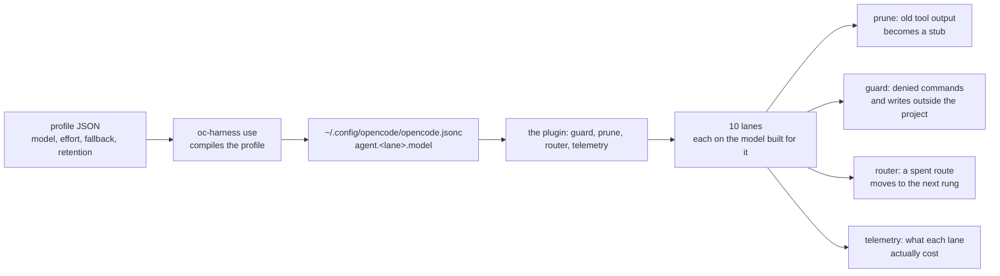

# opencode-harness-kit

[](https://github.com/pham-canh/opencode-harness-kit/actions/workflows/ci.yml)
[](https://www.npmjs.com/package/opencode-harness-kit)

A harness kit for [OpenCode](https://opencode.ai) that is **model-agnostic by
construction**. Switching models is a data edit, not a code change.

```bash
npx -y opencode-harness-kit init    # pick a free model, then install + verify
```

then restart opencode. That is the whole quickstart. No npm account needed on
your side — `npx` only downloads the published kit. Prefer git? The same three
steps from a checkout (see [Install](#install)):

```bash
git clone https://github.com/pham-canh/opencode-harness-kit.git
./bin/oc-harness.mjs init
```

The three steps `init` runs, spelled out for when you want to know what
happened (prefix each with `npx -y opencode-harness-kit@latest` or
`./bin/oc-harness.mjs` to taste):

```bash
oc-harness use fleet-safe    # compile the profile
oc-harness install                # link the plugin, prompts, skills and GLOBAL.md
oc-harness verify                 # prove the install is whole
```

`use` writes the config. `install` writes everything the config *points at*.
Skipping it is the failure mode this kit is built to prevent: see
[Install](#install).

## The problem it solves

Tuning a coding harness for a model means answering model-specific questions:
how much context to reserve, which reasoning levels exist, whether temperature
is even accepted, how much privacy the provider gives you. Answer them in a
prompt and you get a paragraph the model reads once. Answer them in code and
you get two projects that share a name and nothing else.

This kit puts the answers in a profile:

```
profiles/fleet-safe.json     ← the models
lanes.json                   ← the jobs
src/                         ← no model name anywhere in here
```

Same plugin source, eleven shipped profiles, eleven different behaviours. The
test suite asserts that rather than taking it on faith.

### How a request travels



Four things happen to a request, and they are four separate files:

| | |
|---|---|
| `src/guard.ts` | refuses the commands the kit never allows, and any write outside the project |
| `src/prune.ts` | replaces old tool output with a one-line stub, so the window holds the work and not the noise |
| `src/router.ts` | when a route is spent, moves the lane to the next rung of its own chain |
| `src/telemetry.ts` | records what each lane actually cost, so `oc-harness lanes` can say which ones earn their place |

The model for a lane is in the **config**, not in a prompt and not in a file
the agent reads. That is the whole design: the answers are data, and a data
edit is reviewable.

## A fleet, not a model

The default profile is a **fleet**: ten jobs, ten free models, one session.

The table below is the **unrestricted** fleet (`fleet-all`), where every lane
gets the model built for it. The default is the **safe** fleet
(`fleet-safe`), where every lane resolves to a provider with a zero-retention
policy and seven of the ten run on a second-choice model to stay there. Both
cover the same ten jobs; they differ in what they are willing to promise
about your prompts.

| lane | job | model | measured |
|---|---|---|---|
| `build` | write and verify the change | Flint 40B Free | 6.9 s |
| `plan` | turn a request into a plan | Beam | **6.1 s** |
| `reviewer` | read a change in two passes | GLM 5.3 Flash | 7.4 s |
| `locate` | find where something lives | Nemotron 3.5 Lightning | 6.9 s |
| `verify` | run the project's checks | Big Pickle | 10.4 s |
| `vision` | read an image or a screenshot | MiMo-V2.6 Flash | 9.3 s (19 s with an image) |
| `doc` | read a long document or a spec | GLM 5.3 Flash | 7.4 s |
| `schema` | produce JSON or a JSON schema | DeepSeek V4.1 Flash | 10.7 s |
| `sweep` | sweep a lot of code mechanically | Nemotron 3.5 Super VL | 8.4 s |
| `longform` | read a megabyte, or write alternatives | Flint 40B Free | 6.9 s |

`longform` used to run on `longcat-2.5-preview-free`, and the provider
withdrew it. A withdrawn model is not a lane, it is a hole in a lane: the
route falls to the next rung of the same chain, where MiniMax then flint
carried the lane - flint is the model that replaced MiniMax on the tier, and
the only one left with the context the lane exists for. The `measured`
column for that lane is therefore flint's, not either withdrawn model's.

The `measured` column is the median of five one-line requests to that model
on 2026-10-21 - the same prompt for every model, from the process start, so
it is the wait a lane would cost.
[`docs/ROUTING.md`](docs/ROUTING.md) has the method, the install telemetry
beside it, and the command that produced it.

Each lane is an OpenCode agent with its own model, its own context window and
its own effort level. You do not switch models: you hand the job to the lane
that has it. A delegation inside one session runs two different models — that
was measured, not assumed:

```
agent=build    modelID=flint-40b-free
agent=reviewer modelID=glm-5.3-flash-free
agent=build    modelID=flint-40b-free
```

Why ten lanes and not one model: the free tier is genuinely uneven, and the
difference is measurable. Beam answers in 6.1 seconds with a 1M window, and
the four fastest models are inside a second of each other; MiMo reads an
image in 19 and MiniMax reads the same image in 8; Nemotron Super VL is the
only model on the tier that publishes a `none` effort level, which makes
"reasoning off" a job of its own. Putting each on the job it is good at is
worth more than any single "best" model.

The full table, with the measurements behind every choice and the three
capabilities the tier turns out not to have, is in
[`docs/ROUTING.md`](docs/ROUTING.md).

## What the compiler derives

Given a profile, `oc-harness use` writes an `opencode.jsonc` with every
model-dependent number already worked out and commented:

```text
$ oc-harness use fleet-safe --print

// profile      fleet-safe
// model        opencode/deepseek-v4.1-flash-free
// utility      opencode/deepseek-v4.1-flash-free  (opencode's short calls: titles, summaries)
// lanes        10 enabled, each on the first model its chain allows
// context      200,000 tokens  (base model)
// input cap    200,000 tokens
// output cap   32,000 tokens
// reasoning    low < high < max
// retention    zero-retention
//
// Derived numbers, do not hand-edit:
//   session ceiling      6,000,000 tokens  (effort.sessionTokens, 0 = off)
//   compaction.reserved  24,000  (12% of the narrowest input cap in play)
//   prune threshold      176,000  (narrowest input cap minus reserve)
//   role effort          plan=max  build=max  reviewer=max  locate=low  ...
//   lane models          build=deepseek-v4.1-flash-free (out 32,000)  plan=...
```

Two numbers in there are worth explaining, because both were the wrong way
round at some point:

- **The reserve is sized by the *narrowest* lane, not the widest.** A fleet
  mixes a 1M model with 200k models and `compaction.reserved` is one number
  for the whole config. Sizing it by the widest model reserves 125,829 tokens
  and leaves every 200k lane with 74k usable — which is where the lane stops
  working.
- **A lane's model is a chain, not a pin.** Free routes get withdrawn in days.
  Every lane lists the models that could serve it, best first, and the first
  rung the profile's privacy ceiling allows is the one that runs it.

`effort.sessionTokens` is the third number that was the wrong way round: the
kit bounded one request (compaction) and one task (calls per lane) and left the
session unbounded, and the measured session spent 67.93M prompt tokens in 769
requests that were each individually under the ceiling. The telemetry hook
charges every finished message, the guard warns once at 70% and refuses every
tool call at 100%, and `0` turns it off. It counts `input + cache read +
output`, because cached context is discounted rather than free.

### Levels are resolved, never emitted raw

A role asking for `max` on a model whose top level is `xhigh` gets `xhigh`, and
the substitution is reported:

```
$ oc-harness show fleet-safe
  lanes
  build                deepseek-v4.1-flash-free  out 32,000
  plan                 deepseek-v4.1-flash-free  out 32,000
  reviewer             glm-5.3-flash-free        out 32,000
  locate               deepseek-v4.1-flash-free  out 32,000
  vision               deepseek-v4.1-flash-free  out 32,000
  ...
  lane effort
    plan       max
    locate     low
    sweep      low
```

A model with no tunable effort at all gets **no** `variant` written, rather
than a level it does not have. OpenCode does not validate the variant it is
given — `--variant max` on a model that publishes no effort levels is accepted
and silently ignored — so resolving it here is the only thing standing between
a profile and a nonsense request.

## Privacy is a first-class field

`models.dev` describes capability and price. It does not describe what a
provider does with your prompts. `retention.yml` is hand-curated for that
reason, and a profile cannot be installed until a human has stated its terms.

Three levels, not two. `zero-retention` keeps nothing. `retained` does not
train but keeps the data for a stated window — Beam keeps prompts for 30 days
for safety reasons, which is not the same promise, so it gets its own value.
`may-train` may use them to improve the model.

```
$ oc-harness list
  ▸ fleet-safe               200,000      max      10  zero-retention
    fleet-all                160,000      max      10  may-train
    beam-free             1,048,576      max       5  retained
```

The fleet's privacy is a *ceiling*, not a label. `fleet-safe` declares
`maxRetention: zero-retention` and every lane resolves to a model at or below
it; `fleet-all` declares `may-train` and every lane gets the model built for
it. One file covers ten jobs either way.

## Shipped profiles

| profile | lanes | input cap | top effort | retention |
|---|---|---|---|---|
| `fleet-safe` (default) | 10 | 200,000 | `max` | zero-retention |
| `fleet-all` | 10 | 160,000 | `max` | **may train** |
| `big-pickle-auto` | 10 | 160,000 | — | **may train** |
| `bench` | 10 | 200,000 | `max` | zero-retention |
| `flint-40b-free` | 5 | 262,144 | `max` | **may train** |
| `beam-free` | 5 | 1,048,576 | `max` | retained |
| `deepseek-v4.1-flash-free` | 5 | 200,000 | `max` | zero-retention |
| `glm-5.3-flash-free` | 5 | 200,000 | `max` | zero-retention |
| `nemotron-3.5-super-vl-free` | 5 | 1,048,576 | `xhigh` | **may train** |
| `nemotron-3.5-lightning-free` | 5 | 262,144 | — | **may train** |
| `mimo-v2.6-flash-free` | 5 | 200,000 | — | **may train** |
| `big-pickle` | 5 | 160,000 | — | **may train** |
| `ollama-qwen3-coder` | 5 | 262,144 | — | zero-retention (local) |

The five-lane profiles run everything on one model, which is the right shape
when you want one route and want to know exactly which one.

## The model changes, the profile does not

Free models come and go weekly. A profile with ten hand-written chains is a
snapshot of one afternoon, and the afternoon it goes stale is the afternoon
every lane falls back to the same dead rung.

`big-pickle-auto` declares where its lanes come from instead of listing them:

```json
"resolve": { "from": "catalogue", "free": true, "chainDepth": 3 }
```

At `oc-harness use` time the kit reads the live catalogue, keeps the models that
are free, at or below the profile's retention ceiling, and able to serve the
lane they are being considered for — `vision` needs a model that takes images,
`schema` needs structured output — and writes the result to
`~/.config/opencode/lane-resolve.json`. A lane's chain is only recorded once it
is known to exist; a profile that lists a chain by hand and declares `resolve`
is refused, because a lane with two sources of models has none you can trust.

```bash
oc-harness use big-pickle-auto --yes      # resolve now, install, record the lock
oc-harness use big-pickle-auto --print    # show what it would install, write nothing
oc-harness use big-pickle-auto --offline  # replay the lock, no network at all
```

`--offline` never resolves anything. It replays the last recorded resolution for
that same profile and refuses when there is none, or when the lock belongs to a
different profile — an offline install that silently picked models nobody can
trace would be the bug it is trying to avoid. A lock older than fourteen days
still replays, with a warning that the catalogue has probably moved.

`OC_HARNESS_MODEL` is a one-run escape hatch for `work`: it overrides the model
for that invocation without touching the profile or the lock, and it is
deliberately not a flag, because a model you pin by hand stops the chains from
doing their job.

## Free models are perishable, so check them

Every model in the table above except `ollama-qwen3-coder` is a **free tier
slot**, and free tier slots turn over in days. The Ollama profile is the one
row that cannot be withdrawn by a provider: it runs on your machine, and its
only cost is the memory to hold it. Zen states free models are available "for a limited time"
with no date attached, so a profile is a snapshot of a moment rather than a
stable thing.

Observed lifetimes, from one install's 20-day history:

| model | observed lifetime |
|---|---|
| `mimo-v2.5-free` | 1 day |
| `big-pickle` | 1 day |
| `nemotron-3-ultra-free` | 3 days |
| `muse-spark-1.3-contributor-free` | still running at 20 days |

The tier turned over again since. Five of this kit's own profiles are already
withdrawn, and one of them was the **default** at the time:

| withdrawn | why it matters |
|---|---|
| `space-bunny-free` | It was the default profile. A config left pointing at it kept working and kept saying it was zero-retention. |
| `x-preview-f-free` | Withdrawn within a month of shipping. |
| `deepseek-v4-flash-free` | Withdrawn within a month. Replaced by `deepseek-v4.1-flash-free`. |
| `muse-spark-1.3-contributor-free` | A Meta contributor route whose provider was permitted to train on prompts. The paid route is still in the catalogue. |
| `mimo-v2.5-free` | Observed alive for one day. Replaced by `mimo-v2.6-flash-free`. |
| `longcat-2.5-preview-free` | Was the `longform` lane's primary in both fleets, so when it was pulled every lane fell back a rung, and the one profile built only for that model was retired. |
| `minimax-m3.1-flash-free` | Deprecated by the provider and replaced on the tier by `flint-40b-free`, which is the build and `longform` lane today. |

The full list, with a reason for each, is in
[`profiles/index.json`](profiles/index.json).

### The commands, and when each one runs

| command | what it checks | when |
|---|---|---|
| `oc-harness list` | the profiles this kit ships, with retention and caveats | offline, any time |
| `oc-harness doctor` | every profile against the live model catalogue, and the installed config against the active profile | **before a release**, and whenever a lane starts failing with a 429 or a "model not found"; this is the online check, not the release gate |
| `oc-harness doctor --check-models` | one run, non-zero when a shipped model is no longer in the catalogue | from cron: the shape a scheduler wants |
| `oc-harness doctor --watch` | keeps watching, and reports only what **changed** | leave it in a terminal for a week |
| `oc-harness research` | what could **replace** a withdrawn model, and which lanes each candidate could serve | when `doctor` reports a withdrawal, and from cron before it happens |
| `oc-harness refresh <id>` | re-derives a profile's machine-derived fields from live metadata | when `doctor` reports drift |
| `oc-harness verify` | the installed config still matches the profile, and the kit's own files are still installed | after every `use` / `install` |

`npm run selfcheck` is the **release gate**: it builds, runs
`npm run release:check -- --release` against the tarball that build produced,
then typechecks, runs the suite, checks the import graph and the eval
premises, and installs into a fresh directory. `doctor` is the online half —
it reads models.dev and the installed config — and it is not a substitute for
that gate.

A cron line that tells you the moment a route disappears, rather than the
moment a lane starts failing:

```cron
0 9 * * * cd ~/.config/opencode && oc-harness doctor --check-models
```

`doctor` separates the two kinds of finding, because they are not the same
kind of finding:

- **A broken install** — the config no longer matches the profile, or the
  active profile no longer loads. This always exits non-zero.
- **Perishable metadata** — a profile has drifted from models.dev because a
  provider changed a context window or a capability flag. This is reported and
  exits zero, unless you pass `--strict`, which is for a release.

A CI job that failed on the second kind would go red on a Tuesday because
somebody else changed a provider's limits, and a job that goes red for a
reason you cannot act on is a job people stop reading.

It is not a hypothetical. The day this was written, four of the shipped
shipped profiles had already drifted from the live catalogue — the
`temperature` flag had flipped on every one of them.

### What `refresh` will and will not touch

`refresh` rewrites only the fields a machine can derive: context, output and
input ceilings, the effort levels a model publishes, and the capability flags.
It never touches `retention`, `note`, `roles` or the fallback queue, because
those are human judgements and a script overwriting a privacy verdict is worse
than drift.

**If a provider changes its terms, a human has to say so.** `retention.yml` is
hand-curated and dated (`verified:` on every entry). `doctor` will catch the
one case it can check mechanically — a profile that says `zero-retention`
while `retention.yml` now says `may-train` — and nothing else.

### What happens when a model is withdrawn

No plugin hook can change the model of a running session, so the failover is
not mid-flight:

1. The router marks the route spent when a request fails with a free-tier
   limit or a withdrawal.
2. At the **next** session start, the lane that used it moves to the next rung
   of its own chain, and the session's own model moves to the next profile in
   the fallback queue.
3. A fleet keeps its lanes. One spent route costs one lane, not ten — that is
   the whole reason every lane carries a chain of models instead of a single
   name.

If a model is withdrawn and the lane's whole chain has gone with it, the lane
falls back to the profile's base model. If even that is spent, the lane still
gets a model and the config header says what the effective retention turned
out to be. A lane is never left without one.

See [docs/KNOWN-LIMITS.md](docs/KNOWN-LIMITS.md) for the rest of what this
tier cannot do.

### Research: what can replace the model that just died

`doctor` answers one half of the question a perishable tier forces on you:
**is the model I depend on still there?** The other half is **what is there
instead** — and nobody was answering that half, so a withdrawal left a hole
only a person could fill, by hand, out of a catalogue dump.

`oc-harness research` is that half, and it is a file:
[`src/research.js`](src/research.js).

```
$ oc-harness research

research  tier opencode, 9 live of 46 free

  ✓ every model in use is still live

  lanes
      build         2 live 0 dead
      plan          2 live 0 dead
      reviewer      2 live 0 dead
      ...

  candidates  live, free, and not in use yet

  no live free model outside the ones the kit already uses
```

That is the healthy state. When something has been withdrawn, the same command
says which, and says where it was used:

```
  gone  1 model(s) in use have been withdrawn

      ✗ longcat-2.5-preview-free
        withdrawn from the provider - the catalogue keeps the record and marks it deprecated
        base model of longcat-2.5-preview-free
        fallback rung in fleet-all: build, plan, locate, vision, doc, sweep, longform
        fallback rung in fleet-safe: build, plan, reviewer, locate, verify, vision, doc, schema, sweep, longform

  lanes
      build         2 live 1 dead (longcat-2.5-preview-free)
      plan          2 live 1 dead (longcat-2.5-preview-free)
      ...
```

It reports four things:

1. **The models in use that have been withdrawn**, split into the ones that are
   a profile's own base model and the ones that are a rung in a lane chain. A
   dead base model means that profile does nothing; a dead chain rung is a
   fallback that fails on the day it is needed.
2. **The lanes of the default profile**, each with how many rungs of its chain
   are still alive. A lane with zero live rungs is a lane with no model.
3. **The candidates** — live, free models the kit does not use yet, each with
   its context window, its output cap, the effort levels it publishes, and
   **which lanes it could serve**.
4. **What is still undecided** about each candidate.

A candidate can be live in the catalogue and still unable to answer. The
probe result goes in `eval/unusable-models.json`, and both `research` and
`eval/models.mjs --free` skip it until somebody re-probes it.

#### Why the candidate list knows about lanes

A model is not "better" or "worse" in the abstract. It is better or worse
**for a lane**, and the lanes are not asking for the same thing:

| what the lane needs | why |
|---|---|
| tool calls | every lane calls tools, so every lane needs a model that can |
| an image in | the `vision` lane reads an image, so it needs a model that takes one |
| a published effort level | a lane whose role asks for `max` needs a model that publishes `max` |

So `research` matches each candidate against each lane, and a model that
publishes **no** effort levels counts as a match rather than a failure: there
is nothing to mismatch, and the kit already puts such models in the chains of
lanes that ask for one.

#### The line the script does not cross

`research` **writes nothing**. Not `retention.yml`, not a profile, not the
config.

That is the same line `refresh` draws, and it is drawn for the same reason:
`retention.yml` is a human judgement about a provider's terms — whether your
prompts are kept, and whether they train on them. A machine cannot read a
provider's terms of service and come back with a privacy verdict. So a
candidate with no verdict is reported as `retention: unknown` and carries an
explicit blocker, rather than being quietly filed under the tier it happens to
be cheapest on.

`refresh` draws the line in the other direction, and it is the one that
matters: it **only ever removes**. A model that has been withdrawn is removed
from the chains. A model that might do the job better is never added, because
putting a model into a lane changes what that lane does, and that is a
person's decision.

The output of `research` is a shortlist to argue with, not a decision to
accept. When you have read the terms and made the call, `retention.yml` is
where the call lives, and `doctor` checks the rest.

#### Run it on a schedule

```cron
0 9 * * * cd ~/.config/opencode && oc-harness doctor --check-models
30 9 * * * cd ~/.config/opencode && oc-harness research
```

The first line says a route died. The second says what to do about it, and it
runs half an hour later because by then you have had a cup of coffee and the
answer is a decision, not an alarm.

`research --json` prints one parseable object and nothing else, so a script
can read it:

```json
{
  "ok": true,
  "tier": { "provider": "opencode", "total": 46, "live": 10, "withdrawn": 36 },
  "shipped": { "count": 9, "gone": [] },
  "lanes": [ { "lane": "build", "dead": [], "live": ["minimax-m3.1-flash-free", "deepseek-v4.1-flash-free"] } ],
  "candidates": [ { "id": "flint-40b-free", "fits": ["build"], "retention": "unknown", "blockers": ["..."] } ]
}
```

#### One thing the catalogue does that a naive check misses

**A withdrawn model stays in the catalogue.** models.dev does not delete a
model the provider pulls — it keeps the record and marks it
`status: "deprecated"`. So "is it still in the catalogue" and "can it still
run" are two different questions, and a check that asks the first one reports
a dead model as a healthy fallback.

That is not hypothetical. This kit's own default fleet carried a dead fallback
rung in **all ten lanes**, and `doctor` called it healthy, because the chain
check asked whether the model was still present. It now asks whether it is
still alive, and it says so:

```
! fleet-safe                       drift
    lane build: longcat-2.5-preview-free withdrawn, falls back to minimax-m3.1-flash-free
```

**Free is a price, not a name.** The tier is the set of models the provider
charges nothing for. `big-pickle` is on it and does not end in `-free`, so
the suffix is a naming convention and not the test — `research` reads the
price.

### Refresh: taking the dead rung out

`research` tells you a rung is dead. `refresh` takes it out.

```
$ oc-harness refresh --all

refreshed 11 of 11 profile(s) against the live catalogue
  ~ fleet-safe: withdrawn rungs removed: longcat-2.5-preview-free
      lane build: minimax, deepseek, longcat -> minimax, deepseek
      lane longform: longcat, minimax, deepseek -> minimax, deepseek
      ...
```

A chain names the models that could serve a lane, best first. A model the
provider has withdrawn is not one of them any more: it cannot run, so it is
dead weight in a chain whose entire job is to survive a withdrawal. The
refresh removes it, and if the lane's own primary was the dead one, the lane
takes the next live rung as its primary — a chain has to start with its
model. The fallback queue loses its dead entries, and the utility route moves
to a model the profile still reaches.

**The refresh only ever REMOVES.** Putting a model into a lane changes what
that lane does, and that is a person's decision — it is what `research` is
for. A script that quietly added a candidate would be putting a model whose
terms nobody has read into the path of every prompt.

Two cases a script cannot repair, and says so instead of pretending:

- **A profile whose own model was withdrawn.** There is no chain behind it to
  fall back to, so there is nothing to repair. `refresh` reports it and leaves
  the file alone; the honest fix is to retire the profile, and retiring one is
  a decision a person makes. (That is exactly what happened to
  `longcat-2.5-preview-free`.)
- **A lane left with no model at all.** Every rung of its chain was dead. It
  is reported, not filled.

## Requirements

| | |
|---|---|
| Node | **22 or newer** — `engines` in package.json, and the CLI uses `node:` prefixed builtins. Node 20 fails at import time, not with a friendly message. |
| npm | 10 or newer, for `npm ci` when installing from a checkout |
| OS | macOS, Linux and Windows. The tests run on `ubuntu-latest`. |
| Shell | none needed to *use* the kit — no `bash`, `zsh` or `fish` setup. `doctor`, `refresh` and `research` call `curl` to read models.dev. `baseline` and the measurement scripts read the install database with `sqlite3`, and fall back to python3's own `sqlite3` module when that binary is not installed — so python3 is the one thing to have. Everything else, including `install`, `use` and `verify`, works offline. |
| Network | only `doctor`, `refresh` and `research` need it, and only to read the live model catalogue. `list` is offline: it reads the shipped profiles. Everything else works offline. |
| Disk | `use` and `install` write into `~/.config/opencode/` and nothing else. `doctor` writes nothing. `research` writes nothing — it is a report, not a migration. `refresh` rewrites a profile in the kit's own
directory - `node_modules` for an npm install - and keeps a backup of the
one it replaced. |

`~/.config/opencode/` is your live agent config. `use` and `install` write there,
`verify` only reads, and `use --dryrun` writes nothing at all. Every write
keeps a dated copy in `~/.config/opencode/backups/`, including under
`--yes`, and `oc-harness restore <file>` puts one back.

## Commands

```
oc-harness list       profiles with retention and caveats
oc-harness show <id>  resolved lanes, derived numbers, fallback chains, guard rules
oc-harness init       pick a free profile, then install + use + verify
oc-harness auto       refresh + install + use + verify, asking nothing
oc-harness auto --json   the same reconcile, as a report a script can read
oc-harness use <id>   compile a profile into ~/.config/opencode/opencode.jsonc
oc-harness use <id> --dryrun   print a summary of what would be written, write nothing
oc-harness use <id> --no-skills   leave the skill list out of the lanes' prompt
oc-harness use <id> --target v2   write the OpenCode 2 dialect (v1, v2 or auto)
oc-harness refresh <id> re-derive a profile against the live model list
oc-harness install    symlink the plugin, prompts, skills and GLOBAL.md into the config dir
                      (from `npx`, they link into a package copy it makes first - see Install)
oc-harness link       just the plugin, no prompts or skills
oc-harness verify     check the install against the profile; non-zero on drift
oc-harness agents     report agents the effort tiering does not reach
oc-harness lanes      report which lanes the fleet actually used
oc-harness lanes --json   the same report, for a script
oc-harness trust      set up npm trusted publishing for this package
oc-harness doctor     re-check profiles against models.dev and the live config
oc-harness doctor --watch  poll the catalogue, and report only what changed
oc-harness refresh --all   re-derive every shipped profile against the live catalogue
oc-harness upgrade    check for a newer kit, refresh the profiles, rewrite the config
oc-harness backups   the configs that were replaced, newest first
oc-harness uninstall remove the plugin, prompts, skills and GLOBAL.md again
oc-harness spec list   the templates that ship with the kit, and whether each is valid
oc-harness spec init --template inventory   write a track's charter, milestones and docs (no model)
oc-harness spec check  tick the charter's ## Ready, then earn charter_ready
oc-harness spec research / design / decompose   one model call each, then .space/tasks.md
oc-harness work --project   run that validated plan, refusing unless plan_ready is true
oc-harness cost      what the kit is doing on this project, in numbers
oc-harness restore <file>  put one back
oc-harness baseline   measure the current install
oc-harness run        build and verify .space/tasks.md, one task at a time
oc-harness status     what the last run did, from .space/run.json
oc-harness report     the last run as numbers: phases, tokens, verifies, failures
oc-harness resume     continue an interrupted run, including one inside a worktree
oc-harness work --cleanup  remove a finished worktree run; --force-cleanup discards one
oc-harness health     routes recorded as spent; --probe asks every route once
oc-harness mcp        read-only MCP server over stdio for editors
oc-harness plan "<request>"  turn a request into .space/tasks.md, and refuse a plan the loop cannot run
oc-harness work "<request>"  plan when needed, then build, verify, review and finish
```

`oc-harness mcp` answers `harness_status`, `harness_report`, `harness_evidence`,
`harness_events`, `harness_health` and `harness_tasks` over stdio. Every tool is
a read: the plan, the run record and the evidence, never resume or work.

`work` is strict by default: it wants `--review`, `--final-verify`,
`--final-review`, `--worktree` and `--commit` (and a git repository). For a
quick local run on a dirty tree, pass `--no-strict`.

Two flags change where the work happens rather than what it does:
`--sandbox container` runs verify commands in a Docker container with the
project mounted at `/work` and no network; `--adapter exec --agent-command
"<cmd>"` runs an agent other than `opencode`, with the prompt on stdin when the
command has no `{prompt}` placeholder.

The measurement scripts are in `eval/`, and each one says what it measures
at the top of the file:

```
node eval/run.mjs               the pruner and the allowlist
node eval/measure-prune.mjs     the pruner, on real sessions
node eval/measure-install.mjs   before and after the install
node eval/token-burn.mjs        where a session's tokens went, and the per-request gate
node eval/models.mjs            every model the profiles use, one line each
node eval/models.mjs --free --list   free models, and the ones a probe rejected
node eval/models.mjs --free --check  probe each free route: ok, empty, timeout, error
node eval/graph.mjs --check     the import graph, and the profile -> lane -> model graph
node eval/selfcheck.mjs         build, typecheck, suite, graph, premises, fresh install
node eval/ab.mjs                the A/B: the same task with and without the kit
node eval/compare.mjs           the same suite against any agent CLI, same grader
```

Every flag accepts both spellings: `--profile fleet-safe` and
`--profile=fleet-safe` are the same flag.

Every command that can fail says so in its exit code, so a script can tell
"the kit says no" from "the kit broke".
[`docs/EXIT-CODES.md`](docs/EXIT-CODES.md) lists them.

`doctor`, `show` and `lanes` take `--json` and print nothing else, so a
script gets the answer without parsing prose.

`oc-harness <anything-else>` now exits non-zero with the list of real commands,
instead of printing help and reporting success.

### `verify` is the command that matters

A generated config is only half an install. The other half is the instruction
file it names, the prompt files the lanes point at, and the plugin that
enforces the guard — and every one of those can be missing while the config
still validates and still looks correct.

That is not hypothetical. On a real install of this kit, `opencode.jsonc`
pointed at a `GLOBAL.md` that did not exist, declared three agents whose
prompt files had never been copied, and had `build` — the *default* agent —
hand-pinned to a `may-train` model while every generated field still matched
the profile. Nothing errored. `opencode agent list` simply did not show those
agents.

So `verify` exits non-zero when the config has drifted from its profile, when
an instruction path does not resolve, when a lane has no prompt file, when an
installed agent file shadows a lane, when a lane names a model that is not the
active one, or when a stripped schema key is present:

```
$ oc-harness verify

verify  profile fleet-safe -> ~/.config/opencode/opencode.jsonc

  ✓ config matches profile fleet-safe
  ✓ instruction ~/.config/opencode/GLOBAL.md resolves
  ✓ prompt build.md installed
  ...
  ✓ plugin linked
  ✓ 4 kit skill(s) valid
  ✓ 219 other skill(s) present

  install is consistent with the profile
```

`doctor` now reports the same config drift alongside its models.dev check,
because "the profile is fine" and "the installed config matches the profile"
are different questions and only one of them was being asked.

`doctor` exists because free models get withdrawn within days. It diffs each
profile against live metadata and reports drift:

```
✓ fleet-safe    matches catalog
! beam-free     drift
    output 131072 -> 262144
```

That drift was real; `doctor` found it during development. It also reports a
lane whose whole chain has left the catalogue, which is a lane with no model
at all.

### `lanes` is how the fleet gets smaller

Ten lanes is a hypothesis. `oc-harness lanes` counts the requests:

```
$ oc-harness lanes

  lane             reqs     avg ms     avg ctx  model
  ----------------------------------------------------------------------
  plan                0          -           -  deepseek-v4.1-flash-free        never used
  build              87       9935           -  minimax-m3.1-flash-free, deepseek-v4.1-flash-free
  reviewer            0          -           -  glm-5.3-flash-free              never used
  ...
  9 lane(s) were never used cut candidates, not defects
  one request is one assistant message; avg ms covers the requests that finished
```

A lane that is never used is a description the model reads on every turn and
a free model doing nothing. Cut it from the profile's `roles` and the lane
leaves the config with it.

The `build` row is not comparable with the others: it includes the turns
that did the delegating, so it counts the work of the other nine lanes. A
one-line `build` reply on its own is about a third of that number, and
rather more on a cold start. [`docs/ROUTING.md`](docs/ROUTING.md) has the
per-profile tables and what each row measures.

One request is one assistant message, which is one round trip to the provider:
a lane that makes three tool calls makes three requests. The counters come
from `.space/telemetry.jsonl`, written by the plugin, never sent anywhere, and
the file is found by walking up from the working directory so the command
works from a subdirectory too.

## Measuring before tuning

`oc-harness baseline` reads the OpenCode SQLite database and reports what is
actually happening, so thresholds come from measurements rather than intuition.
From one real install:

```
CONTEXT PER REQUEST
  p50    99,648   p90  246,536    p99  482,779    max  547,986
  fresh input p50  534
STORED MESSAGE BYTES
  tool        114.78 MB   77.9%
  reasoning    22.94 MB   15.6%
  text          3.04 MB    2.1%
READ PRESSURE
  read calls                 2,966
  grep/glob/list               249
  reads per search            11.9
  reads over 8 KB             415
  cut by the 200-line cap     441
  re-reads with an offset     423
PERMISSION PRESSURE
  prompt with kit allowlist  1,002 (19.1%)
compaction events  0  (never fired)
```

Four numbers in that report changed how this kit is configured, and two of them
reversed an earlier decision:

**Tool output is 78% of stored context**, and sessions re-read ~100k tokens per
request to add ~534 new ones. That is why pruning here is deterministic and
unconditional.

**Read pressure is 11.9 whole-file reads per search.** Every production harness
in the study in `docs/KNOWN-LIMITS.md` searches before reading; this one mostly
did not. That is a prompt problem, not a config problem, and the fix is a rule
in `GLOBAL.md` and in the lane prompts rather than a number.

**Truncation and re-read are the same number.** 441 reads were cut by the
200-line cap and 423 were re-read with an `offset`. Truncation was not saving
context, it was buying extra round trips at ~17s median apiece — which is why
`tool_output` now sits at OpenCode's own 2000 / 51200 default. Only 14 of 2,966
reads exceed 51,200 bytes, so that ceiling is not what limits context.

Your numbers stay on your machine; only the script is in the repo.

`npm run measure` is an **observation** about one install: it compares the
work before the kit landed with the work after, and the work is never the
same. It says so when the two windows are not comparable, and the gate uses
the number that is.

`npm run measure:prune` is the attributable one. opencode stores the message
parts unpruned — the pruner rewrites the outgoing request, not the history —
so the stored parts of a real session are exactly what the pruner was given,
and replaying the real pruner over them measures exactly what it removed, on
the same messages with and without. On one install, on 2026-10-20:
**80.5% of the context across 60 real sessions**. The number moves with the
sessions, because it is measured over the ones this machine happened to
have - so run the command for the number on yours.

**What is kept is the newest copy of each DISTINCT output.** The window on
recent calls was a window on *recency*, and a long session walks out of it:
after six more calls, the only copy of a file the agent had read was gone,
and the agent read it again. On the long-task A/B that was seventeen
re-reads and five times the input tokens. The newest copy of each distinct
output now survives, and only the repeats are stubbed - **-69% input tokens
and -60% wall time** on that task, at the cost of a bigger context. It is a
setting: `prune.keepDistinctOutputs` in the profile, `false` to get the old
behaviour back.

**The distinct outputs have a ceiling.** The rule without one is not a
trade-off but a leak: it keeps every output the session has ever produced,
and a long session grows without limit. Measured on a real 137-message
session on 2026-10-22: the request was 5.26 MB, the pruner removed 0.04 MB of
it (0.8%), and 4.74 MB of it - 92% - was the distinct outputs of the whole
session. The profile's own budget for that request was 176,000 characters,
so the request was twenty-nine times over. The ceiling keeps the newest
distinct outputs and stubs the ones past it, so the property the rule was
added for - the copy the agent is working with survives, so it does not read
it again - still holds. It is `prune.keepDistinctBudgetChars` in the profile;
unset means the profile's own context budget, and `0` keeps no distinct
output at all.

## Memory

The kit does not implement memory. A local vector store with embeddings, a
web UI, auto-capture and a user profile is a large thing to build badly, and
[`opencode-mem`](https://github.com/tickernelz/opencode-mem) already is one.

What the kit does is make it one flag away and keep the config honest about
it:

```bash
oc-harness use fleet-safe --memory        # adds opencode-mem to the plugin list
oc-harness use fleet-safe --memory=opencode-mem@2.32.0   # a pinned version
```

Your own plugins are never touched — the entry is **added**, so a config that
already has it does not grow a second copy, and a config that already has
other plugins keeps them.

The memory plugin keeps its own configuration in
`~/.config/opencode/opencode-mem.jsonc`. It stores and searches without one,
but **auto-capture needs a provider** to summarise a session into a memory, so
give it one:

```jsonc
{ "opencodeProvider": "openai", "opencodeModel": "inherit" }
```

## The plugins

| module | hook | job |
|---|---|---|
| `guard.ts` | `tool.execute.before` | Blocks destructive commands in code. Fail-closed. |
| `prune.ts` | `experimental.chat.messages.transform` | Replaces old tool output with a one-line stub. |
| `router.ts` | `config`, `event`, `chat.message` | Moves a lane to the next rung of its chain when a route is spent. |
| `telemetry.ts` | `event`, `tool.execute.after` | Local JSONL, gitignored, never a network call. |

### OpenCode 2 and the V1 plugin surface

OpenCode 2 does not load a V1 plugin. The config key is `plugins` rather than
`plugin`, and the module shape is a plain `{ id, setup(ctx) }` object rather
than a default-exported function that returns hooks. A V1 plugin under V2 is
skipped without an error, so the session looks normal and is unguarded.

The two shapes cannot share one default export: a function with `id` and
`setup` attached still fails V2's object schema. The package therefore ships
two entrypoints. `opencode-harness-kit` is the V1 function. On OpenCode 2,
copy `dist/v2.js` into `.opencode/plugins/v2.ts` from a checkout, or name the
published `opencode-harness-kit/v2` in the config's `plugins` list. Its `setup`
builds the same hooks the V1 function returns and registers them on
`ctx.tool`, `ctx.session` and `ctx.event`, so the four concerns in the table
above run on both APIs rather than being silently absent on V2. What the bridge cannot carry - the startup `config` hook, `chat.params`,
and nested calls inside Code Mode - is listed in
[`docs/KNOWN-LIMITS.md`](docs/KNOWN-LIMITS.md#opencode-2-does-not-load-v1-plugins).

The config dialect follows the loader: `oc-harness use <id> --target v2` moves
`subagent_depth` under `experimental`, drops `batch_tool`,
`continue_loop_on_deny`, keeps `lsp`, and sets `external_directory` to `ask`.
`small_model` is not a V2 key, so the utility route follows `model`.
`--target auto` reads `opencode --version`; the default stays `v1` so an
existing install regenerates unchanged. `npm run gate:v2` reads the resolved
config back through `opencode debug config`, then runs a live V2 server with a
fake model and checks that the guard blocks a denied command. It skips when no
2.x binary is installed.

Both `.space/telemetry.jsonl` and `.space/prune.jsonl` are written in the
**project**, not wherever opencode was started from. The prune log used to
land in the process's working directory, which is often your home directory.

**The utility route.** `small_model` is what opencode uses for its short
auxiliary calls — a title, a one-line summary, a question rewritten. It used
to be the session model, so every one of those calls paid the session model's
*reasoning*, and reasoning, not output, is what a short call costs. Measured
on this tier, a title costs **49 reasoning tokens on DeepSeek and 332 on
Nemotron 3.5 Super VL**, and DeepSeek answers in 7.2 s against 22.7 s for
GLM. A fleet now names a cheaper route; a single-model profile keeps its one
route, because "one route, and it is the one you asked for" is a promise those
profiles make. The generated file says which route it chose.

`guard.ts` matches against the command a shell would actually run, not the text
it was handed. It splits on shell separators, honours quotes so that a `;`
inside a string is an argument rather than a second command, strips `env`,
`sudo` and `git -C` before matching, and follows `sh -c "..."` into its payload.
So `cd repo && rm -rf /`, `sudo rm -rf /` and `bash -c "rm -rf /"` are all
caught, while `git log --grep push` and `echo push` are not. `git push` is
not guard-blocked; it falls through to the `*` ask permission so opencode
prompts for human approval before publishing.

Writes are scoped to the project directory, with the OS temp directory as the
one exception GLOBAL.md allows. That covers every tool that writes: `write`
and `edit` by their path, `apply_patch` by the paths named in the patch, and
a bash command by its **working directory** — a command run from `/etc` is
writing outside the project, whatever the command is.

A write tool whose arguments name no file is blocked rather than allowed
through: a guard that cannot see what a write touches cannot scope it. And
if the guard itself cannot decide, it blocks — a guard that quietly passes
when broken is worse than none.

Pruning keeps user messages, assistant prose, diffs, and the last few turns
verbatim, and never touches the in-flight turn. Old reasoning is dropped,
since stale reasoning is worse than none.

`router.ts` fails over **per lane**. A fleet has ten routes, so one spent
route must not take the other nine down with it: the lane that used the dead
model moves to the next rung of its own chain, and every other lane keeps the
model it had.

## Install

One command if you are new here (`init` asks which free profile to run on,
then runs the two commands below plus `verify`):

```bash
npx -y opencode-harness-kit@latest init
```

Two commands, in this order, if you already know which profile you want.
Two forms of the same program: `npx -y opencode-harness-kit@latest …` from
the registry, or `./bin/oc-harness.mjs …` from a checkout. Bare `oc-harness`
elsewhere in this README is shorthand for whichever form installed it —
`npx` leaves no global binary, so every command already naming just
`oc-harness` is one of the two above in disguise:

```bash
oc-harness use fleet-safe   # writes opencode.jsonc
oc-harness install                # writes everything that file points at
```

`install` symlinks (not copies) the plugin, `prompts/`, `skills/` and
`GLOBAL.md` into `~/.config/opencode/`, so this repo stays the single source
of truth and an edit here takes effect on the next opencode start.

That is the checkout behaviour, and it relies on the repository staying put.
Run through `npx` — or any package install — there is no repository to hold
the truth, only a npm cache that `npm cache clean --force` can delete under
it: the installer then COPIES the package once to
`~/.config/opencode/kit/` and links into that instead, so `npm cache clean`
cannot dangle the harness out from under its own config. Same commands, same
config; `uninstall` takes the copy out with the links, and `verify` judges
both modes by the same ownership rules.

### The one command that asks nothing

`init` is the front door for a person: it asks which free profile to run on.
`auto` is the one for a job, an agent, or a script — it reconciles the whole
install and never waits for an answer:

```bash
oc-harness auto              # refresh + install + use + verify
oc-harness auto --json       # the same, as a report a script can read
oc-harness auto --offline    # skip the refresh, for a machine that cannot reach models.dev
```

The profile is the one the installed config names, or the default. A file of
yours that the installer would overwrite is **left alone and reported**, not
overwritten and not asked about — the answer a person would give.

`--yes` still means consent. A profile whose models may train on your prompts
is refused without it, exactly as `use` refuses it: the automation is about
the mechanics, not about the consent. `auto` exits non-zero when `verify`
finds a problem it is not allowed to repair, and `--json` puts the problems in
the report.

Then restart opencode. Check it took:

```bash
opencode debug config | grep -A3 '"agent"'
opencode agent list | grep -E '^(build|plan|reviewer|locate|verify) '
```

`oc-harness use` writes the active profile id into the generated config, and
the plugin records it in the project's `.space/active` at startup so pruning
picks up the right thresholds. To pin a profile explicitly instead:

```bash
export OPENCODE_HARNESS_PROFILE=fleet-safe
```

### Why the model is in the config and not in a file

An agent markdown file of the same name replaces the config entry wholesale,
and a file with no `model:` line makes the agent inherit the caller's model.
Both were observed on OpenCode 1.19, and both fail silently: the config still
looks correct and the lane runs on a model nobody chose.

So the lanes live in `agent.<lane>` in the generated config, their prompt
bodies live in `prompts/`, and `oc-harness verify` fails when an installed
agent file shadows a lane. `oc-harness install` removes the agent files an
earlier version of this kit left behind, for exactly that reason.

### On your phone

**Android (Termux)** runs the whole kit locally — same wizard as desktop:

```bash
pkg install nodejs git
npx -y opencode-harness-kit init
```

Without registry access, the checkout path works identically:

```bash
pkg install nodejs git
git clone https://github.com/pham-canh/opencode-harness-kit.git
./opencode-harness-kit/bin/oc-harness.mjs init
```

The kit writes to `$HOME/.config/opencode` like everywhere else, so there is
nothing phone-specific to learn. Clone the kit repo too if you want the
pre-commit hook; without a checkout that step is skipped.

**iPhone** cannot run Node locally, so the phone is a remote control, not the
engine. Run opencode on your Mac or a server (inside `tmux` so it survives a
dropped connection), then SSH in from the phone — Blink Shell is the usual
client, Tailscale removes the network setup. The kit, the skills and the
free-model profiles all live server-side; the phone only needs a keyboard.

### Permissions: why `edit` is `allow`

The generated config sets `permission.edit: "allow"`, which looks like it
contradicts the read-only lanes. It does not, and the reason is an ordering
rule worth knowing before you edit these by hand.

OpenCode appends the **global** permission rule *after* the agent's own, and
**the last matching rule wins**. So a global `edit: "ask"` silently overrides
every agent's `edit: "deny"` — and the read-only lanes can edit files after a
prompt. `allow` is the permissive *implicit default* and emits no rule at all,
which leaves each agent's `deny` deciding. Verified with `opencode agent list`:

```
build      edit -> allow
plan       edit -> deny
locate     edit -> deny
reviewer   edit -> deny
verify     edit -> deny
```

Writes outside the project still ask, via `external_directory`.

## Lanes

| lane | mode | job | effort |
|---|---|---|---|
| `build` | primary | writes and verifies code | `max` |
| `plan` | primary | turns a request into an executable plan | `max` |
| `reviewer` | subagent | two passes, never edits | `max` |
| `locate` | subagent | finds code, reports `file:line`, never designs | `low` |
| `verify` | subagent | runs checks, never fixes them | `low` |
| `vision` | subagent | reads an image or a screenshot | model's |
| `doc` | subagent | reads a long document or a spec | model's |
| `schema` | subagent | produces JSON a program can parse | `max` |
| `sweep` | subagent | bulk mechanical sweep, no judgement | `low` / `none` |
| `longform` | subagent | very long context, or several answers | model's |

The effort column is the request in the profile, resolved against the levels
of the model the lane actually runs on — so `max` is `max` where the model
publishes it and the nearest level that does exist where it does not, and
`none` is no variant at all on a model that cannot turn reasoning off. Run
`oc-harness show <profile>` for the resolved values and the note explaining
any difference.

The tier is worth protecting: measured on one install, DeepSeek spends **320
reasoning tokens a message at `max` and 19 at `low`**, so the lever is a
factor of 17. A lane that asks for a tier and lands on a model that publishes
none runs at that model's natural rate instead, and the generated config says
so in the form `locate=unset(asked low)`.

Three lanes in the unrestricted fleet cannot get their tier, and the
measurement says they are the three cheapest reasoners on the tier — 116, 59
and 18 reasoning tokens a message, against 289 for `build` and 198 for
`plan`, which keep their tier on purpose. The one lane that was genuinely
expensive was `sweep`, running on a model that reasons 420 tokens a message
for what is supposed to be a mechanical grep. It does not any more.

`locate` is deliberately *not* called `scout`: OpenCode ships a built-in `scout`
subagent for dependency and external-docs research, and shipping our own file
under that name shadowed it with `bash: deny` so it could not do the one thing
the built-in exists for.

Each lane carries a `steps` cap. It is a loop breaker, not a quality knob: on
exhaustion OpenCode forces a text-only response, so an agent that has stopped
making progress reports rather than looping until the context is gone.

Each lane also gets its own `permission.task` rule — `deny` for everything
except the lanes it may hand work to. That is the mechanism behind "hand the
job to the lane that has it": a lane that is not allowed to spawn anything
cannot quietly become a general-purpose agent on the most expensive tier.

Reaching the cap is not an error OpenCode reports: it exits 0 with a text-only
answer. `oc-harness run` counts the turns in the transcript, so a verify that
failed after the cap says "the agent used its whole 120-step allowance" instead
of looking like an ordinary failure. The number quoted is the one in the
installed config for the role being run.

A spent model route is the other way a run looks like a failure and is not
one. It shows up as an empty transcript - some providers exit 0 with it, others
hang until the ceiling kills them. In the first shape `run` stops with exit 3
and "the agent answered nothing" rather than verifying an untouched tree; in
the second it names the route and the limit it waited out, unless the agent
had already edited files: then the task is blocked with exit 2 rather than
retried, because a second route would start on top of a partial change. Either
way the advice is `opencode run --print-logs -m <model> hi`, and a smaller
`--budget` fails sooner.

## The skill loop

The lanes above are the *who*. The skills are the *order*, and they load by
name from `skills/`:

| skill | step | hands to |
|---|---|---|
| `space-plan` | plan before code; one task at a time | `space-build` |
| `space-build` | implement and verify exactly one task | `space-review` |
| `space-review` | two passes; blockers back to build, a clean pass 1 onward | `space-build` or `space-finish` |
| `space-finish` | final checks, summary, publish decision | a human |

The loop's memory is `.space/tasks.md` in the project being worked on, written
by the plan step from
[`skills/space-plan/reference/task-template.md`](skills/space-plan/reference/task-template.md).
Context is pruned; the file is not. Any step that stops reading it works from
the conversation instead of the requirement.

Publishing is never a loop step. `space-finish` prepares the change; a human
decides it ships.

`oc-harness run` is the loop. It hands one task at a time to an agent, runs
that task's own `verify:` command, and writes the real output back into
`.space/tasks.md`. A failed verify is not the end: the agent is handed the real
failure and asked to fix it, up to `--max-fix-rounds` (default 2). A review
failure works the same way. Only an exhausted fix budget marks a task blocked.
No task has a verify command that cannot fail without the run refusing before
the first agent is called.

`oc-harness plan "<request>"` turns a request into `.space/tasks.md`, and
refuses to write a plan the loop cannot run: every task needs `files:`,
`change:` and a `verify:` that can fail. An optional `accept:` line says what a
reviewer recognises as the result; the builder sees it, but it never replaces
the verify command. The plan is validated before it replaces an existing file;
a rejected plan never overwrites a good one.

`oc-harness work "<request>"` is the whole sequence in one command: plan if
there is no executable plan, run the loop, then final verify and final review.
It stops at the first of: a task that cannot be fixed, a plan that cannot be
checked, a budget (time, tokens, or per task), a spent route, or a final check
that fails. `.space/run.json` records every task, attempt, review and
checkpoint; `.space/summary.md` is written only when the run actually finished.
`--force` with a request replaces an existing valid plan before walking it;
without it, a valid plan is kept. Outside a git repository `work` runs only
with `--allow-extra-files`, which turns off the scope check it cannot make.

The run is durable, not just resumable. Every phase change goes through the
table in `src/driver/transitions.mjs`, and `.space/run.json` keeps the last 200
transitions in `history`. Opening a stopped record is a transition too: `start`
begins a fresh one, `resume` clears the old verdict and returns it to
`preflight`, and a spent route writes the provisional `route-failed` (no
terminal) until `work` knows the chain is exhausted. `.space/tasks.md` is
redacted and replaced atomically, so a crash cannot leave a half-written plan.
A crash inside the loop ends the record as `needs-human` with exit 2 and
releases the lock, which is what `resume` expects to find.

Three more guarantees hold the record together. A checkpoint that cannot be
written stops the run with exit 2 (`checkpoint-failed`) instead of returning a
success code for a record that never changed. `--commit` commits a task before
the plan marks it done, so a refused commit leaves the task pending. And `work`
holds one lock for the whole request, route retries included, so a second run
cannot enter between two attempts of the same task. `Ctrl-C` is a stop, not a
killed process: it ends as `interrupted` with exit 130 and `resume` continues
from the pending task.

`--review` closes the review gap without pretending a sentence is a verdict:
after verify passes, the `reviewer` lane is asked for one JSON object matching
[`docs/REVIEW-VERDICT.md`](docs/REVIEW-VERDICT.md). A pass marks the task done.
A fail goes back to the build agent with the blockers, then verify and review
run again. A malformed reply or a crashed reviewer stops the run with exit 5.
Every verdict is written to `.space/review/`, numbered by review, so the
failure that caused a fix and the review that replaced it are both kept
instead of the second overwriting the first.

### The verify command is code

A `verify:` line is shell, and the driver runs it directly. Handing the loop a
task file is therefore handing it code, so execution is an explicit decision:

```
oc-harness run --print-verify     # print the commands, run nothing
oc-harness run --trust-verify     # run them
```

On a terminal without `--trust-verify`, `run` lists the commands and asks
`y/N`. Off a terminal it refuses: a scheduled job that silently ran a task file
from a branch it did not write is exactly the failure this gate exists for.
`--print-verify` with `--json` prints those commands as a JSON object, so a
script that parses every `--json` result with one reader is not handed a bare
command list on this one path.

### Exit codes

| code | meaning |
|---|---|
| 0 | every task done, and any final verify/review that was asked for passed |
| 1 | no task file |
| 2 | bad plan, trust refused, scope violation, budget spent, round cap, or a task already blocked |
| 3 | a model route failed before it edited anything (task left pending; `work` tries the next route), the build agent ran and then failed, or another run holds the live lock |
| 4 | a verify failed after its fix rounds, or a final verify failed |
| 5 | a review failed after its fix rounds, or the reviewer's answer was not a verdict |

`--final-verify "<cmd>"` runs one command after the last task - the project's
whole suite, not one task's slice. `--verify-repeats <n>` runs every task
verify, and the final verify, up to `n` times and stops at the first failure;
each execution gets its own evidence entry with `repeat` and `repeats`, so a
flaky second run is visible instead of averaged away. The default is 1.
`--final-review` reviews the whole diff from the commit the run started at, not
just the last task. `--json` prints one
machine-readable report on stdout and sends human progress to stderr;
`oc-harness status` answers "what did the last run do" from the record.

`work` can run on its own branch (`--branch`), commit each finished task and
only the paths it touched (`--commit`), or do the whole run in a separate
worktree under `.space/worktrees/` (`--worktree`). It never pushes, opens a
pull request or publishes. A spent model route is retried once per other route
in the lane chain, with `OC_HARNESS_MODEL` selecting the next one - never on the
route that just failed. A timeout that already changed files is not retried:
the task is blocked so the partial edit cannot be stacked under a second route.

## What it costs, measured

The kit's own A/B - the same task with and without it, ten reps per arm, 120
agent runs, both arms on the same model, on this repository at a pinned commit
so anyone can repeat it:

| metric (median) | kit on | kit off |
|---|---|---|
| **correct** | **54/60** | **55/60** |
| tool calls | 12.5 | 8 |
| uncached input | 56,205 | 10,540 |
| final context | 39,928 | 12,718 |
| wall seconds | 43 | 21 |
| paths written outside the target | 0 | 0 |

**On a task that fits in one read, the kit is a cost.** It spends over five
times the uncached input tokens and takes twice as long, and the answers are a
tie - 54 against 55, and a second run of the same 120 runs gave 55 against 54.
The two edit tasks are a tie at 10/10, and the guard stopped no writes in
either arm.

The earlier version of this table said 52/60 against 59/59 - the kit looked
clearly worse - and that was the grader's fault: it could not read a
citation written as `**File:** x` on one line and `**Line:** 105` on the
next, which is the shape some of the kit's answers took. Re-scoring the
same 120 runs with the fixed grader gives 34/40 against 30/40 on the lookup
tasks - the kit ahead, where the old grader had it behind. The full account is in [eval/RESULTS.md](eval/RESULTS.md).

**On a long task the pruner is where the kit pays.** The suite above is
made of two-line questions answered in one or two reads, and a session that
short never grows the history far enough for pruning to matter. So there is
a second suite with one task that touches twelve files and asks a question
about the code that consumes what it changed — and on it, with the pruner's
rule fixed (see below), the kit's arm makes the same number of tool calls
as the arm without the kit (47 against 46) and takes 1.2x the wall time.

**The pruner used to make the agent re-read.** The first run of that task
said the kit was much worse: 86 tool calls against 43 and 282,000 input
tokens against 51,000, for the same final context. Seventeen of the reads
were re-reads. The pruner keeps the last six tool outputs and stubs
everything older — a window on *recency* — so after six more calls the only
copy of a file the agent had read was gone, and the agent read it again. The
newest copy of each **distinct** output now survives however old it is, and
only the repeats are stubbed. Same subject, same task, same model: **-69%
input tokens and -60% wall time**, at the cost of a bigger context.

**The process is measured too, and the result is not flattering.** The kit
claims a reviewer that reviews and does not edit. A task that invites the
agent to fix what it finds, graded on the finding being cited AND the file
being untouched, gives **2/2 against 2/2**: the kit's reviewer lane and the
default agent behaved the same. The lane is not what made them behave, and
it is soft — a task that says "fix it" overrides it. Both are in
[eval/RESULTS.md](eval/RESULTS.md), because a claim that is not measured is
a claim.

Whether it is worth it depends on whether the work is long. A repository of
one-file lookups should not install this. The full table is in
[eval/RESULTS.md](eval/RESULTS.md).

The other half is the fixed cost. opencode writes every discovered skill's
name and description into the system message, so a machine with a large skill
collection pays tens of thousands of tokens on every request, before the
conversation starts. The lanes carry their instructions in `prompts/`, so:

```bash
oc-harness use fleet-safe --no-skills
```

omits the skill list from the lanes' prompt and says so in the config header.
It is off by default: removing a capability is the user's call, not the kit's.

It covers the ten lanes. **Subagents are a separate surface**: `--no-skills` does not change a subagent's `skill` tool. It does remove every entry in the generated agent map whose prompt path is `prompts/agents/<name>.txt` - the bundled ECC subagents - because their descriptions were loaded on every request while their prompts were read only when one was delegated to. A lane, or an agent whose prompt is any other path, is left alone; a hand-written agent that reuses the `prompts/agents/` path is removed like the bundle's own. The config header names every entry removed, and the `skill` tool on a subagent left in place is still your call, not the kit's.

## Known limits

Read [docs/KNOWN-LIMITS.md](docs/KNOWN-LIMITS.md) before relying on failover.
The short version: no OpenCode plugin hook can change the model of a running
session, so switching happens at the next session, not mid-flight. What a
plugin *can* do is move a lane to the next rung of its chain before the
session starts.

## What is next, and what is not measured yet

The claims this project makes are measured, and where a measurement has not
happened the claim is written down as a gap rather than as a fact. These are
the open ones.

**The pruner's rule was measured on one task.** Keeping the newest copy of
each distinct tool output instead of a window on recent calls cut the input
tokens by 69% and the wall time by 60% on the long-task A/B. One task is one
workload. It needs the same treatment on a repository that is not this one,
and on a session that runs for hours rather than minutes.

**The reviewer's "you never fix" is an instruction, not a boundary.** The
measurement of it came out even: the kit's reviewer lane and a default agent
behaved the same on a review task, and a task that says "fix it" overrode
the lane. The kit's own loop keeps the line by never asking a reviewer to
fix anything. A guard that cannot be overridden by a task is worth having,
and that is not built yet.

**The nightly A/B needs a provider key on the repository.** The workflow
exists, it runs, and it is skipped until the key is set — the variable
`HAS_OPENCODE_KEY` says the secret is there. The numbers in
[eval/RESULTS.md](eval/RESULTS.md) are the ones taken by hand.

**The TypeScript pilot is one public repository.** It is now a real one
(`typesense-js`, pinned by commit) rather than a private tree, which is what
made it checkable. Two languages are not a survey.

**The lanes are ten because ten models were available.** That is a
hypothesis about the tier, not a number. `oc-harness lanes` counts the
requests and says which lanes were never used; cutting them is a data edit.

## Development

```bash
npm install
npm run check        # everything offline: build, typecheck, tests
```

Or one layer at a time:

```bash
npm test             # model-agnostic assertions, no network, no model calls
npm run typecheck
npm run check:install  # the above, plus the live install measurement and verify
npm run eval         # synthetic: pruning, prompt pressure, effort projection
npm run measure      # is this install behaving? narrow reads, context
npm run attribute    # where the context went: fixed overhead vs history
npm run thresholds   # propose the gate floor from what this install actually did
npm run baseline     # your own install, from scratch
```

`eval/ab.mjs` runs the same tasks with and without the kit, to separate the kit
from the work. It spawns real agents, so it is not part of any check, and it
wants a subject it can hand each run a private copy of:

```bash
node eval/prepare.mjs --repo ~/work/lablab-harness --ref 8a674f5
node eval/ab.mjs --target <printed path> --suite eval/tasks.json --reps 2 --sanitize
node eval/ab.mjs --target <printed path> --suite eval/tasks.json \
  --rescore <saved stream dir>   # re-grade without spawning agents
node eval/premises.mjs --target <printed path> --suite eval/tasks.json
```

`premises` is the freshness check for a suite: it resolves every `file:line`
citation the tasks make against the target and exits non-zero on the first one
that no longer exists. Run it after a subject moves, before spending runs or
trusting a rescore. Point it at this repository and `eval/tasks-self.json` to
check the kit's own suite.

`--fail-fast <n>` (default 2) stops the suite when `n` runs in a row produce
no tool call and no text, or when `n` timeouts in a row went quiet well before
the per-run ceiling. That is what a spent free route looks like: the run hangs
until the per-run ceiling and is recorded as a timeout, so without this a
36-run suite spends hours measuring the provider's quota. A quota error the
provider states outright (`Free usage limit reached`, an HTTP 429) stops the
suite on the first run instead of waiting for two empty ones, and says so
rather than scoring the refusal as a wrong answer. The raw streams are kept
either way, so `--rescore <dir>` can still grade them later. The wall time
comes from the sidecar, so a run killed at the ceiling is reported at the
ceiling, not at the timestamp of its last event.

Both arms pin `small_model` as well as `model`. `model` only covers the main
loop; the title agent runs on `small_model`, whose default is a paid model, so
an unpinned kit-off arm makes paid title calls for a benchmark that is meant
to be free.

The kit-off arm has its own `HOME` with no kit config in it, and that is
enough to break it: opencode resolves `provider/model` against a catalogue it
keeps in `~/.cache/opencode/models.json`, so an arm with a bare `HOME` reports
`ProviderModelNotFoundError` for every model the live install knows. The
catalogue is opencode's, not the kit's, so `eval/ab.mjs` symlinks the cache
into the temporary home along with `~/.local/share/opencode`. If a run still
fails before it starts, the error event is now fatal on the spot:

- `--out <dir>` keeps each run's stream as `<id>-<arm>-<i>.json` next to a
  `<id>-<arm>-<i>.result.json`, and a rerun with the same `--out` skips the
  runs that already have a result. A sidecar with no verdict and no step is
  retried instead of skipped: it is a run that never started, and skipping it
  would make the hole permanent. A suite interrupted by the quota, or by a
  reboot, continues instead of starting over. The directory gets a
  `run-manifest.json`; resuming it against a different target, suite or model
  is refused rather than mixed into one result.
- `--budget <tokens>` caps the suite's context tokens - the same number the
  provider charges, cached prefix included. It is checked before each run, so the
  run that crosses the cap is still measured and counted; the next one stops
  the suite with exit 2.
- A preflight run (on by default, `--no-preflight` to skip) asks the model one
  question before the suite and stops with exit 2 if it does not answer, if it
  times out, if it exits cleanly with an empty stream, or if its stream carries
  an error event. It costs one request and
  saves the eighteen that a broken arm would otherwise spend being scored as
  wrong answers. Its stream goes to a scratch directory, not `--out`, so
  `--rescore` does not warn about a file it cannot grade.

  It earns that cost on the day the window is out. `opencode run` then retries
  the refused request three times and does not exit - one probe sat at zero
  bytes until a 50-second timeout killed it, and the error text only appears in
  `--print-logs`. A suite started in that state would have written 120
  results, every one of them a timeout, and called it a benchmark. The
  preflight turns it into `exit 2` and no result files. The 10-rep run that
  produced the numbers in `eval/RESULTS.md` hit this at 47 of 120 runs: the 47
  are real, the other 73 were never started, and resuming with the same
  `--out` skips the 47. The window is also account-wide, not per model - a second free
  model on the same provider answered "Free usage limit reached" too.

`eval/ab.mjs` knows how to read opencode's event stream, so it can only compare
the kit with opencode. `eval/compare.mjs` grades any CLI the same way: it runs
the command in a fresh copy of the subject, treats stdout as the answer, and
uses the same citation resolver and mutation comparison. That is what makes a
number for Aider or SWE-agent comparable with the kit's own.

```bash
node eval/compare.mjs --target <prepared path> --suite eval/tasks-self.json \
  --reps 3 --timeout 300 \
  --arm 'aider=aider --yes --no-auto-commits --message "$PROMPT"' \
  --arm 'swe=python -m sweagent run --problem "$PROMPT"'
```

The command runs through `sh -c` with `$PROMPT`, `$TASK_ID`, `$DIR`, `$REP` and
`$ARM` in the environment. A command that is not on PATH stops the run with
exit 2 instead of being reported as a 0% pass rate.

`npm test` and `npm run typecheck` need nothing but the repo, so CI runs those.
The rest read `~/.local/share/opencode/opencode.db` and `~/.config/opencode`,
which only exist on a machine that has run OpenCode with the kit installed —
`npm run check:online` additionally hits the model catalog over the network.

Measured results, and the limits they do not cross, are in
[eval/RESULTS.md](eval/RESULTS.md).

`docs/RESEARCH.md` records where the numbers came from and what was tried and
rejected. `docs/ROUTING.md` records the fleet: which model serves which job,
and the measurements behind each choice.

[`CHANGELOG.md`](CHANGELOG.md) records what each release changed and, for the
releases before this one, what was broken in it — the silent failures that a
config could look correct through. [`MIGRATION.md`](MIGRATION.md) covers the
two upgrades that ask something of you: 0.2.x → 0.3.0 (the profile ids
changed, the config layout changed, the telemetry file now means something
different) and 0.3.x → 0.4.x (the guard started refusing in code what it used
to only suggest, and the pre-commit hook started running your project's
tests instead of the kit's).

[`docs/EXIT-CODES.md`](docs/EXIT-CODES.md) lists what every command returns
when it fails, so a script can tell "the kit says no" from "the kit broke".

## Contributing

[`CONTRIBUTING.md`](CONTRIBUTING.md) — the bar is that every change is
verifiable. Offline tests stay offline, anything that writes to disk needs a
`--dryrun` and a backup, and a number that moves updates the README in the same
commit. Bug reports go to [SECURITY.md](SECURITY.md) if they involve a key or
someone else's config; otherwise open an issue with the command you ran and what
it printed.

## License

MIT
