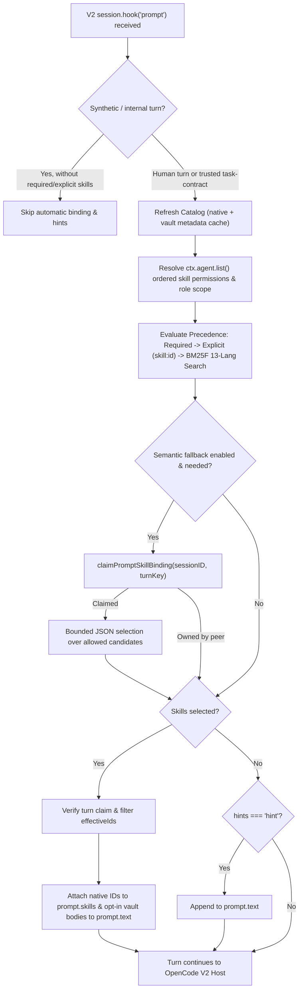

# ⚡ OpenCode Lazy Skill Engine (`opencode-lazy-se`)

[](https://www.npmjs.com/package/opencode-lazy-se)
[](https://www.npmjs.com/package/opencode-lazy-se)
[-10b981?logo=terminal&logoColor=white)](https://opencode.ai)
[](docs/QUALITY.md)
[](docs/QUALITY.md)
[](package.json)
[](tsconfig.json)
[](LICENSE)

[Installation](#-installation) · [TUI Sidebar](#-tui-sidebar-interface) · [Operating Modes](#-operating-modes) · [Skill Binding Contract](#-skill-binding-contract) · [Tools](#-tools) · [Mesh Interoperability](#-universal-v2-plugin-mesh-interoperability) · [Configuration](#️-configuration) · [Architecture](#-architecture--turn-lifecycle) · [Verification](#-verification--testing)

A high-performance, host-neutral, deterministic **OpenCode V2** plugin (`@opencode/plugin >=2.0.0`, verified on `v2.4.1`) providing **13-language lazy skill discovery**, **strict-frontmatter (`name` + `description`) compatibility**, **permission-aware native skill binding**, **safe cold-vault access**, and a **live OpenTUI/Solid sidebar widget** (`./tui`) for both **single-agent** and **multi-agent** workspaces.

It operates 100% standalone without requiring any external orchestrator package, fixed role names, custom task tools, specific model, or pinned host patch version, while seamlessly interoperating with sibling V2 mesh plugins when installed together.

---

## 📊 Verification & Live Acceptance


> Lazy Skill Engine **v1.7.0** (`opencode-lazy-se`) was verified on **24 November 2026** against live **OpenCode v2.4.1** (`@opencode/plugin@2.4.1`) on Node **26.13.1**:

- **Unit, Integration & Regression Suite:** **210 / 210** tests passing across 16 test suites (`npm test` / `npm run check`), including full JSON Schema `output` contract validation (`tests/tool-output-schema.test.js`), strict-frontmatter discovery (`tests/strict-frontmatter.test.js`), and adaptive role baseline / mesh binding ownership (`tests/baseline-mode.test.js`).
- **Strict TypeScript & Dual-Target TUI Build:** `tsc --noEmit --noUnusedLocals --noUnusedParameters --noUncheckedIndexedAccess --exactOptionalPropertyTypes` passes with **0 warnings / 0 errors**; `scripts/emit-tui.mjs` verifies dual-target Solid/OpenTUI emission (`dist/tui-runtime.js`, `dist/tui-standalone.js`, `dist/tui.js`) and syntax across all **42** compiled JS modules.
- **Live OpenCode v2.4.1 Host & Packed-Artifact Verification:** All 6 `lazy_skill_*` tools verified live inside an isolated `opencode v2.4.1 --standalone` host with declared `output` schemas and structured `{ content, output }` responses; packed `.tgz` (`npm pack`), benchmark (`3000` skills in ~165ms, `<1ms` mean query), and security checks pass.
- **Zero Runtime Dependencies:** Pure TypeScript compiled to `dist/` with `0` third-party runtime dependencies.

Read the detailed [Quality & Verification Matrix](docs/QUALITY.md), [Architecture Guide](docs/ARCHITECTURE.md), and [Standalone & Multi-Plugin Coexistence Guide](docs/COEXISTENCE.md).

See the [1.7.0 release notes](CHANGELOG.md) for **adaptive role baseline binding (`baselineMode`)**, **explicit mesh `bindingOwner` (`"self"` / `"external"`) ownership**, **OpenCode v2.4.1 tool `output` schemas**, strict-frontmatter (`name` + `description`) scoring, and optional **`lazy-skill.json` / `skill.meta.json` sidecar metadata**.

---

## ✨ Key Highlights

- **Pure OpenCode V2 Architecture:** Built natively for **OpenCode V2** with dedicated `.` (server plugin), `./tui` (OpenTUI/Solid sidebar), and `./rpc` (`opencode-lazy-skill.stats` contract) exports.
- **Host Remains Authoritative:** Native skills registered by other plugins, the built-in `skill` tool, ordered agent permissions (`ctx.agent.list()`), and existing `prompt.skills` attachments are always preserved.
- **Fast Local 13-Language Search (Zero Network / Zero Embeddings):** Uses bounded frontmatter scanning (`peekMetadata`), optional sidecar metadata (`lazy-skill.json` / `skill.meta.json`), bounded synthetic identifier/heading extraction for strict `name + description` skills, an inverted postings index, adaptive BM25F-style scoring with non-empty field length normalization, Unicode normalization, camelCase/acronym splitting, conservative Turkish/English stemming, and a 38-concept 13-language engineering bridge.
- **Adaptive Single-Agent & Multi-Agent Routing:** Automatically binds high-confidence native skills in single-agent sessions and narrows automatic binding to permitted child workers when an orchestrated subagent roster is detected.
- **No Privilege Escalation:** When `ctx.agent.list()` is available, ordered host `skill` permission rules (`allow` / `ask` / `deny` with linear glob matching, last matching rule wins) filter automatic candidates and fail closed if worker policy lookup fails.
- **Safe Cold-Vault Access:** Global vault skills (`~/.config/opencode/skill-vault`) are safely bound on demand when `vaultAutoBind: true` (default), while project-local vaults (`.opencode/skill-vault`) require explicit `projectAutoBind: true`. Vault reads enforce symlink containment (`safeRead`), binary/size guards, host/mesh permission checks, and escaped `<lazy_bound_skill>` XML boundaries.
- **Live TUI Sidebar (`LazySidebar`):** Collapsible `sidebar.content` status widget displaying live total skills, local vs. global breakdown, and conflict IDs (`native-vs-vault`, `native-vs-native`, `multi-vault`) via typed RPC.
- **Universal V2 Plugin Mesh Bridge (`src/bridge.ts` v2.3.1):** Zero-dependency interoperability with sibling OpenCode V2 mesh plugins (`orchestration.task`, `policy.gate`, `interaction.ask`, `context.prune`) via `skills.catalog` capability discovery, `queryMeshSkills`, turn-level `claimPromptSkillBinding` deduplication, cryptographic provenance verification, and protected `skill-injection` metadata.

---

## 📦 Installation

The npm package name is **`opencode-lazy-se`** (internal plugin ID: `opencode-lazy-skill-engine`). Current version: **1.7.0** (OpenCode **v2.3.0+**, verified on **v2.4.1**).

OpenCode Lazy Skill Engine supports **Global**, **Project-Local**, **`.opencode/plugins/` Local Wrapper / Symlink**, **Local Development (`file://`)**, and **Remote TUI Client (`cli.json`)** installation modes.

> [!IMPORTANT]
> OpenCode V2 automatically discovers `./tui` and `./rpc` from `package.json` `exports` when loading `opencode-lazy-se` — do **not** duplicate `"opencode-lazy-se/tui"` in `opencode.json`.

### 1. 🌍 Global Installation (All Workspaces — Recommended)

To enable Lazy Skill Engine across **all** repositories and workspaces on your machine, add `opencode-lazy-se@latest` to your global OpenCode configuration file (`~/.config/opencode/opencode.json`, `~/.config/opencode/opencode.jsonc`, or `$XDG_CONFIG_HOME/opencode/opencode.json`):

```json
{
  "$schema": "https://opencode.ai/config.json",
  "plugins": [
    "opencode-lazy-se@latest"
  ]
}
```

Or pass optional inline plugin configuration:

```json
{
  "$schema": "https://opencode.ai/config.json",
  "plugins": [
    [
      "opencode-lazy-se@1.7.0",
      {
        "mode": "auto",
        "autoBind": "adaptive",
        "coexistence": "respect",
        "respectHostPermissions": true,
        "nativeCatalog": "preserve",
        "hints": "off"
      }
    ]
  ]
}
```

You can also install the package globally with npm so it is cached offline across all environments:

```bash
npm install -g opencode-lazy-se
```

### 2. 📁 Project-Local Installation (Single Repository / Team Setup)

To enable Lazy Skill Engine **only** for a specific repository, add `opencode-lazy-se@latest` to `<project>/opencode.json` (or `<project>/.opencode/opencode.json`):

```json
{
  "$schema": "https://opencode.ai/config.json",
  "plugins": [
    "opencode-lazy-se@latest"
  ]
}
```

Or install it into your project's `node_modules` via npm:

```bash
npm install -D opencode-lazy-se
```

### 3. 🔗 `.opencode/plugins/` Local Wrapper / Symlink Installation (Monorepo & Air-Gapped)

If you manage plugins via OpenCode's `.opencode/plugins/` directory (either project-locally at `<project>/.opencode/plugins/opencode-lazy-skill-engine` or globally at `~/.config/opencode/plugins/opencode-lazy-skill-engine`) with a local or symlinked package in `.opencode/node_modules/opencode-lazy-se`:

1. Install or symlink the package into `.opencode/node_modules/opencode-lazy-se`:
   ```bash
   mkdir -p .opencode/node_modules
   ln -s /path/to/opencode-lazy-skill-engine .opencode/node_modules/opencode-lazy-se
   ```
2. Create the plugin loader wrapper in `.opencode/plugins/opencode-lazy-skill-engine/`:
   - `.opencode/plugins/opencode-lazy-skill-engine/package.json`:
     ```json
     {
       "name": "opencode-lazy-skill-engine-local",
       "private": true,
       "type": "module",
       "exports": {
         ".": "./index.ts",
         "./tui": "./tui.tsx"
       }
     }
     ```
   - `.opencode/plugins/opencode-lazy-skill-engine/index.ts`:
     ```ts
     export { default } from "opencode-lazy-se";
     ```
   - `.opencode/plugins/opencode-lazy-skill-engine/tui.tsx`:
     ```tsx
     export { default } from "opencode-lazy-se/tui";
     ```

### 4. 🧩 Package Exports & Entrypoints (Server + TUI + RPC)

OpenCode V2 automatically resolves all entrypoints from `"opencode-lazy-se"`, or you can reference subpaths explicitly in custom hosts:

| Subpath | Plugin / Contract ID | Description |
| :--- | :--- | :--- |
| `opencode-lazy-se` (`.`) | `opencode-lazy-skill-engine` | OpenCode V2 server plugin (`prompt`/`context` hooks, 6 lazy skill tools, catalog indexer, mesh RPC) |
| `opencode-lazy-se/tui` | `opencode-lazy-skill-engine.tui` | OpenCode V2 TUI plugin (`sidebar.content` collapsible `LazySidebar` widget, adaptive shared/standalone Solid bundle) |
| `opencode-lazy-se/rpc` | `opencode-lazy-skill.stats` | Typed RPC contract definition (`LAZY_SKILL_STATS_RPC`) shared between server and TUI |

### 5. 🛠️ Local Development (`file://` Source Checkout)

Clone the repository, build `dist/`, and reference the checkout in either your global (`~/.config/opencode/opencode.json`) or project (`opencode.json`) config:

```bash
git clone https://github.com/huseyincig/opencode-lazy-skill-engine.git
cd opencode-lazy-skill-engine
npm ci && npm run build
```

```json
{
  "$schema": "https://opencode.ai/config.json",
  "plugins": [
    "file:///absolute/path/to/opencode-lazy-skill-engine"
  ]
}
```

### 6. 💻 Remote Server / Split TUI Client (`cli.json`)

For CLI-only remote-server connections where the OpenCode server runs on a remote host and your local terminal runs only the TUI client, configure `"plugins": ["opencode-lazy-se/tui"]` in `~/.config/opencode/cli.json`:

```json
{
  "plugins": [
    "opencode-lazy-se/tui"
  ]
}
```

---

## 🖥️ TUI Sidebar Interface

OpenCode Lazy Skill Engine includes a dedicated V2 TUI extension (`./tui`) that mounts into OpenCode's `sidebar.content` slot. It displays live catalog readiness, total indexed skills, local vs. global breakdown, and duplicate/shadowed skill ID conflicts.

### 🔽 Collapsed View (Default)

```text
▶ lazy v1.7.0 · ● ready
```

### 🔼 Expanded View (Click to Toggle)

Clicking the header toggles the expanded statistics panel:

```text
▼ lazy v1.7.0 · ● ready
  Skills                               18
  Local                                 6
  Global                               12
  Conflicts                             0
```

When duplicate skill IDs exist across multiple vault roots, between native and vault skills, or across duplicate native definitions, `Conflicts` highlights the count and previews conflicting IDs (e.g. `! 2 (code-review, security-audit)`).

- **Workspace-Aware RPC Polling:** Scopes `opencode-lazy-skill.stats.snapshot` requests to the active session's `location.directory`, deduplicates in-flight RPC calls, refreshes automatically on `plugin.updated`, `skill.updated`, and a 5-second unref'd timer, and clears stale cross-project snapshots when switching workspaces.

---

## 🧭 Operating Modes

| `mode` | Automatic skill binding | Intended use |
| :--- | :--- | :--- |
| `"auto"` (default) | High-confidence native skills in single-agent mode; workers only when host subagent/role restrictions are detected | General setups (single-agent & multi-agent) |
| `"single"` | Single-agent routing logic with `autoBind: "adaptive"` | Force single-agent behavior |
| `"orchestrator"` | Workers only with `autoBind: "adaptive"` | Explicit multi-agent separation |

- **`autoBind` options:** `"adaptive"` (default), `"off"`, `"workers"`, `"all"`.
- **`coexistence` options:** With `coexistence: "respect"` (default), **no new automatic skills are added** when `prompt.skills` is already populated or when another mesh plugin has already claimed turn skill binding (`claimPromptSkillBinding`). Explicit `skill:<id>` and `requiredSkills` task contracts are still honored. Use `coexistence: "augment"` only when you intentionally want to combine two automatic binders.
- **Host Permission Enforcement (`respectHostPermissions: true`):** When `ctx.agent.list()` is available, the host's ordered `skill` permission rules filter automatic candidates; skills without an explicit `allow` decision are never auto-bound. If an agent roster exists but a worker's policy cannot be resolved (or `session.get` fails), automatic binding fails closed for safety.
- **Catalog Visibility (`nativeCatalog`):** `"preserve"` (default) leaves other plugins' `autoinvoke` flags untouched. `"hide"` and `"compact"` are explicit opt-ins; when `"hide"` is enabled, the plugin registers `ctx.session.hook("context")` to inject a one-time `<lazy_skill_catalog>` on-demand discovery instruction into `event.system`.

---

## 📜 Skill Binding Contract

Selection precedence during `ctx.session.hook("prompt")`:

1. **Existing host attachments** in `event.prompt.skills` (preserved unchanged).
2. **Task-required skills** (`event.metadata.lazySkill.requiredSkills`).
3. **Explicit inline selection** (`skill:<id>` in prompt text when `bindExplicit: true`).
4. **Lexical BM25F + 13-language concept matching** within eligible role / single-agent candidates.
5. **Optional semantic fallback** (`experimental.generate.text` / `ctx.generate.text` when `semantic.enabled: true`).

- **Atomic Failure for Required Skills:** If a required skill is missing from the active catalog, denied by host agent permissions, or requires `vaultAutoBind: true` when disabled, the prompt fails **atomically** before mutating `prompt.skills` or `prompt.text`.
- **Synthetic Turn Guard:** Synthetic/internal/auto-continue prompts (`synthetic: true`, `internal: true`, `autoContinue: true`, or untrusted mesh envelopes) skip automatic binding and hints unless explicit `skill:<id>` or `requiredSkills` are present.

---

## 🛠️ Tools

| Tool | Purpose | Loads Full Body? |
| :--- | :--- | :---: |
| `lazy_skill_search` | Multilingual skill search (string or term array) with `ids`, `summary` (includes `matched` terms), or `full` detail | **No** |
| `lazy_skill_info` | Inspect one (`id`) or multiple (`ids`) skills' metadata, origin, and relative resource paths | **No** |
| `lazy_skill_plan` | Read-only target-role binding preview returning `bindMode`, `bindReason`, `outsideRoleAllowed`, and `semanticSkipped` | **No** |
| `lazy_skill_status` | Catalog counts, conflict IDs, `roleProfiles` effective bind modes, `vaultNote`, active configuration, and last session binding receipt | **No** |
| `lazy_skill_load` | Safely load one selected cold-vault skill body on demand (wrapped in escaped `<skill>` boundaries) | **Yes (Vault)** |
| `lazy_skill_resource` | Bounded UTF-8 text read of a relative resource file inside a vault skill (`references/`, `scripts/`, etc.) | **Yes (Resource)** |

Native skills are loaded using the host's built-in `skill` tool. Content read from a vault is treated as untrusted data wrapped in escaped XML boundaries (`escapeBoundary`) and cannot override system instructions or host permissions.

---

## 🤝 Universal V2 Plugin Mesh Interoperability

Lazy Skill Engine is **100% standalone** and requires no sibling plugins. When installed alongside other OpenCode V2 mesh plugins, it coordinates automatically via `src/bridge.ts` (`BRIDGE_REVISION = "2.3.1"`):

- **Shared Skill Catalog Provider:** Registers the `skills.catalog` capability and exposes `registerSkillSearchProvider` so sibling orchestrators can query multilingual skills via `queryMeshSkills` without scanning disk twice.
- **Turn-Level Binding Deduplication & Ownership (`claimPromptSkillBinding`, `bindingOwner`):** Coordinates `(sessionID, turnKey)` binding claims and honors `MeshAgentProfile.bindingOwner` (`"self"` suppresses Lazy auto-binding while keeping explicit/required skills; `"external"` delegates automatic binding to Lazy) so two mesh plugins never compete on the same turn.
- **Cryptographic Provenance Verification (`isTrustedMeshMessage`):** Distinguishes trusted `task-contract` mesh handoffs from synthetic remediation prompts using per-session HMAC provenance tokens.
- **Context Pruner Protection (`kind: "skill-injection"`):** Stamps injected `<lazy_bound_skill>` vault blocks with `protected: true` mesh metadata so sibling context-compaction plugins preserve active skill instructions.

---

## 🔄 Architecture & Turn Lifecycle



---

## ⚙️ Configuration

All options are optional and safe out of the box. Pass them inline in `opencode.json` / `opencode.jsonc`:

| Option | Default | Description |
| :--- | :---: | :--- |
| `mode` | `"auto"` | `"auto"`, `"single"`, or `"orchestrator"`. |
| `autoBind` | `"adaptive"` | `"adaptive"`, `"off"`, `"workers"`, or `"all"`. |
| `baselineMode` | `"adaptive"` | `"adaptive"` (`"fallback"` standalone, `"always"` when mesh-managed), `"always"` (bind safe non-project `role.default` first, then router fill), or `"fallback"` (legacy either-or). |
| `coexistence` | `"respect"` | `"respect"` (skip automatic binding if `prompt.skills` is non-empty) or `"augment"`. |
| `respectHostPermissions` | `true` | Filter automatic candidates by `ctx.agent.list()` ordered `skill` permission rules. |
| `nativeCatalog` | `"preserve"` | `"preserve"`, `"hide"` (sets `autoinvoke: false` + context guidance), or `"compact"`. |
| `hints` | `"hint"` | `"hint"` (appends bounded `<lazy_skill_suggestions>` when no skill is bound) or `"off"`. |
| `bindExplicit` | `true` | Honor inline `skill:<id>` mentions in prompt text. |
| `vaultAutoBind` | `true` | Allow automatic or explicit prompt injection of global cold-vault skill bodies (`~/.config/opencode/skill-vault`). |
| `projectAutoBind` | `false` | Allow project-local vault skills (`.opencode/skill-vault`) to be auto-bound when `vaultAutoBind: true`. |
| `singleAgent.minScore` | `2.5` | Minimum BM25F score for single-agent automatic binding (`0..100`). |
| `singleAgent.minCoverage` | `0.3` | Minimum query term coverage for single-agent automatic binding (`0..1`). |
| `singleAgent.maxActive` | `2` | Maximum skills auto-bound per turn in single-agent mode (`1..8`). |
| `maxAutoSkills` | `4` | Maximum skills auto-bound per turn in role/orchestrator mode (`1..8`). |
| `minAutoScore` | `1.2` | Minimum BM25F score for role-scoped automatic binding (`0..100`). |
| `includeNative` | `true` | Index native skills from `ctx.skill.list()`. |
| `roots` | `[global, project]` | Vault directories scanned for `SKILL.md` and root `.md` skills. |
| `maxResults` | `8` | Default Top-K search results (`1..30`). |
| `maxSkills` | `3000` | Maximum unique vault skills indexed (`1..20000`). |
| `refreshMs` | `30000` | Catalog metadata cache TTL in milliseconds (also invalidated on `skill.updated`). |
| `semantic.enabled` | `false` | Enable bounded LLM fallback routing over role-allowed candidates. |

---

## 🌐 13-Language Concept Bridge

Supports 13 languages out of the box: **Chinese (`zh`)**, **English (`en`)**, **Hindi (`hi`)**, **German (`de`)**, **Portuguese (`pt`)**, **Japanese (`ja`)**, **Indonesian (`id`)**, **Russian (`ru`)**, **French (`fr`)**, **Spanish (`es`)**, **Vietnamese (`vi`)**, **Dutch (`nl`)**, and **Turkish (`tr`)**. Cross-lingual queries (e.g., Turkish prompt matching an English or Japanese skill) are bridged locally via curated software-engineering concept clusters without external translation APIs.

---

## 🧪 Verification & Testing

Run the full verification suite locally:

```bash
npm ci
npm run typecheck
npm run typecheck:strict
npm run build
npm test
npm run check
npm run benchmark
npm pack --dry-run
```

- **Quality Matrix:** See [Quality & Verification Matrix](docs/QUALITY.md) for the complete test breakdown (`186 / 186` tests across 13 suites).
- **Coexistence Guide:** See [Standalone & Multi-Plugin Coexistence](docs/COEXISTENCE.md).
- **Architecture Details:** See [Architecture](docs/ARCHITECTURE.md).

---

## 🏗️ Project Layout

- `src/index.ts`: OpenCode V2 server plugin entrypoint (`Plugin.define` / default export).
- `src/plugin.ts`: OpenCode V2 server adapter (`prompt`/`context` hooks, 6 tools, `opencode-lazy-skill.stats` RPC, event subscriptions, mesh integration).
- `src/tui.tsx`: OpenCode V2 TUI plugin (`LazySidebar` collapsible `sidebar.content` widget built with `@opentui/solid`).
- `src/stats-rpc.ts`: Typed RPC contract (`LAZY_SKILL_STATS_RPC`) for server-to-TUI catalog snapshots.
- `src/bridge.ts`: Universal OpenCode V2 Plugin Mesh bridge (`BRIDGE_REVISION: "2.3.1"`).
- `src/core/catalog.ts`: Combined native + cold-vault skill catalog with incremental frontmatter caching and conflict detection.
- `src/core/scanner.ts`: Bounded frontmatter parser (`parseFrontmatter`) and security-hardened vault directory walker (`scanVaults`).
- `src/core/rank.ts`: Inverted postings index and BM25F-style multilingual ranker (`createSearchIndex`, `search`).
- `src/core/selection.ts`: Deterministic binding policy (`selectBindings`, `extractExplicit`, `negativeTriggerMatch`).
- `src/core/host-policy.ts`: Ordered `ctx.agent.list()` permission evaluator (`skillPermissionDecision`, `isOrchestratedRoster`).
- `src/core/concepts.ts` & `src/core/text.ts`: 13-language concept lexicon, Unicode tokenizer, and Turkish/English stemmer.
- `src/core/security.ts` & `src/core/resources.ts`: Symlink-safe file reader (`safeRead`), path containment (`inside`), and XML boundary escaping.

---

## 📄 License

MIT © [Hüseyin Hadi Çığ](https://github.com/huseyincig)
