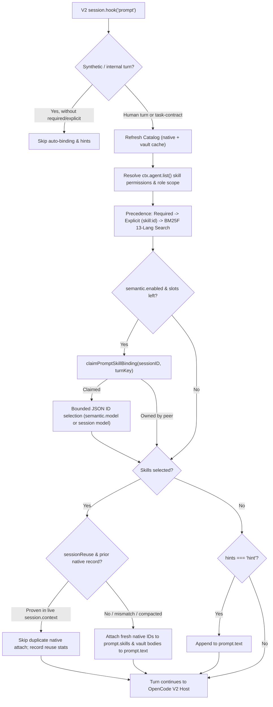

# ⚡ OpenCode Lazy Skill Engine (`opencode-lazy-se`)

[](https://www.npmjs.com/package/opencode-lazy-se)
[](https://www.npmjs.com/package/opencode-lazy-se)
[-10b981?logo=terminal&logoColor=white)](https://opencode.ai)
[](docs/QUALITY.md)
[](docs/QUALITY.md)
[](package.json)
[](tsconfig.json)
[](LICENSE)

[Scope & Boundaries](#-what-it-does--and-what-it-does-not-do) · [Installation](#-installation) · [Feature Guide](#-feature-guide) · [Examples](#-ready-to-use-configuration-examples) · [Tools](#-tools) · [Configuration Reference](#️-configuration-reference) · [TUI Sidebar](#-tui-sidebar-interface) · [Mesh Interop](#-universal-v2-plugin-mesh-interoperability) · [Verification](#-verification--testing)

A zero-runtime-dependency, host-neutral **OpenCode V2** plugin (`@opencode/plugin >=2 <3`, verified on `v2.4.1`) that provides **local 13-language skill discovery**, **permission-aware native skill binding**, **fail-closed native session skill reuse**, **safe cold-vault access**, **optional LLM semantic fallback**, and a **live OpenTUI/Solid sidebar widget** (`./tui`) for single-agent and multi-agent workspaces.

It runs standalone without requiring any external orchestrator package, fixed role names, custom task tools, or specific LLM provider, and coordinates cleanly with sibling V2 mesh plugins when installed together.

---

## 🎯 What It Does — and What It Does Not Do

Keeping expectations clear:

- **What it actually does:**
  - Indexes OpenCode **native skills** (`ctx.skill.list()`) and **cold-vault directories** (`~/.config/opencode/skill-vault`, `<project>/.opencode/skill-vault`, plus optional custom `roots`) using bounded frontmatter reads and optional sidecar metadata (`lazy-skill.json` / `skill.meta.json`).
  - Ranks skills locally with a **deterministic BM25F inverted index** and a **finite 38-concept / 13-language alias bridge** — no network calls, no vector database, and no embedding model required.
  - Works on strict **`name` + `description` skills that have no `keywords` field** by deriving bounded synthetic tokens from skill IDs and top markdown headings.
  - Automatically attaches high-confidence native skills to `event.prompt.skills` while respecting `ctx.agent.list()` ordered `skill` permission rules and existing user/orchestrator attachments.
  - Avoids re-attaching native skills that are already proven present in live `ctx.session.context()` (`sessionReuse: true`), failing closed to fresh attachment whenever proof is missing, stale, compacted, or edited.
  - Offers an **optional LLM semantic fallback** (`semantic.enabled: true`, disabled by default) where you can specify a fast model (`providerID/modelID[#variant]`) or fall back to the active session's model.
  - Exposes 6 structured-output `lazy_skill_*` tools and a live `LazySidebar` TUI widget (`./tui`, `./rpc`).
- **What it intentionally does NOT do:**
  - It is **not** a neural embedding engine or machine-translation system; cross-lingual recall outside its 38 engineering concept clusters relies on shared identifiers/tokens or optional `semantic.enabled: true`.
  - It **never** bypasses OpenCode's native `skill` tool or `ctx.agent.list()` permissions (`lazy_skill_load` refuses native skills and directs callers to the built-in `skill` tool).
  - It **never** auto-binds project-local vault skills (`.opencode/skill-vault`) unless you explicitly opt in with `projectAutoBind: true`.
  - It **never** injects raw LLM output from semantic routing into prompts; only strict JSON IDs validated against the role-allowed candidate set are accepted.

---

## 📦 Installation

The npm package name is **`opencode-lazy-se`** (internal plugin ID: `opencode-lazy-skill-engine`). Requires OpenCode **v2.3.0+** (verified on **v2.4.1**) and Node.js **>=20**.

> [!IMPORTANT]
> OpenCode V2 automatically discovers `./tui` and `./rpc` from `package.json` `exports` when loading `opencode-lazy-se` — do **not** add `"opencode-lazy-se/tui"` separately in `opencode.json`.

### 1. Global Installation (All Workspaces — Recommended)

Add `opencode-lazy-se@latest` to `~/.config/opencode/opencode.json` (or `opencode.jsonc`):

```json
{
  "$schema": "https://opencode.ai/config.json",
  "plugins": [
    "opencode-lazy-se@latest"
  ]
}
```

Or pass inline options as a tuple `["opencode-lazy-se@latest", { ... }]` (see [Ready-to-Use Configuration Examples](#-ready-to-use-configuration-examples) and [`examples/`](examples/README.md)).

### 2. Project-Local Installation

Add `"opencode-lazy-se@latest"` to `<project>/opencode.json` (or `<project>/.opencode/opencode.json`), or install with `npm install -D opencode-lazy-se`.

### 3. `.opencode/plugins/` Local Wrapper / Symlink (Monorepo & Air-Gapped)

1. Link or install the package into `.opencode/node_modules/opencode-lazy-se`.
2. Create `.opencode/plugins/opencode-lazy-skill-engine/` with:
   - `package.json` (`"type": "module"`, `"exports": { ".": "./index.ts", "./tui": "./tui.tsx" }`)
   - `index.ts`: `export { default } from "opencode-lazy-se";`
   - `tui.tsx`: `export { default } from "opencode-lazy-se/tui";`

### 4. Local Development (`file://`) & Remote Split TUI (`cli.json`)

- **Local checkout:** Clone, run `npm ci && npm run build`, and add `"file:///absolute/path/to/opencode-lazy-skill-engine"` to `plugins`.
- **Remote server / CLI-only TUI client:** Add `"plugins": ["opencode-lazy-se/tui"]` to `~/.config/opencode/cli.json`.

### Package Exports

| Subpath | Plugin / Contract ID | Purpose |
| :--- | :--- | :--- |
| `opencode-lazy-se` (`.`) | `opencode-lazy-skill-engine` | OpenCode V2 server plugin (`prompt`/`context` hooks, 6 `lazy_skill_*` tools, catalog indexer, event subscriptions, mesh interop) |
| `opencode-lazy-se/tui` | `opencode-lazy-skill-engine.tui` | OpenCode V2 TUI plugin (`sidebar.content` collapsible `LazySidebar` widget, adaptive shared/standalone Solid bundle) |
| `opencode-lazy-se/rpc` | `opencode-lazy-skill.stats` | Typed RPC contract (`LAZY_SKILL_STATS_RPC`) shared between server and TUI |

---

## 🔍 Feature Guide

### 1. Strict `name + description` Skills & Sidecar Metadata

Skills do **not** need custom `keywords` or `triggers` frontmatter to be discovered:

- **Strict frontmatter works out of the box:** For skills that only declare `name` and `description` in `SKILL.md`, the scanner safely reads a bounded prefix of the file to extract non-boilerplate markdown headings and identifiers (`derivedKeywords` / `derivedAliases`) and normalizes BM25F field lengths across only non-empty fields.
- **Optional YAML frontmatter fields:** `keywords`, `aliases`, `tags`, `triggers`, `negative_triggers` / `negativeTriggers`, `languages`, and `roles`. Duplicate frontmatter keys follow **first-key-wins** and emit a `DUPLICATE_FRONTMATTER_KEY:<key>` diagnostic in `lazy_skill_status`.
- **Sidecar metadata without editing third-party skills:** Drop a `lazy-skill.json` or `skill.meta.json` file next to any `SKILL.md` (see [`examples/sidecar-skill-meta.json`](examples/sidecar-skill-meta.json)) to attach `keywords`, `aliases`, `tags`, `triggers`, `negativeTriggers`, `languages`, or `roles`.
- **Config-level `rules`, `weights`, and `exclude`:** You can also inject extra search terms per skill ID via `rules`, tune BM25F field weights via `weights`, or hide noisy skills via `exclude` directly in `opencode.jsonc` — without touching any skill file.

### 2. Search Syntax, Long Prompts & Negative Triggers

Both `lazy_skill_search` and prompt routing share the same local index:

- **Query operators (`lazy_skill_search`):**
  - `@skill-id` or `skill:skill-id` — exact ID match (`+40` score bonus preserved even if other query words don't match).
  - `"exact phrase"` — phrase match boost.
  - `-term` — exclude skills matching `term`.
  - `*` — list indexed skills up to `top_k`.
  - Array queries — e.g. `["sqlite", "wal", "migration"]` (empty/whitespace arrays are rejected).
- **Inline explicit binding in prompts:** Writing `skill:<id>` in a user prompt binds that skill when `bindExplicit: true` (default) and permitted by host rules. Negated (`-skill:<id>`) and quoted (`"skill:<id>"`, `'skill:<id>'`) prose mentions are ignored so discussions *about* a skill do not trigger accidental attachment.
- **Long-prompt & shared-prefix resilience:** Long multi-sentence prompts keep up to `64` IDF-prioritized corpus terms (rather than truncating after the first few words), and ubiquitous catalog prefixes shared across many skills (such as `opencode-*` or `v2`) are automatically dampened (`sharedIdentityPrefix`) so specific domain terms win cleanly.
- **Negative triggers (`negativeTriggers`):** Veto automatic binding and hints when forbidden single words (checked across the full prompt, even past token 150), multi-word phrases, or unspaced CJK terms appear.
- **13-language concept bridge:** Bridges 38 software-engineering concept clusters locally across **zh, en, hi, de, pt, ja, id, ru, fr, es, vi, nl, tr** (for example, a Turkish prompt like `"veritabanı migrasyonu ve güvenlik incelemesi"` matches English skills covering database migrations and security review).

### 3. Fail-Closed Native Session Skill Reuse (`sessionReuse`)

Enabled by default (`sessionReuse: true`), native skill reuse avoids re-attaching the same native skill body on follow-up turns of the same session when it is still present in live conversation context:

- **Zero extra overhead on first turn:** `ctx.session.context({ sessionID })` is queried **only** when the session ledger already has a prior native attachment record and a SHA-256 `contentHash` from `ctx.skill.list()`.
- **Fail-closed live proof:** Before skipping re-attachment, the engine verifies that the live context (scanning up to the most recent `1,000` messages, capped at `64` skill entries / `1 MiB`) still carries the matching host-prepared skill wrapper, unchanged `sourceHash`, and matching `messageID` or timestamp (with a `5s` clock-order tolerance).
- **Immediate invalidation:** Any `session.compaction.started`, `session.compaction.ended`, `session.deleted`, `skill.updated`, `plugin.updated`, source edit (`sourceHash` change), context lookup error, or `1000ms` lookup timeout immediately forces fresh attachment.
- **Observability:** `lazy_skill_status` reports `sessionReuse` and cumulative `reuse: { events, bytes }`. Set `"sessionReuse": false` to always attach fresh on every turn.

### 4. Optional Semantic LLM Fallback (`semantic`)

Disabled by default (`semantic.enabled: false`). Enable it when you want a fast LLM to act as a bounded last-resort selector for ambiguous prompts that deterministic BM25F did not fill:

```jsonc
{
  "semantic": {
    "enabled": true,
    "model": "google/gemini-2.5-flash", // or "providerID/modelID#variant", or "" to use the session's active model
    "timeoutMs": 1500,                  // 50..5000 ms deadline
    "maxCandidates": 40                 // 1..120 allowed candidates (id + short description only)
  }
}
```

- Requires the host to expose `experimental.generate.text` or `ctx.generate.text`.
- Runs **only** when deterministic lexical binding has not reached the active skill limit and the turn has not already been claimed by a sibling mesh plugin.
- Sends only candidate `{ id, description }` pairs (max 220 chars each), expects strict `{"skills":["id"]}` JSON (markdown fences stripped), validates every returned ID against the role-allowed candidate set, caches up to `128` decisions in an LRU cache, and returns `[]` on timeout or parse error.

### 5. Operating Modes, Role Baselines & Coexistence

| `mode` | Automatic binding behavior (with default `autoBind: "adaptive"`) |
| :--- | :--- |
| `"auto"` (default) | Single-agent sessions bind high-confidence skills (`singleAgent.*`); when an orchestrated subagent roster or mesh orchestration capability is detected, automatic binding narrows to permitted workers. |
| `"single"` | Forces single-agent routing rules. |
| `"orchestrator"` | Forces orchestrator/worker separation (primary sessions stay clean; workers bind within role + host permission scopes). |

- **`baselineMode` (`"adaptive"` | `"always"` | `"fallback"`):** Controls how `roles.<name>.default` interacts with ranked lexical hits. `"always"` binds safe non-project role defaults first and fills remaining slots up to `maxActive` with ranked hits; `"fallback"` uses defaults only when lexical routing finds nothing; `"adaptive"` (default) resolves to `"always"` when managed by a mesh orchestrator profile and `"fallback"` standalone.
- **`coexistence` (`"respect"` | `"augment"`):** Default `"respect"` adds no automatic skills when `event.prompt.skills` is already populated or another mesh plugin claimed the turn.
- **`nativeCatalog` (`"preserve"` | `"compact"` | `"hide"`):** Default `"preserve"` leaves native skills untouched. `"compact"` trims native descriptions to `compactDescriptionChars`. `"hide"` sets `autoinvoke: false` on native skills and injects a one-time `<lazy_skill_catalog>` on-demand guidance block via `ctx.session.hook("context")`.
- **Synthetic turn guard:** Internal, remediation, continuation, guardian, and auto-continue turns skip automatic binding and hints unless explicit `skill:<id>` or `requiredSkills` are provided.

### 6. Cold-Vault Security & Filesystem Hardening

- **Vault roots:** Scans `~/.config/opencode/skill-vault` (`origin: "global"`), `<project>/.opencode/skill-vault` (`origin: "project"`), and any custom `roots` (supporting both `<root>/<id>/SKILL.md` and `<root>/<id>.md`).
- **Safe opt-in trust boundary:** `vaultAutoBind: true` allows global vault skills to bind on demand, while `projectAutoBind: false` keeps repository-local vaults from auto-injecting unless explicitly trusted.
- **Hardened file reads (`safeRead` / `peekMetadata`):** Uses `lstat` pre-check, `O_NONBLOCK` (prevents FIFO hangs), `fstat` `dev`/`ino` identity verification (TOCTOU guard), Linux `/proc/self/fd/<fd>` canonical containment checks, `2s` read deadlines (`.unref()`), binary null-byte checks, strict UTF-8 decoding, and escaped XML boundaries (`<skill>`, `<vault_resource>`, `<lazy_bound_skill>`).
- **Bounded scanning:** Uses streaming `opendir` with `SKILL.md` prioritized ahead of sibling files under tight visit budgets, bounded resource walking (`MAX_RESOURCE_VISITED = 2,000`, `1s` deadline), and per-session permission checks (`assertVaultSkillPermitted`) on `lazy_skill_load` and `lazy_skill_resource`.

---

## 📋 Ready-to-Use Configuration Examples

All runnable examples live in [`examples/`](examples/README.md):

| Example | Scenario |
| :--- | :--- |
| [`examples/opencode.jsonc`](examples/opencode.jsonc) | Balanced default configuration (explicitly showing out-of-the-box defaults including `sessionReuse: true`). |
| [`examples/semantic-fallback.jsonc`](examples/semantic-fallback.jsonc) | Enabling `semantic.enabled: true` with a dedicated fast model (`providerID/modelID[#variant]`). |
| [`examples/multi-agent-roles.jsonc`](examples/multi-agent-roles.jsonc) | Orchestrator/worker separation with per-role `allowed`, `default`, `maxActive`, `baselineMode: "always"`, and `agents` vault gating. |
| [`examples/cold-vault-and-tuning.jsonc`](examples/cold-vault-and-tuning.jsonc) | Custom vault `roots`, `projectAutoBind`, custom `rules`, BM25F `weights`, `exclude`, and `nativeCatalog: "compact"`. |
| [`examples/discovery-only.jsonc`](examples/discovery-only.jsonc) | Tools + TUI sidebar + shared catalog only (`autoBind: "off"`, `hints: "off"`). |
| [`examples/sidecar-skill-meta.json`](examples/sidecar-skill-meta.json) | Enriching any strict `SKILL.md` via `lazy-skill.json` / `skill.meta.json` without modifying the skill file. |

---

## 🛠️ Tools

All 6 tools are registered under the `lazy_skill` namespace with declared JSON Schema `output` definitions and return structured `{ content, output }` payloads:

| Tool | Inputs | Loads Full Body? | What It Returns |
| :--- | :--- | :---: | :--- |
| `lazy_skill_search` | `query` (string or string array, `*` to list), `top_k` (`1..30`), `scope` (`"native" \| "vault"`), `detail` (`"ids" \| "summary" \| "full"`) | **No** | Ranked hits (`id`, `scope`, `origin`, `score`, `coverage`, `matched`, `load`), detected `language`, `total`. |
| `lazy_skill_info` | `id` or `ids` (`1..20`) | **No** | Skill metadata (`name`, `description`, `scope`, `origin`, `keywords`, `tags`), relative `resources` list, and loader guidance. |
| `lazy_skill_plan` | `query`, optional `agent`, `worker`, `requiredSkills` | **No** | Read-only binding preview: `ids`, `source`, `scores`, `mode`, `bindMode`, `baselineMode`, `bindingOwner`, `bindReason`, `outsideRoleAllowed`, `semanticSkipped`. |
| `lazy_skill_status` | optional `refresh` (boolean) | **No** | Catalog counts (`skills`, `native`, `vault`, `local`, `global`), `conflicts` / `conflictIds`, `metadataCache`, `diagnostics`, `roleProfiles`, `sessionReuse`, `reuse: { events, bytes }`, `receipt`, active config. |
| `lazy_skill_load` | `id`, optional `reload` (boolean) | **Yes (Vault only)** | Escaped `<skill source="vault">` body for one permitted cold-vault skill. Refuses native skills (directs callers to the built-in `skill` tool). |
| `lazy_skill_resource` | `id`, `path` (relative path, e.g. `references/guide.md`) | **Yes (Vault only)** | Bounded UTF-8 text inside `<vault_resource>` tags. Blocks traversal, external symlinks, and binaries. |

---

## ⚙️ Configuration Reference

Every option below is optional and validated/clamped in [`src/core/config.ts`](src/core/config.ts).

### Routing, Modes & Session Reuse

| Option | Default | Valid Values / Range | Description |
| :--- | :---: | :--- | :--- |
| `mode` | `"auto"` | `"auto" \| "single" \| "orchestrator"` | Workspace routing mode. |
| `autoBind` | `"adaptive"` | `"adaptive" \| "off" \| "workers" \| "all"` | Which sessions receive automatic skill binding. |
| `baselineMode` | `"adaptive"` | `"adaptive" \| "always" \| "fallback"` | How `roles.<name>.default` combines with ranked lexical hits. |
| `coexistence` | `"respect"` | `"respect" \| "augment"` | `"respect"` skips auto-binding when `prompt.skills` is non-empty or a sibling mesh plugin claimed the turn. |
| `respectHostPermissions` | `true` | `boolean` | Filter candidates using `ctx.agent.list()` ordered `skill` permission rules (fail-closed on lookup failure). |
| `sessionReuse` | `true` | `boolean` | Skip re-attaching native skills proven present in live `ctx.session.context()` (fail-closed on compaction/edit/error). |
| `bindExplicit` | `true` | `boolean` | Honor inline `skill:<id>` mentions in prompt text (ignores `-skill:<id>` and quoted mentions). |

### Single-Agent & Multi-Agent Roles

| Option | Default | Valid Values / Range | Description |
| :--- | :---: | :--- | :--- |
| `singleAgent.allowed` | `[]` | `string[]` (max 128 IDs) | Optional allowlist restricting single-agent automatic binding (empty = all eligible). |
| `singleAgent.maxActive` | `2` | `1..8` | Maximum skills auto-bound per turn in single-agent mode. |
| `singleAgent.minScore` | `2.5` | `0..100` | Minimum BM25F score for single-agent auto-binding. |
| `singleAgent.minCoverage` | `0.3` | `0..1` | Minimum query term coverage for single-agent auto-binding. |
| `roles` | `{}` | `Record<role, { allowed, default, maxActive }>` | Up to 64 named role profiles (`maxActive`: default `3`, `1..8`). |
| `minAutoScore` | `1.2` | `0..100` | Minimum BM25F score for role-scoped auto-binding. |
| `maxAutoSkills` | `4` | `1..8` | Default cap for role-scoped auto-binding when `role.maxActive` is not set. |
| `agents` | `[]` | `string[]` | Optional allowlist of agent IDs allowed to load/auto-bind vault skills (empty = all host-permitted agents). |

### Optional Semantic LLM Fallback

| Option | Default | Valid Values / Range | Description |
| :--- | :---: | :--- | :--- |
| `semantic.enabled` | `false` | `boolean` | Enable bounded LLM fallback selection when lexical hits don't fill slots. |
| `semantic.model` | `""` | `"providerID/modelID[#variant]"` (max 160 chars) | Model used for semantic routing; empty string falls back to the active session's model. |
| `semantic.timeoutMs` | `1500` | `50..5000` | Hard deadline in milliseconds for the semantic LLM call. |
| `semantic.maxCandidates` | `40` | `1..120` | Maximum allowed candidate skills sent (`id` + short description) to the semantic selector. |

### Native Catalog, Hints & Search Tuning

| Option | Default | Valid Values / Range | Description |
| :--- | :---: | :--- | :--- |
| `includeNative` | `true` | `boolean` | Index native skills from `ctx.skill.list()`. |
| `nativeCatalog` | `"preserve"` | `"preserve" \| "compact" \| "hide"` | `"compact"` trims native descriptions; `"hide"` sets `autoinvoke: false` and adds `<lazy_skill_catalog>` context guidance. |
| `compactDescriptionChars` | `100` | `30..200` | Description length cap when `nativeCatalog: "compact"`. |
| `hints` | `"hint"` | `"hint" \| "off"` | Append bounded `<lazy_skill_suggestions>` when no skill was bound on the turn. |
| `language` | `"auto"` | `"auto"` or `zh,en,hi,de,pt,ja,id,ru,fr,es,vi,nl,tr` | Language override for hint text and `lazy_skill_search` reporting. |
| `maxHints` | `2` | `0..5` | Maximum advisory hints appended per turn. |
| `minHintCoverage` | `0.65` | `0..1` | Minimum query coverage required before suggesting a skill hint. |
| `searchDetail` | `"summary"` | `"ids" \| "summary" \| "full"` | Default detail level returned by `lazy_skill_search`. |
| `maxResults` | `8` | `1..30` | Default `top_k` returned by `lazy_skill_search`. |
| `rules` | `{}` | `Record<skillId, string[]>` | Extra custom keywords/triggers appended per skill ID (up to 32 strings per ID). |
| `weights` | `{ id:7, name:6, keywords:5, aliases:4, tags:3, triggers:5, description:1.8 }` | `0..20` per field | BM25F field weights. |
| `exclude` | `[]` | `string[]` | Skill IDs excluded from indexing and `nativeCatalog` transforms. |

### Vault Roots, Bounds & Cache

| Option | Default | Valid Values / Range | Description |
| :--- | :---: | :--- | :--- |
| `roots` | `[global, project]` | `string[]` | Extra vault directories scanned alongside `~/.config/opencode/skill-vault` and `<project>/.opencode/skill-vault`. |
| `vaultAutoBind` | `true` | `boolean` | Allow automatic/explicit binding of global cold-vault skill bodies. |
| `projectAutoBind` | `false` | `boolean` | Allow project-local vault skills to auto-bind when `vaultAutoBind: true`. |
| `refreshMs` | `30000` | `0..3600000` | Catalog metadata cache TTL in ms (also invalidated immediately on `skill.updated` / `plugin.updated`). |
| `maxSkills` | `3000` | `1..20000` | Maximum unique vault skills indexed. |
| `maxDepth` | `6` | `1..10` | Maximum directory recursion depth inside vault roots. |
| `maxSkillBytes` | `98304` | `1024..524288` | Maximum byte size for a loaded vault `SKILL.md` (96 KiB default). |
| `maxResourceBytes` | `65536` | `1024..524288` | Maximum byte size for `lazy_skill_resource` reads (64 KiB default). |
| `maxFrontmatterBytes` | `8192` | `256..32768` | Maximum prefix bytes read during vault metadata scanning (8 KiB default). |
| `maxPromptChars` | `12000` | `300..100000` | Maximum prompt characters inspected for explicit references and routing. |
| `sessionTtlMs` | `3600000` | `60000..86400000` | In-memory session ledger TTL (1 hour default). |
| `maxSessions` | `200` | `10..2000` | Maximum tracked sessions in memory (LRU-evicted). |

---

## 🖥️ TUI Sidebar Interface

The `./tui` entrypoint mounts a collapsible `LazySidebar` widget into OpenCode's `sidebar.content` slot:

```text
▼ lazy v1.8.0 · ● ready
  Skills                               18
  Local                                 6
  Global                               12
  Conflicts                             0
```

Click the header to collapse to `▶ lazy v1.8.0 · ● ready`. When duplicate IDs exist (`native-vs-vault`, `native-vs-native`, or `multi-vault`), `Conflicts` displays the count and conflicting IDs. Requests are scoped to the active session directory, deduplicated while in flight, refreshed on `plugin.updated` / `skill.updated` / session switches, and polled on a quiet 30-second unref'd safety timer once connected (5s while connecting).

---

## 🤝 Universal V2 Plugin Mesh Interoperability

When installed alongside sibling OpenCode V2 mesh plugins, [`src/bridge.ts`](src/bridge.ts) (`BRIDGE_REVISION = "2.3.1"`) coordinates via `Symbol.for("opencode.mesh.v2")`:

- Registers the `skills.catalog` capability (`registerSkillCatalogProvider`) so orchestrators can query skills without rescanning disk.
- Deduplicates turn-level binding via `claimPromptSkillBinding` and respects `MeshAgentProfile.bindingOwner` (`"self"` vs `"external"`).
- Verifies trusted `task-contract` vs synthetic remediation envelopes with per-session HMAC provenance (`isTrustedMeshMessage`) and cleans up session state on `session.deleted`.
- Stamps injected `<lazy_bound_skill>` vault blocks with `kind: "skill-injection", protected: true` so sibling context pruners preserve active skill instructions.

---

## 🔄 Architecture & Turn Lifecycle



---

## 🧪 Verification & Testing


Run all local verification gates:

```bash
npm ci
npm run check          # typecheck:strict + build + emit-tui + 46 JS syntax checks + 229 node:test tests
npm run benchmark      # 3000-skill catalog index & query benchmark
npm pack --dry-run     # verify published package tarball contents
```

- **Automated Suite:** **229 / 229** tests passing across **19** test suites (`npm run check`), `0` strict TypeScript errors, `0` runtime dependencies, and `0` high-severity npm audit vulnerabilities.
- **Live Host Status:** All 6 `lazy_skill_*` tools and declared `output` schemas were verified in an isolated `opencode v2.4.1 --standalone` probe; multi-plugin live load-order sessions remain explicitly documented as `NOT_RUN` in [docs/QUALITY.md](docs/QUALITY.md).
- Read more in [docs/ARCHITECTURE.md](docs/ARCHITECTURE.md), [docs/COEXISTENCE.md](docs/COEXISTENCE.md), and [docs/QUALITY.md](docs/QUALITY.md).

---

## 🏗️ Project Layout

- `src/index.ts` — OpenCode V2 server plugin entrypoint (`Plugin.define` / default export).
- `src/plugin.ts` — Server adapter (`prompt`/`context` hooks, 6 tools with JSON output schemas, stats RPC, event subscriptions, mesh integration).
- `src/tui.tsx` — OpenCode V2 TUI plugin (`LazySidebar` widget built with `@opentui/solid`).
- `src/stats-rpc.ts` — Typed RPC contract (`LAZY_SKILL_STATS_RPC`) shared between server and TUI.
- `src/bridge.ts` — Universal OpenCode V2 Plugin Mesh bridge (`BRIDGE_REVISION: "2.3.1"`).
- `src/core/config.ts` — Clamped option validation (`configure`).
- `src/core/catalog.ts` — Native + cold-vault catalog with SHA-256 `contentHash`, fingerprint-checked cache reuse, and conflict tracking.
- `src/core/scanner.ts` — First-key-wins bounded frontmatter parser, sidecar reader, and streaming `opendir` vault scanner.
- `src/core/rank.ts` — Inverted index, adaptive BM25F scoring, IDF-prioritized long-query selection, and shared-prefix dampening.
- `src/core/selection.ts` — Deterministic binding policy, `baselineMode`, explicit extraction, and negative trigger checks.
- `src/core/reuse.ts` — Fail-closed live-context proof for native session skill reuse (`planNativeSkillReuse`).
- `src/core/semantic.ts` — Optional bounded LLM fallback router (`SemanticRouter`, `modelFromString`, strict JSON parser).
- `src/core/host-policy.ts` — Ordered `ctx.agent.list()` permission evaluator and orchestrated roster detection.
- `src/core/session.ts` — Bounded in-memory session ledger, compaction invalidation, `reuseEpoch`, and reuse stats.
- `src/core/concepts.ts` & `src/core/text.ts` — 38-concept 13-language bridge, Unicode tokenizer, stopwords, and EN/TR stemmer.
- `src/core/security.ts` & `src/core/resources.ts` — `O_NONBLOCK` / `dev`+`ino` / `/proc/self/fd` symlink-safe file reader and bounded resource walker.
- `examples/` — Runnable OpenCode configuration and sidecar metadata examples.

---

## 📄 License

MIT © [Hüseyin Hadi Çığ](https://github.com/huseyincig)
