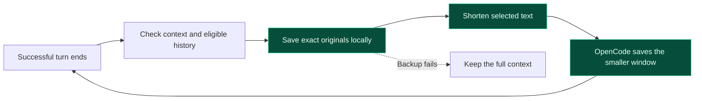

# OpenCode Live Compact

**Keep context under control while the agent works.**

**English** · [简体中文](README.zh-CN.md)

[](https://github.com/anomalyco/opencode/releases/tag/v2.2.6)
[](package.json)
[](package.json)
[](LICENSE)
[](https://www.npmjs.com/package/opencode-live-compact)

[Results](#benchmark-results) · [Quick start](#quick-start) · [How it works](#how-it-works) · [Configuration](docs/architecture.md#configuration) · [Run benchmarks](benchmarks/README.md)

Long coding sessions accumulate file reads, command output, and intermediate explanations. **Live Compact** is a native OpenCode plugin that checks after successful turns and shortens eligible completed history locally. It makes no extra model calls for these reductions, preserves the prefix before each cut, and saves the original text for exact recall.

**The problem: waiting until the context window is nearly full lets unnecessary history pile up, then interrupts work with a large compaction.** Live Compact aims to keep that growth under control throughout the conversation, making small, safe reductions after completed turns. Don't wait until the window is full to start compacting.

## How it works



1. **Check completed work.** Once context reaches 20,000 tokens, inspect older completed history. Active work and the latest three tool rounds stay intact.
2. **Choose small cuts.** Combine eligible adjacent results into a completed span, or shorten an individual result. The current minimum is 1,000 source tokens; each replacement must reduce both estimated tokens and serialized size.
3. **Back up before changing anything.** Store exact originals in private session directories. If preservation fails, keep the original context.
4. **Save a stable replacement.** Preserve reasoning, tool calls, call/result pairs, message order, and the prefix before the cut. OpenCode persists and reuses the smaller window.
5. **Recall details when needed.** Checkpoints include a reference for `live_compact_recall`. Recall returns exact archived text without a summarization call.

The goal is **lower context growth with useful prompt-cache reuse**. Editing a suffix can still cause cache misses, so fewer prompt tokens alone do not establish lower cost.

### What stays protected

- User requirements, system instructions, active or interrupted work, and recent tool rounds.
- Reasoning, tool-call arguments, identifiers, and valid call/result relationships.
- Unsupported or ambiguous output, diagnostics, existing checkpoints, and their active recovery references.

OpenCode's automatic compaction stays enabled. The plugin can resume after native compaction. Switching provider or model uses OpenCode's fallback to original history.

[Read the architecture, safety rules, and limitations →](docs/architecture.md)

## Quick start

Use **Node.js 22.18+** and stock **OpenCode 2.2.6**, the version covered by our tests.

### Install from npm

```sh
opencode plugin add opencode-live-compact
```

This installs the [npm package](https://www.npmjs.com/package/opencode-live-compact) into OpenCode's global configuration. Restart OpenCode after installation.

### Use the local checkout

```sh
git clone https://github.com/Haoming9527/opencode-live-compact.git
cd opencode-live-compact
npm ci
npm run build
```

In the project where you use OpenCode, add this to `opencode.jsonc`:

```jsonc
{
  "plugins": [
    {
      "package": "/absolute/path/to/opencode-live-compact"
    }
  ]
}
```

Replace the path with your checkout. On Windows, use a path such as `E:/projects/opencode-live-compact`. Start OpenCode in that project and work normally.

### Defaults

| Setting | Default |
| --- | --- |
| Start checking context | 20,000 tokens |
| Minimum eligible source per cut | 1,000 tokens |
| Ordinary span size limit | 32,000 tokens |
| Retained checkpoint text | Up to 8,000 Unicode code points per span |
| Recent tool rounds preserved | 3 |
| Maximum cuts per completed-turn cycle | 3 |
| Recovery budget across sessions | 256 MiB |
| Extra model calls for local reductions | 0 |

Set overrides in the plugin entry's `options` object. [All configuration options →](docs/architecture.md#configuration)

Recovery files live in private per-session directories. Before a backup would exceed the shared budget, cleanup removes the oldest retired backups toward 80% usage. Active checkpoints stay protected; if they leave insufficient room, the plugin keeps the full context.

## Checking plugin status

Ask OpenCode to call `live_compact_status` to see this session's latest planning or failure reason. Normal skips are logged once per reason change; storage and replay failures produce warnings even with `diagnostics: false`. Enable diagnostics for detailed JSONL measurements.

Recall reports `missing`, `expired`, `unreadable`, or `storage-unavailable` when it cannot recover text. Re-read the source instead of guessing omitted details. References from other sessions also report `missing` to preserve isolation. Active backups do not expire after seven days; that grace period applies only to retired records.

## Development and benchmarks

```sh
npm run typecheck
npm test
npm run test:integration
```

Integration tests launch stock OpenCode 2.2.6 with a local scripted provider. They verify completed-turn timing, prefix preservation, exact recall, restart, backup failure, and continued operation after native compaction without paid model calls.

The benchmark runner supports four suites:

| Suite | Workload |
| --- | --- |
| Short | 6 small JavaScript tasks |
| SemVer | 10 sequential feature-development stages |
| Aider Polyglot | 150 programming exercises across five languages |
| Web-Bench React | 20 dependent tasks building one application |

[Run any of the four locally or in Daytona →](benchmarks/README.md) · [Publish a new version](docs/publishing.md)

## Benchmark results

**150 programming exercises + 20 dependent React tasks.** Each suite used one continuous session per version, stock OpenCode **2.2.6**, **GPT-6 Luna**, and identical tasks and defaults. Run in Daytona on November 9, 2026.


[Aider: logs and source data](benchmarks/results/2026-11-09-aider-150/README.md) · [Web-Bench: logs and source data](benchmarks/results/2026-11-09-webbench-react-20/README.md)

## License

Inspired by the ideas behind [DSH Live Compact](https://github.com/Tranquillitatis-Lab/dsh-live-compact).

[MIT licensed](LICENSE).
