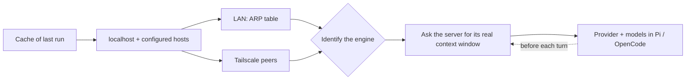

<div align="center">

# pi-local-server

**Your local LLM servers, found automatically, with their real context window.**

Plug-and-play discovery of llama.cpp, LM Studio, Strata, Ollama, vLLM, SGLang and more on this machine, your LAN and your Tailscale network, for **[Pi](https://github.com/earendil-works/pi)** and **[OpenCode](https://opencode.ai)**.

[](https://www.npmjs.com/package/pi-local-server)
[](https://www.npmjs.com/package/opencode-local-server)
[](https://github.com/Leo00703/pi-local-server/actions/workflows/ci.yml)
[](LICENSE)

</div>

---

You run models on a big PC, and code from a laptop. Without this, every new machine means hand-writing a provider that points at the right IP and guessing a context size. Guess it too high and the agent hits truncation or a failed compaction; too low and you waste the model.

**pi-local-server finds your servers and asks each one what it is really running with**, so `/model` just lists them, with the right context window, and keeps it right when you reload a model with another `--ctx-size`.

## Quick start

**Pi**

```bash
pi install npm:pi-local-server
```

**OpenCode** (1.x and 2.x), in `opencode.json` / `opencode.jsonc`:

```json
{ "plugin": ["opencode-local-server"] }
```

Restart, start your server, open the model list. That is all: no hosts, ports or context sizes to configure. Details for OpenCode are in [opencode/README.md](opencode/README.md).

## What you get

- **Zero configuration.** Finds servers on this machine, on your LAN (ARP table) and on every online Tailscale peer. One provider per machine, even when it is reachable at two addresses.
- **The context window the server actually runs with**, never a hardcoded guess, and re-read before the agent uses the model. If the server was restarted with a different size, the model is updated and you are told (`m context window 8192 → 4096`).
- **Honest about what it knows.** Every model records where its context came from. Values the server did not state are marked as *not verified* instead of being presented as fact.
- **Right capabilities.** Vision input and reasoning are picked up from what the server advertises; `maxTokens` is always kept below the window.
- **Safe by default.** Only private addresses are probed, API keys only go where you configured them, redirects are never followed. See [docs/security.md](docs/security.md).
- **Cross-platform.** macOS, Windows and Linux, tested in CI on all three.

## How it works



1. **Instant start:** providers from the last run are restored from a small cache so a new session is usable at once, and `localhost` plus any configured hosts are probed.
2. **Background sweep:** the LAN and every online Tailscale peer are scanned, each live server is identified by the *shape* of its answers (not just an open port) and registered.
3. **Always current:** the window is re-read from the server before the agent uses a local model. An unreachable server keeps its last known values.

How each engine reports its context is in [docs/engines.md](docs/engines.md).

## Supported engines

| Engine | Context window source | Status |
|---|---|---|
| llama.cpp (single model and router mode, Llama-macOS app) | `/props`, per-model launch args | Live-tested |
| Strata | `/props` (`n_ctx`) | Live-tested |
| LM Studio | native API (`loaded_context_length`) | Live-tested |
| Ollama | `/api/show` | Implemented, not live-tested |
| vLLM, SGLang | `max_model_len` | Implemented, not live-tested |
| llama-swap, Jan, MLX-LM, KoboldCpp, text-generation-webui, LocalAI, Xinference, LiteLLM, GPT4All, TGI, TabbyAPI, Aphrodite, any OpenAI-compatible server | advertised in `/v1/models`, otherwise a configurable default (marked *estimated*) | Detected by API shape |

Ports, fingerprints and caveats are in [docs/engines.md](docs/engines.md). **Using an engine that is marked "not live-tested"?** A [report](https://github.com/Leo00703/pi-local-server/issues/new/choose), good or bad, is very welcome.

## Pi commands

| Command | What it does |
|---|---|
| `/local-server` or `/local-server status` | Registered providers and models, and which contexts are not verified |
| `/local-server rescan` | Full LAN + Tailscale sweep now |
| `/local-server hosts` | Show the extra hosts you configured |

## Configuration

Nothing is required. Everything is optional environment variables: extra hosts, API keys, per-model context overrides, timeouts, switching LAN or Tailscale discovery off. See [docs/configuration.md](docs/configuration.md).

## Making your server reachable

Discovery can only find what other devices can reach. Most engines listen on `127.0.0.1` by default; see [docs/engines.md](docs/engines.md#making-a-server-reachable) for the one flag or setting per engine (llama.cpp, LM Studio, Strata) and the firewall note for Tailscale.

## Contributing

Bug reports, engine reports and pull requests are welcome: see [CONTRIBUTING.md](CONTRIBUTING.md). Notable changes are listed in the [changelog](CHANGELOG.md). Please report vulnerabilities privately as described in [SECURITY.md](SECURITY.md).

## License

[MIT](LICENSE)
