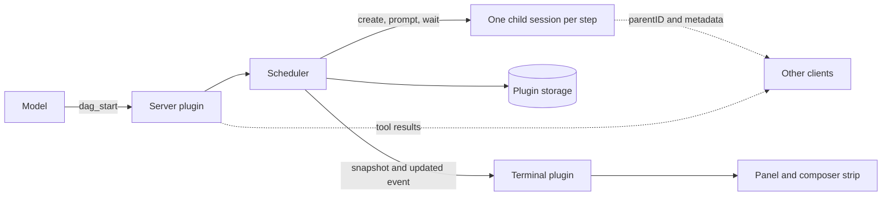

# opencode-sidequest

Agent DAGs for [OpenCode V2](https://opencode.ai/v2/docs/). The model hands
OpenCode a dependency graph of sub-agent steps. Independent steps run in
parallel, each in its own child session, and a live panel in the terminal UI
shows the graph while it runs.

Developed against OpenCode 2.0.29 and its plugin API.

## Table of Contents

- [What it adds](#what-it-adds)
- [Install](#install)
  - [From a checkout](#from-a-checkout)
- [Running a DAG](#running-a-dag)
- [The panel](#the-panel)
  - [Focus shortcut](#focus-shortcut)
- [How it works](#how-it-works)
- [Other clients](#other-clients)
- [Permissions and cost](#permissions-and-cost)
- [Limits and unverified behavior](#limits-and-unverified-behavior)
- [Development](#development)
- [Releases](#releases)
- [Related projects](#related-projects)
- [License](#license)

## What it adds

| Piece | What it does |
| --- | --- |
| `dag_start` | Starts a run from a list of steps and waits for it by default |
| `dag_status` | Shows a run as a table; defaults to the newest run in the session |
| `dag_cancel` | Interrupts the running steps and cancels the run |
| `dag_retry` | Re-runs failed, skipped, and cancelled steps; finished steps keep their output |
| Panel | A graph of the run beside the transcript, shown only in the session that owns a running DAG |
| Composer strip | One line above the prompt while a run is going |

## Install

Install [Sidequest from npm](https://www.npmjs.com/package/opencode-sidequest)
by adding it to `~/.config/opencode/opencode.jsonc`:

```jsonc
{
  "$schema": "https://opencode.ai/config.json",
  "plugins": ["opencode-sidequest@0.1.0"]
}
```

OpenCode installs the package automatically. Terminal clients also load its
`./tui` export; other clients load only the server half. Restart OpenCode after
changing the plugin configuration.

### From a checkout

For local development, replace the package spec with the checkout's absolute path:

```jsonc
{
  "plugins": ["/absolute/path/to/opencode-sidequest"]
}
```

OpenCode needs the peer packages next to the plugin, so install them in the
checkout first:

```sh
npm install
```

Restart OpenCode after changing the plugin.

## Running a DAG

Ask for one explicitly. The tool description tells the model not to start a DAG
for ordinary planning or coding.

```text
Run a DAG: read the three config files in parallel, then write one summary
that depends on all three.
```

The model calls `dag_start` with steps like these:

```json
{
  "name": "config-review",
  "maxParallel": 3,
  "nodes": [
    { "id": "app", "prompt": "Summarize app.yaml" },
    { "id": "db", "prompt": "Summarize db.yaml" },
    { "id": "net", "prompt": "Summarize net.yaml" },
    { "id": "report", "prompt": "Write one report", "depends_on": ["app", "db", "net"] }
  ]
}
```

| Rule | Value |
| --- | --- |
| Steps per run | 1 to 24 |
| Step id | Lowercase letters, digits, `-` and `_`; up to 32 characters; unique |
| `maxParallel` | 1 to 8, default 3 |
| Step fields | `id`, `prompt`, `agent`, `model`, `timeout`, `maxCost`, `maxTokens`, `label`, `depends_on`; unknown keys are rejected |
| `model` | `provider/modelID`, optionally `#variant`. When omitted the host picks its own default for new sessions, which is not necessarily the parent session's model. Set it on every step |
| `timeout` | 1 to 3600 seconds. The step is failed and its child session interrupted when it expires |
| `maxTokens` | Ceiling on total tokens (input, cached input, output, reasoning), checked every 2 seconds while the step runs and again when it ends. Each child starts with about 23,000 tokens of instructions and tool definitions, which a warm child reports as cached input, so set it well above that |
| `maxCost` | USD ceiling, checked the same way. Free or unpriced models report a cost of 0, so this never trips for them; use `maxTokens` |
| `retries` | Automatic retries after a failure or timeout, 0 to 3, default 0, so a step gets at most `retries + 1` attempts. A step that exceeds its token or cost cap is never retried. A run also stops retrying after 6 retries in total, whatever its steps ask for. The status table shows `(attempt N)` for a retried step |
| Dependency output | Each step receives its dependencies' outputs, about 4,000 characters each |
| Runs per session | At most 3 running at once; the newest 10 are kept |
| Nesting | `dag_start` is refused from inside a DAG step |

A failed step skips everything downstream of it. Independent branches keep
going. After a server restart, a run that was running comes back as `failed`
with the error `interrupted by restart`, and `dag_retry` continues it.

## The panel

The side panel is one pane with up to four pages, and `y` (previous) and `o` (next) step through
all of them, wrapping around. Session is OpenCode's own landing page: the session title, the
context window use, and the MCP servers, built from the same data its sidebar uses. Graph draws
the newest DAG, or one you picked in Runs, and needs a run in the session. Runs lists the
session's runs and needs two or more. Help explains how to run a DAG, the keys, and the OpenCode
keys that matter beside it.

The pane belongs to OpenCode, not the plugin, so you resize it with the mouse: drag the light line
on its left edge, and double-click the line to reset it. The width is remembered, and `f` toggles
fullscreen. A plugin cannot set that width, so it opens at OpenCode's default, half the terminal,
which is wide enough for a DAG's boxes to sit side by side. OpenCode's own sidebar is a fixed 42
columns and has no handle, which is why the plugin replaces it instead of adding a section to it.

| Situation | Behavior |
| --- | --- |
| A run starts in the session you are viewing | The panel opens on the Graph page, unless you closed it for that run or the terminal is 80 columns or narrower |
| The run finishes and you never touched the panel | The panel closes after about 8 seconds, but only if the plugin opened it |
| You open it with `<leader>b` | It lands on the Graph page while a run is going, otherwise on the page you last used |
| You switch session tabs | A panel you opened by hand follows you: OpenCode closes it on navigation and the plugin opens it again |
| You close it, or something else takes the pane | It stays closed until a new run starts in that session |
| You are viewing a step's session | The panel highlights the step; it never opens by itself there |

| Key | Action |
| --- | --- |
| `<leader>b` | Show or hide the panel. Free OpenCode's sidebar toggle as described below. Also `/side-panel` |
| `ctrl+g` (default) | Move the cursor between the session and the panel, opening the panel first if it is closed. Configurable with `focusKey` below |
| `<leader>o` | From a step's session, go back to the session that started the DAG. Also `/dag-origin` and the palette |
| `/dag` | Open the panel on the newest graph and move the cursor into it |

While the panel has the cursor, arrows and `hjkl` always do the same thing:

| Key | Graph | Runs | Session, Help |
| --- | --- | --- | --- |
| `j` / `k`, down / up | Move to the box below or above | Move the cursor | Scroll |
| `h` / `l`, left / right | Move along a row of boxes | | |
| `Enter` | Open the selected step inside the panel | Show that run in the graph | |
| `y` / `o` | Previous / next page | Previous / next page | Previous / next page |
| `c` / `r` | Cancel the run, after a confirmation / retry a finished run | | |
| `f` | Toggle fullscreen | Toggle fullscreen | Toggle fullscreen |
| `q`, `Esc` | Close the panel | Close the panel | Close the panel |

`Enter` on a box opens that step inside the panel, under the Graph tab: its state, time and
model, then its conversation, which refreshes while the step runs. A message box sits under the
conversation, so you can answer a step without leaving the session that started the DAG:

| Key in a step | Action |
| --- | --- |
| `j` / `k`, down / up | Scroll the conversation |
| `i`, `Enter` | Start typing a message to the step; `Enter` sends it |
| `Esc` | Stop typing, then go back to the graph, then close the panel |
| `g` | Open the step's own session in OpenCode |
| `y` / `o` | Leave the step and change page |
| `q` | Close the panel |

While you type, every plain key goes into the message, so `q`, `j` or `c` cannot act on the
panel or the run. `c` and `r` do nothing inside a step and say so; go back to the graph first.
A message continues the step's session but does not change the output the DAG already recorded
for it. OpenCode's own view of a step replaces its prompt with a subagent picker, which is why the
panel carries the message box.

Clicking the MCP title on the Session page collapses the server list when there are more than
two, and clicking a server opens OpenCode's MCP list. A step has no prompt of its own, so a typed
command is not an option there and OpenCode's parent-session command does not fire inside a step;
that is why `<leader>o` is a plugin command. With the default focus key, keep `ctrl+g` free:
OpenCode also binds it to "first message", so set `"session.first": "home"` in `cli.json`.
Set `"session.sidebar.toggle": "none"` so `<leader>b` reaches the plugin, and set
`session.sidebar` to `"hide"`. With it on `"auto"`, OpenCode shows its own sidebar whenever
the panel is closed. The plugin does not bind leader-plus-direction keys; plain arrows and
`hjkl` navigate the panel only while it has focus.

### Focus shortcut

`focusKey` is a terminal plugin option, read from the `cli.json` plugin entry. It defaults
to `"ctrl+g"`. If you use `ctrl+g` as OpenCode's leader, choose `"<leader>p"` instead:

```json
{
  "plugins": [
    {
      "package": "/absolute/path/to/opencode-sidequest",
      "options": { "focusKey": "<leader>p" }
    }
  ],
  "keybinds": {
    "leader": "ctrl+g",
    "session.first": "home",
    "session.sidebar.toggle": "none"
  },
  "session": { "sidebar": "hide" }
}
```

Press Ctrl+G, then P to open the panel or switch focus between it and the session.
Use the exact same package reference in `cli.json` and `opencode.jsonc`, whether that is
a checkout path or a pinned package reference. OpenCode loads the TUI from the server
declaration automatically; the matching CLI entry supplies its terminal options and is
deduplicated, so it does not load a second copy. Setting `focusKey` only in `opencode.jsonc`
does not configure the terminal half. Preserve any other entries in both plugin arrays.

The footer and Help page use OpenCode's resolved shortcut, so they show the configured
leader key. OpenCode 2.0.32 rejects plugin command IDs in `cli.json.keybinds`; configure
`options.focusKey`, not a `keybinds["sidequest.dag.focus"]` entry.

Key chords with a modified first key, such as `ctrl+g p`, do not work: OpenCode's key parser
accepts only single keys, concatenated plain keys, and `<leader>` combinations, and an unparsed
chord leaks its second key into the prompt.

Each box shows the step's label, its state, the model it was asked to use
(`◇ default model` when the step sets none), and its prerequisites: `after ✓ plan □ lint`
lists each one with its own glyph, an empty box `□` for one that is not met yet, and
`no deps` marks a step that starts first. Step glyphs: `○` pending, `●` running, `✓` completed,
`×` failed, `·` skipped, `−` cancelled. The strip above the prompt reads
`dag <name>  2● 3/6 ✓  1×  1m20s   ctrl+g panel`, and inside a step it adds the way back.

Colors come from OpenCode's active theme (muted, accent, success, error, warning, and selected),
so the panel follows a theme change with no palette of its own.

The bottom of the panel keeps a reminder of the keys for the current page, written out as the
keys you press. A key that OpenCode did not register is left out, so a key that does nothing is
never shown.

## How it works



The server plugin owns the state. The terminal plugin only draws it: it asks
for a snapshot when it starts, when you switch sessions, and when the server
reconnects, then applies `updated` events by revision. RPC events are live only
and are not replayed, so a snapshot is always the recovery path.

`rpc.ts` is the contract between the two halves.

## Other clients

Every step is a real child session with `parentID` set to the origin session and
its own `metadata.dag = { runId, nodeId }`. The origin session gets a small
summary under `metadata.dag`. `dag_status` returns a markdown table. A client
that lists child sessions or renders tool results can show a run without the
terminal plugin. This has not been tested in any client other than the terminal
UI.

## Permissions and cost

The plugin does not change permission rules. The `dag_*` tools follow your
host's default for plugin tools, and child sessions run under the permission
rules in effect when they are created.

| Risk | Detail |
| --- | --- |
| Concurrency | Up to 24 child sessions at once: 3 runs times 8 parallel steps |
| Blocked calls | With `wait` true, a child waiting on a permission prompt holds the parent call until someone answers in the child session; the panel shows `waiting on permission` |
| Stored text | Plugin storage keeps prompts and outputs, capped at 4,000 characters each |
| Cross-session | A session can cancel or retry another session's run by id |

## Limits and unverified behavior

The scheduler and the panel logic are covered by unit tests and a simulated host. The terminal
behavior below was driven through a real OpenCode client in an isolated tmux, as noted.

| Area | Status |
| --- | --- |
| Panel pages, `y` `o`, drag and double-click resize, fullscreen | Checked in a real terminal with an isolated tmux client, injecting mouse drags |
| Opening a step in the panel, messaging it, `Esc` back out, `g` | Checked the same way: a typed message reached the step and its reply showed in the panel |
| Auto-open on a run, auto-close, following across tabs, the `ctrl+g` flip, `<leader>b` | Checked the same way |
| `focusKey: "<leader>p"` with a Ctrl+G leader | Checked in OpenCode 2.0.32 with an isolated tmux client: opens the panel, switches focus both ways, and updates footer and Help shortcuts |
| `<leader>o` from a step | Checked the same way; it is a plugin command because OpenCode's `session.parent` did not fire in a step's session |
| Session page against OpenCode's sidebar | Same data and layout, checked by eye; it is a copy, so a change in OpenCode's sidebar will not follow |
| Panel width on first open | OpenCode's default, half the terminal; a plugin cannot set it, and a width you dragged earlier is reused |
| Real model-driven runs | A five-step diamond ran live on `gpt-6-luna` from an isolated client; long runs, other providers, and permission prompts inside steps are not covered |
| `session.wait` timing against `outcome` | Checked in types and source only |
| Concurrent metadata writers | The origin summary is a read-merge-write and can lose an update |
| Another plugin's panel | Opening the plugin's panel replaces it, and the API cannot detect one |
| Strip in a child session | Also shown there |

One user reports that pressing `Enter` to submit a message in the step panel can
switch the main pane to that child session, with no intervening focus change.
This remains unresolved: isolated OpenCode 2.0.29 and 2.0.32 checks did not
reproduce the switch. Use `<leader>o` or **Go to the DAG's origin session** in
the command palette (`/dag-origin`) to return to the parent session if it happens.

Separately, tests confirmed that moving focus away from a step's message box
with `ctrl+g` and back can leave `Enter` unresponsive. That is a distinct issue,
not a reproduction of the reported session switch.

## Development

```sh
npm install
npm test
npm run typecheck
```

Linting and the other checks run through [prek](https://prek.j178.dev/), locally on
every commit and in CI. The type check and the tests are hooks too, so run
`npm install` first.

```sh
uv tool install prek==0.5.4
prek install --overwrite
prek run --all-files
```

| Hook | Checks |
| --- | --- |
| gitleaks | Secrets in staged content |
| pre-commit-hooks | Whitespace, end of file, YAML and JSON syntax, merge markers, large files |
| actionlint | GitHub Actions workflows |
| markdownlint-cli2 | Markdown, configured in `.markdownlint.yaml` |
| biome-ci | TypeScript and JavaScript lint rules, configured in `biome.jsonc`; read-only, with the formatter off |
| typecheck, test | `tsc --noEmit` and the `node:test` suites |

CI runs the same hooks from `.github/workflows/ci.yaml`, which calls the reusable
`.github/workflows/prek.yaml`.

| File | Role |
| --- | --- |
| `index.ts` | Server plugin: scheduler, tools, storage, RPC |
| `dag.mjs` | Pure logic: validation, state transitions, prompts, status table |
| `rpc.ts` | RPC and run schema shared by both halves |
| `tui.tsx` | Terminal plugin: panel, strip, keys |
| `layout.mjs` | Pure rendering of the graph, strip, and detail card |
| `panel-state.mjs` | Pure decisions: when to open and close, selection, run store |
| `test/` | `node:test` suites |

Tests need `typescript` to load the server plugin. One test decodes every
emitted run against the real RPC schemas and needs `@opencode/plugin`
installed, so it is skipped without `npm install`.

## Releases

After prek passes on a push to `main`, Release Please opens or updates a release
PR from Conventional Commits. Merging that PR and passing CI creates the version
tag and GitHub release. The first release is `0.1.0`.

See [RELEASING.md](RELEASING.md) for versioning and the shared `RELEASE_PLEASE_CI`
credential. Version `0.1.0` is published on npm. Trusted-publisher setup is pending;
once configured, CI stages later releases for maintainer approval with 2FA.

## Related projects

- [opencode-pillbox-statusline](https://github.com/crag-h4k/opencode-pillbox-statusline)
  adds a configurable footer for context, cost, and provider quota. Its optional
  `sidequest` pill has no data adapter yet, so enabling it does not display DAG
  progress. Sidequest supplies its own progress strip above the prompt.
- [dotfiles](https://github.com/crag-h4k/dotfiles) manages a selective macOS and
  Debian workstation with chezmoi, shared terminal palettes, and OpenCode tooling.

Sidequest works independently of both projects. Use your own OpenCode
configuration and the keybindings described in [The panel](#the-panel).

## License

MIT. See `LICENSE`.
