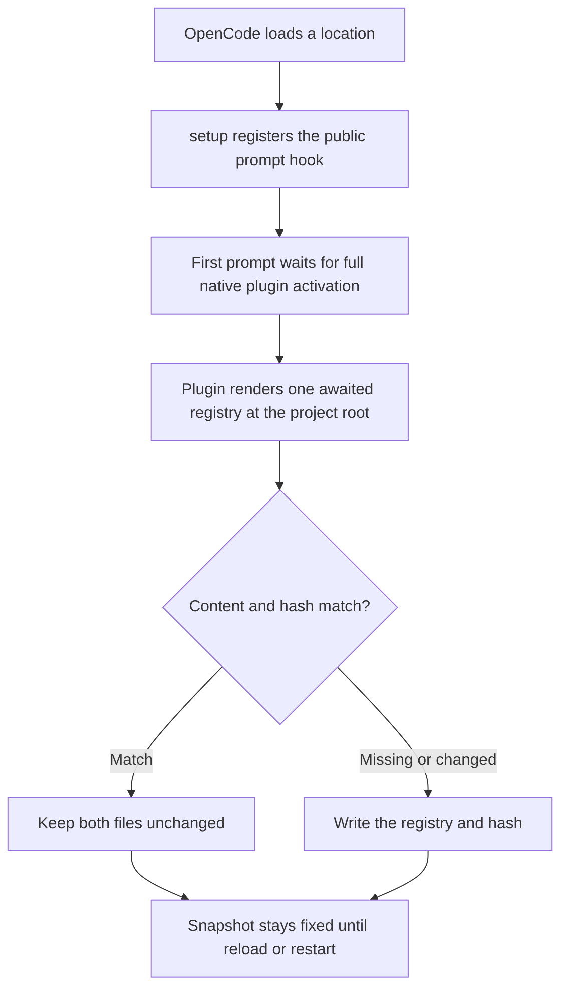

# OpenCode Skill Registry

[](https://www.npmjs.com/package/opencode-skill-registry)

Automatically generate a lightweight index of the skills active in an OpenCode project.

On the first prompt after OpenCode loads or reloads a project, the plugin creates or updates:

```text
<project>/.ai/atl/skill-registry.md
<project>/.ai/atl/skill-registry.hash
```

There is no manual generation step and no `/skill` step for users. The plugin queries OpenCode's resolved skill list internally.

## Install

This checkout requires OpenCode `>=2.0.28 <3`. Published version `0.2.1` is the V1 release; do not install it for V2.

Until a V2-compatible release is published, build this checkout:

```bash
pnpm install --frozen-lockfile
pnpm run build
```

Add its absolute directory to your project configuration, preserving other entries:

```jsonc
{
  "plugins": ["/absolute/path/to/opencode-skill-registry"]
}
```

Restart or reload OpenCode, open the project, and send the first prompt. The files appear automatically before that prompt is admitted.

After a V2-compatible release is published, install that release with:

```bash
opencode plugin add opencode-skill-registry@<v2-compatible-version>
```

## Use

Consumers match a description in `skill-registry.md`, then load its **Skill ID** through OpenCode's native skill loader. IDs identify skills; display names may repeat. Filesystem entries can also be read at their listed location. The registry is an index, not a copy of skill bodies.

## Sources

OpenCode decides which skills are active. The registry groups that resolved list in this display order:

| Source | Includes |
| --- | --- |
| OpenCode | Built-in skills, `.opencode/{skill,skills}`, global config, and the configured `skills` array |
| Agents | Project and global `.agents/skills` |
| Claude | Project and global `.claude/skills` |

OpenCode resolves duplicate IDs before the plugin sees them. The registry records the same winner instead of imposing separate precedence. Each entry includes the native `id`, `name`, and `description`, with native `path` displayed as Location. Skill bodies are never copied into the index.

### Convention references

Files such as `AGENTS.md`, `CLAUDE.md`, `.cursorrules`, and `GEMINI.md` appear in a separate reference section. They are not presented as active skills or as OpenCode's active instruction set.

The plugin does not enable sources or inspect a Claude executable. OpenCode **2.0.28 ignores** the legacy `OPENCODE_DISABLE_CLAUDE_CODE_SKILLS` and `OPENCODE_DISABLE_EXTERNAL_SKILLS` flags; the registry still follows the native list exactly. A project-level `skills/` directory appears only when OpenCode resolves it, for example through `skills: ["./skills"]`.

## Automatic cycle



In Git, the project root is the root of the current worktree. Outside Git, it is the directory opened in OpenCode.

Opening a project alone does not generate the index. OpenCode invokes the public prompt hook after full plugin activation, including downloads of configured plugins that are not cached. Concurrent first prompts await the same generation; later prompts keep the snapshot unchanged.

Generation failures retry automatically up to three times, with a one-second cooldown and a five-second discovery deadline per attempt. The first prompt waits for this bounded work; after the retry budget is spent, it proceeds without a new index. Later prompts do not reset that budget or refresh a successful snapshot. Unloading removes the hook, aborts pending reads and timers, and waits for any publication already started.

## Storage details

- Store generated state under project-local `.ai/atl/`.
- Hash the exact rendered Markdown and repair a missing or corrupted registry.
- Publish the registry and hash through same-directory temporary files.
- Leave Git exclusion of `.ai/` to the surrounding harness or installer.
- Keep a stable first-prompt snapshot; restart or reload OpenCode and send a new prompt to include skills added during a session.
- Query only the local OpenCode client; do not fetch configured skill URLs independently.

The package has no runtime npm dependencies. Its root and `./server` entrypoints load the same server plugin.

## Update or remove

Pin a V2-compatible release rather than assuming the current npm `latest` supports V2.

To remove the plugin, delete only its matching string or package/options object from the applicable `plugins` array in `opencode.jsonc` or `opencode.json`, preserve every other entry, and reload or restart OpenCode. There is no global npm installation to uninstall. Generated `.ai/atl/` files remain until removed separately.

## Migration from V1

This port follows the [official plugin migration guide](https://opencode.ai/build/plugins/migrate-v1), checked against the `v2.0.28` source tag. V1 plugin implementations do not run in V2.

- The stable plugin ID remains `andresnator.skill-registry`; the entrypoint now uses `setup(ctx)` instead of `server` and V1 hooks.
- Configuration uses `plugins`, not `plugin`; package/options tuples become `{ "package": "...", "options": {} }`.
- Skill configuration uses `skills: ["./team-skills", "https://example.com/skills/"]`, not separate `paths` and `urls` fields.
- Existing `.ai/atl/` files remain until the first prompt after loading, then are replaced and rehashed on successful generation. No session or skill-body migration is needed.
- Stay on plugin `0.2.1` if you still use OpenCode V1. This checkout does not retain a V1 implementation.

## Develop

```bash
pnpm install --frozen-lockfile
pnpm run check
pnpm run security:check
```

See [Contributing](CONTRIBUTING.md) for local loading and review rules.

## Help

- [Report a problem](https://github.com/andresnator/opencode-skill-registry/issues)
- [Changelog](CHANGELOG.md)
- [MIT License](LICENSE)
