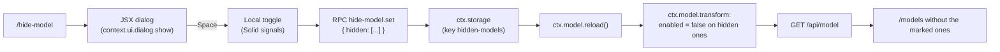

# opencode-tui-model-hide

[OpenCode V2](https://opencode.ai/v2/docs/) plugin that adds the `/hide-model` command to the TUI: it opens a window
with the available chat models and lets you mark which ones should disappear from the `/models` selector.

> **Status:** implemented and loaded by OpenCode 2.2.5 (`features.server`, `features.tui` and `features.rpc` all `true`
> in `GET /api/plugin`). The automated checks are described in [Verification](#verification). What has not been
> exercised by hand is listed in [Limitations and open items](#limitations-and-open-items).

## Usage

1. Type `/hide-model` in the prompt (or open it from the command palette: **Hide models from /models**).
2. Move with `↑`/`↓` (or `k`/`j`), page with `PgUp`/`PgDn`, jump with `Home`/`End`.
3. `Space` or a mouse click toggles the model; a mouse click on the provider header toggles **all** its models. The
   change is written immediately.
4. The mouse wheel scrolls the list; `Enter` or `Esc` closes the window.

| Action | Result |
| --- | --- |
| `/hide-model` | Opens the window with the chat models enabled on the server. |
| `Space` / click on the row | Toggles hidden/visible and persists right away (no confirmation). |
| Click on the provider header | Toggles the whole provider: hides all its models when any is visible, shows all when they are all hidden. |
| `↑`/`↓`, `k`/`j`, `PgUp`/`PgDn`, `Home`/`End` | Move the cursor (the list follows). |
| Mouse wheel | Scrolls the list inside the window (the window grows with the terminal). |
| `Enter` / `Esc` | Closes the window (both behave the same). |
| `/hide-model` with the window open | Closes it. |

State rules:

- **Default: nothing marked.** The hidden list starts empty, so every model shows up in `/models`.
- **Grouped by provider, sorted by name.** The window draws one header per provider (`[x]` when every model of the group
  is hidden, `[~]` when only some are, `[ ]` otherwise) with its model count and how many are hidden; clicking the header
  toggles all of the provider's models at once. Inside each group the models are in alphabetical order by name.
- Marking removes the model from `/models`; unmarking brings it back.
- The selection is stored in `ctx.storage` (key `hidden-models`) and survives plugin reloads.
- The window lists only what `/models` would show: chat models (`type: "chat"`) that are enabled. Image models, decision
  models and models already disabled by config are not listed — hiding them would have no visible effect.
- The window keeps listing hidden models that left the catalog (an uninstalled provider, for example) so they can be
  unmarked.

## How it works

The TUI does not decide what `/models` shows: the server filters it. That is why the plugin ships both parts.



- **`index.ts` (server)** — loads the hidden list from `ctx.storage`, registers `ctx.model.transform` and, on every run,
  builds the window catalog (`editor.list()`) and disables the marked models with `editor.update(..., model.enabled =
  false)`. `ctx.model.reload()` is called after each change. Disabling (instead of `editor.remove`) keeps the model
  resolvable when referenced explicitly; the effect on the selector is the same.
- **`tui.tsx` (TUI)** — registers the `hide-model.open` command (palette + `/hide-model`) and the JSX dialog with the
  list. Keys are handled by a listener on `context.renderer.keyInput` (`prependListener`), not by a keymap layer: the
  dialog focus is not one of our renderables, and a mode layer lost the race against the prompt. The listener consumes
  (`preventDefault` + `stopPropagation`) only the keys it recognizes. Rows live in a `<scrollbox>` whose height follows
  the terminal (up to ~78% of it), grouped by provider and sorted by name; a click toggles the row, a click on the
  provider header toggles all of that provider's models, and the wheel scrolls.
  The dialog width comes from the host presets (`medium` 60, `large` 88, `xlarge` 116 columns); the plugin asks for
  `xlarge` **after** the dialog is open, because `dialog.set` only applies to the active dialog — set beforehand it is
  ignored and the window falls back to the 60-column default.
- **`rpc.ts`** — the RPC contract (`list`, `set`, `changed` event) in JSON Schema, with no runtime dependency, plus the
  normalizers the TUI uses to turn the `unknown` responses into types.

The catalog is captured inside the `transform` because `editor.list()` includes disabled candidates — that is what keeps
the catalog complete even after models are hidden.

## Installation

Requires OpenCode 2.2.5+ with the V2 plugin API. One package entry loads both parts —
the server part that filters `/models` and the TUI part with the dialog.

### From Git (recommended)

```bash
opencode plugin add rodabarbosa/opencode-tui-model-hide
```

Installs the repository's default branch through the package entry, without depending on
the npm registry. The single entry loads every part: the server part (`.`), the TUI part
(`./tui`) and the RPC contract (`./rpc`), resolved through `package.json` `exports`.
`opencode plugin update` compares the `version` field.

Restart the TUI (or run `/reload`) afterwards. Manage the install with:

```bash
opencode plugin list                            # shows hide-model <version>
opencode plugin check                           # is a newer version available?
opencode plugin update                          # update
opencode plugin remove opencode-tui-model-hide  # uninstall
```

### From npm

```bash
opencode plugin add opencode-tui-model-hide          # latest
opencode plugin add opencode-tui-model-hide@1.0.0    # pinned version
```

`opencode plugin add` only accepts an npm registry package or a Git package specifier —
a local directory, a `file:` path and a `.tgz` are rejected (`Error: Plugin target must be
an npm registry package or Git package specifier`, checked on 2.2.5). The command installs
the package, caches it under `~/.cache/opencode/npm/` and appends it to the global
configuration.

> If `opencode plugin add` returns a 404, the package has not been published yet. Use the
> Git specifier above or a local copy below.

The same package can be listed directly in `opencode.json(c)` by name (or name plus
version):

```jsonc
{
  "$schema": "https://opencode.ai/config.json",
  "plugins": ["opencode-tui-model-hide@1.0.0"]
}
```

### Local (development)

Copy or clone the directory into the global config directory:

```text
<global-config>/plugins/opencode-tui-model-hide/index.ts   # server part
<global-config>/plugins/opencode-tui-model-hide/tui.tsx    # TUI part
<global-config>/plugins/opencode-tui-model-hide/rpc.ts     # contract
```

Restart the TUI (or run `/reload`) after copying the directory. For local development
OpenCode loads the TypeScript sources directly, so no build is needed there; published
installs use the committed `dist/`.

Alternative: register an arbitrary local directory in `opencode.json(c)`:

```jsonc
{
  "$schema": "https://opencode.ai/config.json",
  "plugins": ["./plugins/opencode-tui-model-hide"]
}
```

A **TUI-only** package would go in `cli.json`; since this plugin needs the server part to
filter the catalog, the right file is `opencode.json(c)`.

> **Do not keep both.** While this directory stays under `~/.config/opencode/plugins/`,
> the same plugin also loads as a local plugin, and OpenCode loads a local plugin and a
> package with the same name separately. After installing the package (or the Git
> specifier), remove the local copy (or the `plugins` entry pointing at it) so only one
> instance registers `hide-model`:
>
> ```bash
> mv ~/.config/opencode/plugins/opencode-tui-model-hide ~/backup/
> ```

## Publishing

The package follows the V2 layout required by `opencode plugin add`: one package, parts
declared in `exports` (`.` server, `./tui`, `./rpc`). `files` ships the bundled `dist/`
(built from `index.ts`, `tui.tsx`, `rpc.ts`) plus `README.md`; npm always adds `LICENSE`.

The package must **not** ship `.tsx`: when OpenCode loads it from `~/.cache/opencode/npm`, a
`.tsx` resolves `solid-js` and `@opentui/solid` from the plugin's own `node_modules`,
creating a second Solid instance and a render loop — the dialog opens but stops responding.
The bundle keeps those imports as bare specifiers so the host maps its own instances.

### Prerequisites (one time)

- An npm account with permission for the `opencode-tui-model-hide` name (confirm it is
  still free with `npm view opencode-tui-model-hide version`; a `404` means free).
- Authenticate the publishing machine: `npm login` (then `npm whoami` must succeed).

### Release

```bash
bun install                              # dependencies for the build (typecheck + bundle)
npm run build                            # typecheck + bundle into dist/
npm pack --dry-run                       # inspect the tarball (dist + README + LICENSE)
npm version patch --no-git-tag-version   # or minor/major — every publish needs a new version
npm publish                              # prepublishOnly runs the build; publishConfig.access=public
```

Verify the release:

```bash
npm view opencode-tui-model-hide version
opencode plugin add opencode-tui-model-hide
opencode plugin list                     # hide-model <new version> opencode-tui-model-hide
```

Commit the version bump and push.

Notes:

- `prepublishOnly` runs `npm run build` (typecheck + bundle), so a broken or unbundled
  package cannot be published.
- `version` must be bumped for every published change; `opencode plugin update` compares
  it with the registry.
- `@opencode/plugin`, `@opentui/core`, `@opentui/solid` and `solid-js` are
  `peerDependencies` (provided by the OpenCode host), not `dependencies`: installing
  nested copies is what caused the second Solid instance. `devDependencies` carries the
  same packages for local typecheck/bundle only.
- `dist/` is committed because the Git install path (the primary one) does not run a
  build; rebuild and commit it whenever the sources change.
- `license` is MIT and the `LICENSE` file ships in the tarball.
- The doc in `temp/instalador.md` describes the V1 plugin format (CommonJS
  `module.exports = function (ctx)` and files copied into the plugin directory). It does
  not apply to V2: here the parts are ES modules created with `Plugin.define`, resolved
  through `exports`, and installed as an npm package.

## Structure

```text
opencode-tui-model-hide/
├── index.ts         # server: storage + ctx.model.transform + RPC (source)
├── tui.tsx          # TUI: /hide-model command + dialog (source)
├── rpc.ts           # contract (JSON Schema) + normalizers (source)
├── scripts/
│   └── bundle.ts    # Bun.build → dist/ (host modules kept external)
├── dist/
│   ├── index.js     # published server part
│   ├── tui.js       # published TUI part
│   └── rpc.js       # published contract
├── package.json     # exports "." | "./tui" | "./rpc" → dist/; peer deps + npm metadata
├── tsconfig.json    # local typecheck (no emit)
├── README.md
├── LICENSE          # MIT
└── .gitignore
```

`package.json` declares the `exports` the loader resolves (pointing at `dist/`), the
`peerDependencies` provided by the host, the npm metadata (`repository`, `homepage`,
`bugs`, `publishConfig`) and `files`, so the published tarball carries only the bundled
`dist/`, the README and the license.

## Development

```bash
bun install          # dev dependencies for typecheck + bundle
bun run typecheck    # tsc --noEmit
bun run build        # typecheck + bundle into dist/ (commit dist/)
npm pack --dry-run   # inspect what would be published
```

## Verification

What was executed and the observed result:

| Check | Command | Result |
| --- | --- | --- |
| Types | `bun run typecheck` | no errors |
| Publish tarball | `npm pack --dry-run` | 6 files: `dist/index.js`, `dist/tui.js`, `dist/rpc.js`, `package.json`, `README.md`, `LICENSE` |
| Plugin loaded | `opencode api get /api/plugin` | `hide-model` with `server`, `tui` and `rpc` active |
| Window catalog | `POST /api/rpc/hide-model/list` | 364 models (the same 364 as `/api/model`) |
| Hide | `POST /api/rpc/hide-model/set` + `GET /api/model` | 364 → 363 visible models; the marked model disappeared |
| Restore | same `set` with `hidden: []` | back to 364 |
| Dialog | `bun --preload @opentui/solid/preload` + `testRender` with a fake context | list renders in a `<scrollbox>`, grouped by provider with readable provider names and sorted by name, `↓`/`End`/`Home`/`PgDn` move the cursor and scroll the list, `Space` persists `hidden` and the row becomes `[x]`, a click toggles the row, the wheel scrolls, `Esc` closes and releases the listener |

The dialog test used a fake context (theme, `keyInput`, dialog, RPC client) and simulated input (`mockMouse`); it proves
the JSX, the navigation, the click and the RPC round trip, not the interaction with the real TUI.

## Limitations and open items

- **No automated proof of the real TUI interaction.** The plugin shows as active and the parts load, but keys, clicks and
  the wheel were validated with the OpenTUI test renderer; the manual check in a real session is still pending.
- **Keys only while the window is open.** The listener on `context.renderer.keyInput` is installed on open and removed on
  close; while open, `↑`/`↓`/`Space`/`Enter`/`Esc` are consumed by the window and never reach the prompt.
- **State per server instance, not per project.** A single `hidden-models` key in `ctx.storage` applies to every location
  served by the same server. A per-project split would need another key/strategy (not verified whether `ctx.storage` is
  already isolated per location).
- **Hiding the model in use changes the default.** Verified: hiding the default model made `GET /api/model/default`
  return another visible model. An in-flight session was not tested in that scenario.
- **Persistence across restarts** relies on the documented `ctx.storage`; it was observed across calls and plugin reloads,
  not after restarting the TUI.
- **Window width is a host preset.** The dialog API only exposes `medium`/`large`/`xlarge` (60/88/116 columns); `xlarge`
  is the widest window available, and it does not grow past that even on a wider terminal. Going wider would mean
  abandoning `ui.dialog` for an overlay/panel, which is out of scope here.
- **One window at a time** — the `hide-model` mode is global; opening another instance from a different TUI session was
  not tested.

## References

- [Plugins (overview)](https://opencode.ai/v2/docs/build/plugins/)
- [Server plugin](https://opencode.ai/v2/docs/build/plugins/server/)
- [TUI plugin](https://opencode.ai/v2/docs/build/plugins/cli/)
- [RPC](https://opencode.ai/v2/docs/build/plugins/rpc/)
- [Keybinds](https://opencode.ai/v2/docs/cli/keybinds/)
- [Models and `/models`](https://opencode.ai/v2/docs/models/)
