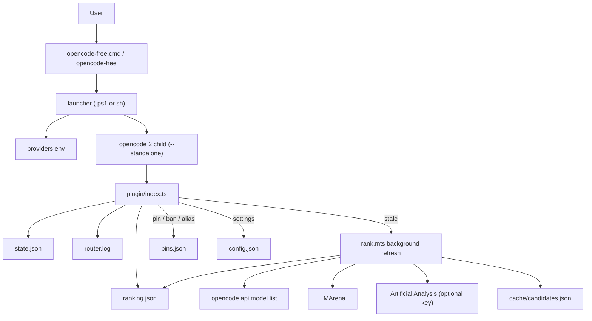

# opencode-free-router

[](https://github.com/lettland/opencode-free-router/actions/workflows/ci.yml)
[](https://coveralls.io/github/lettland/opencode-free-router?branch=master)

An [opencode](https://opencode.ai) plugin that always runs on the **best free model available right
now**, so you never have to track which free models exist this week.

You pick one model, `free/auto`, and the plugin does the rest:

- **Ranked, not random.** Every free model opencode can reach is scored with
  [LMArena](https://huggingface.co/datasets/lmarena-ai/leaderboard-dataset) (agent, webdev and text
  boards) and [Artificial Analysis](https://artificialanalysis.ai) (coding, agentic and intelligence
  indices). New stealth models with no benchmarks yet, like the ones OpenRouter and OpenCode Zen run
  for a week, are detected and placed near the top.
- **Sticky.** A session keeps its model. It does not switch on every request. When a better model
  appears, new sessions get it.
- **Fails over.** When the model hits its quota or rate limit, is removed, or is refused, it goes on
  cooldown and the session moves to the next-ranked model. The interrupted task continues
  automatically, in the same turn.
- **Only free.** Free providers are an explicit allowlist, and each pick is re-checked against live
  provider data. Subscription plans that report a price of 0 are never used.

```text
$ opencode-free run "explain this repo"
> build · space-bunny-free
```

This repository is the Windows-native adaptation of
[lettland/opencode-free-router](https://github.com/lettland/opencode-free-router). It keeps the
original Linux/macOS behavior and adds first-class native Windows support. Read the
[Spanish README](README.es.md).

Requires **opencode 2** (`opencode --version` says 2.x; `install.sh` refuses 1.x) and Node 22.18+
(or Bun), on macOS, Linux, or Windows. On Windows, run `./scripts/install.sh` from Git Bash. The code is TypeScript and ships as source: opencode loads the plugin
directly, and Node 22.18+ or Bun runs the ranker without a build step.

- **opencode 2** (`opencode --version` says 2.x). The installers refuse opencode 1.x.
- **Node.js 22.18 or newer** (or Bun on POSIX). The code ships as TypeScript source: opencode loads
  the plugin directly, and Node/Bun runs the ranker without a build step. The native Windows
  installer requires Node.js.
- macOS, Linux, WSL, or native Windows. The Windows path does not require WSL.

If you upgrade opencode from 1.x to 2, run the installer again. The 1.x plugin does not load on 2, and
the installer moves the `plugin` entry in `free.jsonc` to the `plugins` directory entry that
opencode 2 reads.

## Install

### macOS / Linux / WSL

```sh
git clone https://github.com/lettland/opencode-free-router
cd opencode-free-router
./scripts/install.sh              # add --bb to also register a bb agent
```

`install.sh` options:

| Option | Meaning |
|---|---|
| `--dir PATH` | Install directory. Default: `$XDG_CONFIG_HOME/opencode/free-router` or `~/.config/opencode/free-router`. |
| `--no-rank` | Skip the first ranking run. |
| `--bb` | Register the **Free (auto)** ACP agent in bb. |

The installer replaces the code, renders `opencode-free` with the absolute install directory, keeps
your `free.jsonc`, `config.json`, `pins.json`, `providers.env`, `ranker.env`, `ranking.json` and
state, and links `opencode-free` into `~/.local/bin` only when that directory is already on `PATH`.
Paths containing `&`, `|`, `\`, `$`, quotes, backticks, spaces or non-ASCII characters are escaped
before they are written into the launcher.

To pin a release instead of tracking the default branch, `git checkout vX.Y.Z` (see
[releases](https://github.com/lettland/opencode-free-router/releases)) before running the installer.

### Native Windows

```powershell
powershell -ExecutionPolicy Bypass -File .\scripts\install-windows.ps1
```

From Command Prompt or Explorer, the thin `.cmd` wrapper forwards every option:

```bat
.\scripts\install-windows.cmd
```

`install-windows.ps1` options:

| Option | Default | Meaning |
|---|---|---|
| `-InstallDir PATH` | `%USERPROFILE%\.config\opencode\free-router` | Code, config, keys, ranking and state. |
| `-ShimDir PATH` | `%USERPROFILE%\.local\bin` | `opencode-free.cmd` and `opencode-free-launcher.ps1`. |
| `-NoRank` | off | Skip the first ranking run. |
| `-NoPath` | off | Do not create the user-profile shim or change `PATH`; the launcher still lives in `-InstallDir`. |
| `-NoPathUpdate` | off | Create the shim but do not edit the user `PATH` (used by tests). |

A normal install:

1. verifies opencode 2 and Node 22.18+;
2. refuses drive roots, protected/system locations, the repository itself, symlinks/junctions and
   unrelated non-empty directories;
3. writes a `.opencode-free-router.json` install marker with `complete: false`, copies the code, and
   rewrites the marker to `complete: true` only at the end;
4. creates `free.jsonc`, `config.json`, `pins.json`, `providers.env` and `ranker.env` only when they
   are missing, then migrates the old one-line `"plugin": ["./plugin.ts"]` entry to
   `"plugins": ["./plugin"]`;
5. installs the `.cmd` shim and its `opencode-free-launcher.ps1` companion in the install directory
   and, unless `-NoPath`/`-NoPathUpdate` is used, copies them to `-ShimDir` and puts that directory
   at the front of the **user** `PATH`;
6. restricts the install directory and user files to the current user, `SYSTEM` and
   `Administrators` when the filesystem supports ACLs;
7. optionally runs the first ranking.

New terminals pick up a `PATH` change. If `opencode-free` is not found in the current terminal, open
a new one or run the full path to the shim.

### Re-running the installer

Re-running either installer upgrades the code and launchers in place. User files are never
overwritten. An install interrupted after the marker was written but before it was marked complete is
still recognized, and can be repaired by re-running the installer or removed with `-Purge`.

## Use

```sh
opencode-free                 # TUI on free/auto
opencode-free run "..."       # one-shot; quote the message
opencode-free acp             # ACP agent (Zed, JetBrains, bb, ...)
opencode-free --list-models   # prints free/auto without starting opencode
```

`opencode-free` is opencode with the free-router config layered on with `OPENCODE_CONFIG`. Your
normal `opencode` command, configuration and authentication are not modified.

opencode 2 commands normally talk to a shared background service that ignores `OPENCODE_CONFIG`, so
the wrapper runs every command that can with its own private server (`--standalone`). Consequences:

- `opencode-free service` and `serve --service` are refused.
- Commands that manage, restart or may auto-start the shared service are refused: `debug`, `pair`,
  `mcp`, `plugin`, `upgrade`, `update`, `uninstall`. Run those as plain `opencode`.
- `run` messages must be quoted, because an unquoted `service` word inside the message is also
  refused:

```sh
opencode-free run "restart the service"    # not: opencode-free run restart the service
```

The wrapper exits with `127` and a clear message when `opencode` is not on `PATH`. `--list-models`
still works in that case.

### Windows argument handling

The `.cmd` shim always runs the PowerShell launcher in a child process, so it does not leak
`OPENCODE_CONFIG` or `FREE_ROUTER_DIR` into your PowerShell session. The launcher quotes every
argument. These forms are supported and tested:

- spaces and non-ASCII paths/arguments;
- `&`, `|`, `<`, `>`, `^`, `!` inside an argument;
- embedded double quotes and empty arguments;
- arguments with trailing backslashes.

Known `cmd.exe` limitations, not bugs in the launcher:

- `%NAME%` is expanded by `cmd.exe` before the launcher sees it. Escape or avoid literal percent
  signs in arguments.
- Newlines cannot be passed through a `.cmd` argument.

The PowerShell launcher deliberately is not named `opencode-free.ps1`; it is installed as
`opencode-free-launcher.ps1`. PowerShell resolves a bare `.ps1` name in the current session, which
would leak the router environment into your shell. The `.cmd` shim is the only `opencode-free`
command.

## bb

On POSIX, `./scripts/install.sh --bb` registers a custom ACP agent **Free (auto)** (provider
`acp-free`) that runs `opencode-free acp`. Pick `free/auto` as its model. No other bb agent is
touched. If an older install shows only "Agent default" as the model, re-run `./scripts/install.sh
--bb`.

The native Windows installer has no `-bb` switch. To use bb on Windows, point an ACP agent at
`opencode-free.cmd acp` and select `free/auto`; re-running the Windows installer does not touch bb's
configuration.

A failover happens inside the running prompt, so bb sees one prompt answered by the new model; it
does not receive a queued "continue" message.

## Which free models

Without keys you get OpenCode Zen's free models. Each key you add grows the pool:

| Provider | Key | What counts as free |
|---|---|---|
| OpenCode Zen | none | models priced 0 (`*-free`, big-pickle, …) |
| OpenRouter | `OPENROUTER_API_KEY` | `:free` models (routers such as `openrouter/auto` are excluded) |
| NVIDIA | `NVIDIA_API_KEY` | models priced 0 on build.nvidia.com |
| Z.AI | `ZHIPU_API_KEY` | models priced 0 (GLM-4.7-Flash, GLM-4.5-Flash, GLM-4.6V-Flash) |
| Zhipu AI | `ZHIPU_API_KEY` | the same free GLM Flash models, for a China (BigModel) account |
| ModelScope | `MODELSCOPE_API_KEY` | all models (priced 0; 2,000 requests a day) |
| Mistral | `MISTRAL_API_KEY` | Devstral Small, Codestral and Mistral Small via the free Experiment plan |
| Groq | `GROQ_API_KEY` | all models via the free tier |
| Cerebras | `CEREBRAS_API_KEY` | all models via the free tier |
| Google AI Studio | `GOOGLE_GENERATIVE_AI_API_KEY` | Flash and Gemma models via the free tier |

Keys you already have through `opencode auth login` or your shell work automatically. Otherwise put
them in `~/.config/opencode/free-router/providers.env` (or the Windows install directory). This also
covers launches that do not read your shell profile, such as bb or GUI applications.

**Use free-plan accounts.** Groq, Cerebras, Google and Mistral models count as free because of their
free tiers, so a key with billing enabled may be charged.

Notes on the extra providers:

- **Z.AI / Zhipu.** The free GLM Flash models are free for every account, not trial credits. The
  catch is throughput: roughly one request at a time, about one a second. They are two separate
  platforms sharing one variable, `ZHIPU_API_KEY`: a z.ai key only works on `zai`, a BigModel
  (China) key only on `zhipuai`. The wrong endpoint returns 401 and that provider goes on a
  24-hour cooldown, so exactly one of the two reaches the pool.
- **ModelScope.** Everything it serves is free, with a quota of 2,000 requests a day (500 per model)
  and no card, but signup wants a phone number and the endpoint is fastest inside Asia.
- **Mistral.** The Experiment plan (no card, 1B tokens a month, 1 request a second) covers Devstral
  Small 2, Codestral and Mistral Small, but the catalog prices them, so the router matches them by
  name. Every Devstral entry Mistral lists is currently marked deprecated, including its only
  0-priced one, so the router skips those. The Devstral glob is there for the first current Devstral
  Small that appears. Tune the families in `config.json` if Mistral changes the plan:
  `{"mistral": ["$zero", "devstral-small*", "codestral*", "mistral-small*"]}`.

Left out on purpose, because a price of 0 there does not mean free: Cloudflare Workers AI (10,000
neurons a day, and the models its free plan dropped now answer 403, which would bench the whole
provider), Vercel AI Gateway (free credits need a payment method, and the catalog marks Llama models
as 0 that Vercel actually prices), Hugging Face ($0.10 of monthly credits), and the many gateway
clones that list every model at 0.

An optional `ARTIFICIAL_ANALYSIS_API_KEY` in `ranker.env` adds Artificial Analysis scores (free key,
100 requests a day; the ranker uses a few per refresh). Without it, ranking uses LMArena only.

`ranker.env` is read only by `rank.mts`. It is parsed into the ranker's own process environment and
is not exported to opencode or the agent's tools. The Artificial Analysis key is also removed from
the environment of the child process that lists models.

## How ranking works

`rank.mts` writes `ranking.json`. The plugin re-runs it in the background whenever the file is older
than `refreshHours` (6), one refresh at a time.

1. It lists the models opencode can reach (`opencode api --standalone model.list`) and keeps the ones
   that are free, can call tools, are enabled, and have at least 64k context. A model with several
   price tiers counts as free only if every tier is.
2. It matches each model against the leaderboards by name. `mimo-v2.6-flash` never matches
   `mimo-v2.6-pro`, and AA's `ling-3-0-flash-fin` matches `ling-3.0-flash-fin-free`.
3. Each source becomes a percentile. The score is the weighted mean over the sources that matched.
4. Models with no benchmarks: stealth models (OpenRouter's `stealth/` listing) score `stealthScore`
   (0.95). Others score about 0.25–0.35, less for small models, so an unknown 2B preview never beats
   a benchmarked model.

```sh
node ~/.config/opencode/free-router/rank.mts --status    # ranking, cooldowns, model per session
```

Commands:

```text
Usage: rank.mts [options]

  (no options)             refresh ranking.json and print a one-line summary
  --status                 print ranking.json, cooldowns and recent session picks
  --quiet                  refresh, printing only warnings
  --config <free.jsonc>    opencode config to list models with (default: free.jsonc here)
  --lock <file>            remove this lock file when done (set by the plugin)
  -h, --help               show this help

Exit codes: 0 success, 1 refresh failed, 2 invalid command line.
```

### Overrides: `pins.json`

```json
{
  "pin":   ["opencode/space-bunny-free"],
  "ban":   ["openrouter/liquid/lfm-2.5-2.6b:free"],
  "alias": { "opencode/some-model-free": "name-on-the-leaderboard" }
}
```

`pin` forces models to the top in that order, `ban` never uses them, and `alias` fixes a missed
benchmark match. Duplicate IDs are removed after pinning. Run `rank.mts` after editing.

### Settings: `config.json`

Everything is optional. Nested maps merge with the defaults key by key. Values of the wrong type fall
back to the default.

| Key | Default | Meaning |
|---|---|---|
| `freeTier` | see table above | allowlist: provider → model globs; `"$zero"` = models priced 0 |
| `excludeProviders` | `[]` | never use these, e.g. `["openrouter"]` for sensitive code |
| `minContext` | `64000` | minimum context window |
| `weights` | `arena_agent 0.35, arena_webdev 0.35, arena_text 0.15, aa_coding 0.25, aa_agentic 0.25, aa_intelligence 0.15` | score weights |
| `stealthScore` | `0.95` | score for unbenchmarked stealth models |
| `unscoredBase` | `0.25` | base score for other unbenchmarked models |
| `unscoredRecencyMax` | `0.1` | maximum recency bonus for unbenchmarked models |
| `smallPenalty` | `0.15` | penalty for small models |
| `cooldownMinutes` | quota 360, rate 10, server 5, unavailable 1440 | how long a failed model sits out, unless `retry-after` says longer |
| `maxSwitchesPerTurn` | `3` | failover budget per message |
| `autoContinue` | `true` | retry the failed turn on the next model; `false` fails the turn instead and the next message uses the new model |
| `refreshHours` | `6` | re-rank when `ranking.json` is older than this |

Malformed cache or state data is ignored per entry instead of breaking the router. A cache timestamp
in the future is treated as stale, and temporary files from atomic writes are cleaned up on failure.

## Failover in detail

opencode keeps one model for a whole turn, including its own retries, which can wait up to fifteen
minutes on a rate limit. So when a request fails, the plugin looks at the error before opencode
retries:

1. If the model is to blame, it goes on cooldown, until `retry-after` if the provider sends one,
   otherwise the default above. A quota message, a removed model, or an auth/permission rejection
   (401/403) fails over at once; a rate limit or server error fails over after the second try, or at
   once when the wait would be over a minute. A context overflow, a cut-off answer or a content
   filter is not the model's fault and is left to opencode.
2. The session moves to the next-ranked model that is not cooling down. If every model is cooling
   down, it uses the one that frees up first.
3. opencode retries the same request on the new model straight away, in the same turn. The partial
   answer of a request cut off half-way stays in the conversation and the new model continues from
   it.

At most `maxSwitchesPerTurn` switches happen per turn; after that the provider's error is shown at
once instead of being waited out. With `autoContinue` off, the turn fails and the next message runs
on the new model.

**A failover sends the whole conversation to the next free provider without asking.** Everything
said in the session so far goes to the new model's provider, under that provider's data terms.

Where you can see a switch: the model shown by the TUI, the model ACP clients report, `router.log`
(`failover ...`) and `rank.mts --status`. There is no extra message in the conversation.

**Choosing a model yourself ends routing for that session.** After `/model` to anything but
`free/auto`, the router leaves the session and its errors alone; `/model free/auto` hands it back.
Child sessions and forks follow the pick of the session they came from. A cyclic parent graph is
detected and does not recurse forever.

## Architecture



`free.jsonc` is the opencode config loaded through `OPENCODE_CONFIG`. It defines `free/auto` with a
dead local `baseURL`, so a missed switch fails fast instead of silently landing on a paid model. The
plugin replaces `free/auto` with the chosen free model for each session.

## Privacy and security

**Free models are usually paid for with your data.** Assume prompts and completions may be logged or
used for training:

- On OpenCode Zen, most free models are explicit exceptions to Zen's zero-retention policy. During
  the free period, data "may be used to improve the model" (Big Pickle, MiMo Flash, Ling Flash Fin).
  NVIDIA's free endpoints log usage ("do not submit personal or confidential data"). "Contributor"
  models such as Muse Spark Contributor Free train on your prompts. Some stealth models state zero
  retention. Check [Zen's privacy notes](https://opencode.ai/docs/zen/) for the current list.
- On OpenRouter, free providers may keep prompts.
- Groq, Cerebras, Google and Mistral free tiers follow each provider's own terms. So do Z.AI's free
  GLM Flash models and ModelScope's free inference.

Do not point `free/auto` at confidential or client code. Narrow the pool with `ban` in `pins.json`
or list whole providers in `excludeProviders`. See [SECURITY.md](SECURITY.md).

Security-relevant behavior of this implementation:

- `providers.env` is exported into opencode, so the agent's tools can read those keys, like any
  opencode provider key. `ranker.env` is not exported; it is read only by `rank.mts`.
- On POSIX, key files and state/log files are created with mode `0600`. On Windows, the installer
  restricts the install directory and user files to the current user, `SYSTEM` and the built-in
  `Administrators` group. ACL restriction is best effort: on FAT/exFAT, some network shares or
  policy-locked profiles it warns and leaves the install usable.
- `router.log` is timestamped per line. Both `router.log` and `state.json` redact common credential
  shapes. Error text is cut to 200 characters. Stack frames are cut to three. The response body is read only to
  classify a failure, never stored. Logs still contain session IDs, local paths and possibly a
  provider's masked key fragment; review before sharing.
- `cache/candidates.json` strips headers, request bodies and provider settings.
- The Windows installer requires a `.opencode-free-router.json` marker before `-Purge` recursively
  deletes a directory. `-Force` is the explicit escape hatch for legacy marker-less installs.
- The uninstaller removes only shims that reference this install directory, and a normal uninstall
  removes only known code files and an empty `plugin` directory.
- `writeJSONAtomic` removes its temporary file when a rename fails. The ranker caps leaderboard
  pagination so a broken or endless endpoint cannot page forever.

## Troubleshooting

| Symptom | What to do |
|---|---|
| `opencode-free` is not recognized | Open a new terminal so the updated user `PATH` is loaded, or run `%USERPROFILE%\.local\bin\opencode-free.cmd` directly. |
| `opencode-free: opencode is not on PATH` (exit 127) | Install opencode 2 and put it on `PATH`; `--list-models` still works without it. |
| Install refuses `-InstallDir` | It is a protected/system path, the repository, a symlink/junction, or a non-empty directory that is not a router install. Choose a new directory. |
| `-Purge` refuses the directory | There is no valid `.opencode-free-router.json` marker. Use `-Force` only when you are certain that directory is a router install. |
| ACL warning during install | The filesystem cannot store the ACL. Install remains usable; use NTFS or a local profile directory for key privacy. |
| `ranking.json` is missing or empty | Run `node "<install>\rank.mts"`. It needs network, opencode 2 and at least one configured provider. |
| Ranking warns that Artificial Analysis is skipped | Set `ARTIFICIAL_ANALYSIS_API_KEY` in `ranker.env` or ignore it; LMArena ranking still works. |
| A message with `%NAME%` is mangled on Windows | `cmd.exe` expands `%NAME%` before the launcher runs. Escape or avoid literal percent signs. |
| Standard `opencode` seems changed | It is not modified by this project. Check `PATH` shadows and run `opencode --version`; the router only adds its own `.cmd` shim and config. |

Diagnostics:

```sh
node ~/.config/opencode/free-router/rank.mts --status
```

```powershell
node "$HOME\.config\opencode\free-router\rank.mts" --status
```

`router.log` in the install directory records picks, failovers and background refreshes.
`cache/candidates.json` explains why a model was or was not eligible.

## Testing and verification

Local verification in this repository (Windows 11, Windows NT 10.0.26300.0, Node.js 24.22.1,
npm 11.19.1, Windows PowerShell 5.1.26100.9711, OpenCode 2.1.2):

| Check | Command | Result |
|---|---|---|
| Type-check | `npm run check` | pass |
| Unit/integration/regression suite | `npm test` | 113 tests: 102 pass, 0 fail, 11 skipped (POSIX-only on Windows) |
| Coverage | `npm run test:coverage` | 98.07% lines, 94.47% branches, 98.77% functions on Node 24; `coverage/lcov.info` written |
| Dependency audit | `npm audit --audit-level=moderate` | 0 vulnerabilities |
| PowerShell parse | parser over `scripts/*.ps1`, `bin/*.ps1` | 6/6 files parse |
| Real ranking | installed `rank.mts` against OpenCode 2.1.2 | 10 eligible free models; top `opencode/deepseek-v4.1-flash-free` |
| Live one-shot | installed `opencode-free run "Reply with exactly OK"` | exit 0, selected `opencode/deepseek-v4.1-flash-free`, returned `OK` |
| Isolated install/upgrade/uninstall | temporary `-InstallDir`/`-ShimDir` | pass; user files preserved, code/shim removed, `-Purge` safe |
| Standard opencode unaffected | `opencode --version` before/after | `opencode v2.1.2` both times |

The suite covers unit, integration, regression, security, installer, launcher and compatibility
behavior. Failover is tested with fake providers in the plugin tests; a live provider failure was not
forced. The POSIX installer/uninstaller tests and `./scripts/e2e-failover.sh` are skipped on Windows.
Coverage on Node 26 uses `--test-coverage-include-all` when available; local Node 24 does not support
that flag, so the local report includes the files the tests import.

Informal performance on the same Windows machine: five cold `opencode-free --list-models` runs
averaged about 950 ms (mostly PowerShell startup), and `rank.mts --status` took about 104 ms. These
are startup measurements, not a throughput benchmark.

CI is configured in [.github/workflows/ci.yml](.github/workflows/ci.yml) for Ubuntu (Node 22/24),
macOS and Windows, plus a Node 26 coverage job and shellcheck. This report only claims the local
Windows runs above; CI itself was not executed here.

## Development

```sh
npm ci --ignore-scripts       # compiler and type definitions, for npm run check only
npm run check                 # type-check (TypeScript 7, strict)
npm test                      # tests; no network and no real opencode needed
npm run test:coverage         # tests plus coverage/lcov.info (cross-platform coverage runner)
npm run lint:sh               # shellcheck (requires shellcheck)
./scripts/e2e-failover.sh     # POSIX: real opencode 2 + a fake 429 provider
```

The test suite is split so the POSIX and Windows code paths do not hide each other:

- `test/lib.test.ts`, `test/rank.test.ts`: scoring, cache, CLI, redaction, atomic writes.
- `test/plugin.test.ts`: routing, stickiness, failover, cooldowns, logging, background refresh.
- `test/launcher.test.ts`: POSIX launcher (skipped on Windows).
- `test/launcher-windows.test.ts`: PowerShell launcher and `.cmd` quoting, Unicode, missing opencode.
- `test/scripts.test.ts`: POSIX install/uninstall (skipped on Windows).
- `test/scripts-windows.test.ts`: Windows install/upgrade/uninstall, markers, purge safety, ACLs, PATH.

Release notes live in [CHANGELOG.md](CHANGELOG.md). The default branch in this fork is `master`; its
release workflow runs manually from the Actions tab. Write entries under `## Unreleased`; a
`[minor]` or `[major]` marker in a commit subject picks the bump, otherwise it is a patch.

## Uninstall

macOS/Linux/WSL:

```sh
./scripts/uninstall.sh [--bb] [--purge]
```

Native Windows:

```powershell
powershell -ExecutionPolicy Bypass -File .\scripts\uninstall-windows.ps1
```

Or from Command Prompt/Explorer:

```bat
.\scripts\uninstall-windows.cmd
```

Windows uninstaller options:

| Option | Meaning |
|---|---|
| `-InstallDir PATH` | Install directory to remove code from. |
| `-ShimDir PATH` | Shim directory to clean. |
| `-NoPath` | Do not remove the shim (used by tests). |
| `-Purge` | Also delete the install directory: config, keys, ranking and state. |
| `-Force` | Allow `-Purge` without a valid marker. Use only for a known legacy router install. |

A normal uninstall removes the code, launcher and owned shim, and keeps `free.jsonc`, `config.json`,
`pins.json`, `*.env`, `ranking.json` and state. It leaves the install marker with `complete: false` so
a later `-Purge` still recognizes the directory. `-Purge` requires a valid marker; without one it
refuses to recursively delete anything.

## Attribution

Model scores come from [LMArena](https://lmarena.ai) (`lmarena-ai/leaderboard-dataset`) and
[Artificial Analysis](https://artificialanalysis.ai). Not affiliated with either, or with opencode.

## License

[BSD-2-Clause](LICENSE)
