# opencode-free-router

[](https://github.com/lettland/opencode-free-router/actions/workflows/ci.yml)
[](https://coveralls.io/github/lettland/opencode-free-router?branch=master)

English: [README.md](README.md)

Un plugin de [opencode](https://opencode.ai) que siempre funciona con el **mejor modelo gratuito
disponible en este momento**, para que nunca tengas que estar pendiente de qué modelos gratuitos
existen esta semana.

Tú eliges un modelo, `free/auto`, y el plugin hace el resto:

- **Clasificado, no aleatorio.** Todos los modelos gratuitos a los que opencode puede acceder se
  puntúan con [LMArena](https://huggingface.co/datasets/lmarena-ai/leaderboard-dataset) (tablas de
  agente, webdev y texto) y [Artificial Analysis](https://artificialanalysis.ai) (índices de
  programación, agéntico e inteligencia). Los nuevos modelos stealth que aún no tienen benchmarks,
  como los que OpenRouter y OpenCode Zen ejecutan durante una semana, se detectan y se colocan cerca
  de la cima.
- **Persistente.** Una sesión conserva su modelo. No cambia en cada petición. Cuando aparece un modelo
  mejor, lo obtienen las sesiones nuevas.
- **Con failover.** Cuando el modelo alcanza su cuota o su límite de peticiones, se retira o se
  rechaza, entra en cooldown y la sesión pasa al siguiente modelo de la clasificación. La tarea
  interrumpida continúa automáticamente, en el mismo turno.
- **Solo gratuitos.** Los proveedores gratuitos son una allowlist explícita, y cada elección se vuelve
  a comprobar con los datos en vivo del proveedor. Nunca se usan planes de suscripción que declaren un
  precio de 0.

```text
$ opencode-free run "explain this repo"
> build · space-bunny-free
```

Este repositorio es la adaptación nativa para Windows de
[lettland/opencode-free-router](https://github.com/lettland/opencode-free-router). Mantiene el
comportamiento original de Linux/macOS y añade soporte de primera clase para Windows nativo. Consulta
la [versión en inglés](README.md).

## Requisitos

- **opencode 2** (`opencode --version` debe indicar 2.x). Los instaladores rechazan opencode 1.x.
- **Node.js 22.18 o superior** (o Bun en POSIX). El código se distribuye como TypeScript fuente:
  opencode carga el plugin directamente y Node/Bun ejecuta el ranker sin compilación. El instalador
  nativo de Windows requiere Node.js.
- macOS, Linux, WSL o Windows nativo. La ruta de Windows no requiere WSL.

Si actualizas opencode de 1.x a 2, vuelve a ejecutar el instalador. El plugin de 1.x no se carga en 2,
y el instalador traslada la entrada `plugin` de `free.jsonc` a la entrada de directorio `plugins` que
lee opencode 2.

## Instalación

### macOS / Linux / WSL

```sh
git clone https://github.com/lettland/opencode-free-router
cd opencode-free-router
./scripts/install.sh              # añade --bb para registrar también un agente bb
```

Opciones de `install.sh`:

| Opción | Significado |
|---|---|
| `--dir PATH` | Directorio de instalación. Predeterminado: `$XDG_CONFIG_HOME/opencode/free-router` o `~/.config/opencode/free-router`. |
| `--no-rank` | Omite la primera clasificación. |
| `--bb` | Registra el agente ACP **Free (auto)** en bb. |

El instalador sustituye el código, genera `opencode-free` con la ruta absoluta de instalación, conserva
tu `free.jsonc`, `config.json`, `pins.json`, `providers.env`, `ranker.env`, `ranking.json` y el estado,
y enlaza `opencode-free` en `~/.local/bin` solo si ese directorio ya está en `PATH`. Las rutas con
`&`, `|`, `\`, `$`, comillas, backticks, espacios o caracteres no ASCII se escapan antes de escribirlas
en el lanzador.

Para fijar una versión en lugar de seguir la rama predeterminada, ejecuta `git checkout vX.Y.Z`
(consulta [releases](https://github.com/lettland/opencode-free-router/releases)) antes de ejecutar el
instalador.

### Windows nativo

```powershell
powershell -ExecutionPolicy Bypass -File .\scripts\install-windows.ps1
```

Desde el Símbolo del sistema o el Explorador, el wrapper `.cmd` reenvía todas las opciones:

```bat
.\scripts\install-windows.cmd
```

Opciones de `install-windows.ps1`:

| Opción | Predeterminado | Significado |
|---|---|---|
| `-InstallDir PATH` | `%USERPROFILE%\.config\opencode\free-router` | Código, configuración, claves, clasificación y estado. |
| `-ShimDir PATH` | `%USERPROFILE%\.local\bin` | `opencode-free.cmd` y `opencode-free-launcher.ps1`. |
| `-NoRank` | desactivado | Omite la primera clasificación. |
| `-NoPath` | desactivado | No crea el shim del perfil de usuario ni cambia `PATH`; el lanzador sigue en `-InstallDir`. |
| `-NoPathUpdate` | desactivado | Crea el shim pero no edita el `PATH` del usuario (lo usan las pruebas). |

Una instalación normal:

1. comprueba opencode 2 y Node 22.18+;
2. rechaza raíces de unidad, ubicaciones protegidas/del sistema, el propio repositorio, enlaces
   simbólicos/junctions y directorios no vacíos ajenos al router;
3. escribe un marcador `.opencode-free-router.json` con `complete: false`, copia el código y cambia el
   marcador a `complete: true` solo al final;
4. crea `free.jsonc`, `config.json`, `pins.json`, `providers.env` y `ranker.env` solo si faltan, y
   migra la antigua entrada de una línea `"plugin": ["./plugin.ts"]` a `"plugins": ["./plugin"]`;
5. instala el shim `.cmd` y su compañero `opencode-free-launcher.ps1` en el directorio de instalación
   y, salvo que se use `-NoPath`/`-NoPathUpdate`, los copia a `-ShimDir` y pone ese directorio al
   principio del `PATH` **del usuario**;
6. restringe el directorio de instalación y los archivos de usuario al usuario actual, `SYSTEM` y
   `Administradores` cuando el sistema de archivos admite ACL;
7. opcionalmente ejecuta la primera clasificación.

Los terminales nuevos recogen el cambio de `PATH`. Si `opencode-free` no se encuentra en el terminal
actual, abre uno nuevo o ejecuta la ruta completa al shim.

### Volver a ejecutar el instalador

Volver a ejecutar cualquiera de los instaladores actualiza el código y los lanzadores en el mismo
lugar. Los archivos del usuario nunca se sobrescriben. Una instalación interrumpida después de
escribir el marcador pero antes de marcarlo como completa sigue reconociéndose, y se puede reparar
volviendo a ejecutar el instalador o eliminar con `-Purge`.

## Uso

```sh
opencode-free                 # TUI con free/auto
opencode-free run "..."       # una sola ejecución; entrecomilla el mensaje
opencode-free acp             # agente ACP (Zed, JetBrains, bb, ...)
opencode-free --list-models   # imprime free/auto sin iniciar opencode
```

`opencode-free` es opencode con la configuración de free-router superpuesta mediante
`OPENCODE_CONFIG`. Tu comando, configuración y autenticación normales de `opencode` no se modifican.

Normalmente, los comandos de opencode 2 se comunican con un servicio en segundo plano compartido que
ignora `OPENCODE_CONFIG`, así que el wrapper ejecuta cada comando que puede con su propio servidor
privado (`--standalone`). Consecuencias:

- se rechazan `opencode-free service` y `serve --service`;
- se rechazan los comandos que gestionan, reinician o pueden iniciar automáticamente el servicio
  compartido: `debug`, `pair`, `mcp`, `plugin`, `upgrade`, `update`, `uninstall`. Ejecútalos como
  `opencode` normal;
- los mensajes de `run` deben ir entre comillas, porque una palabra `service` sin comillas dentro del
  mensaje también se rechaza:

```sh
opencode-free run "restart the service"    # no: opencode-free run restart the service
```

El wrapper sale con `127` y un mensaje claro cuando `opencode` no está en `PATH`. `--list-models`
sigue funcionando en ese caso.

### Argumentos en Windows

El shim `.cmd` siempre ejecuta el lanzador de PowerShell en un proceso hijo, así que no filtra
`OPENCODE_CONFIG` ni `FREE_ROUTER_DIR` en tu sesión de PowerShell. El lanzador entrecomilla cada
argumento. Estas formas están soportadas y probadas:

- espacios y rutas/argumentos no ASCII;
- `&`, `|`, `<`, `>`, `^`, `!` dentro de un argumento;
- comillas dobles incrustadas y argumentos vacíos;
- argumentos con barras invertidas finales.

Limitaciones conocidas de `cmd.exe`, no errores del lanzador:

- `cmd.exe` expande `%NAME%` antes de que el lanzador lo vea. Escapa o evita los signos de porcentaje
  literales en los argumentos.
- No se pueden pasar saltos de línea mediante un argumento `.cmd`.

El lanzador de PowerShell deliberadamente no se llama `opencode-free.ps1`; se instala como
`opencode-free-launcher.ps1`. PowerShell resuelve un nombre `.ps1` sin ruta en la sesión actual, lo que
filtraría el entorno del router en tu shell. El shim `.cmd` es el único comando `opencode-free`.

## bb

En POSIX, `./scripts/install.sh --bb` registra un agente ACP personalizado **Free (auto)** (proveedor
`acp-free`) que ejecuta `opencode-free acp`. Elige `free/auto` como su modelo. No se toca ningún otro
agente de bb. Si una instalación anterior muestra solo "Agent default" como modelo, vuelve a ejecutar
`./scripts/install.sh --bb`.

El instalador nativo de Windows no tiene la opción `-bb`. Para usar bb en Windows, apunta un agente
ACP a `opencode-free.cmd acp` y selecciona `free/auto`; volver a ejecutar el instalador de Windows no
toca la configuración de bb.

El failover ocurre dentro del prompt en ejecución, así que bb ve un solo prompt respondido por el
nuevo modelo; no recibe un mensaje "continue" en cola.

## Qué modelos gratuitos

Sin ninguna clave obtienes los modelos gratuitos de OpenCode Zen. Cada clave que añadas amplía el
conjunto:

| Proveedor | Clave | Qué cuenta como gratuito |
|---|---|---|
| OpenCode Zen | ninguna | modelos con precio 0 (`*-free`, big-pickle, …) |
| OpenRouter | `OPENROUTER_API_KEY` | modelos `:free` (los routers como `openrouter/auto` quedan excluidos) |
| NVIDIA | `NVIDIA_API_KEY` | modelos con precio 0 en build.nvidia.com |
| Z.AI | `ZHIPU_API_KEY` | modelos con precio 0 (GLM-4.7-Flash, GLM-4.5-Flash, GLM-4.6V-Flash) |
| Zhipu AI | `ZHIPU_API_KEY` | los mismos modelos GLM Flash gratuitos, para una cuenta de China (BigModel) |
| ModelScope | `MODELSCOPE_API_KEY` | todos los modelos (precio 0; 2.000 peticiones al día) |
| Mistral | `MISTRAL_API_KEY` | Devstral Small, Codestral y Mistral Small mediante el plan gratuito Experiment |
| Groq | `GROQ_API_KEY` | todos los modelos mediante el nivel gratuito |
| Cerebras | `CEREBRAS_API_KEY` | todos los modelos mediante el nivel gratuito |
| Google AI Studio | `GOOGLE_GENERATIVE_AI_API_KEY` | modelos Flash y Gemma mediante el nivel gratuito |

Las claves que ya tengas mediante `opencode auth login` o el entorno de tu shell funcionan
automáticamente. Si no, ponlas en `~/.config/opencode/free-router/providers.env` (o en el directorio
de instalación de Windows). Eso también cubre los lanzamientos que no leen tu perfil de shell, como bb
o las aplicaciones con GUI.

**Usa cuentas de plan gratuito.** Los modelos de Groq, Cerebras, Google y Mistral cuentan como
gratuitos por sus niveles gratuitos, así que una clave con facturación activada podría generar cargos.

Notas sobre los proveedores adicionales:

- **Z.AI / Zhipu.** Los modelos GLM Flash gratuitos son gratuitos para todas las cuentas, no son
  créditos de prueba. El inconveniente es el rendimiento: aproximadamente una petición a la vez, una
  por segundo. Son dos plataformas separadas que comparten una sola variable, `ZHIPU_API_KEY`: una
  clave de z.ai solo funciona en `zai`, y una clave de BigModel (China) solo en `zhipuai`. El endpoint
  equivocado responde 401 y ese proveedor entra en un cooldown de 24 horas, así que exactamente uno de
  los dos llega al conjunto.
- **ModelScope.** Todo lo que sirve es gratuito, con una cuota de 2.000 peticiones al día (500 por
  modelo) y sin tarjeta, pero el registro pide un número de teléfono y el endpoint es más rápido dentro
  de Asia.
- **Mistral.** El plan Experiment (sin tarjeta, 1.000 millones de tokens al mes, 1 petición por
  segundo) cubre Devstral Small 2, Codestral y Mistral Small, pero el catálogo les asigna un precio,
  así que el router los empareja por nombre. Ahora mismo todas las entradas Devstral que lista Mistral
  están marcadas como obsoletas, incluida la única con precio 0, y el router las omite. El glob de
  Devstral está ahí para el primer Devstral Small actual que aparezca. Ajusta las familias en
  `config.json` si Mistral cambia el plan:
  `{"mistral": ["$zero", "devstral-small*", "codestral*", "mistral-small*"]}`.

Se dejan fuera a propósito, porque un precio de 0 allí no significa gratuito: Cloudflare Workers AI
(10.000 neuronas al día, y los modelos que su plan gratuito retiró ahora responden 403, lo que dejaría
fuera a todo el proveedor), Vercel AI Gateway (los créditos gratuitos requieren un método de pago, y
el catálogo marca como 0 modelos Llama que Vercel en realidad cobra), Hugging Face (0,10 $ de créditos
mensuales) y los muchos clones de pasarela que listan todos los modelos a 0.

Una `ARTIFICIAL_ANALYSIS_API_KEY` opcional en `ranker.env` añade las puntuaciones de Artificial
Analysis (clave gratuita, 100 peticiones al día; el ranker usa unas pocas por actualización). Sin
ella, la clasificación solo usa LMArena.

`ranker.env` solo lo lee `rank.mts`. Se carga en el entorno del propio proceso del ranker y no se
exporta a opencode ni a las herramientas del agente. La clave de Artificial Analysis también se elimina
del entorno del proceso hijo que enumera los modelos.

## Cómo funciona la clasificación

`rank.mts` escribe `ranking.json`. El plugin lo vuelve a ejecutar en segundo plano siempre que el
archivo tenga más antigüedad que `refreshHours` (6), una actualización a la vez.

1. Enumera los modelos a los que opencode puede acceder (`opencode api --standalone model.list`) y
   conserva los que son gratuitos, pueden llamar a herramientas, están habilitados y tienen al menos
   64k de contexto. Un modelo con varios niveles de precio cuenta como gratuito solo si todos los
   niveles lo son.
2. Empareja cada modelo con las clasificaciones por nombre. `mimo-v2.6-flash` nunca coincide con
   `mimo-v2.6-pro`, y `ling-3-0-flash-fin` de AA coincide con `ling-3.0-flash-fin-free`.
3. Cada fuente se convierte en un percentil. La puntuación es la media ponderada de las fuentes que
   coincidieron.
4. Modelos sin benchmarks: los modelos stealth (la lista `stealth/` de OpenRouter) puntúan
   `stealthScore` (0.95). Los demás puntúan alrededor de 0.25–0.35, menos los modelos pequeños, así
   que un preview desconocido de 2B nunca supera a un modelo con benchmarks.

```sh
node ~/.config/opencode/free-router/rank.mts --status    # clasificación, cooldowns, modelo por sesión
```

Comandos (la ayuda que imprime está en inglés):

```text
Usage: rank.mts [options]

  (no options)             refresh ranking.json and print a one-line summary
  --status                 print ranking.json, cooldowns and recent session picks
  --quiet                  refresh, printing only warnings
  --config <free.jsonc>    opencode config to list models with (default: free.jsonc here)
  --lock <file>            remove this lock file when done (set by the plugin)
  -h, --help               show this help

Ranking needs network access, opencode 2 on PATH and at least one configured provider.
Exit codes: 0 success, 1 refresh failed, 2 invalid command line.
```

### Anulaciones: `pins.json`

```json
{
  "pin":   ["opencode/space-bunny-free"],
  "ban":   ["openrouter/liquid/lfm-2.5-2.6b:free"],
  "alias": { "opencode/some-model-free": "name-on-the-leaderboard" }
}
```

`pin` fuerza modelos a la cima en ese orden, `ban` evita usarlos siempre, y `alias` corrige una
coincidencia de benchmark fallida. Los IDs duplicados se eliminan después de aplicar los pins. Ejecuta
`rank.mts` después de editar.

### Ajustes: `config.json`

Todo es opcional. Los mapas anidados se combinan con los valores predeterminados clave por clave. Los
valores de tipo incorrecto vuelven al valor predeterminado.

| Clave | Predeterminado | Significado |
|---|---|---|
| `freeTier` | ver la tabla anterior | allowlist: proveedor → globs de modelos; `"$zero"` = modelos con precio 0 |
| `excludeProviders` | `[]` | no usar nunca estos, p. ej. `["openrouter"]` para código sensible |
| `minContext` | `64000` | ventana de contexto mínima |
| `weights` | `arena_agent 0.35, arena_webdev 0.35, arena_text 0.15, aa_coding 0.25, aa_agentic 0.25, aa_intelligence 0.15` | pesos de las puntuaciones |
| `stealthScore` | `0.95` | puntuación para modelos stealth sin benchmark |
| `unscoredBase` | `0.25` | puntuación base para otros modelos sin benchmark |
| `unscoredRecencyMax` | `0.1` | bonificación máxima por recencia para modelos sin benchmark |
| `smallPenalty` | `0.15` | penalización para modelos pequeños |
| `cooldownMinutes` | quota 360, rate 10, server 5, unavailable 1440 | cuánto tiempo queda fuera un modelo fallido, salvo que `retry-after` indique más |
| `maxSwitchesPerTurn` | `3` | presupuesto de failover por mensaje |
| `autoContinue` | `true` | reintentar el turno fallido con el siguiente modelo; `false` hace fallar el turno y el siguiente mensaje usa el nuevo modelo |
| `refreshHours` | `6` | volver a clasificar cuando `ranking.json` tenga más antigüedad que esto |

Los datos de caché o estado mal formados se ignoran entrada por entrada en lugar de romper el router.
Una marca de tiempo de caché en el futuro se trata como obsoleta, y los archivos temporales de las
escrituras atómicas se limpian si fallan.

## El failover en detalle

opencode mantiene un solo modelo durante todo un turno, incluidos sus propios reintentos, que pueden
esperar hasta quince minutos ante un límite de peticiones. Por eso, cuando falla una petición, el
plugin examina el error antes de que opencode reintente:

1. Si la culpa es del modelo, entra en cooldown, hasta `retry-after` si el proveedor lo envía, o si
   no, el valor predeterminado anterior. Un mensaje de cuota, un modelo retirado o un rechazo de
   autenticación o permisos (401/403) provocan el failover de inmediato; un límite de peticiones o un
   error del servidor, tras el segundo intento, o de inmediato cuando la espera superaría un minuto.
   Un desbordamiento de contexto, una respuesta cortada o un filtro de contenido no son culpa del
   modelo y se dejan en manos de opencode.
2. La sesión pasa al siguiente modelo de la clasificación que no esté en cooldown. Si todos los
   modelos están en cooldown, usa el que se libere primero.
3. opencode reintenta la misma petición con el nuevo modelo de inmediato, en el mismo turno. La
   respuesta parcial de una petición cortada a medias permanece en la conversación y el nuevo modelo
   continúa a partir de ella.

Como máximo se producen `maxSwitchesPerTurn` cambios por turno; después, el error del proveedor se
muestra de inmediato en lugar de esperar. Con `autoContinue` desactivado, el turno falla y el
siguiente mensaje se ejecuta con el nuevo modelo.

**Un failover envía toda la conversación al siguiente proveedor gratuito sin preguntar.** Todo lo
dicho en la sesión hasta ese momento pasa al proveedor del nuevo modelo, con las condiciones de datos
de ese proveedor.

Dónde puedes ver un cambio: el modelo que muestra la TUI, el modelo que informan los clientes ACP,
`router.log` (`failover ...`) y `rank.mts --status`. No hay ningún mensaje adicional en la
conversación.

**Elegir un modelo tú mismo termina el enrutamiento para esa sesión.** Después de `/model` hacia
cualquier cosa que no sea `free/auto`, el router deja la sesión y sus errores en paz; `/model
free/auto` se la devuelve. Las sesiones hijas y los forks siguen la elección de la sesión de la que
provienen. Un grafo de padres cíclico se detecta y no recurre indefinidamente.

## Arquitectura

```mermaid
flowchart TD
  U[Usuario] --> C["opencode-free.cmd / opencode-free"]
  C --> L["lanzador (.ps1 o sh)"]
  L --> E["providers.env"]
  L --> O["proceso hijo opencode 2 (--standalone)"]
  O --> P["plugin/index.ts"]
  P --> S["state.json"]
  P --> R["ranking.json"]
  P --> G["router.log"]
  P -->|obsoleto| K["actualización en segundo plano de rank.mts"]
  K --> A["opencode api model.list"]
  K --> LM["LMArena"]
  K --> AA["Artificial Analysis (clave opcional)"]
  K --> CA["cache/candidates.json"]
  K --> R
  P -->|pin / ban / alias| J["pins.json"]
  P -->|ajustes| CF["config.json"]
```



`free.jsonc` es la configuración de opencode que se carga mediante `OPENCODE_CONFIG`. Define
`free/auto` con un `baseURL` local muerto, de modo que un cambio perdido falla rápido en lugar de caer
silenciosamente en un modelo de pago. El plugin sustituye `free/auto` por el modelo gratuito elegido
para cada sesión.

## Privacidad y seguridad

**Los modelos gratuitos normalmente se pagan con tus datos.** Asume que los prompts y las
finalizaciones pueden registrarse o usarse para entrenamiento:

- En OpenCode Zen, la mayoría de los modelos gratuitos son excepciones explícitas a la política de
  retención cero de Zen. Durante el periodo gratuito, los datos "pueden usarse para mejorar el
  modelo" (Big Pickle, MiMo Flash, Ling Flash Fin). Los endpoints gratuitos de NVIDIA registran el
  uso ("no envíes datos personales ni confidenciales"). Los modelos "Contributor", como Muse Spark
  Contributor Free, entrenan con tus prompts. Algunos modelos stealth declaran retención cero.
  Consulta las [notas de privacidad de Zen](https://opencode.ai/docs/zen/) para la lista actual.
- En OpenRouter, los proveedores gratuitos pueden conservar los prompts.
- Los niveles gratuitos de Groq, Cerebras, Google y Mistral se rigen por las condiciones propias de
  cada proveedor. También los modelos GLM Flash gratuitos de Z.AI y la inferencia gratuita de
  ModelScope.

No apuntes `free/auto` a código confidencial o de clientes. Para reducir el conjunto, usa `ban` con
modelos concretos en `pins.json` o enumera proveedores completos en `excludeProviders`. Consulta
[SECURITY.md](SECURITY.md).

Comportamiento relevante para la seguridad de esta implementación:

- `providers.env` se exporta a opencode, así que las herramientas del agente pueden leer esas claves,
  como cualquier clave de proveedor de opencode. `ranker.env` no se exporta; solo lo lee `rank.mts`.
- En POSIX, los archivos de claves y los de estado/log se crean con modo `0600`. En Windows, el
  instalador restringe el directorio de instalación y los archivos de usuario al usuario actual,
  `SYSTEM` y el grupo integrado `Administradores`. La restricción de ACL es de mejor esfuerzo: en
  FAT/exFAT, algunas comparticiones de red o perfiles bloqueados por políticas avisa y deja la
  instalación usable.
- `router.log` lleva marca de tiempo por línea. Tanto `router.log` como `state.json` redactan formas
  comunes de credenciales. El texto de error se corta a 200 caracteres. Las tramas de pila se cortan a tres. El
  cuerpo de la respuesta solo se lee para clasificar un fallo, nunca se guarda. Los logs todavía
  contienen IDs de sesión, rutas locales y posiblemente un fragmento enmascarado de la clave de un
  proveedor; revísalos antes de compartirlos.
- `cache/candidates.json` elimina cabeceras, cuerpos de petición y ajustes del proveedor.
- El instalador de Windows exige un marcador `.opencode-free-router.json` antes de que `-Purge`
  elimine un directorio de forma recursiva. `-Force` es la vía de escape explícita para instalaciones
  antiguas sin marcador.
- El desinstalador solo elimina shims que hacen referencia a este directorio de instalación, y una
  desinstalación normal solo elimina archivos de código conocidos y un directorio `plugin` vacío.
- `writeJSONAtomic` elimina su archivo temporal cuando falla un rename. El ranker limita la paginación
  de las clasificaciones para que un endpoint roto o sin fin no pueda paginar indefinidamente.

## Solución de problemas

| Síntoma | Qué hacer |
|---|---|
| `opencode-free` no se reconoce | Abre un terminal nuevo para que se cargue el `PATH` del usuario actualizado, o ejecuta `%USERPROFILE%\.local\bin\opencode-free.cmd` directamente. |
| `opencode-free: opencode is not on PATH` (salida 127) | Instala opencode 2 y ponlo en `PATH`; `--list-models` sigue funcionando sin él. |
| La instalación rechaza `-InstallDir` | Es una ruta protegida/del sistema, el repositorio, un enlace simbólico/junction, o un directorio no vacío que no es una instalación del router. Elige otro directorio. |
| `-Purge` rechaza el directorio | No hay un marcador `.opencode-free-router.json` válido. Usa `-Force` solo si estás seguro de que ese directorio es una instalación del router. |
| Aviso de ACL durante la instalación | El sistema de archivos no puede almacenar la ACL. La instalación sigue siendo usable; usa NTFS o un directorio local del perfil para la privacidad de las claves. |
| `ranking.json` falta o está vacío | Ejecuta `node "<install>\rank.mts"`. Necesita red, opencode 2 y al menos un proveedor configurado. |
| La clasificación avisa de que se omite Artificial Analysis | Define `ARTIFICIAL_ANALYSIS_API_KEY` en `ranker.env` o ignóralo; la clasificación con LMArena sigue funcionando. |
| Un mensaje con `%NAME%` se corrompe en Windows | `cmd.exe` expande `%NAME%` antes de que se ejecute el lanzador. Escapa o evita los signos de porcentaje literales. |
| Parece que `opencode` normal ha cambiado | Este proyecto no lo modifica. Comprueba sombras en `PATH` y ejecuta `opencode --version`; el router solo añade su propio shim `.cmd` y su configuración. |

Diagnóstico:

```sh
node ~/.config/opencode/free-router/rank.mts --status
```

```powershell
node "$HOME\.config\opencode\free-router\rank.mts" --status
```

`router.log` en el directorio de instalación registra las elecciones, los failovers y las
actualizaciones en segundo plano. `cache/candidates.json` explica por qué un modelo fue o no elegible.

## Pruebas y verificación

Verificación local en este repositorio (Windows 11, Windows NT 10.0.26300.0, Node.js 24.22.1,
npm 11.19.1, Windows PowerShell 5.1.26100.9711, OpenCode 2.1.2):

| Comprobación | Comando | Resultado |
|---|---|---|
| Comprobación de tipos | `npm run check` | pasa |
| Suite unitaria/integración/regresión | `npm test` | 113 pruebas: 102 pasan, 0 fallan, 11 omitidas (solo POSIX en Windows) |
| Cobertura | `npm run test:coverage` | 98,07 % líneas, 94,47 % ramas, 98,77 % funciones en Node 24; se escribe `coverage/lcov.info` |
| Auditoría de dependencias | `npm audit --audit-level=moderate` | 0 vulnerabilidades |
| Análisis de PowerShell | parser sobre `scripts/*.ps1`, `bin/*.ps1` | 6/6 archivos se analizan |
| Clasificación real | `rank.mts` instalado contra OpenCode 2.1.2 | 10 modelos gratuitos elegibles; primero `opencode/deepseek-v4.1-flash-free` |
| Ejecución real | `opencode-free run "Reply with exactly OK"` instalado | salida 0, eligió `opencode/deepseek-v4.1-flash-free`, devolvió `OK` |
| Instalación/actualización/desinstalación aisladas | `-InstallDir`/`-ShimDir` temporales | pasan; archivos del usuario conservados, código/shim eliminados, `-Purge` seguro |
| opencode estándar sin cambios | `opencode --version` antes/después | `opencode v2.1.2` ambas veces |

La suite cubre comportamiento unitario, de integración, regresión, seguridad, instaladores, lanzadores
y compatibilidad. El failover se prueba con proveedores falsos en las pruebas del plugin; no se forzó
un fallo real de proveedor. Las pruebas de los instaladores POSIX y `./scripts/e2e-failover.sh` se
omiten en Windows. La cobertura en Node 26 usa `--test-coverage-include-all` cuando está disponible;
Node 24 local no admite esa opción, así que el informe local incluye los archivos que importan las
pruebas.

Rendimiento informal en la misma máquina Windows: cinco ejecuciones en frío de
`opencode-free --list-models` promediaron unos 950 ms (sobre todo el arranque de PowerShell), y
`rank.mts --status` tardó unos 104 ms. Son medidas de arranque, no un benchmark de rendimiento.

CI está configurado en [.github/workflows/ci.yml](.github/workflows/ci.yml) para Ubuntu (Node 22/24),
macOS y Windows, además de un trabajo de cobertura con Node 26 y shellcheck. Este informe solo afirma
las ejecuciones locales de Windows anteriores; CI no se ejecutó aquí.

## Desarrollo

```sh
npm ci --ignore-scripts       # compilador y definiciones de tipos, solo para npm run check
npm run check                 # comprobación de tipos (TypeScript 7, strict)
npm test                      # pruebas; sin red ni opencode real
npm run test:coverage         # pruebas más coverage/lcov.info (runner de cobertura multiplataforma)
npm run lint:sh               # shellcheck (requiere shellcheck)
./scripts/e2e-failover.sh     # POSIX: opencode 2 real + un proveedor falso con 429
```

La suite está dividida para que las rutas POSIX y Windows no se oculten entre sí:

- `test/lib.test.ts`, `test/rank.test.ts`: puntuación, caché, CLI, redacción, escrituras atómicas.
- `test/plugin.test.ts`: enrutamiento, persistencia, failover, cooldowns, logs, actualización en
  segundo plano.
- `test/launcher.test.ts`: lanzador POSIX (omitido en Windows).
- `test/launcher-windows.test.ts`: lanzador PowerShell y comillas de `.cmd`, Unicode, opencode ausente.
- `test/scripts.test.ts`: instalación/desinstalación POSIX (omitidas en Windows).
- `test/scripts-windows.test.ts`: instalación/actualización/desinstalación de Windows, marcadores,
  seguridad de purge, ACL, PATH.

Las notas de versión están en [CHANGELOG.md](CHANGELOG.md). La rama predeterminada de este fork es
`master`; su workflow de release se ejecuta manualmente desde la pestaña Actions. Escribe las entradas
bajo `## Unreleased`; un marcador `[minor]` o `[major]` en el asunto de un commit elige el incremento;
de lo contrario, es un patch.

## Desinstalación

macOS/Linux/WSL:

```sh
./scripts/uninstall.sh [--bb] [--purge]
```

Windows nativo:

```powershell
powershell -ExecutionPolicy Bypass -File .\scripts\uninstall-windows.ps1
```

O desde el Símbolo del sistema/Explorador:

```bat
.\scripts\uninstall-windows.cmd
```

Opciones del desinstalador de Windows:

| Opción | Significado |
|---|---|
| `-InstallDir PATH` | Directorio de instalación del que eliminar el código. |
| `-ShimDir PATH` | Directorio del shim que limpiar. |
| `-NoPath` | No elimina el shim (lo usan las pruebas). |
| `-Purge` | Elimina también el directorio de instalación: configuración, claves, clasificación y estado. |
| `-Force` | Permite `-Purge` sin un marcador válido. Úsalo solo para una instalación antigua conocida del router. |

Una desinstalación normal elimina el código, el lanzador y el shim propio, y conserva `free.jsonc`,
`config.json`, `pins.json`, `*.env`, `ranking.json` y el estado. Deja el marcador de instalación con
`complete: false` para que un `-Purge` posterior siga reconociendo el directorio. `-Purge` exige un
marcador válido; sin él se niega a borrar nada de forma recursiva.

## Atribución

Las puntuaciones de los modelos provienen de [LMArena](https://lmarena.ai)
(`lmarena-ai/leaderboard-dataset`) y [Artificial Analysis](https://artificialanalysis.ai). Sin
afiliación con ninguno de los dos, ni con opencode.

## Licencia

[BSD-2-Clause](LICENSE)
