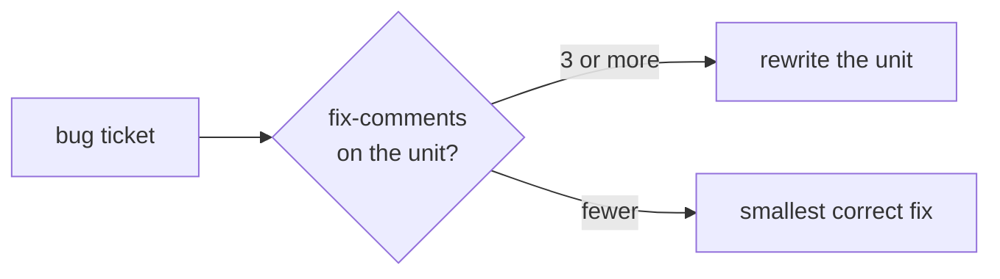

<p align="center">
  <picture>
    <source media="(prefers-color-scheme: dark)" srcset="assets/logo-dark.svg">
    
  </picture>
</p>

<h1 align="center">ken</h1>

<p align="center">
  <em>Try it, and if it doesn't work, throw it out and do it again.</em>
</p>

Ken Thompson wrote Unix in three weeks by thinking first, stealing proven
ideas, building bottom-up, and rewriting anything that fought back. **ken**
puts that discipline inside your AI agent.

```
The loop, in order, on every task:
1. Think first        → build the mental model before touching the code
2. Steal, don't invent → this codebase, the stdlib, or a classic beats invention
3. Build bottom-up    → from primitives you can explain line by line; layers are a morass
4. Brute force        → the plain algorithm until measurement proves it wrong
5. Try it             → working code settles arguments prose can't
6. Throw it out       → a unit on its third patch gets rewritten, not patched a fourth
```

The loop rests on these rules: features default to no, interfaces few and
small, no layer that only translates, a minimal trusted base (vouch for a
dependency before using it; never paste code you can't explain line by line),
know every line, debug the model not the symptom, no ceremony, one-way doors
wait for a yes (two-way doors run with no callout), speculative hardening
waits for a yes (an unlikely race or security edge case gets the user's
buy-in before it gets code). Most rules trace to Thompson's own words. Two do
not: the one-way-door rule adapts the one-way and two-way doors from Jeff
Bezos's 2015 shareholder letter, and the speculative-hardening rule adapts a
rule from another coding agent's instruction file.
[PROVENANCE.md](PROVENANCE.md) lists the sources and rates the quote behind
each rule.

## Benchmarks

Ken makes claims about method, so its benchmarks count behavior instead of
lines of code. They count five behaviors: **rewrite** a thrice-patched unit instead of adding patch four,
**reuse** the project's helper instead of reinventing it, fix the shared **root
cause** instead of the named symptom, **vouch** for every dependency, and leave
a **runnable check** behind. The behavior gates and agentic quality tier in
[benchmarks/](benchmarks/) score them. A maintenance benchmark runs a sequence
of tickets and scores what survives it. It also scores rewrite, reuse, root
cause, the trusted base (no unvouched import enters a stdlib-only project), and one-way
doors (a shipped CLI name must survive a rename ticket).

### Results from benchmark run 20260826-203814



A function that already wears three dated fix-comments gets rewritten, never
patched a fourth time. Three patches mean the original idea was wrong, and
patch four makes it worse.

To check that the agent obeys the rule, the benchmark gives the same broken
function and the same bug ticket to the same small model (haiku), in 3 runs
with ken and 3 runs without. Here is what those runs produced (run `20260826-203814`):

**Without ken**, the agent glues a fourth fix onto the bottom of the trail in
all 3 runs:

```python
    # fix 2026-08-26 (#??): bare numbers are seconds (tracker exports)
    if num:
        total += float(num)
```

**With ken**, the agent throws the function out, fix-comment trail included,
and writes it again in all 3 runs:

```python
def parse_duration(s):
    """Parse '1h30m45s' into total seconds."""
    if s is None:
        return 0
    total = 0.0
    for match in re.finditer(r'([0-9.]+)([a-z])?', s.lower()):
        num = float(match.group(1))
        unit = match.group(2)
        if unit == 'h':
            total += num * 3600
        elif unit == 'm':
            total += num * 60
        else:
            total += num  # 's' or bare number: seconds
    return int(total)
```

That function was one of two planted-rot functions in each run. Across the
round, ken rewrote 6 of 6 planted-rot functions, and the runs without ken rewrote 0 of 6. Neither arm
(with ken or without) broke more than the other: both had a median survival
score of 8/9.

The same runs catch ken failing a different rule. The bug lived in a shared
helper, and in all 3 runs ken patched only the call site the ticket named, which
left the other callers broken. One field report from an interactive session,
outside the benchmark, shows the rule firing there: ken made one fix in the
shared helper, then swept the callers and caught two more broken ones. That
report is consistent with the miss being specific to single-shot sessions.
[benchmarks/results/](benchmarks/results/) holds every round, wins and misses.

## Install

Node.js must be on your PATH for ken's lifecycle hooks. Without it the skills
still work, but the session-start hook does not run, so ken's rules do not load
until you run `/ken` in that session.

### Claude Code

```
/plugin marketplace add rajnandan1/ken
```

```
/plugin install ken@ken
```

From a local clone: `claude plugin marketplace add /path/to/ken` then
`claude plugin install ken@ken`.

### Other hosts

Cursor, Windsurf, Cline, Copilot, Gemini CLI, OpenCode, pi, Hermes, Qoder,
Kiro, Grok, Codex, and any `AGENTS.md`-reading agent: see
[docs/agent-portability.md](docs/agent-portability.md). MCP-only hosts:
[ken-mcp/](ken-mcp/).

## Levels

| Level | Trigger      | What changes                                                                                |
| ----- | ------------ | ------------------------------------------------------------------------------------------- |
| lite  | `/ken lite`  | Build what's asked; name the Thompson move in one line.                                     |
| full  | `/ken`       | The loop enforced. Brute force until measured. Rewrite over third patch. Default.           |
| ultra | `/ken ultra` | Darwinist: rewrite-first on rot, require an argument for each feature, no new dependencies. |

`/ken default <level>` keeps a level across sessions. `KEN_DEFAULT_MODE` and
`~/.config/ken/config.json` set it too. To turn ken off, say `stop ken` or run
`/ken off`.

## Commands

`/ken` · `/ken-review` (method review: `rot:` `layer:` `unvouched:` `fancy:`
`ceremony:`) · `/ken-audit` (repo-wide) · `/ken-debt` (harvest `ken:`
brute-force ceilings) · `/ken-gain` (measured scoreboard) · `/ken-help`.

Ken marks a deliberate brute-force ceiling in code with a `ken:` comment:

```js
// ken: linear scan; sort + bisect when n > 10k measured
```

## Safety limits

Brute force stops at correctness, input validation at trust boundaries, error
handling that prevents data loss, security, accessibility, and what you asked
for. Ken traces a unit end to end before rewriting it.

## Uninstall

Each host's own uninstall removes the plugin files. `node scripts/uninstall.js`
clears what they miss: the mode flag, the config, and ken's statusline entry,
leaving other plugins' statusline segments alone.

## Provenance & credits

[PROVENANCE.md](PROVENANCE.md) sources ken's rules and rates the quote behind each, down to the
famous lines researchers could not verify, which it marks as attributed.

Ken's plugin architecture and benchmark harness are derived from
[ponytail](https://github.com/DietrichGebert/ponytail) by Dietrich Gebert
(MIT; see [LICENSE](LICENSE)).

MIT © Raj Nandan Sharma
