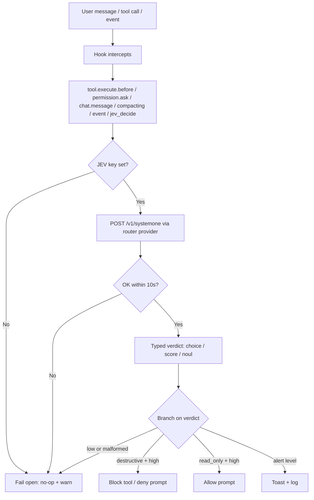
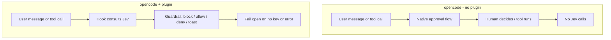

# @vheins/opencode-system-one

An [opencode](https://opencode.ai) plugin that routes **TypeSafe Jev (System One)** structured judgments through opencode's built-in plugin hooks.

Jev is not a drop-in model replacement. It answers named questions about a piece of state and returns **typed** results (`choice`, `score`, `noul`) that the plugin branches on to make guardrail decisions: block a destructive tool call, arbitrate a permission prompt, triage a session error, and so on.

All Jev calls go through the configured router provider, which exposes a pass-through route at `POST /v1/systemone`. The router forwards the body untouched and returns the native System One JSON.

## How it works

The plugin sits between opencode events and the configured router provider. Each hook sends state plus a named question, receives a typed verdict, then branches. A missing key, timeout, error, or malformed verdict falls back to no-op so opencode continues with its native flow.

### Runtime flow



Verdict types map to hooks in the [Hook / event map](#hook--event-map): `choice` drives risk, routing, and severity labels; `noul` drives compaction and file review probabilities; `score` is available through the `tool.jev_decide` custom tool.

### With and without the plugin



Without the plugin, every decision stays in the native approval flow. With the plugin, the same points consult Jev first and apply guardrails, while any Jev outage returns control to the native flow.

## Install

### From npm (recommended)

Add the package to your opencode config (`opencode.json`):

```json
{
  "$schema": "https://opencode.ai/config.json",
  "plugin": ["@vheins/opencode-system-one"]
}
```

opencode installs the plugin with Bun at startup and caches it under `~/.cache/opencode/`. Then set the JEV key (see [Configuration](#configuration)) and restart opencode.

### From source

Clone this repository (or copy **both** the `.opencode/` directory **and** the root `src/` directory, preserving their relative layout). The local plugin entry `.opencode/plugins/jev.ts` is a thin re-export of `../../src/index`, so `src/` must sit beside `.opencode/`:

```
your-project/
  .opencode/
    plugins/jev.ts        # re-exports ../../src/index
    package.json
    .env.example
  src/
    index.ts              # canonical plugin source
```

opencode auto-discovers any `*.ts` file in `.opencode/plugins/`, so `jev.ts` loads automatically. Install the plugin's dependencies once:

```bash
cd .opencode && bun install   # or: npm install
```

Then restart opencode (config and plugins load at startup).

## Configuration

Copy `.opencode/.env.example` to `.env` (or export the variables in your shell). Every value is optional except the JEV key, which enables the guardrails.

| Variable | Default | Purpose |
| --- | --- | --- |
| `JEV_API_KEY` | — | Bearer key for the router provider. If unset, the plugin falls back to the key file below, then no-ops with a warning. |
| `JEV_BASE_URL` | `https://model.spasi.biz.id/v1/systemone` | Router pass-through route for System One judgments. |
| `JEV_MODEL` | `oc/jev-1.13-free` | Jev model id (confirmed against this deployment). |
| `JEV_BLOCK_THRESHOLD` | `0.85` | Block a destructive tool call when confidence exceeds this value. |
| `JEV_ALLOW_THRESHOLD` | `0.7` | Auto-allow a read-only action at or above this confidence. |
| `JEV_ROUTE_THRESHOLD` | `0.8` | Toast when `chat.message` routes to `needs_human` at or above this confidence. |
| `JEV_SEVERITY_THRESHOLD` | `0.8` | Toast when a `session.error` severity resolves to `real_bug`/`fatal` at or above this confidence. |
| `JEV_COMPACT_THRESHOLD` | `0.75` | Append a preservation reminder to compaction context at or above this probability. |

Key resolution order: `JEV_API_KEY` environment variable, then the file `~/.config/opencode/.jev-key`. **Never commit a real key.** The repository ignores `.env`, `*.key`, and similar files.

## Hook / event map

| Hook or event | Jev question | Behavior |
| --- | --- | --- |
| `tool.execute.before` | Choice: `read_only` \| `mutating` \| `destructive` | Blocks (throws) when the verdict is `destructive` and confidence > `JEV_BLOCK_THRESHOLD`. |
| `permission.ask` | Choice: same risk labels | Sets `allow` for a confident `read_only`; sets `deny` for a confident `destructive`; otherwise leaves the prompt to the human. |
| `chat.message` | Choice: `code_only` \| `needs_model` \| `needs_human` | Cascade-routes each user message; logs the verdict; raises a TUI toast on a confident `needs_human`. Never alters the message flow. |
| `experimental.session.compacting` | Noul: "does this session hold unrecoverable decisions?" | Pushes a preservation reminder line into the summary context when the probability is high. Never replaces the compaction prompt. |
| `event` → `session.error` | Choice: `transient` \| `real_bug` \| `fatal` | Logs the severity; raises a toast on a confident non-transient verdict. |
| `event` → `file.edited` | Noul: "is this path security-sensitive / needs review?" | Logs a high verdict and raises a review toast. |
| `tool.jev_decide` (custom tool) | Choice / Score / Noul over arbitrary state | Exposes Jev directly to the agent; returns the typed answer as JSON. |

## Safety

The plugin is designed to **fail open** so it can never break opencode's flow:

- **No key / missing key** — every hook degrades to a no-op and logs a warning once. opencode startup never crashes.
- **Jev error or timeout** — each classifier catches the failure, logs a warning, and returns `undefined`; the affected hook then does nothing (the action proceeds under opencode's native approval flow).
- **10s fetch timeout** — every Jev request carries an `AbortSignal.timeout(10000)`, so a hung router degrades to the no-op path instead of stalling tool calls, messages, or events.
- **Verdict-shape validation** — before any allow/deny/block decision, the remote `choice`/`confidence` is validated (known label, finite number, `0 <= confidence <= 1`). A malformed answer is ignored rather than trusted.

## License

MIT. See [LICENSE](./LICENSE).
