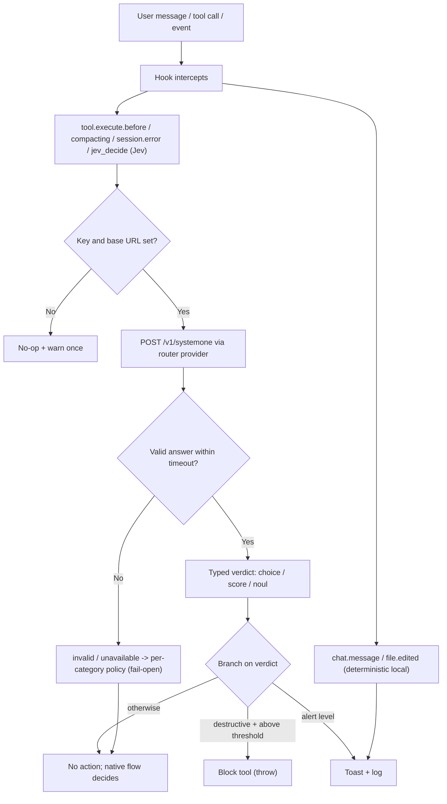
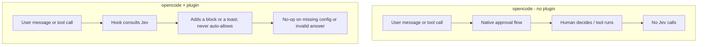

# @vheins/opencode-system-one

An [opencode](https://opencode.ai) plugin that routes **TypeSafe Jev (System One)** structured judgments through opencode's built-in plugin hooks.

Jev is not a drop-in model replacement. It answers named questions about a piece of state and returns **typed** results (`choice`, `score`, `noul`) that the plugin branches on to make guardrail decisions: block a destructive tool call, classify a message, triage a session error, and so on.

All Jev calls go through the configured router provider, which exposes a pass-through route at `POST /v1/systemone`. The router forwards the body untouched and returns the native System One JSON.

## How it works

The plugin sits between opencode events and the configured router provider. Each hook sends state plus a named question, receives a typed verdict, then branches. Every answer is validated **per type** (a choice label drawn from its criteria, a noul probability, a score within its rubric) before it is used; a missing key, missing base URL, timeout, transport error, or out-of-contract answer is reported as an explicit `invalid`/`unavailable` outcome rather than being treated as permission to proceed.

Judgement is **on-demand**: the agent consults `tool.jev_decide` for consequential, hard-to-reverse decisions. The automatic `tool.execute.before` risk gate is **off by default** (enable with `enableToolGate` / `JEV_TOOL_GATE`), so a default install adds no per-tool-call latency and opencode's native permission flow is the sole gate for execution.

The plugin can only ever **add a block** to a tool call. It never auto-allows, so opencode's native approval flow remains the sole gate for execution.

### Runtime flow



Verdict types map to hooks in the [Hook / event map](#hook--event-map): `choice` drives risk and severity labels; `noul` drives the compaction probability; `score` is available through the `tool.jev_decide` custom tool. `chat.message` and `file.edited` are scored by deterministic local checks, so they make no Jev call.

### With and without the plugin



Without the plugin, every decision stays in the native approval flow. With the plugin, the same points consult Jev first and apply an additional guardrail, while a Jev outage or an unconfigured install returns control to the native flow.

## Install

### From npm (recommended)

Add the package to your opencode config (`opencode.json`):

```json
{
  "$schema": "https://opencode.ai/config.json",
  "plugin": ["@vheins/opencode-system-one"]
}
```

opencode installs the plugin with Bun at startup and caches it under `~/.cache/opencode/`. Then set the JEV key and base URL (see [Configuration](#configuration)) and restart opencode.

To configure the plugin inline instead of via environment variables, use the **tuple form** and pass an options object as the second array element:

```json
{
  "$schema": "https://opencode.ai/config.json",
  "plugin": [
    [
      "@vheins/opencode-system-one",
      {
        "baseUrl": "https://your-router.example/v1/systemone",
        "model": "oc/jev-1.13-free",
        "blockThreshold": 0.85
      }
    ]
  ]
}
```

The object form `{"package": "...", "options": {...}}` is **not** supported by opencode 1.19.0 (it is dropped by the v1/v2 compatibility layer), and a custom top-level `opencode.json` key is silently stripped. Only the tuple form delivers options to the plugin.

### From source

Clone this repository (or copy the root `src/` directory). The canonical plugin source is `src/index.ts`; register it from your opencode config so a single resolution path loads it:

```json
{
  "$schema": "https://opencode.ai/config.json",
  "plugin": ["/absolute/path/to/opencode-jev/src/index.ts"]
}
```

```
your-project/
  src/
    index.ts              # canonical plugin source
```

Registering the plugin once (here or via the package name above) is deliberate: loading it from **both** an `.opencode/plugins/*.ts` auto-discovery entry **and** an `opencode.json` entry makes opencode load it twice, so every hook fires twice.

opencode loads the plugin with Bun at startup. Install the plugin's dependencies once:

```bash
cd /absolute/path/to/opencode-jev && bun install   # or: npm install
```

Then restart opencode (config and plugins load at startup).

## Configuration

Every value can be supplied three ways. Resolution precedence, highest first:

1. **opencode.json plugin options** (the tuple form above), camelCase keys.
2. **Environment variables** (`JEV_*`), exported in your shell or a `.env`.
3. **The key file** `~/.config/opencode/.jev-key` (for the API key only).

The JEV key and the base URL are both required; if neither source supplies one, the guardrails degrade to a no-op that warns once.

| Option (opencode.json) | Environment variable | Default | Purpose |
| --- | --- | --- | --- |
| `apiKey` | `JEV_API_KEY` | — | Bearer key for the router provider. If unset, the plugin falls back to `~/.config/opencode/.jev-key`, then no-ops with a warning. |
| `baseUrl` | `JEV_BASE_URL` | — (required) | Router pass-through route for System One judgments. **No default host is shipped**; an unset or blank value disables Jev (no-op + warn) rather than calling any host. |
| `model` | `JEV_MODEL` | `oc/jev-1.13-free` | Jev model id. |
| `blockThreshold` | `JEV_BLOCK_THRESHOLD` | `0.85` | Block a destructive tool call when confidence exceeds this value. |
| `routeThreshold` | `JEV_ROUTE_THRESHOLD` | `0.8` | Toast when the deterministic `chat.message` score reaches this value. |
| `severityThreshold` | `JEV_SEVERITY_THRESHOLD` | `0.8` | Toast when a `session.error` severity resolves to `real_bug`/`fatal` at or above this confidence. |
| `compactThreshold` | `JEV_COMPACT_THRESHOLD` | `0.75` | Append a preservation reminder to compaction context at or above this probability. |
| `fileReviewThreshold` | `JEV_FILE_REVIEW_THRESHOLD` | `0.8` | Toast when the deterministic `file.edited` sensitivity score reaches this value. |
| `timeoutMs` | `JEV_TIMEOUT_MS` | `3000` | Per-request timeout (ms) for a Jev call. Must be a positive integer; an invalid value is ignored and warned. |
| `decisionLogPath` | `JEV_DECISION_LOG` | `~/.config/opencode/jev-decisions.log` | Newline-delimited JSON decision log. An empty string or `off` disables logging. |
| `decisionLogMaxBytes` | `JEV_DECISION_LOG_MAX_BYTES` | `1000000` | Rotate the decision log once it reaches this many bytes. |
| `decisionLogBackups` | `JEV_DECISION_LOG_BACKUPS` | `3` | Number of rotated copies to keep (`<path>.1` .. `<path>.N`). |
| `traceLog` | `JEV_TRACE_LOG` | `false` | Opt-in per-call trace log (one entry per Jev call). Off by default, so no trace file IO happens until enabled. |
| `traceLogPath` | `JEV_TRACE_LOG_PATH` | `~/.local/share/opencode/log/jev.log` | Trace-log file path. An empty string or `off` disables writing. |
| `traceLogMaxBytes` | `JEV_TRACE_LOG_MAX_BYTES` | `1000000` | Rotate the trace log once it reaches this many bytes. |
| `traceLogBackups` | `JEV_TRACE_LOG_BACKUPS` | `3` | Number of rotated trace-log copies to keep. |
| `toastDecisions` | `JEV_TOAST_DECISIONS` | `false` | Toast **every** decision (not just the three default toasts). |
| `enableToolGate` | `JEV_TOOL_GATE` | `false` | Run the automatic `tool.execute.before` risk gate. **Off by default**: judgement is on-demand via `tool.jev_decide`, and opencode's native permission flow is the sole gate for tool calls. Enable to restore the automatic destructive-tool block. |
| `cooldownMs` | `JEV_COOLDOWN_MS` | `30000` | Selective-trigger cooldown window (ms). A repeat judgement for the same logical action within this window reuses the previous outcome instead of re-asking the model, so consecutive calls of one logical decision collapse to a single judgement. `0` disables dedup/cooldown. Must be a non-negative integer; an invalid value is ignored and warned. |

Thresholds are per category; there is no single global threshold across unrelated decisions. A value outside `[0, 1]` is ignored and the default is used, so a typo cannot widen a guardrail silently. A wrong-typed option is likewise ignored (the environment value then applies) and logs a one-time warning naming the field, never its value. The decision-log fields are validated the same way: `decisionLogMaxBytes` and `decisionLogBackups` must be non-negative integers, and `toastDecisions` must be a boolean. `timeoutMs` must be a positive integer; a non-positive or non-integer value is ignored and warned.

### Decision observability

opencode's plugin hooks all return `Promise<void>` and **cannot inject an assistant message**, so Jev has no way to surface a decision as chat text. Instead, every decision is written to the decision log, and optionally toasted:

- **Decision log** — one JSON object per line: `ts`, `hook`, `kind` (`valid`/`abstain`/`invalid`/`unavailable`), `decision` (the chosen label, or `null`), `confidence` (or `null`), `action` (`block`/`allow`/`toast`/`log`/`context`/`return`/`none`), and an optional short `detail`. The log rotates on size: when it reaches `decisionLogMaxBytes`, `<path>` becomes `<path>.1`, older copies shift up, and anything beyond `decisionLogBackups` is dropped. The file is created (with parent directories) on first write; a write failure is warned once and never thrown into a hook. The API key, request body, and full state are never written, and `detail` is truncated to 200 characters.
- **Startup proof** — when Jev is enabled, the plugin emits one `Jev enabled: model=…, baseUrl=<host>, key=<set|missing>` log line (host only, never the full URL or the key value). With `toastDecisions` on, the same line is also shown as a toast.
- **Toast every decision** — with `toastDecisions: false` (default) the three default toasts still fire (confident `needs_human`, confident non-transient error severity, security-sensitive file edit); with `toastDecisions: true` every decision also surfaces a toast, including the ones that would otherwise only be logged.

### Per-call trace log (opt-in)

The decision log records the **outcome** of each decision; the trace log records the **raw call** that produced it, so a failure can be traced after the fact (for example, why a call returned `invalid:wrong-type` or `unavailable:provider`).

- **Opt-in** — off by default. Enable it with the `traceLog: true` option or `JEV_TRACE_LOG=1`. While disabled the client performs **zero trace file IO**: no directory, no file, no write attempt.
- **One entry per call** — each line is one JSON object: `ts`, `hook`, `summary` (a bounded, non-secret tool/state summary), `questionId`, `questionType`, `model`, `durationMs`, `cache` (`hit`/`miss`), `circuit` (`open`/`closed`), `outcome` (`valid`/`abstain`/`invalid`/`unavailable`/`timeout`/`transport`/`provider`/`busy`/`circuit_open`/`cache_hit`), and an optional bounded `snippet`.
- **Bounded and redacted** — `summary` and `snippet` are truncated to 200 characters; the `snippet` is single-line and has the API key redacted before it is written. The API key, `Authorization` header, and full request/response bodies are never written.
- **Rotation** — same size-based rotation as the decision log (`traceLogMaxBytes`, `traceLogBackups`), so it cannot grow without bound.
- **Never throws** — a write failure is warned once and swallowed, so trace logging can never break a hook or the main loop.

### Security: prefer env or the key file for the secret

`opencode.json` is often committed to a repository. Putting `apiKey` there risks leaking the secret with the config file. Prefer `JEV_API_KEY` in your shell or `~/.config/opencode/.jev-key` for the key, and reserve the options object for non-secret settings (`baseUrl`, `model`, thresholds). An option-supplied key is never written to a log line.

Key resolution order: the `apiKey` option, then the `JEV_API_KEY` environment variable, then the file `~/.config/opencode/.jev-key`. **Never commit a real key.** The repository ignores `.env`, `*.key`, and similar files.

## Hook / event map

| Hook or event | Jev question | Behavior |
| --- | --- | --- |
| `tool.execute.before` | Choice: `read_only` \| `mutating` \| `destructive` | **OFF by default.** When enabled (`enableToolGate` / `JEV_TOOL_GATE`), it blocks (throws) when the verdict is `destructive` and confidence > `JEV_BLOCK_THRESHOLD`. Low-risk tools skip the call: the read-only set (`read`, `list`, `glob`, `grep`, `todoread`, `webfetch`) plus the meta tools `todowrite` and `task-read`. The dispatch tool `task` and every mutating tool (`edit`, `write`, `bash`, `execute`, `memory-write`) stay on the network path. Runs on a tight budget: no retry, so worst-case blocking latency is one `timeoutMs` (~3s). It never auto-allows; opencode's native flow still decides everything else. |
| `chat.message` | Deterministic local score | Scores each user message for high-stakes signals (destructive verbs on production data, secrets, approvals, migrations) with **no Jev call**. Raises a TUI toast when the score reaches `JEV_ROUTE_THRESHOLD`. This hook is **observe-only**: it cannot reroute the message. |
| `experimental.session.compacting` | Noul: "does this session hold unrecoverable decisions?" | Pushes a preservation reminder line into the summary context when the probability is high. Never replaces the compaction prompt. |
| `event` → `session.error` | Choice: `transient` \| `real_bug` \| `fatal` | Logs the severity; raises a toast on a confident non-transient verdict. A `MessageAbortedError` is ignored. |
| `event` → `file.edited` | Deterministic local path check | Scores the edited path for security-sensitive patterns (`.env`, key material, CI auth) with **no Jev call**, and raises a review toast when the score reaches `JEV_FILE_REVIEW_THRESHOLD`. |
| `tool.jev_decide` (custom tool) | Choice / Score / Noul over arbitrary state | The primary, on-demand judgement path. Exposes Jev directly to the agent; validates the answer per type and returns the typed answer as JSON. An **identical** repeated call (same tool + scope + questions) within the cooldown window reuses the previous result instead of re-asking; a distinct question always re-asks. |
| `tool.jev_metrics` (custom tool) | — | Reports effectiveness metrics for the judgement layer: System One call count, added latency (ms), duplication rate, and decision-influence rate. Derived in memory from the same signals the decision/trace logs persist, so reading it performs **no IO**. |

### Selective trigger (dedup + cooldown)

Judgement is a **selective** decision layer, not a per-tool-call examiner. In front of `judge()`/`decidePolicy()` a trigger gate collapses consecutive calls of ONE logical decision:

- **Dedup** — an identical judgement (same tool + scope + questions) within the `cooldownMs` window reuses the previous outcome instead of re-asking the model.
- **Cooldown** — a repeat judgement for the same logical action within the window is suppressed and the previous outcome replayed.
- **One judgement per logical decision** — the gate groups only a **proven-safe** equivalence class (a locally-recognized destructive hint keyed by its exact matched pattern). An unproven action is never grouped and is judged on its own, so a genuinely different decision is never suppressed.
- **Additive and fail-open** — a reuse **replays** a decision that was already computed, so it can only re-apply the same outcome (including a block) and can never invent an allow or relax opencode's native permission flow. Both guards never block on their own.
- **Metrics** — `tool.jev_metrics` reports calls, added latency, duplication rate, and decision-influence rate (how many judgements changed the decision: `verify`/`revise`/`request-approval` vs a silent `proceed`), derived from the same signals the decision log (`action`) and trace log (`durationMs`) persist. Reading them adds no IO, in particular nothing when tracing is off.

### When to consult `jev_decide`

Consult `jev_decide` for **consequential, hard-to-reverse decisions with two or more viable options** (a destructive migration, an irreversible data change, a long-lived architecture choice). Do **not** consult it for routine actions (read, search, a small edit, a lint fix): those do not need a judgement call.

`jev_decide` only informs; it never replaces the user approval gate (ASK_MECHANISM) or native OpenCode permission. If the protocol requires user approval, that gate stands regardless of any Jev verdict.

The plugin does **not** register a `permission.ask` handler. That hook is declared in the plugin types but is not triggered by opencode 1.19.0, so any handler would be dead code that appears to arbitrate permissions without doing so.

## Safety

The plugin is designed so it can never break opencode's flow and never weakens the native approval gate:

- **Missing key or base URL** — every hook degrades to a no-op and logs a warning once. opencode startup never crashes. No default host is ever called.
- **Invalid or unavailable verdict** — an absent, malformed, contradictory, out-of-range, timed-out, or disabled answer is reported as `invalid`/`unavailable` and carries no verdict. It is never treated as permission to proceed.
- **Per-category failure policy** — a non-actionable verdict for a high-impact action (destructive or high-impact category) surfaces a warning; low-risk categories stay silent. Neither case relaxes opencode's native approval flow.
- **Block only** — `tool.execute.before` either throws (deny) or returns (defer). The plugin cannot auto-allow, so a model verdict never bypasses opencode's permission controls. This gate is **off by default**; when disabled, opencode's native permission flow is the sole authority for tool calls.
- **Never blocks the loop** — a Jev answer can only *add* a block; it can never stall the main agent loop. The blocking hook runs on a tight budget with no retry, so a hung provider fails open after one `timeoutMs` (~3s), including when the local hint is destructive.
- **Bounded network** — each request carries an `AbortSignal.timeout` (default 3000ms, configurable). Non-blocking hooks retry at most once, and only for transient failures (timeouts, connection errors, `429`, and `5xx`); the blocking `tool.execute.before` hook never retries. A deterministic `4xx` is never retried.
- **Failure short-circuit** — after three consecutive provider/transport/timeout failures the client opens a short-TTL (5s) circuit and fails open without any network call, so a down provider is not hit by every hook. A single success resets the streak. It is bounded and fail-open: it never throws and never stalls.
- **Diagnosable failures** — a provider failure records its HTTP status and a bounded, single-line, key-redacted response-body snippet (clipped to 200 characters) in the decision-log `detail`, so `unavailable:provider` is no longer opaque. The API key is redacted from the snippet before it is stored.
- **No secret leakage** — the API key and request bodies are never written to logs or the decision log.
- **Validated answers** — every answer is validated against its own type contract: a `choice` verdict must carry a known label drawn from its criteria, a finite confidence in `[0, 1]`, and a probability map that does not contradict the selected label; a `noul` verdict must carry a probability in `[0, 1]`; a `score` verdict must carry a score within its rubric range. An out-of-contract answer is reported as `invalid`, never surfaced as a valid verdict.

## Development

Typecheck and tests run against the source with no build step (Node 24 strips TypeScript):

```bash
./node_modules/.bin/tsc --noEmit          # strict typecheck
node --test "test/**/*.test.ts"           # unit + hook integration tests
```

## License

MIT. See [LICENSE](./LICENSE).
