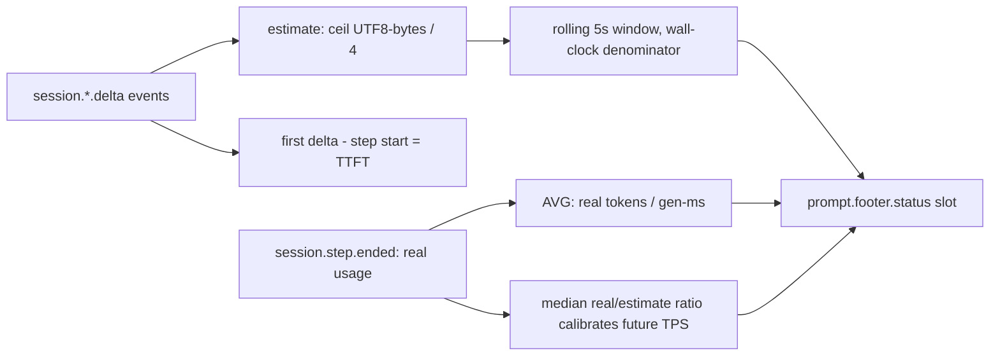

# @vixyz/opencode-tps-live

Live tokens-per-second meter for the [OpenCode](https://opencode.ai) TUI.

While the model streams, the prompt footer shows:

```
TPS 42.5 | AVG 38.1 | TTFT 0.8s
```

- **TPS** — live output rate over a rolling 5-second window, `--` when idle
- **AVG** — session-wide average from real usage reports (tokens ÷ generation time)
- **TTFT** — time from step start to the first streamed token of the last step

Text, reasoning, and tool-argument deltas all count toward the live rate, so a
model writing a large file through a tool call still shows a speed.

## Install

```sh
opencode plugin add @vixyz/opencode-tps-live
```

Or add it by hand to your configuration and restart the TUI:

```jsonc
// ~/.config/opencode/opencode.json(c)
{
  "plugins": ["@vixyz/opencode-tps-live"]
}
```

Restart OpenCode after installing — TUI plugin parts load at startup.

## How it works



Providers do not stream real token counts mid-response, so the live TPS is an
estimate — the same ceiling every live meter has. What makes it honest:

- The estimate is **calibrated**: when a message completes, the real
  output-token count from the usage report is compared against the estimate,
  and a running median ratio rescales future live readings.
- The window denominator is wall-clock (`now − oldest sample`), so network
  buffering cannot inflate the rate, and a single fast chunk cannot imply a
  huge number (300ms floor).
- AVG uses only real usage numbers and excludes tool-execution time and TTFT.

## Design notes

- **TUI-only.** The package exports only `./tui` and has no server part, so
  the OpenCode server never imports it. Plugin parts that load in the server
  process have caused conflicts in other TPS plugins (a second OpenTUI copy
  re-registering environment variables); this layout makes that impossible.
- **No bundled dependencies.** `@opentui/*` and `solid-js` are declared as
  peers only; OpenCode resolves them from its own bundled copies at runtime.
- **Guarded handlers.** Every event handler is wrapped so one malformed event
  cannot break the TUI. Everything cleans up on plugin unload.

## Development

```sh
bun test                        # unit tests for the measure math
bun build src/tui.tsx --external '*' --outfile /tmp/tui-check.js   # syntax/JSX check
```

Debug output (handler errors, calibration ratios, load confirmation):

```sh
TPS_LIVE_DEBUG=1 opencode
```

Verified against OpenCode v2.0.x. Event names follow the V2 session stream
(`session.step.*`, `session.{text,reasoning,tool.input}.delta`).

## Security

This package ships **zero runtime dependencies**; its manifest declares only
peer dependencies (`@opentui/*`, `solid-js`), which the OpenCode host resolves
from its own bundled copies. Scanners that resolve peers (Socket, `npm audit`)
may show moderate advisories inherited from the OpenCode plugin toolchain —
`@opentui/solid` → `babel-plugin-module-resolver` → `glob` / `minimatch`
(GHSA-3g3m-2fjr-6pw4, GHSA-g3hv-75wg-m249). Those libraries run only during
the plugin's one-time TSX compilation inside OpenCode's plugin cache and never
see plugin input; the fix belongs upstream. The package itself has no known
advisories (OSV).

## License

[MIT](LICENSE)
